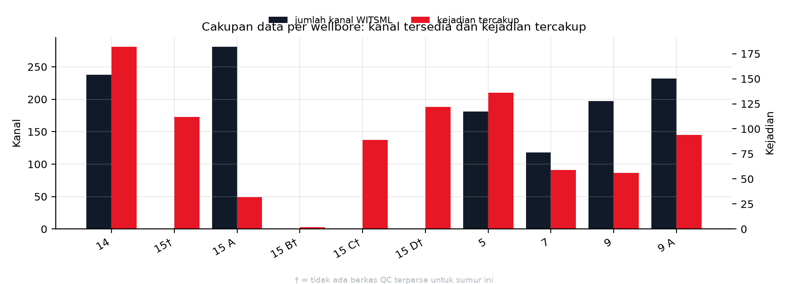
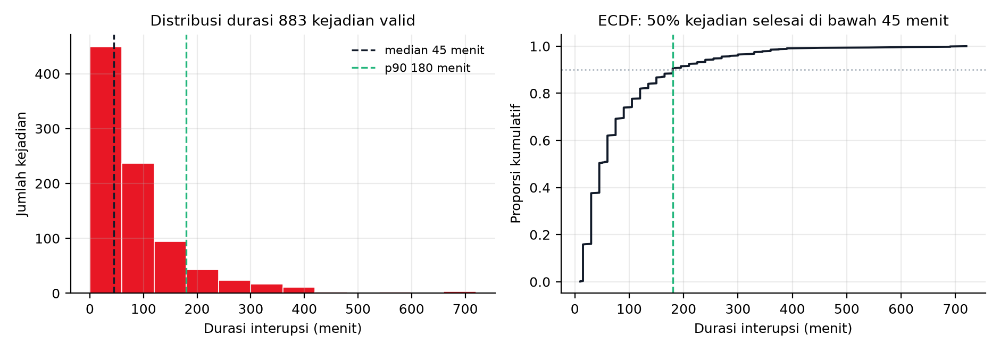

# BAB I PENDAHULUAN

## 1.1 Latar Belakang Sistem

### 1.1.1 Deskripsi Objek Studi dan Sistem yang Dikaji

Objek kajian proyek ini adalah **PT Halliburton Indonesia, divisi Sperry Drilling**, yaitu penyedia jasa pengeboran yang mengoperasikan instrumentasi lubang bawah (MWD, LWD, dan Rotary Steerable System) serta layanan pemantauan parameter pengeboran bagi operator minyak dan gas. Pengajuan objek melalui jalur Magang/MBKM mengikuti pedoman 2.8c, sehingga permasalahan yang diangkat harus berasal dari proses kerja nyata mitra dan dimiliki oleh seorang pemilik masalah di lapangan.

Sistem yang dikaji bukan satu alat, melainkan **rantai keputusan pengeboran**: sensor lubang bawah mengirim data fisis ke permukaan, sistem permukaan menampilkan dan menyimpan data tersebut, driller dan drilling engineer membaca tampilan itu, lalu memutuskan apakah pengeboran dilanjutkan, parameter diubah, atau rangkaian ditarik. Mutu rantai ini ditentukan oleh dua hal yang saling bertukar: kelengkapan pengukuran (berapa kanal yang benar-benar terisi) dan kecepatan keputusan (berapa menit antara gejala terbaca dan tindakan diambil).

Basis data yang dipakai proyek berasal dari **lapangan Volve (Equinor, lisensi CC BY-NC-SA 4.0)** karena data operasi mitra tidak dapat dibuka. Inventaris yang benar-benar ada di disk berisi **10 entri puncak** pada folder `data/volve` yang bila ditelusuri rekursif memuat **37.572 berkas** dengan total **27,43 GB** (cacah berkas dan byte per entri, dijumlahkan), dengan tulang punggung berupa **9.935.698 baris log pengeboran WITSML hasil parse** dari 10 berkas CSV, yaitu 9.935.708 baris mentah dikurangi 10 baris header dan matriks latih **292.954 baris** pada **6 dataset siap pakai**. Cakupan sumur adalah **10 wellbore** dengan rentang kejadian dari tahun 2007 sampai 2015 menurut kolom `event_date`.

Perlu dinyatakan sejak awal agar naskah tidak menyesatkan: data yang dipakai adalah **data lapangan nyata beresolusi grid 60 detik**, bukan telemetri real time 1 Hz milik Sperry seperti tertulis pada draft lama. Angka 1 Hz di draft berstatus ASUMSI dan bertabrakan dengan kontrak pipeline yang benar-benar dijalankan. Konsekuensinya, klaim kinerja di Bab I dan Bab II selalu dikaitkan ke resolusi 60 detik, dan klaim pemakaian langsung pada stream mitra dinyatakan sebagai rencana integrasi, bukan hasil.

Sistem yang diusulkan proyek berada di antara tahap pengukuran dan tahap keputusan, yaitu lapisan **decision support** yang mengubah data parameter pengeboran menjadi peringatan dini beserta alasannya. Lapisan ini dirancang sebagai **7 mode deteksi** yang direalisasikan dalam **27 varian metode (head)**, dilatih pada matriks 55 fitur dan diuji dengan **37 lipatan leave-one-well-out** tanpa satu pun pelanggaran kebocoran fitur ke label.

### 1.1.2 Stakeholder dan Kepentingannya

Pedoman mensyaratkan identifikasi stakeholder beserta kepentingannya, dan karakteristik masalah kompleks WP6 mensyaratkan adanya pihak dengan tuntutan yang berbeda. Tabel berikut memisahkan **kepentingan** (apa yang diinginkan pihak tersebut dari sistem) dari **risiko** (apa yang memburuk bila sistem salah bekerja), karena dua kolom itu yang menentukan arah desain di Bab III.

| No | Stakeholder | Peran dalam sistem | Kepentingan utama | Risiko bila sistem salah | Bukti keberadaan pihak |
|---|---|---|---|---|---|
| S1 | Driller / company man di rig | Pemakai keputusan akhir (problem owner) | Peringatan yang cukup awal dan cukup jelas untuk ditindaklanjuti sebelum kerusakan membesar | Kelelahan akibat alarm palsu; keputusan berubah karena saran yang salah | Draft Sperry menetapkan driller dan tim operasi Sperry sebagai problem owner; pemilik masalah wajib ada pada Buku Pedoman PPT |
| S2 | Drilling engineer / supervisor Sperry Drilling | Penafsir data dan penyusun program pengeboran | Diagnosis yang dapat dijelaskan, bukan kotak hitam, agar dapat dipertanggungjawabkan ke operator | Kehilangan kepercayaan pada alat; rekomendasi tidak dipakai | Divisi mitra; draft Sperry l.31-32 (monitoring parameter pengeboran) |
| S3 | Manajemen Sperry Drilling (mitra MBKM) | Penyedia jasa, pemilik proses kerja | Efisiensi waktu rig dan reputasi layanan | Biaya layanan naik karena waktu non-produktif tidak terdeteksi | Mitra proyek (pedoman 2.8c) |
| S4 | Operator minyak dan gas (mis. Eni) | Pemilik sumur dan anggaran | Ketepatan waktu penyerahan sumur dan keamanan operasi | Pembengkakan biaya rig dan risiko integritas sumur | Rilis pers Halliburton 9 Juli 2026 tentang operasi closed-loop bersama Eni di Indonesia |
| S5 | Engineer MWD/LWD di lokasi | Penjaga mutu kanal pengukuran | Kanal yang rusak atau kosong dikenali sebagai keterbatasan alat, bukan disalahkan ke manusia | Kanal bermasalah tetap dipakai sebagai dasar peringatan | Kanal instrumen MWD menjadi sumber label (VIBLAT_RT, SHKRSK_RT, STUCK_RT, CRPM_RT) |
| S6 | Fungsi HSE / keselamatan | Penjaga batas keselamatan operasi | Tidak ada insiden sumur (kick, loss, pipa terjepit) yang terlambat ditangani | Peringatan yang terlalu lambat dianggap gagal sistem | Tujuh detektor mencakup hidraulik dan pipa terjepit; kategori `safety_personnel` ada di label kejadian |
| S7 | Tim PPT I (tiga mahasiswa Teknik Industri UNS) | Perancang dan pelaksana kajian | Capaian pembelajaran, metode yang dapat dipertanggungjawabkan, data yang dapat diaudit | Naskah dinilai tidak berbasis bukti | Susunan tim dan pembagian peran pada 1.3 |
| S8 | Mentor dosen PPT | Penilai metodologi | Kesesuaian dengan pedoman, rubrik, dan model SIMILAR | Bab I dinilai lemah pada rubrik 1 (memetakan masalah kompleks, bobot 15 persen) | Buku Pedoman PPT h.38 sampai h.40 |
| S9 | Pemilik data (Equinor, lewat kanal Volve) | Penyedia data uji | Data dipakai sesuai lisensi dan tidak diklaim sebagai milik proyek | Pelanggaran lisensi CC BY-NC-SA 4.0 | baris lisensi |

Dua ketegangan antarpihak yang akan muncul berulang di Bab III: (a) S1 dan S5 berlawanan soal ambang, karena S1 menuntut peringatan sesedikit mungkin sedangkan S5 menuntut kanal bermasalah tetap dilaporkan; (b) S2 dan S4 berlawanan soal bentuk keluaran, karena S2 menuntut penjelasan yang dapat diperiksa sedangkan S4 menuntut keputusan cepat. Keduanya menjadi bahan sub-bab trade-off 1.1.5.

### 1.1.3 Alur Operasi dan Alur Data

Alur operasi pengeboran terdiri atas delapan tahap. Kolom terakhir menunjukkan **di mana tahap itu meninggalkan jejak data yang benar-benar dipakai proyek**, sehingga alur ini bukan gambar konseptual tanpa kaitan ke berkas.

| Tahap | Aktor utama | Keluaran tahap | Jejak data di proyek | Titik gangguan yang terukur |
|---|---|---|---|---|
| T1 Perencanaan sumur dan desain rangkaian bor | Drilling engineer | Program pengeboran, desain BHA | **161 berkas bhaRun**, **192 assembly tubular berisi 1.392 komponen**, **63 berkas trajectory berisi 5.561 stasiun**, **27 berkas wbGeometry berisi 109 section** | Rating motor (batas torsi dan tekanan) tidak ada pada 192 dari 192 berkas, sehingga perhitungan beban puncak rangkaian tetap terblokir |
| T2 Rakit rangkaian dan masuk lubang (make-up dan RIH) | Rig crew, MWD engineer | Rangkaian siap, run dimulai | `dTimStart`/`dTimStop` per run; 154 dari 161 `uidRef` bhaRun bertaut ke tubular | Hanya 19 dari 161 run memuat batas kedalaman, sehingga penautan waktu ke kedalaman rapuh |
| T3 Pengeboran dengan parameter terkendali | Driller | Lubang bertambah, parameter terekam | Kanal inti `TQA`, `SPPA`, `TFLO`, `RPM`, `SWOB`, `HKLD`, `ROP`, `SPM`, `depth`, `dbtm` | Beban dan getaran berlebih tidak terlihat sebagai satu angka tunggal, melainkan pola beberapa kanal sekaligus |
| T4 Transmisi telemetri lubang bawah ke permukaan | Sistem MWD/LWD | Data lubang bawah di permukaan | Kanal instrumen `VIBLAT_RT`, `SHKRSK_RT`, `STUCK_RT`, `CRPM_RT` | Kanal instrumen jarang terisi: `SHKRSK_RT` di F-7 hanya 0,67 persen baris, `CRPM_RT` F-7 0,51 persen, `VIBLAT_RT` F-14 0,14 persen |
| T5 Perekaman dan penyeragaman grid data | Sistem permukaan dan historian | Data tersimpan dan seragam | Grid **60 detik** dengan mode seluruh baris; jendela fitur 10 menit hanya melihat ke masa lalu | Fill-rate tidak seragam: 60 sampai 281 kanal per sumur, tetapi hanya **37 sampai 48 kanal terisi minimal 50 persen**; F-14 hanya 12.635 dari 96.698 bin menit berstatus mengebor (13,1 persen) |
| T6 Pemantauan dan interpretasi di permukaan | Driller, MWD engineer, drilling engineer | Penilaian kondisi lubang | Tampilan permukaan (LOGIX pada operasi mitra); di proyek digantikan dashboard advisory | Penilaian bergantung pada intuisi dan pengalaman, tanpa ambang adaptif per sumur; laju alarm palsu 0,00 sampai 132,05 per 24 jam antar sumur dan mode pada mode getaran |
| T7 Keputusan operasi | Driller bersama supervisor | Lanjut, ubah parameter, atau tarik rangkaian | Tidak terekam sebagai kolom keputusan; tercermin pada `state_detail`, `category`, dan `outcome` label kejadian | Keputusan yang tidak terdokumentasi menyulitkan penautan sebab dan akibat antara peringatan dan tindakan |
| T8 Pencatatan kejadian dan pelaporan harian | Rig supervisor, DDR | Laporan harian pengeboran | **884 kejadian terkurasi** dengan 9 kategori | Hanya **582 dari 884** kejadian yang rentang waktunya masuk ke rentang CSV terparse; 571 kejadian relevansi BHA-nya masih `uncertain` |

Pembacaan alur di atas menghasilkan satu kesimpulan yang menjadi dasar seluruh bab: **informasi disfungsi sudah tersedia di data, tetapi tidak pernah berubah menjadi keputusan lebih awal**. Nilai tambah bukan terletak pada penambahan sensor, melainkan pada penyisipan satu tahap penalaran antara T5 dan T6. Tahap itulah yang dibangun proyek, dan posisinya dalam rich picture ditandai sebagai simpul N7 pada 1.1.4.

**Gambar 1.** Cakupan data per wellbore: batang gelap (sumbu kiri) menunjukkan jumlah kanal WITSML tersedia dan batang merah (sumbu kanan) menunjukkan jumlah kejadian tercakup. Enam dari sepuluh wellbore memiliki berkas QC dengan jumlah kanal 118 sampai 281. Empat wellbore lain (F-15, F-15 B, F-15 C, F-15 D) tidak memiliki berkas QC terparse sehingga batangnya nol dan ditandai †. Jumlah kejadian per wellbore menyebar dari 2 (F-15 B) sampai 182 (F-14). Nilai tiap batang dihitung dari tabel kanal dan tabel kejadian per wellbore, sebagaimana dijelaskan pada 1.1.8.

### 1.1.4 Rich Picture: Narasi dan Spesifikasi Elemen

#### Narasi

Rich picture menggambarkan satu siklus pengeboran sebagai perpindahan data dari lubang bawah ke keputusan, lalu kembali menjadi tindakan di rig. Di sisi kiri gambar, rangkaian bor dan sensor lubang bawah menghasilkan besaran fisis: torsi, tekanan standpipe, laju alir, berat pada bit, putaran, dan getaran. Besaran itu naik ke permukaan sebagai telemetri, direkam oleh historian, diseragamkan ke grid 60 detik, lalu dipotong menjadi jendela 10 menit yang hanya melihat ke belakang. Di tengah gambar, tujuh detektor menilai jendela tersebut dan mengeluarkan tiga tingkat keluaran: status kondisi, peringatan berpengawasan, dan tren. Di sisi kanan, driller dan drilling engineer menerima keluaran itu bersama penjelasan kanal mana yang menyimpang, lalu memutuskan melanjutkan, mengubah parameter, atau menarik rangkaian. Keputusan itu mengubah kondisi lubang, yang kembali terekam sebagai data, sehingga siklus tertutup.

Gangguan masuk ke gambar di lima tempat. Pertama, kanal instrumen yang jarang terisi membuat label sulit dibentuk, terlihat dari `CRPM_RT` yang kosong pada 86,68 persen bin menit, yaitu 537.644 dari 620.288 bin tanpa satu pun bacaan CRPM. Kedua, kepadatan waktu tidak merata, karena F-14 hanya 13,1 persen bin menit berstatus mengebor. Ketiga, label kejadian bersifat ambigu, karena 56,1 persen dari 884 kejadian justru tidak memuat bukti kegagalan dan 64,6 persen relevansi BHA-nya uncertain. Keempat, ambang global tidak dapat dipakai karena laju alarm palsu menyebar 0,00 sampai 132,05 per 24 jam antar sumur dan mode. Kelima, keputusan manusia tidak terdokumentasi sebagai data, sehingga rantai sebab akibat antara peringatan dan tindakan harus disimpulkan dari label kejadian.

Empat loop umpan balik digambar sebagai panah melingkar. Loop operasi menjelaskan mengapa masalah ini berulang: disfungsi terdeteksi setelah dampak terjadi, lalu tindakan perbaikan memakan waktu rig, dan hasilnya hanya tercatat sebagai kejadian baru tanpa mengubah cara pemantauan. Loop kalibrasi menjelaskan bahwa model harus disesuaikan per sumur karena karakter kanal berbeda. Loop pelabelan menjelaskan bahwa laporan harian menjadi sumber kebenaran acuan, sehingga mutu laporan menentukan mutu model. Loop keputusan menjelaskan bahwa keluaran model baru bernilai bila berakhir pada tindakan yang terverifikasi.

#### Daftar elemen: simpul (14 simpul, syarat minimal 10)

| ID | Nama elemen | Jenis | Isi yang harus tergambar | Bukti atau angka yang menempel |
|---|---|---|---|---|
| N1 | Formasi dan lubang bor | Lingkungan fisik | Potongan lubang, kedalaman, litologi sekitar | Litologi mudlog: 2.882 interval, dengan claystone 957 dan sandstone 884 sebagai litologi terbanyak |
| N2 | Rangkaian bor dan sensor lubang bawah (MWD/LWD/RSS) | Peralatan | BHA, bit, sensor, arah aliran data ke atas | 161 run bhaRun dan 1.392 komponen tubular |
| N3 | Kanal telemetri lubang bawah | Aliran data | Empat kanal instrumen dan tanda kanal kosong | `VIBLAT_RT`, `SHKRSK_RT`, `STUCK_RT`, `CRPM_RT`; `CRPM` kosong 86,68 persen |
| N4 | Sensor dan kanal permukaan | Peralatan dan aliran data | Torsi, standpipe, laju alir, hookload, WOB, RPM, ROP | 11 kanal permukaan menjadi dasar 55 fitur |
| N5 | Historian dan penyimpanan data | Penyimpanan | Berkas WITSML terparse dan folder dataset | 10 CSV, 9.935.708 baris mentah; 37.572 berkas pada 10 entri puncak, 27,43 GB |
| N6 | Penyeragaman grid dan jendela fitur | Proses | Dua kotak proses: grid 60 detik lalu jendela 10 menit | Konversi grid 60 detik dan jendela `[t0-10, t0)` |
| N7 | Lapisan deteksi tujuh mode kegagalan (sisipan proyek) | Proses baru | Tujuh kotak kecil atau satu kotak berlabel 7 mode, dengan tiga tingkat keluaran | 7 mode, 27 head, 292.954 baris latih |
| N8 | Dashboard peringatan dan penjelasan | Antarmuka | Peringatan, tingkat keyakinan, kanal penyebab | Tier alat 0 alarm otomatis, 3 peringatan, 2 bersyarat, 2 tren |
| N9 | Driller di rig | Aktor manusia | Orang yang mengambil keputusan langsung | Pemilik masalah; ambang alarm belum layak otomatis |
| N10 | Drilling engineer dan supervisor | Aktor manusia | Pemeriksa penjelasan dan penyusun program | Kebutuhan explainability; ketegangan S2 melawan S4 di 1.1.2, lalu menjadi kriteria pemilihan di Bab III |
| N11 | Operator pemilik sumur | Aktor eksternal | Penerima laporan kinerja sumur | Rilis pers Eni dan Halliburton 9 Juli 2026 |
| N12 | Waktu rig dan waktu non-produktif | Dampak | Dua kolom waktu berdampingan: produktif dan terbuang | 884 kejadian, total 73.500 menit atau 1.225 jam; median 45 menit |
| N13 | Laporan harian pengeboran (DDR) | Sumber label | Tumpukan laporan yang menjadi asal label kejadian | 884 kejadian terkurasi; hanya 50 yang terverifikasi relevan BHA |
| N14 | Tim PPT I dan mentor | Aktor proyek | Kotak pemilik kajian di luar sistem operasi | Tim tiga mahasiswa dan mentor dosen (1.1.2 S7 dan S8) |

#### Daftar elemen: relasi (13 relasi berarah, syarat minimal 8)

| ID | Dari | Ke | Label panah | Jenis aliran |
|---|---|---|---|---|
| R1 | N1 | N2 | kondisi formasi menekan rangkaian | fisik |
| R2 | N2 | N3 | getaran, torsi, tekanan naik sebagai telemetri | data |
| R3 | N2 | N4 | parameter mekanis terukur di permukaan | data |
| R4 | N3 | N5 | kanal instrumen direkam | data |
| R5 | N4 | N5 | kanal permukaan direkam | data |
| R6 | N5 | N6 | penyeragaman grid 60 detik dan pemotongan jendela | proses |
| R7 | N6 | N7 | matriks 55 fitur masuk ke tujuh detektor | data |
| R8 | N7 | N8 | tiga tingkat keluaran beserta penjelasan | informasi |
| R9 | N8 | N9 | peringatan dan saran tindakan | keputusan |
| R10 | N9 | N2 | ubah parameter atau tarik rangkaian | tindakan |
| R11 | N9 | N12 | keputusan terlambat menambah waktu terbuang | dampak |
| R12 | N9 | N13 | tindakan dan hasilnya dicatat di laporan harian | dokumentasi |
| R13 | N13 | N5 | laporan menjadi label acuan bagi dataset | umpan balik data |

#### Loop umpan balik (4 loop)

| ID | Nama loop | Jalur | Mengapa penting untuk gambar |
|---|---|---|---|
| L1 | Loop operasi reaktif | N9 lalu N12 lalu N13 lalu N5 lalu N7 | Menjelaskan akar masalah berulang: deteksi terjadi setelah dampak timbul, dan hasilnya hanya menjadi catatan kejadian baru |
| L2 | Loop kalibrasi per sumur | N7 lalu N8 lalu N10 lalu N7 | Menjelaskan mengapa ambang global dilarang: laju alarm palsu menyebar 0,00 sampai 132,05 per 24 jam antar sumur dan mode pada mode getaran |
| L3 | Loop mutu label | N13 lalu N5 lalu N6 lalu N7 | Menjelaskan mengapa mutu laporan harian menentukan mutu model, karena 56,1 persen kejadian tidak memuat bukti kegagalan |
| L4 | Loop keputusan dan verifikasi | N8 lalu N9 lalu N12 lalu N8 | Menutup siklus nilai: keluaran model baru bernilai bila berakhir pada tindakan yang hasilnya terukur |

#### Penanda gangguan (5 titik)

| ID | Titik gangguan | Letak di gambar | Angka pendukung |
|---|---|---|---|
| G1 | Kanal instrumen jarang terisi | Antara N2 dan N3, tanda putus | `CRPM_RT` kosong 86,68 persen baris; `SHKRSK_RT` F-7 0,67 persen terisi |
| G2 | Kepadatan waktu tidak merata | Di dalam N5 atau N6, tanda kepadatan berbeda per sumur | F-14 hanya 12.635 dari 96.698 bin menit berstatus mengebor (13,1 persen) |
| G3 | Label kejadian ambigu | Antara N13 dan N5, tanda tanya | 496 dari 884 kejadian tanpa bukti kegagalan (56,1 persen); 571 uncertain |
| G4 | Ambang tidak portabel | Di dalam N7 atau N8, tanda larangan ambang global | Laju alarm palsu 0,00 sampai 132,05 per 24 jam antar sumur dan mode |
| G5 | Keputusan manusia tidak terekam | Antara N9 dan N13, kotak abu-abu | Tidak ada kolom keputusan pada 20 kolom label kejadian |

#### Ketentuan gambar rich picture

1. Tata letak: lubang bawah di kiri, permukaan dan historian di tengah, keputusan dan dampak di kanan, waktu sebagai sumbu mendatar dari kiri ke kanan.
2. N7 wajib dibedakan secara visual (warna berbeda) karena itu satu-satunya komponen yang ditambahkan proyek, sedangkan N1 sampai N6 dan N9 sampai N13 adalah sistem eksisting.
3. Setiap nomor simpul, relasi, loop, dan gangguan wajib ditulis di gambar dengan ID yang sama seperti tabel di atas, agar naskah dan gambar dapat dicocokkan satu per satu.
4. Angka yang dicetak di gambar dibatasi pada lima angka berikut agar tidak sesak: 884 kejadian, 1.225 jam, 7 mode, 0 dari 7 alarm otomatis, dan 86,68 persen kanal kosong.
5. Legenda wajib memuat empat jenis garis: aliran data, aliran keputusan, aliran dampak, dan loop umpan balik.

### 1.1.5 Trade-off Variabel Sistem

Model SIMILAR tahap satu mensyaratkan perumusan trade-off minimal dua aspek. Trade-off di bawah disusun dari kategori 6M agar tidak menjadi retorika, dan setiap kutub ditempeli angka hasil pengukuran proyek, bukan perkiraan.

**T1 Man melawan Method: kewenangan manusia berbanding otomatisasi ambang.**
Kutub Man memberi driller hak memutuskan dengan dukungan peringatan, sedangkan kutub Method menyerahkan keputusan pada ambang otomatis. Data proyek menolak kutub Method untuk saat ini: **tidak ada satu pun dari 7 mode yang memenuhi syarat alarm otomatis**, dan rekap alat menunjukkan 0 alarm, 3 peringatan berpengawasan, 2 bersyarat, serta 2 hanya untuk tren. Pada mode hidraulik yang paling kuat, alarm palsu masih 14,62 sampai 58,43 per 24 jam, sedangkan sapuan ambang seluruh detektor hanya menemukan 10 dari 402 titik uji yang memenuhi syarat alarm dengan recall positif. Implikasi desain: keluaran 1.1 dan Bab III harus berupa **advisory dengan manusia di dalam loop**, dan klaim alarm otomatis ditulis sebagai sasaran yang belum tercapai, bukan sebagai kemampuan.

**T2 Machine melawan Measurement: resolusi instrumen berbanding kelengkapan pengukuran.**
Kutub Machine menuntut resolusi setinggi mungkin, sedangkan kutub Measurement dibatasi oleh kanal yang benar-benar terisi. Pipeline yang berjalan memakai grid 60 detik, sementara draft lama menulis asumsi stream 1 Hz yang tidak pernah dibuktikan. Pada sisi kelengkapan, tiap sumur membawa 60 sampai 281 kanal tetapi hanya 37 sampai 48 kanal terisi minimal 50 persen, dan kanal `CRPM_RT` yang menjadi dasar label stick-slip kosong pada 86,68 persen bin menit (537.644 dari 620.288). Implikasi desain: menaikkan resolusi tanpa menutup kanal kosong hanya menambah baris kosong, sehingga prioritas Bab III adalah **pemilihan kanal dan kalibrasi per sumur**, bukan penambahan frekuensi.

**T3 Method melawan Measurement: sensitivitas ambang berbanding beban alarm palsu.**
Menaikkan sensitivitas menaikkan recall tetapi juga menaikkan alarm palsu, dan keduanya terukur pada detektor yang sama. Pada mode getaran, presisi rule mencapai 0,868 sampai 0,952 tetapi recall hanya 0,276 sampai 0,595 dengan alarm palsu 9,99 sampai 49,94 per 24 jam. Pada mode stick-slip, recall rule bahkan 0,000 sampai 0,032. Sebaliknya, detektor pipa terjepit memperoleh presisi 0,9238 sampai 0,9662 dan recall 0,449 sampai 0,599 tetapi alarm palsunya 8,32 sampai 61,0 dan cakupannya hanya 2 lipatan. Implikasi desain: tidak ada satu titik operasi yang berlaku untuk semua detektor, sehingga Bab III wajib memilih titik operasi **per mode** dan menyertakan uji sensitivitas, bukan satu ambang global.

Ketiga trade-off di atas juga menegaskan batas yang jujur: target desain recall 0,70 sampai 0,80 dan lead time 10 sampai 30 menit masih berstatus **ASUMSI berupa target**, karena hasil terukur baru mencapai lead 4,5 sampai 8,5 menit pada satu kelas dan nol alarm otomatis.

### 1.1.6 Uraian Singkat Permasalahan

Permasalahan utama bukan kerusakan alat tunggal, melainkan **tidak adanya lapisan penalaran yang mengubah data pengeboran menjadi peringatan sebelum dampak terjadi**. Akibatnya, setiap disfungsi baru dikenali setelah ia menjadi waktu terbuang, dan pengetahuan tentangnya hanya tersimpan sebagai catatan kejadian, tidak sebagai aturan pemantauan.

Ukuran dampak yang dapat dipertanggungjawabkan disajikan pada tabel berikut. Semua baris berasal dari hitung ulang pada subbab ini, dan tidak ada baris yang berdiri sebagai perkiraan.

| Dimensi dampak | Angka | Cara membaca yang benar |
|---|---|---|
| Populasi kejadian operasi | 884 kejadian pada 10 wellbore | Ini populasi kejadian operasional, bukan 884 kerusakan |
| Waktu terbuang tercatat | 73.500 menit atau 1.225 jam | Total durasi seluruh kejadian, dihitung dari selisih `act_start` dan `act_end` |
| Sebaran durasi per kejadian | median 45 menit, p90 180 menit, maksimum 780 menit | Setengah kejadian berlangsung sampai 45 menit, dan sepuluh persen terpanjang bernilai 3 jam atau lebih |
| Komposisi kategori terbesar | `routine_no_failure_evidence` 496 kejadian (56,1 persen) dan 601,1 jam | Kategori terbesar justru bukan kegagalan, sehingga tidak boleh dipakai sebagai bukti kerusakan |
| Kategori kegagalan peralatan permukaan | `surface_rig_equipment` 216 kejadian dan 343,5 jam (28,0 persen jam) | Penyumbang jam terbesar di antara kategori yang memuat bukti kegagalan |
| Kategori kegagalan lubang bawah | `bha_stuck_fishing` 38 kejadian dan 47,3 jam, serta `bha_downhole_equipment` 12 kejadian dan 14,0 jam | Kedua kategori ini yang paling relevan bagi objek Sperry Drilling |
| Relevansi BHA | 50 kejadian `yes` (5,7 persen), 263 `no`, 571 `uncertain` (64,6 persen) | Hanya sebagian kecil kejadian terbukti menyangkut rangkaian lubang bawah |
| Konsentrasi sumur | F-14 menyumbang 182 kejadian (20,6 persen) | Beban kejadian tidak merata, sehingga validasi antar sumur wajib |
| Mutu capaian deteksi saat ini | 0 dari 7 mode layak alarm otomatis | Kapasitas alat saat ini adalah peringatan berpengawasan, bukan alarm |
| Lead time terukur | 4,5 sampai 8,5 menit dengan median 7,0 menit pada kelas pipa terjepit | Ini satu-satunya lead time bersatuan menit yang terukur di domain rig |
| Sasaran yang belum tercapai | recall 0,70 sampai 0,80 dan lead 10 sampai 30 menit | Keduanya berstatus target desain, bukan hasil |
| Rujukan pihak ketiga | efisiensi lebih dari 15 persen pada operasi closed-loop Eni | Milik vendor dan milik operasi pihak lain, tidak boleh menjadi janji luaran proyek |

Dengan bahan tersebut, permasalahan dirumuskan dalam tiga pertanyaan yang menjadi batas kajian. Ketiganya diberi kode RM1, RM2, dan RM3 supaya dapat dirujuk ulang di Bab III dan Bab IV. Ketiga kode itu adalah pertanyaan riset. Hal-hal yang mengikat ruang lingkup jawaban, misalnya jumlah sumur, kualitas label, dan ketersediaan kanal, bukan pertanyaan riset dan diletakkan terpisah pada paragraf batasan di bawah serta pada subbab 1.4:

**RM1.** Bagaimana merancang lapisan peringatan dini yang memakai data pengeboran yang benar-benar tersedia pada grid 60 detik dan kanal yang terisi 37 sampai 48 per sumur, tanpa mengklaim resolusi yang tidak dimiliki?
**RM2.** Bagaimana memilih titik operasi per mode sehingga peringatan cukup awal untuk ditindaklanjuti, sedangkan beban alarm palsu tetap dapat diterima pengawas, mengingat laju alarm palsu mencapai 0,00 sampai 132,05 per 24 jam antar sumur dan mode?
**RM3.** Bagaimana menyajikan keluaran yang dapat dijelaskan kepada drilling engineer, sehingga rekomendasi dipakai dan bukan diabaikan, ketika kapasitas alat baru sampai pada peringatan berpengawasan pada 3 dari 7 mode?

Batasan realistis yang mengikat jawaban tersebut ada empat. Pertama, batas teknik: data hanya 10 wellbore dengan rentang 2007 sampai 2015 dan tanpa rating motor pada 192 dari 192 berkas tubular. Kedua, batas kualitas data: 571 kejadian berstatus uncertain dan hanya 582 kejadian yang rentang waktunya bertaut ke CSV terparse. Ketiga, batas metode: seluruh evaluasi memakai leave-one-well-out dengan 37 lipatan, sehingga klaim berlaku untuk sumur baru dalam lapangan yang sama, bukan untuk lapangan lain. Keempat, batas pemanfaatan: keluaran bersifat advisory karena syarat alarm otomatis belum terpenuhi pada detektor mana pun.

### 1.1.7 Batas Kejujuran Data

Empat pernyataan berikut wajib menyertai Bab I agar pembaca tidak menarik kesimpulan berlebih dari angka dampak.

1. **884 kejadian tidak sama dengan 884 kerusakan.** Kategori terbesar, yaitu 496 kejadian atau 56,1 persen, tidak memuat bukti kegagalan, dan hanya 50 kejadian atau 5,7 persen yang terverifikasi relevan BHA. Kalimat yang sah adalah "basis label memuat 884 kejadian operasi dengan total durasi 1.225 jam, 50 di antaranya terverifikasi relevan BHA".
2. **Data proyek adalah data lapangan pihak ketiga, bukan telemetri mitra.** Sumbernya Volve dengan lisensi CC BY-NC-SA 4.0, sehingga klaim penerapan langsung pada stream Sperry dinyatakan sebagai rencana integrasi.
3. **Resolusi yang dipakai adalah 60 detik.** Asumsi 1 Hz pada draft lama tetap ditandai ASUMSI dan tidak boleh muncul kembali sebagai fakta.
4. **Pemetaan dampak per mode FMEA masih sementara.** Matriks 27 sebab baru terisi sebagian, sehingga klasifikasi dampak per mode (getaran, stick-slip, telemetri) belum dapat diverifikasi. Karena itu 1.1 memakai dampak **per kategori label** yang sudah terukur dan belum memuat occurrence per mode maupun kejadian per seribu jam operasi.

Yang belum diverifikasi pada subbab ini dan perlu diperiksa pada tahapan lanjutan: (a) isi 1.392 komponen tubular belum dihitung ulang, hanya jumlah berkasnya; (b) 239 kolom dan 13 kolom pit pada `time.csv` F-9A dilaporkan, belum direproduksi; (c) angka 10.650 `CD_ASSEMBLY_COMP` dan 632 `CD_BHA_COMP_BIT` pada EDM belum dihitung ulang; (d) angka lapisan B dan 402 titik uji masih berasal dari laporan uji sebelumnya, belum dihitung ulang pada subbab ini.

**Gambar 2.** Sebaran durasi interupsi. Panel kiri: histogram 883 kejadian valid pada filter 0 sampai 720 menit dengan garis putus-putus median 45 menit dan garis putus-putus persentil 90 sebesar 180 menit. Panel kanan: fungsi distribusi kumulatif yang menunjukkan setengah kejadian selesai di bawah 45 menit. Filter ini menyisakan 72.720 menit atau 1.212 jam, sedangkan basis penuh 884 kejadian berjumlah 73.500 menit atau 1.225 jam. Satu baris durasi 780 menit berada di luar filter. Nilai persentil 90 sama pada dua cara kuantil (interpolasi dan nearest-rank). Batas median dan persentil 90 diambil dari daftar durasi terurut seperti pada 1.1.8.

### 1.1.8 Cara Memperoleh Setiap Angka

Tabel ini memuat setiap angka yang dipakai pada 1.1 beserta langkah hitungnya. Semua besaran dihitung langsung dari data mentah Volve dan dari catatan hasil uji, bukan dari ringkasan yang sudah jadi, sehingga pembaca dapat mengulang perhitungan dengan definisi yang tertulis di kolom kedua.

| Angka | Cara memperoleh | Hasil |
|---|---|---|
| 884 kejadian | Cacah baris tabel label kejadian setelah baris header dikurangi | 884 |
| 9 kategori (496, 216, 47, 38, 28, 25, 21, 12, 1) | Frekuensi tiap nilai unik kolom `category` | sama |
| 50 terverifikasi / 263 no / 571 uncertain | Frekuensi tiap nilai kolom `bha_relevant` | 50 / 263 / 571 |
| 73.500 menit atau 1.225 jam | Jumlah `(act_end - act_start)` per baris dalam menit; 884 baris semuanya terpakai karena 0 gagal parse, 0 negatif, 0 di atas 720 jam | 73.500,0 menit |
| Median 45 menit | Rata-rata dua nilai tengah dari daftar 884 durasi terurut | 45,0 |
| p90 180 menit | Dua cara sekaligus: elemen ke-795 daftar terurut, dan kuantil-10 dengan interpolasi; keduanya 180 | 180,0 |
| Maksimum 780 menit | Elemen terakhir daftar durasi terurut | 780,0 |
| 10 wellbore, F-14 dengan 182 kejadian | Himpunan unik dan frekuensi kolom `wellbore` | sama |
| 2007 sampai 2015 | Nilai terkecil dan terbesar empat digit pertama kolom `event_date`; frekuensi per tahun 95, 425, 96, 7, 101, 21, 139 | 2007 / 2015 |
| 601,1 / 343,5 / 101,5 / 50,5 / 47,3 / 40,2 / 25,8 / 14,0 / 1,2 jam | Jumlah menit per kategori dibagi 60 | sama |
| 56,1 / 5,7 / 64,6 / 20,6 persen | 496/884, 50/884, 571/884, 182/884 | sama |
| 49,1 / 28,0 / 3,9 / 5,0 persen | 601,1/1.225, 343,5/1.225, 47,3/1.225, (47,3+14,0)/1.225 | sama |
| 10 entri puncak, 37.572 berkas, 27,43 GB | Penelusuran rekursif folder data: jumlah berkas dan ukuran byte tiap entri puncak dijumlahkan | sama |
| 10 berkas, 9.935.708 baris mentah, 9.935.698 baris data | Cacah baris tiap berkas log hasil parse, dikurangi satu baris header per berkas | sama |
| 292.954 baris pada 6 dataset | Cacah baris tiap dataset latih setelah dekompresi, dikurangi satu baris header; rincian hyd_ki 52.509, shk 56.495, ssi 35.906, stuck_k1 5.555, stuck_k2 118.567, vib 23.922 | sama |
| 37 lipatan, 0 pelanggaran kebocoran | Lipatan dihitung sebagai jumlah pasangan sumur uji pada skema leave-one-well-out; pelanggaran dicacah sebagai baris latih yang fiturnya berasal dari waktu setelah labelnya | sama |
| 7 mode, 27 varian metode, tier 13 TREN / 12 PERINGATAN-BERPENGAWAS / 2 BELUM LAYAK PAKAI, lapisan L0 5 / L1 11 / L2 9 / L3 2 | Cacah mode dan varian metode pada daftar metode proyek; tier dan lapisan dihitung dari kolom penandaan tiap varian | sama |
| 620.288 bin menit, 86,68 persen tanpa CRPM (537.644) | Setiap menit direkam sebagai satu bin; bin tanpa satu pun bacaan CRPM dicacah (kolom jumlah bacaan bernilai nol), per sumur 74,0 sampai 97,1 persen | sama |
| 96.698 bin dan 12.635 bin mengebor pada F-14 (13,1 persen) | Cacah bin menit pada F-14 dan cacah bin yang berstatus mengebor; perbandingan keduanya 12.635/96.698 | sama |
| 0,67 persen `SHKRSK_RT` terisi pada F-7 | Cacah baris data getaran F-7 yang kolom `SHKRSK_RT`-nya berisi nilai bukan nol: 3.659 dari 547.500 baris | sama |
| Presisi rule 0,868 sampai 0,952, recall 0,276 sampai 0,595 (getaran) | Presisi = positif benar dibagi seluruh alarm; recall = positif benar dibagi seluruh kejadian positif. Nilai tiap fold getaran: presisi 0,9444, 0,8676, 0,8984, 0,9519 dan recall 0,4537, 0,2761, 0,3753, 0,5951 | sama |
| Laju alarm palsu 9,99 sampai 49,94 (getaran), 8,32 sampai 61,0 (pipa terjepit), 38,70 sampai 132,05 (hidraulik) per 24 jam | Alarm palsu per fold dihitung sebagai jumlah alarm pada jendela negatif dibagi lama jendela negatif, dinormalkan ke 24 jam | sama |
| Laju alarm palsu 0,00 sampai 132,05 per 24 jam antar sumur dan mode | Nilai terkecil dan terbesar dari seluruh laju alarm palsu per fold yang dihitung dengan cara baris di atas | sama |
| Target recall 0,70 sampai 0,80 dan lead 10 sampai 30 menit | Bukan hasil hitung; sasaran desain yang dinyatakan pada kalimat yang sama | target |
| Efisiensi lebih dari 15 persen | Klaim vendor, bukan hitungan proyek: rilis pers Halliburton 9 Juli 2026 | sumber vendor |

