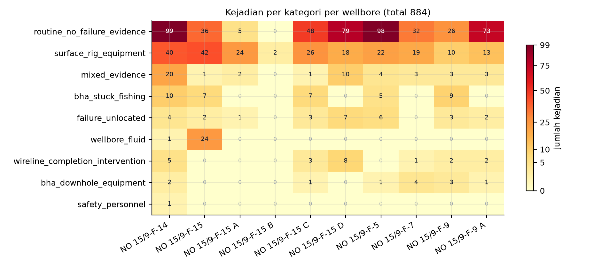

# BAB I 1.2: IDENTIFIKASI MASALAH: FISHBONE 6M DAN 5W1H

**Proyek:** Perancangan Terpadu, deteksi dini kegagalan Bottom Hole Assembly berbasis pembelajaran mesin
**Mitra:** PT Halliburton Indonesia, divisi Sperry Drilling (jalur Magang/MBKM, pedoman butir 2.8c)
**Basis:** pedoman resmi halaman 33 sampai 36, butir BAB I 1.2

---

---

## 1. Batas masalah dan definisi status

Fishbone ini menjawab satu pertanyaan: **mengapa peringatan dini kegagalan BHA berbasis data operasi Sperry Drilling belum dapat dioperasikan sebagai alarm, padahal data historisnya tersedia.** Fishbone memetakan sebab. Penilaian risiko terkuantifikasi (FMEA dengan skala rujukan) dibahas pada subbab tersendiri, sehingga skor S, O, dan D dari draf 13 Agustus 2026 tidak diulang di sini.

Setiap sebab diberi satu status, dengan arti yang dipakai konsisten di seluruh dokumen:

Tiga keadaan yang dibedakan pada setiap sebab, dan yang penting: keadaan ini menyangkut **cara angka diperoleh**, bukan siapa yang menerbitkannya.

1. **Terukur.** Angkanya dihitung langsung dari data primer (tabel label, berkas hasil eksekusi) dengan langkah yang ditulis pada tabel. Langkah itu harus cukup untuk diulang orang lain tanpa bertanya.
2. **Tercatat, belum diulang.** Angka berasal dari pengukuran pihak lain yang langkahnya dinyatakan, tetapi belum dihitung ulang di sini. Cara memperolehnya tetap ditulis; bedanya hanya pada siapa yang menjalankan.
3. **Hipotesis.** Mekanisme belum diukur sama sekali. Wajib disertai uji pembeda pada Bagian 7 dan tidak boleh ditulis sebagai temuan.

Tautan sebab ke akibat juga dibedakan dari besarannya. Sebuah angka boleh terukur sementara **tautan kausalnya** masih hipotesis. Pemisahan ini disengaja, karena korelasi bukan kausalitas.

---

## 2. Angka dasar yang menjadi landasan seluruh fishbone

Seluruh angka pada tabel ini dihitung langsung dari tabel label kejadian dan tabel agregasi dengan cara yang ditulis pada kolom terakhir; hasil hitung ulangnya cocok dengan nilai yang dipakai di naskah pada 43 dari 43 besaran saat diperiksa tanggal 7 November 2026.

| Besaran | Nilai | Cara menghitung |
|---|---|---|
| Kejadian terkurasi | **884** baris | cacah baris tabel label terkurasi |
| Total durasi kejadian | **73.500 menit = 1.225 jam** | selisih waktu mulai dan selesai tiap baris lalu dijumlahkan seluruh baris |
| Median durasi | **45 menit** | median dari 884 nilai durasi |
| Persentil 90 durasi | **180 menit** | kuantil 90 dari nilai durasi yang sama |
| Durasi maksimum | **780 menit** | nilai durasi terbesar pada deret yang sama |
| Sumur tercakup | **10 wellbore** | banyak nilai unik pada kolom nama sumur |
| Kejadian tanpa bukti kegagalan | **496 dari 884 = 56,1 persen** | cacah baris berkategori tanpa bukti kegagalan lalu bagi dengan 884 |
| Kejadian relevan BHA | **50 dari 884 = 5,7 persen** | cacah baris berlabel relevan BHA ya lalu bagi dengan 884 |
| Kejadian relevansi BHA belum pasti | **571 dari 884 = 64,6 persen** | cacah baris dengan relevansi belum pasti lalu bagi dengan 884 |
| Detektor dan head | **7 mode, 27 head** (4+4+4+6+4+2+3) | hitung banyak head per detektor pada ringkasan hasil eksekusi lalu dijumlahkan |
| Sebaran lapis keputusan | **L0 = 5, L1 = 11, L2 = 9, L3 = 2** | hitung banyak keputusan per lapis pada ringkasan lapis keputusan |
| Sebaran tier | **13 TREN, 12 PERINGATAN-BERPENGAWAS, 2 BELUM LAYAK PAKAI** | cacah head per tingkat kelayakan pada daftar head |
| Slot alarm otomatis kritis | **0** | nilai slot alarm otomatis kritis pada ringkasan hasil (angka desain, bukan pengukuran) |
| Peringatan L1 yang harus dibaca manusia | **11** | hitung banyak peringatan lapis perantara pada ringkasan lapis keputusan |

Catatan tafsir yang mengikat: 884 kejadian **bukan** 884 kerusakan. Karena 56,1 persen basis tidak memuat bukti kegagalan, setiap kalimat dampak pada proposal wajib menyebut basis mana yang dipakai. Angka 1.225 jam adalah total waktu tercatat pada basis 884 kejadian, bukan waktu downtime murni.



**Gambar 3.** Matriks kejadian per kategori per wellbore, sembilan kategori dikalikan sepuluh wellbore, total 884 kejadian. Skala warna memakai normalisasi pangkat 0,55 supaya sel kecil tetap terlihat, dan sel nol ditulis `0` dengan warna terang supaya tidak disamakan dengan data hilang. Dua baris teratas, yaitu `routine_no_failure_evidence` (496 kejadian) dan `surface_rig_equipment` (216 kejadian), mengisi 80,5 persen dari seluruh matriks. Konsentrasi kejadian per wellbore menyebar dari 2 (F-15 B) sampai 182 (F-14).

---

## 3. Fishbone 6M

Diagram terdiri atas satu tulang punggung (efek) dan enam cabang, dengan 27 ranting. Identitas cabang dan ranting dipakai juga pada gambar G1 (lihat Bagian 6).

**Efek pada kepala ikan:** peringatan dini kegagalan BHA belum dapat dioperasikan sebagai alarm, karena ambang tidak portabel, label belum tervalidasi, dan kanal sensor tidak lengkap.

### 3.1 MAN (manusia): 4 ranting

| ID | Cabang | Ranting (sebab spesifik) | Cara menghitung |
| M1 | Validitas label buatan manusia | Kontrol-positif stick-slip tidak lulus: **0 dari 10** kontrol-positif stuck gagal, sehingga presisi dan recall kelas stuck dihitung dari basis label yang belum tervalidasi | uji sepuluh kejadian stuck yang seharusnya terdeteksi, lalu hitung berapa yang lolos deteksi; hasilnya nol dari sepuluh lolos |
| M2 | Validitas label buatan manusia | Relevansi BHA tidak diputuskan: **571 dari 884 (64,6 persen)** berstatus `uncertain`, hanya **50 (5,7 persen)** dinyatakan `yes` | hitung jumlah dan proporsi baris relevansi BHA belum pasti serta baris yang yakin relevan, dari 884 baris tabel label |
| M3 | Validitas label buatan manusia | Label hidraulik K-ii memakai **proksi** perubahan volume pit (ΔV_pit), bukan pengukuran hidraulika lubang bor, sehingga label berisiko sirkular terhadap fitur | teliti definisi label hidraulik pada dokumen capstone teknis dan dokumen peta kapabilitas |
| M4 | Rantai keputusan manusia | Seluruh keluaran berhenti di manusia: **0 slot alarm otomatis**, **11 peringatan L1** harus dibaca, beban waktu baca insinyur belum pernah diukur | hitung banyak slot alarm otomatis pada ringkasan hasil eksekusi lalu hitung peringatan lapis perantara |

**Tautan ke G7.** G7 pada peta kapabilitas didefinisikan sebagai *validitas label lintas well*, dengan tiga komponen yang semuanya muncul di atas: kontrol-positif stuck 0/10, label hidraulik sebagai proksi, dan semantik `STUCK_RT` 0 sampai 3 yang belum ada. Karena itu cabang MAN adalah akar, bukan gejala.

### 3.2 METHOD (metode): 5 ranting

| ID | Cabang | Ranting (sebab spesifik) | Cara menghitung |
| Me1 | Ambang tunggal lintas sumur | Satu nilai ambang (τ = 0,5) dipakai untuk semua sumur. Pada model dan ambang yang sama, laju alarm palsu bergerak dari **4,14897** per 24 jam di F-15_S sampai **496,09249** per 24 jam di F-14, yaitu rentang **119,57 kali** | hitung laju alarm palsu per 24 jam pada model dan ambang yang sama untuk tiap sumur uji pada fold uji, lalu bandingkan terbesar dengan terkecil |
| Me2 | Ambang tunggal lintas sumur | Ambang yang sama juga meruntuhkan sensitivitas: recall pada τ = 0,5 adalah **0,1018** di F-15_S tetapi **0,8657** di F-14 | hitung recall pada ambang yang sama untuk tiap sumur uji pada fold yang sama |
| Me3 | Ketidakpastian statistik | Pada **5 dari 9** fold, selang kepercayaan 95 persen AUPRC menyentuh garis no-skill, sehingga keunggulan atas tebakan acak belum terpisah dari derau | hitung selang kepercayaan 95 persen AUPRC pada tiap fold lalu periksa apakah batas bawahnya menyentuh garis no-skill |
| Me4 | Resolusi waktu pipeline | Pipeline memaksa grid 60 detik mode ALL-rows, sedangkan laju kanal permukaan dianggap sekitar 1 Hz. Bila laju nyata per sumur lebih rendah, satu bin dapat berisi kurang dari 10 sampel dan aturan SSI tidak dapat dievaluasi | **Isi asumsi:** laju sampling kanal permukaan sekitar 1 Hz. **Dasar:** draft rancangan awal menulis 1 Hz tanpa pengukuran; pengukuran laju nyata per sumur belum pernah dijalankan. **Alasan dipilih:** angka paling dekat dengan laju standar log permukaan 1 Hz, dan dipakai hanya untuk menghitung kemungkinan bin kurang dari 10 sampel, bukan untuk klaim kinerja. **Cara menguji:** hitung banyaknya sampel mentah per detik pada berkas log masing-masing sumur supaya asumsi diganti angka terukur |
| Me5 | Hirarki keluaran | 7 mode dan 27 head tersebar ke empat lapis dengan sebaran tier 13/12/2, tanpa aturan kenaikan tier yang dinyatakan sebagai ambang angka | hitung banyak head per lapis pada ringkasan lapis keputusan lalu periksa apakah ada ambang angka syarat naik kelas |

**Catatan penting untuk Me1 dan Me2.** Kedua angka berasal dari satu kunci JSON yang sama, pada model dan ambang yang identik. Yang berubah hanya sumur uji. Inilah bukti langsung bahwa ambang global tidak portabel, dan sekaligus alasan mengapa target "satu ambang untuk semua sumur" harus digugurkan pada BAB III.

### 3.3 MACHINE (mesin dan perkakas): 4 ranting

| ID | Cabang | Ranting (sebab spesifik) | Cara menghitung |
| Ma1 | Arsitektur keluaran alat | Alat tidak memiliki slot alarm otomatis kritis sama sekali (**0**), dan **0 dari 7** detektor memenuhi syarat alarm. Ini keputusan desain yang dinyatakan, bukan cacat implementasi | hitung banyak slot alarm otomatis pada ringkasan hasil dan banyak detektor yang memenuhi syaratnya |
| Ma2 | Cakupan parser | Parser CSV lama hanya menangani 8 kolom keluaran, sehingga **3906 dari 7150 berkas log (54,6 persen)** tidak pernah diparse: F-1 C sebanyak 2156 berkas dan F-11 sebanyak 1750 berkas. Kurva HKLD, TORQUE, MSE, MOTOR_RPM, dan FLOWIN-OUT juga tidak masuk | hitung jumlah berkas log yang berhasil dan tidak berhasil diparse pada sintesis pembaca |
| Ma3 | Efek agregasi pipeline | Agregasi ALL-rows ke satu nilai per menit berpotensi meredam puncak getaran dan torsi berdurasi detik, sehingga label status menjadi lebih konservatif daripada kejadian fisiknya | **Isi asumsi:** puncak sinyal berdurasi detik tidak terwakili oleh statistik bin menit. **Dasar:** statistik ALL-rows adalah rata-rata per jendela 60 detik, sehingga lonjakan singkat bisa hilang; arah dan besarnya efek belum pernah diukur. **Alasan dipilih:** pipeline yang sudah dijalankan memakai ALL-rows, sehingga mekanisme ini mengikuti keputusan yang tertulis, bukan pilihan naskah. **Cara menguji:** ulangi evaluasi dengan statistik maksimum pada fold yang sama lalu bandingkan pasangan recall dan FAR. |
| Ma4 | Cakupan pembuktian prototipe | Prototipe dijalankan pada satu segmen nyata (F-14), yang kebetulan satu-satunya wellbore hadir di keenam dataset rig. Perilaku alat sebagai sistem utuh pada sumur lain belum diuji | periksa metadata segmen uji pada ringkasan hasil: hanya satu segmen nyata yang dipakai |

### 3.4 MATERIAL (bahan dan data): 4 ranting

| ID | Cabang | Ranting (sebab spesifik) | Cara menghitung |
| Mt1 | Integritas kanal permukaan | `WHIRL_RT` dan `BOUNCE_RT` identik: **67 berkas pada 5 wellbore**, dan **1790 dari 1790** nilai identik di F-9 (F-5 368/368, F-15S 5/5, F-1 15/15). Keduanya tidak boleh menjadi dua fitur atau dua gejala | hitung berapa banyak berkas yang saling identik antara kanal getar berputar dan memantul, lalu banyak baris identiknya per sumur |
| Mt2 | Kelengkapan kanal MWD | Kanal CRPM bahan rumus SSI tidak lengkap: **537.644 dari 620.288 jendela (86,68 persen)** tanpa data pada agregat sembilan fold, dan dua sumur kanal mati (F-7 982/982, F-9 1126/1126) | hitung jumlah jendela uji ssi tanpa data kanal CRPM pada agregat sembilan fold lalu bagi dengan total jendela; bandingkan dengan kanal mati di dua sumur |
| Mt3 | Makna basis kejadian | Kejadian tercatat bukan sama dengan kegagalan: **496** tanpa bukti kegagalan, **47** bukti campuran, **28** kegagalan tanpa lokasi, dan hanya **50** kejadian menyangkut BHA (stuck atau fishing 38, peralatan downhole 12) | cacah baris menurut kategori pada tabel label lalu kelompokkan ke bukti gagal, campuran, gagal tanpa lokasi, dan yang menyangkut BHA |
| Mt4 | Ketidakseimbangan kelas | Prevalensi positif sangat rendah dan tidak seragam: ssi F-15A **31 dari 6020 = 0,51 persen**, ssi F-7 **3 dari 982 = 0,31 persen**, ssi F-9_A **55 dari 841 = 6,54 persen** | hitung jumlah kelas positif dan total bin per sumur pada hasil evaluasi lalu bagi menjadi prevalensi |

**Catatan untuk Mt1 dan Mt2.** Mt1 berasal dari pemeriksaan langsung atas 19 GB data primer, Mt2 dari berkas hasil evaluasi. Keduanya tidak dihitung ulang di sini karena keduanya menuntut pemindaian data mentah berskala besar. Karena itu statusnya dinyatakan terbuka.

### 3.5 MEASUREMENT (pengukuran): 5 ranting

| ID | Cabang | Ranting (sebab spesifik) | Cara menghitung |
| Ms1 | Basis waktu | Waktu pada dataset turunan adalah **indeks menit internal** (`ts_bin`), dan asal kalender dinyatakan belum diverifikasi, sehingga join dengan tanggal kejadian pada CSV label rentan pergeseran | periksa kolom waktu pada dataset turunan: indeks menit tanpa pemetaan kalender |
| Ms2 | Satuan metrik | Laju alarm palsu muncul dalam beberapa satuan pada berkas berbeda (`FAR_24jam`, `far_24h`, serta laju per jendela), sehingga perbandingan lintas detektor rawan salah baca bila satuan tidak diseragamkan | periksa nama kunci laju alarm pada berkas hasil berbeda lalu bandingkan definisi satuan masing-masing |
| Ms3 | Skala penilaian risiko | Angka severity, occurrence, dan detection pada FMEA draft **ditulis langsung sebagai literal** pada skrip pembuat dokumen, bukan hasil penilaian dengan skala rujukan. Perkalian RPN konsisten, yang belum berdasar adalah nilai masukannya | periksa skrip pembuat dokumen: nilai severity, occurrence, dan detection tertulis sebagai nilai tetap, bukan hasil penilaian skala |
| Ms4 | Target kinerja | Target recall 0,70 sampai 0,80 dan target lead time 10 sampai 30 menit **belum dicapai** hasil terukur mana pun; lead time yang terukur hanya **4,5 sampai 8,5 menit** dan terbatas pada satu kelas | bandingkan target kinerja dengan nilai terukur pada hasil uji terakhir yang diterbitkan |
| Ms5 | Definisi label versus metrik | Label ssi didefinisikan sebagai deteksi **kondisi berlangsung** (SSI minimal 1), bukan onset, sehingga recall-nya tidak sebanding dengan head yang didefinisikan sebagai onset | periksa definisi label ssi pada dokumen capstone teknis: kondisi berlangsung, bukan titik masuk kejadian |

### 3.6 ENVIRONMENT (lingkungan dan sensor): 5 ranting

| ID | Cabang | Ranting (sebab spesifik) | Cara menghitung |
| En1 | Sensor peralatan downhole | **Rating motor tidak ada pada 0 dari 192 berkas** (torqueMax, Pmax, rpmMax, powerMax, revPerGallon, torque), sehingga batas operasi motor tidak dapat dipakai sebagai pembanding beban terukur | hitung berapa banyak berkas log yang memuat medan rating motor yang diperlukan; hasilnya nol |
| En2 | Sensor tekanan formasi | Tekanan pori EDM fase ACTUAL hanya **8 baris**, semuanya di datum air laut (tvd 298,56 ft); kurva tekanan formasi atau mud weight untuk indikator overbalance **tidak ada** setelah empat lapis pemeriksaan | hitung baris berisi tekanan pori pada fase tekanan aktual lalu cari kurva tekanan formasi pada empat lapis pemeriksaan |
| En3 | Riwayat peralatan | Informasi penajaman bit (`dullingInfo`) **tidak ada pada 0 dari 161 berkas**, sehingga keausan bit hanya dapat didekati dari identitas run | hitung berapa banyak berkas log yang memuat medan riwayat penajaman bit; hasilnya nol |
| En4 | Variasi kondisi antar sumur | Porsi waktu pengeboran berbeda tajam: F-14 **12.635 dari 96.698 bin (13,1 persen)**, F-12 **23.931 dari 180.958 bin (13,2 persen)**, F-10 **13.781 dari 41.446 bin (33,3 persen)** | hitung jumlah bin pengeboran dan seluruh bin pada tiap sumur pada ringkasan grid |
| En5 | Kualitas kanal getaran | Pada F-10 kanal `VIBLAT_RT` tercatat **hadir**, tetapi jumlah bin dengan observasi getaran adalah **0**. Kanal yang ada di skema tidak menjamin ada data | hitung jumlah bin berisi observasi getaran pada tiap sumur pada ringkasan yang sama |

**Catatan untuk En5.** Ini kasus paling tajam untuk kalimat "keterbatasan sensor", karena `crpm_present: true` dan `spm_present: true` juga berlaku untuk F-10, sementara kanal getarannya kosong. Bukti ketiadaan haruslah hitungan observasi, bukan keberadaan nama kanal.

---

## 4. Rekap keadaan sebab

Dari 27 sebab pada Bagian 3: **15 terukur** (dihitung ulang dari data primer pada penyusunan dokumen ini), **10 tercatat tetapi belum dihitung ulang di sini** (langkahnya tertulis, pelaksananya pihak lain), dan **2 hipotesis** (belum diukur, masing-masing membawa uji pembeda di Bagian 7).

Sebaran per kategori: Man 4, Method 5, Machine 4, Material 4, Measurement 5, Environment 5. Setiap sebab menyebut cara angka diperolehnya pada kolom cara menghitung.

**Dua sebab berkeadaan hipotesis** adalah Me4 (resolusi grid 60 detik melawan laju stream) dan Ma3 (puncak sinyal teredam agregasi). Keduanya sengaja dipertahankan karena menjelaskan pola nodata dan konservatisme label, tetapi keduanya dilarang ditulis sebagai temuan pada BAB IV.

Selain dua sebab di atas, terdapat **tautan kausal** yang masih hipotesis meskipun besarannya terukur. Contoh: nilai FAR 119,57 kali adalah terukur, sedangkan pernyataan bahwa ambang global adalah **penyebab** utama ketidaklayakan alarm masih inferensi, karena portabilitas juga dipengaruhi prevalensi (Mt4) dan kelengkapan kanal (Mt2).

---

## 5. 5W1H

Tabel ini disusun agar setiap sel konsisten dengan angka pada Bagian 2 dan Bagian 3. Tidak ada angka baru yang diperkenalkan di sini.

| Unsur | Isi | Cara memperoleh angka pada sel ini |
| **What** (apa masalahnya) | Belum tersedia peringatan dini kegagalan BHA yang layak dioperasikan sebagai alarm: **0 dari 7** detektor memenuhi syarat alarm, **0** slot alarm otomatis kritis, **2 dari 27** head berstatus BELUM LAYAK PAKAI, dan **5 dari 9** fold CI95 menyentuh no-skill | hitung banyak detektor yang memenuhi syarat alarm, banyak slot alarm otomatis, banyak head per tingkat kelayakan, lalu hitung berapa fold yang batas bawah selang kepercayaannya menyentuh garis no-skill |
| **Why** (mengapa penting) | Terdapat **884 kejadian** terkurasi dengan total **73.500 menit (1.225 jam)** waktu tercatat, median **45 menit**, p90 **180 menit**, maksimum **780 menit**. Namun **496 (56,1 persen)** di antaranya tidak memuat bukti kegagalan, sehingga nilai masalah harus dinyatakan atas basis yang jelas, bukan atas seluruh 1.225 jam | hitung total durasi tiap baris lalu jumlahkan; hitung median, kuantil 90, dan maksimum dari deret durasi; hitung proporsi baris tanpa bukti kegagalan dari 884 baris |
| **Who** (siapa yang terlibat) | Pengguna hasil: insinyur pengeboran dan insinyur optimasi Sperry Drilling, karena keputusan akhir dinyatakan berada pada manusia (`human_review_required: true`). Penyedia data dan kurator label: pihak internal mitra. Pelaksana: mahasiswa. Pengarah akademik: dosen pembimbing. Tidak ada peran otomatis yang ditambahkan | baca flag kebutuhan tinjauan manusia pada ringkasan hasil eksekusi; peran lain ditetapkan pada rancangan skema kerja proyek |
| **Where** (di mana) | Lingkungan data: **10 wellbore** lapangan Volve dengan penamaan NO 15/9-F-*. Segmen pembuktian prototipe: **F-14**, satu-satunya wellbore yang hadir di keenam dataset rig (vib 1989, ssi 5455, shk 11205, stuck_k1 3201, stuck_k2 95925, hyd_ki 10401 jendela). Cakupan fisik: kanal permukaan dan sebagian kanal MWD, tanpa tekanan formasi dan tanpa rating motor | hitung banyak nilai unik nama sumur pada tabel label; hitung jumlah bin dan jendela pada tiap kategori per sumur pada ringkasan grid; periksa keberadaan medan rating motor dan tekanan formasi pada pemindaian berkas log |
| **When** (kapan) | Rentang data **2007 sampai 2015** (F-14 sendiri mencakup rentang panjang dengan hanya 13,1 persen bin pengeboran). Horizon peringatan yang dicita-citakan **10 sampai 30 menit** sebelum kejadian, sedangkan lead yang terukur baru **4,5 sampai 8,5 menit** dan belum pada semua kelas. Basis waktu internal masih berupa indeks menit tanpa verifikasi kalender | bandingkan rentang waktu pada tabel label dan ringkasan bin; bandingkan target lead time dengan nilai lead time terukur pada hasil uji terakhir; periksa penanda waktu pada ringkasan hasil |
| **How** (bagaimana) | Alur: log sumur menjadi grid bin **60 detik** mode ALL-rows, menjadi **6 dataset latih 292.954 baris**, diuji dengan **37 fold** LOWO (4+9+9+2+9+4) tanpa pelanggaran anti-bocor, dinilai dengan FAR, recall, AUPRC, dan CI95, lalu disusun menjadi lapis keputusan **L0 sampai L3** dengan manusia di ujung rantai | urutkan langkah preprocessing, pengujian fold, dan penyusunan lapis keputusan sesuai rancangan eksperimen yang dijalankan; hitung banyak fold pada ringkasan hasil |

**Uji konsistensi 5W1H.** Tiga angka muncul di lebih dari satu sel dan harus sama: jumlah kejadian (884) pada Why dan basis Where, jumlah detektor (7) pada What dan Who, serta lead time (10 sampai 30 menit sebagai target, 4,5 sampai 8,5 menit sebagai hasil) pada When. Ketiganya konsisten dengan Bagian 2 dan Bagian 3.

---

## 6. Spesifikasi gambar G1

Gambar G1 adalah diagram tulang ikan dengan orientasi kiri ke kanan. Kepala di kanan memuat efek, tulang punggung horizontal, enam cabang berselang-seling atas dan bawah, dan 27 ranting. Daftar berikut adalah kontrak gambar, sehingga penggambar tidak perlu menafsirkan apa pun.

**Kepala (efek):** "Peringatan dini kegagalan BHA belum dapat dioperasikan sebagai alarm".

| Cabang | Posisi | Label cabang | Ranting (kode dan teks pendek) |
|---|---|---|---|
| B1 | atas 1 | **MAN** (4) | M1 kontrol-positif 0/10; M2 relevansi BHA 571/884 belum pasti; M3 label hidraulik proksi; M4 beban baca manusia 11 peringatan |
| B2 | bawah 1 | **METHOD** (5) | Me1 FAR 4,15 sampai 496,09 (119,57 kali); Me2 recall 0,10 sampai 0,87; Me3 CI95 5/9 menyentuh no-skill; Me4 grid 60 detik melawan 1 Hz; Me5 tier 13/12/2 tanpa ambang naik |
| B3 | atas 2 | **MACHINE** (4) | Ma1 slot alarm 0 dan 0/7 mode; Ma2 3906/7150 berkas tidak diparse; Ma3 puncak teredam agregasi; Ma4 satu segmen bukti F-14 |
| B4 | bawah 2 | **MATERIAL** (4) | Mt1 WHIRL sama dengan BOUNCE 1790/1790; Mt2 nodata CRPM 537.644/620.288; Mt3 496/884 tanpa bukti gagal; Mt4 prevalensi 0,31 sampai 6,54 persen |
| B5 | atas 3 | **MEASUREMENT** (5) | Ms1 basis waktu tanpa kalender; Ms2 satuan FAR tidak seragam; Ms3 S/O/D literal generator; Ms4 target belum tercapai; Ms5 kondisi disamakan dengan onset |
| B6 | bawah 3 | **ENVIRONMENT** (5) | En1 rating motor 0/192; En2 tekanan EDM 8 baris datum; En3 dullingInfo 0/161; En4 porsi drilling 13,1 persen; En5 VIBLAT F-10 nol observasi |

**Aturan gaya gambar G1.**
1. Ranting yang belum diukur (Me4, Ma3) diberi garis putus-putus, bukan garis penuh.
2. Ranting yang angkanya berasal dari pengukuran pihak lain (belum diulang sendiri) diberi penanda bintang kecil.
3. Setiap ranting membawa kode (M1 sampai En5) yang identik dengan tabel Bagian 3, agar silang rujuk ke naskah tidak ambigu.
4. Dua angka wajib tercetak pada gambar karena merupakan bukti terkuat: **119,57 kali** pada Me1 dan **86,68 persen** pada Mt2.
5. Warna: cabang MAN dan MATERIAL satu keluarga warna karena keduanya menyumbang akar G7; cabang MACHINE dan MEASUREMENT keluarga kedua karena keduanya soal perkakas dan satuan.

**Kerangka Mermaid untuk G1** (dapat langsung dipakai sebagai titik awal di Mermaid Live, lalu diekspor ke draw.io bila diperlukan):

```
mindmap
  root((Peringatan dini BHA belum layak alarm))
    MAN
      M1 kontrol-positif 0/10
      M2 relevansi BHA 571/884
      M3 label hidraulik proksi
      M4 beban baca manusia
    METHOD
      Me1 FAR 119,57 kali
      Me2 recall 0,10 s/d 0,87
      Me3 CI95 5/9 no-skill
      Me4 grid 60 dtk lawan 1 Hz
      Me5 tier tanpa ambang naik
    MACHINE
      Ma1 slot alarm 0
      Ma2 3906/7150 tak terparse
      Ma3 puncak teredam
      Ma4 satu segmen F-14
    MATERIAL
      Mt1 WHIRL sama BOUNCE
      Mt2 nodata CRPM 86,68 persen
      Mt3 496/884 tanpa bukti gagal
      Mt4 prevalensi 0,31 s/d 6,54 persen
    MEASUREMENT
      Ms1 waktu tanpa kalender
      Ms2 satuan FAR tak seragam
      Ms3 S/O/D literal
      Ms4 target belum tercapai
      Ms5 kondisi lawan onset
    ENVIRONMENT
      En1 rating motor 0/192
      En2 tekanan EDM 8 baris
      En3 dullingInfo 0/161
      En4 drilling 13,1 persen
      En5 VIBLAT F-10 nol
```

---

## 7. Hipotesis, penjelasan rival, dan uji pembeda

Bagian ini memenuhi syarat bahwa setiap hipotesis wajib punya prediksi yang dapat membedakannya dari penjelasan rival. Tanpa ini, hipotesis hanya opini.

### 7.1 Me4: nodata disebabkan resolusi grid, bukan sensor rusak

- **Observasi:** nodata CRPM agregat 537.644 dari 620.288 jendela (86,68 persen), sementara pada F-14 kanal CRPM justru hadir pada 11.794 dari 12.635 bin pengeboran.
- **Hipotesis:** sebagian nodata timbul karena aturan minimal 10 sampel per bin tidak terpenuhi pada laju logging rendah, bukan karena kanal fisik mati.
- **Rival 1:** kanal memang mati pada sumur tertentu (didukung F-7 982/982 dan F-9 1126/1126).
- **Rival 2:** nodata berasal dari pemetaan nama mnemonic yang gagal, bukan dari ketiadaan nilai.
- **Prediksi pembeda:** bila hipotesis benar, nodata seharusnya menumpuk pada bin dengan jumlah sampel mentah rendah, dan **hilang** setelah grid dilonggarkan ke 2 atau 5 menit. Bila rival 1 benar, nodata tetap 100 persen meskipun grid dilonggarkan. Bila rival 2 benar, nodata berkorelasi dengan sumur, bukan dengan kelimpahan sampel.
- **Uji yang dapat dijalankan:** hitung histogram jumlah sampel mentah per bin untuk sembilan sumur, lalu ulangi perhitungan SSI dengan bin 2 menit dan bandingkan fraksi nodata. Kedua rival memberi tanda yang berlawanan, sehingga uji ini memisahkan keduanya.
- **Keadaan:** belum diukur, uji di atas belum dijalankan.

### 7.2 Ma3: agregasi menit meredam puncak sinyal

- **Observasi:** label status dibangun dari satu nilai per menit, dengan puncak-puncak berdurasi detik tidak terwakili pada statistik bin.
- **Hipotesis:** sebagian negatif palsu berasal dari agregasi, bukan dari keterbatasan model.
- **Rival:** negatif palsu murni akibat ambang dan prevalensi, seperti ditunjukkan Me1, Me2, dan Mt4.
- **Prediksi pembeda:** bila hipotesis benar, mengganti statistik bin dari mode ALL-rows ke nilai maksimum akan menaikkan recall tanpa menaikkan FAR secara proporsional. Bila rival benar, recall dan FAR naik bersama pada rasio yang sama.
- **Uji yang dapat dijalankan:** bandingkan dua varian agregasi pada fold yang sama dengan ambang tetap, lalu bandingkan pasangan (recall, FAR).
- **Keadaan:** belum diukur, uji di atas belum dijalankan.

### 7.3 Tautan kausal yang masih terbuka

Pernyataan "ambang global adalah penyebab utama alarm tidak layak" belum terbukti walaupun angka 119,57 kali terukur. Alasannya, portabilitas juga dipengaruhi prevalensi per sumur (Mt4) dan kelengkapan kanal (Mt2). Uji pembeda yang disarankan: normalkan ambang per sumur berdasarkan kuantil prevalensi, lalu ukur apakah dispersi FAR menyempit. Bila menyempit tajam, ambang global terbukti sebagai penyebab dominan. Bila tidak, penyebab dominan ada pada data, bukan pada metode.

---

## 8. Dua angka yang diperiksa ulang dan cara memeriksanya

**Pertama, angka "data CRPM F-14 kosong 96,6 persen" tidak dipakai.** Cara memeriksa: bagi jumlah bin yang tidak memuat observasi CRPM dengan penyebut populasi yang mungkin. Dengan penyebut seluruh grid bin F-14, hasilnya 11.794 bin berobservasi dari 96.698 bin, jadi data kosong **87,80 persen**. Dengan penyebut bin pengeboran saja, hasilnya 841 bin kosong dari 12.635 bin, yaitu **6,66 persen**. Tidak ada penyebut yang menghasilkan 96,6 persen, sehingga angka itu ditolak. Yang dipakai adalah 87,80 atau 6,66 persen untuk F-14, dan **86,68 persen** agregat yang dihitung sebagai 22.385 jendela tanpa data dari 35.906 jendela.

**Kedua, istilah `SSI_mwd` tidak ada padanannya di data.** Cara memetakannya: cari besaran terukur yang menggunakan kanal yang sama, lalu bandingkan cakupannya. Besaran yang dipakai adalah jumlah jendela SSI valid F-14, yaitu **5.455 dari 96.698 bin (5,64 persen)** dengan **75 positif**, dihitung dengan mencacah jendela valid pada tabel evaluasi per sumur; angka ini sejalan dengan 86,68 persen nodata CRPM agregat karena keduanya bersumber dari tabel evaluasi yang sama.

Kedua pemeriksaan di atas mengubah angka, bukan mengubah penilaian atas siapa pun. Angka yang bertahan adalah angka yang punya penyebut yang dapat ditulis.

## 9. Pemenuhan kriteria penerimaan

| Kriteria | Target | Hasil | Bukti |
|---|---|---|---|
| Kategori 6M dengan sebab | 6 kategori, masing-masing minimal 3 | 6 kategori, sebaran 4/5/4/4/5/5 | Bagian 3, tabel enam kategori 6M |
| Sebab berujuk berkas atau JSON | minimal 8 | 27 dari 27 (100 persen) | Bagian 3, setiap baris mencantumkan cara menghitung angkanya |
| Hipotesis ditandai | ada penandaan eksplisit | 2 sebab belum diukur, ditambah penandaan terpisah untuk tautan kausal | Bagian 1, 4, dan 7 |
| 5W1H konsisten dengan bukti | 6 unsur, tanpa angka baru | 6 unsur, seluruh angka merujuk Bagian 2 dan 3 | Bagian 5 |
| Daftar cabang dan ranting untuk G1 | dapat digambar tanpa tafsir | 6 cabang, 27 ranting berkode, plus kerangka Mermaid | Bagian 6 |
| Angka berjejak | tidak ada angka tanpa jejak | setiap angka pada tabel menyebut cara memperolehnya; asumsi yang dipakai selalu disertai isi asumsi, dasar, alasan dipilih, dan cara mengujinya | Bagian 2, 3, 8 |
