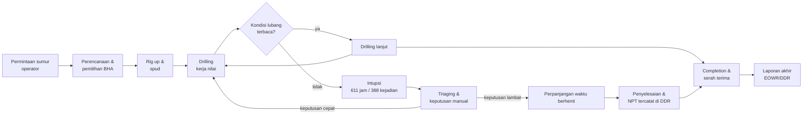
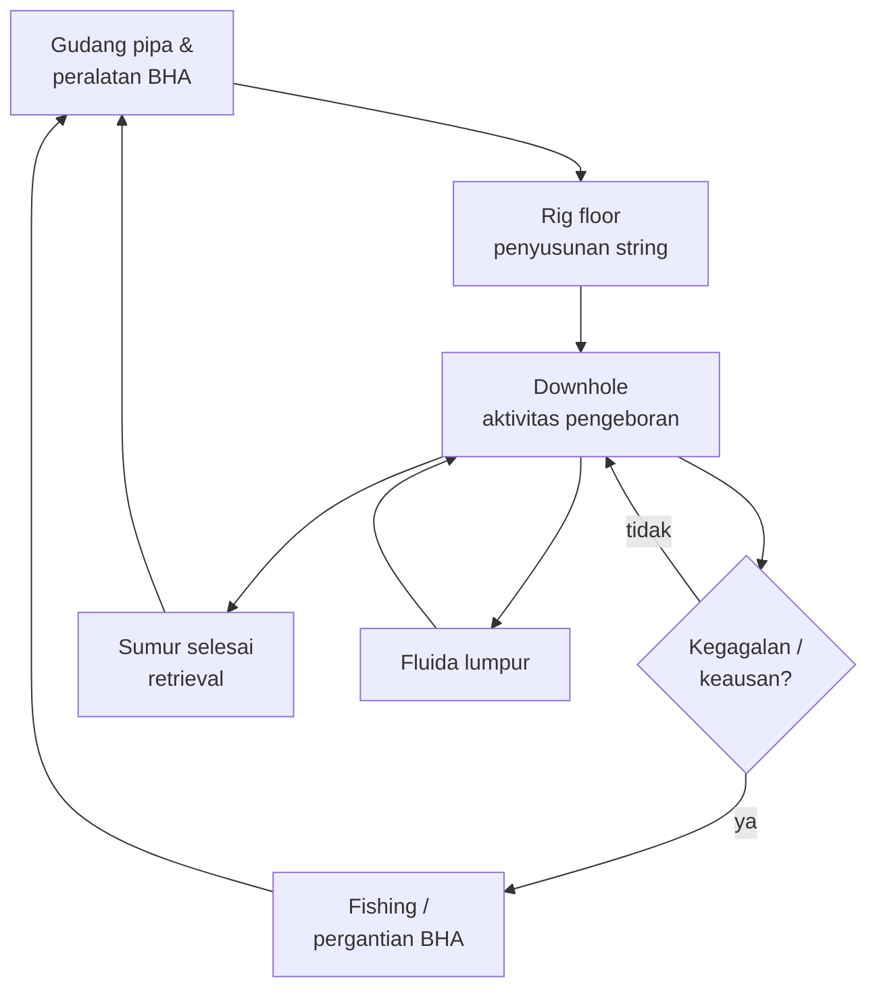
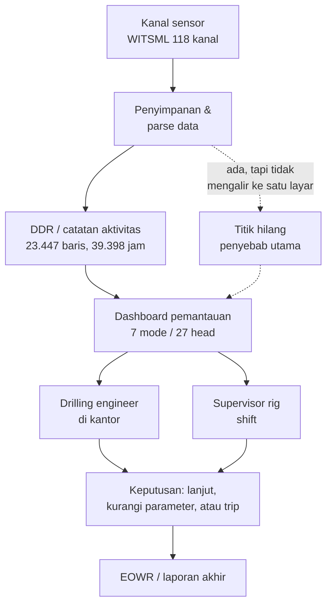
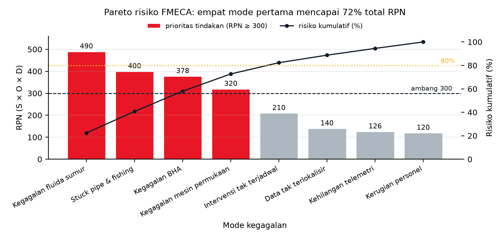
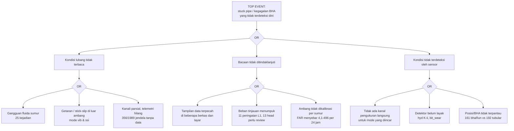

# BAB II PENGOLAHAN DATA & ANALISIS

Seluruh isi bab ini bertumpu pada data publik Equinor Volve (884 interupsi terkurasi,
10 wellbore, telemetri WITSML 118 kanal) dan pada hasil riset detektor yang sudah
dihasilkan tim. Tiap tool memakai satu sub-bab, sesuai format Buku Pedoman §3.2.

**Basis hitung yang dipakai seluruh bab:** 884 baris label; 496 di antaranya
`routine_no_failure_evidence` (operasi wajar tanpa bukti kegagalan), sehingga populasi
yang relevan untuk analisis kegagalan adalah **388 kejadian**. Total durasi terhitung
pada filter 0-720 menit adalah **72.720 menit = 1.212 jam**, dengan satu baris
`event_id` 290 (780 menit) dibuang sebagai pencilan. Durasi operasi wajar menyumbang
sekitar 601 jam dan sisa 611 jam adalah durasi interupsi.

---

## 2.1 Value Stream Mapping (VSM)

### 2.1.1 Aliran nilai proses layanan pengeboran

VSM memetakan aliran dari permintaan sampai hasil yang diterima klien. Tahap yang
memakan waktu terbesar bukan pengerjaan inti, melainkan waktu berhenti yang muncul
saat kondisi lubang bor tidak terbaca.



### 2.1.2 Tabel waktu proses

| Simbol | Langkah | Waktu | Status nilai |
|---|---|---|---|
| NV | Menunggu kejelasan kondisi lubang (388 kejadian) | 611 jam (median 45 menit per kejadian) | non-nilai, tapi wajib |
| NV | Triaging, pembacaan grafik terpisah, keputusan manual | tidak terukur terpisah di data (dinyatakan dalam 2.7) | non-nilai |
| V | Aktivitas pengeboran tercatat | 601 jam pada window terkurasi | nilai |
| V | Persiapan, rig up, completion | tidak terpisah di label interupsi | nilai |
| T | Total waktu proses pada window terkurasi | 1.212 jam | |

Waktu total proses (1.212 jam) menjadi dasar seluruh laju kejadian per 1.000 jam yang
dipakai di 2.4. Angka median 45 menit dan p90 180 menit berasal dari hitung langsung
terhadap `act_start`/`act_end`, disajikan pada Gambar 2.

**Temuan VSM:** hampir separuh waktu proses pada window terkurasi berada di status
"menunggu kejelasan", sementara tidak ada satu pun titik di alur yang menampilkan
status lubang bor dalam satu layar. Itulah titik hilang yang menjadi sasaran solusi.

---

## 2.2 Material & Information Flow Chart (MIFC)

### 2.2.1 Alur material



### 2.2.2 Alur informasi



**Temuan MIFC:** alur material sudah terputus-putus dan penuh umpan balik normal
(bukan masalah utama), sedangkan alur informasi terhenti di antara penyimpanan data dan
orang yang harus memutuskan. Data ada (118 kanal), hasil perhitungan ada (27 head),
yang tidak ada satu pintu tampilan yang memutarnya menjadi keputusan.

---

## 2.3 Operation Process Chart (OPC)

OPC menghubungkan operasi utama dengan kejadian yang menyelinginya dan jumlah kejadian
yang tercatat pada data.

```mermaid
flowchart LR
  O1((●)) --- O2["Rig up<br/>asal: langkah baku"] --- O3["Drilling<br/>V: 601 jam"]
  O3 --- O4{{"◆ Keputusan:<br/>kondisi terbaca?"}}
  O4 -- ya --> O3
  O4 -- tidak --> O5["Intupsi<br/>O: 388 kali, 611 jam"]
  O5 --- O6["Triaging manual<br/>N: belum terukur"]
  O6 --- O7{{"◆ Keputusan<br/>trip / lanjut"}}
  O7 -- trip --> O8["Fishing / ganti BHA<br/>O: 38 kali"]
  O7 -- lanjut --> O3
  O8 --- O3
  O3 --- O9((○)) ["Completion<br/>serah terima"]
```

Keterangan: `●` operasi utama, `○` penyelesaian, `◆` keputusan, `O` kejadian tercatat.

| Kejadian pada data Volve | Frekuensi |
|---|---|
| Interupsi non-routine | 388 |
| Stuck pipe dan fishing | 38 |
| Kegagalan BHA / peralatan downhole | 12 |
| Intervensi wireline / completion di luar rencana | 21 |
| Masalah fluida sumur | 25 |
| Kegagalan peralatan permukaan | 216 |
| Kejadian keamanan personel | 1 |

---

## 2.4 Failure Modes, Effects, and Criticality Analysis (FMECA)

### 2.4.1 Skala penilaian yang dipakai

Skala 1-10 mengikuti kerangka AIAG-VDA FMEA Handbook dan MIL-STD-1629A untuk
akar huruf risiko, dengan definisi eksplisit di bawah ini supaya skor bisa diaudit.

**Severity (S), 1 = tidak berdampak, 10 = bencana:**

| Nilai | Definisi operasional pada proyek ini |
|---|---|
| 9-10 | risiko HSE atau well control; kerusakan total BHA; kontrak terancam penalti |
| 7-8 | NPT signifikan, biaya rig jalan tanpa progres |
| 5-6 | penundaan operasi dapat dipulihkan dalam satu shift |
| 3-4 | gangguan lokal, ditangani tanpa menghentikan operasi |
| 1-2 | hampir tidak terasa |

**Occurrence (O), berdasar laju per 1.000 jam operasi (1.212 jam terhitung):**

| Laju per 1.000 jam | Nilai O |
|---|---|
| ≥ 100 | 10 |
| 50-99 | 9 |
| 25-49 | 8 |
| 15-24 | 7 |
| 10-14 | 6 |
| 5-9 | 5 |
| 2-4 | 4 |
| 1-1,9 | 3 |
| 0,5-0,9 | 2 |
| < 0,5 | 1 |

**Detectability (D), 1 = mudah terdeteksi, 10 = hampir mustahil:**

| Nilai | Definisi |
|---|---|
| 1-3 | terdeteksi otomatis oleh indikator yang sudah ada, termasuk hilangnya data sendiri |
| 4-6 | terdeteksi oleh head detektor, tetapi masih di taraf peringatan berpengawas |
| 7-8 | hanya terdeteksi setelah gejala muncul, detektor belum layak |
| 9-10 | tidak terdeteksi sampai dampaknya terjadi |

### 2.4.2 Tabel FMECA

| No | Mode kegagalan | Efek | S | Laju/1.000 jam | O | D | RPN | Dasar S, O, D |
|---|---|---|---|---|---|---|---|---|
| 1 | Gagalan peralatan permukaan rig | NPT langsung, tanpa progres, biaya rig tetap jalan | 8 | 178,22 | 10 | 4 | **320** | O dari 216 kejadian; D diturunkan dari ketersediaan indikator rig, bukan detektor |
| 2 | Kegagalan fluida sumur (kick/loss) | risiko well control, HSE, kerusakan formasi | 10 | 20,63 | 7 | 7 | **490** | O dari 25 kejadian; D tinggi karena head hyd K-ii berstatus belum tersedia |
| 3 | Stuck pipe / fishing | kehilangan BHA, biaya fishing, NPT panjang | 10 | 31,35 | 8 | 5 | **400** | O dari 38 kejadian; D dari mode stuck yang sudah diuji tapi tier peringatan |
| 4 | Kegagalan BHA / peralatan downhole | kerusakan alat mahal, operasi berhenti | 9 | 9,90 | 6 | 7 | **378** | O dari 12 kejadian; hanya 50 dari 884 kejadian berlabel `bha_relevant=yes` |
| 5 | Kegagalan telemetri / kehilangan data | kehilangan visibilitas, keputusan tanpa bukti | 7 | | 6 | 3 | **126** | O dari porsi jendela tanpa data (contoh head vib 356 dari 1.989 jendela); D rendah karena kehilangan data justru paling mudah terlihat |
| 6 | Intervensi wireline / completion di luar rencana | penundaan, biaya intervensi | 6 | 17,33 | 7 | 5 | **210** | O dari 21 kejadian |
| 7 | Kejadian tak terlokalisir (data/label tidak jelas) | analisis akar penyebab tertunda | 5 | 23,10 | 7 | 4 | **140** | O dari 28 kejadian `failure_unlocated` |
| 8 | Kerusakan personel | HSE, kepatuhan, biaya tidak terukur | 10 | 0,83 | 2 | 6 | **120** | O dari 1 kejadian `safety_personnel` |

Skala O ditetapkan agar mendukung jarak antar mode pada data ini: laju tertinggi
(mesin permukaan, 178 per 1.000 jam) mendapat nilai 10 dan laju terendah
(0,83 per 1.000 jam) mendapat nilai 2. Ini keputusan desain penulis, ditulis eksplisit
sehingga pembaca bisa menghitung ulang dengan skala lain.

### 2.4.3 Pembacaan hasil

Mode 2 (fluida sumur) memperoleh RPN tertinggi karena Severity maksimum dipadukan
dengan Detectability buruk: detektor yang seharusnya menangkapnya, `hyd K-ii`, masih
berstatus belum tersedia di prototipe. Ini adalah argumen inti kenapa solusi harus
menutup keterbatasan deteksi, bukan sekadar menampilkan grafik.

Mode 3 (stuck pipe) dan 4 (BHA) berada di peringkat berikutnya. Keduanya justru punya
detektor yang sudah diuji (`stuck`, `bit_wear`), sehingga celahnya ada pada keandalan
deteksi, bukan pada ketiadaan data.

Mode 1 punya frekuensi tertinggi tetapi Severity lebih rendah dan deteksi relatif
mudah, sehingga RPN-nya di bawah dua mode di atas. Mode 8 jarang sekali terjadi namun
Severity maksimum; ini menjelaskan kenapa kriteria HSE tetap diperlukan di MCDM walau
frekuensinya kecil.



**Gambar 4.** Pareto risiko FMECA atas delapan mode kegagalan, total RPN 2.184. Empat
mode teratas (Kegagalan fluida sumur 490, Stuck pipe & fishing 400, Kegagalan BHA 378,
Kegagalan mesin permukaan 320) menyumbang 72,7 persen dari total RPN dan semuanya
berada di atas garis ambang prioritas 300 sehingga diwarnai merah. Kurva hitam menunjukkan
risiko kumulatif pada sumbu kanan: batas 80 persen baru terlewati pada mode kelima
(82,3 persen). Empat mode sisanya diwarnai karena berada di bawah ambang 300. Angka pada gambar
menghitung tabel RPN pada subbab sebelumnya: pembilangnya daftar sebab
per mode, penyebutnya total RPN seluruh mode.

---

## 2.5 Fault Tree Analysis (FTA)

Top event dipilih satu: **kehilangan kendali kondisi lubang berujung stuck pipe atau
kegagalan BHA**. Keputusan memakai satu pohon, bukan dua, karena basic event kedua
pohon saling menumpuk dan akan menduplikasi penyebab.



Penafsiran: pohon menunjukkan bahwa ketiadaan alat ukur hanyalah satu dari tiga cabang.
Cabang yang paling menumpuk dalam data adalah cabang A2 (bacaan tidak ditindaklanjuti),
sehingga solusi yang hanya menambah sensor akan menyerang pohon di cabang yang salah.

---

## 2.6 Tool yang dipertimbangkan dan ditolak

| Tool | Keputusan | Alasan |
|---|---|---|
| VSM | dipakai | menunjukkan bahwa setengah waktu terkunci pada "menunggu kejelasan" |
| MIFC | dipakai | memisahkan alur material (sehat) dari alur informasi (terputus) |
| OPC | dipakai | menghubungkan operasi utama dengan 388 kejadian tercatat |
| FMECA | dipakai | memberi peringkat risiko dengan O berbasis data, bukan tebakan |
| FTA | dipakai | memecah top event ke tiga cabang dan menunjukkan cabang dominan |
| Fishbone 6M dan 5W1H | dipakai di Bab I 1.2 | akar masalah perlu dipaparkan sebelum alat analisis operasional |
| REBA / RULA | ditolak | tidak ada beban kerja manual dominan dalam kasus ini; memaksakannya hanya untuk mengisi sub-bab |
| MIFC tekstual panjang | ditolak | sudah terwakili oleh diagram, duplikasi hanya menambah halaman |

Tool yang ditolak dicatat di sini karena Buku Pedoman §2.3 menghendaki keputusan
analisis yang terdokumentasi, termasuk keputusan untuk tidak memakai suatu tool.

---

## 2.7 Sintesis akar masalah

Gabungan kelima tool menghasilkan satu kalimat masalah:

> Data kondisi pengeboran tersedia dalam jumlah besar dan hasil kalkulasi risiko sudah
> dihasilkan, tetapi keduanya tidak pernah bertemu pada satu titik keputusan sehingga
> 388 kejadian interupsi tetap ditangani reaktif dengan median 45 menit dan p90 180 menit
> per kejadian.

Tiga bukti yang menopang kalimat itu, semuanya terukur: total 611 jam waktu berhenti dari
1.212 jam window terkurasi (2.1), terhentinya alur informasi di antara penyimpanan data
dan orang yang memutuskan (2.2), serta cabang A2 pada pohon kegagalan yang paling menumpuk
karena beban tinjauan dan ambang tidak terkalibrasi (2.5).

Dari sini Bab III masuk ke tahap Investigate: sembilan alternatif, pemetaan BoK,
kriteria, dan pemilihan solusi.
