# PROPOSAL PROYEK PERANCANGAN TERPADU I
## Sistem Pemantauan Kondisi Lubang Bor Berbasis Dashboard dengan 7 Engine dan 27 Head (Status Advisory)

Dokumen terkompilasi dari sepuluh berkas sumber `PPT1_*` di folder ini, dalam urutan
Bab I sampai Bab IV lalu Daftar Pustaka. Setiap angka memiliki jejak di
`PPT1_LEDGER_ANGKA.md`; setiap gambar dibuat ulang oleh `assets/make_figures.py`
dari data primer. Sumber data: dataset publik Equinor Volve.

Catatan revisi 2026-11-06: rumusan masalah diberi kode RM1 sampai RM3 pada 1.1.6;
tabel 3.1.2 dipisahkan menjadi kondisi pengikat dan celah teknis, bukan rumusan masalah;
Bab III memuat tabel pemetaan RM1 sampai RM3 ke alternatif beserta status jawabannya;
Bab IV kini memuat tiga kesimpulan yang memetakan satu lawan satu ke RM1 sampai RM3,
dengan batasan dipisahkan ke subbab tersendiri. Kemudian empat cacat hasil audit
sub agent diverifikasi dan dibereskan: TOPSIS dinyatakan atas delapan kriteria
(sesuai matriks Bab III), klaim beban tinjauan menyinggung FTA Bab II (11 peringatan
L1 dan 13 head perlu review), SOP triage dan eskalasi alarm berjenjang ditegaskan
sebagai alternatif Anggota A pada 1.3 yang belum dieksekusi di Bab III, dan angka jam
berhenti batasan 4.3
kembali ke sumber Bab I (73.500 menit = 1.225 jam).

---

# BAB I PENDAHULUAN

## 1.1 Latar Belakang Sistem

| | |
|---|---|
| Kartu kanban | `t_6fff319f` (R&D, BAB I 1.1) |
| Tanggal | 25 Oktober 2026 (WIB) |
| Ruang kerja | `/mnt/d/Capstone 1(v2)` |
| Keluaran | `docs/PPT1_BAB1_1.md` (naskah) + `scratch/ppt1/bab1_1_angka.json` (bukti angka) + `scratch/ppt1/bab1_1_hitung.py` (skrip hitung ulang) |
| Mitra | PT Halliburton Indonesia, divisi Sperry Drilling (jalur Magang/MBKM, pedoman 2.8c) |
| Format acuan | Buku Pedoman PPT h.33-36, sub-bab 1.1: deskripsi objek kasus, stakeholder, rich picture, alur produksi, uraian singkat permasalahan; ditambah tuntutan SIMILAR tahap satu (trade-off minimal dua aspek) |
| Status angka dampak | TERUKUR untuk total durasi dan sebaran (kartu P0 `t_0eb03f13`, dihitung ulang di kartu ini). TEMPORER untuk pemetaan per mode FMEA karena kartu D1 `t_c0e851b8` berstatus **blocked** dan belum menghasilkan `docs/PPT1_BUKTI_DAMPAK.md` |

**Riset pendahuluan: `ppt-halliburton`** (beserta `references/ppt1-proposal-build.md` dan `references/pedoman-summary.md`) - format wajib 1.1 adalah lima elemen (objek, stakeholder, rich picture, alur produksi, uraian masalah) plus trade-off SIMILAR tahap satu; peta bahan menunjukkan angka dampak berasal dari `labels_curated_v2.csv`, bukan dari draft Agustus 2026.
**Riset pendahuluan: `verification-mandatory`** - setiap angka dipisah menjadi bukti mentah dan kesimpulan, angka tanpa jejak ditulis sebagai ASUMSI/TEMPORER, dan laporan ditutup dengan daftar yang belum diverifikasi (lihat 1.1.8).
**Riset pendahuluan: `sequentialthinking` (sequ-mcp, empat pikiran)** - urutan pikir: (1) susun struktur 1.1 dari tuntutan pedoman, (2) cek status kartu D1 sebelum memakai angka mode, (3) uji ulang angka durasi dengan instrumen parser yang berbeda, (4) rancang elemen rich picture agar kartu G1 dapat menggambar tanpa menebak.

### 1.1.1 Deskripsi Objek Studi dan Sistem yang Dikaji

Objek kajian proyek ini adalah **PT Halliburton Indonesia, divisi Sperry Drilling**, yaitu penyedia jasa pengeboran yang mengoperasikan instrumentasi lubang bawah (MWD, LWD, dan Rotary Steerable System) serta layanan pemantauan parameter pengeboran bagi operator minyak dan gas. Pengajuan objek melalui jalur Magang/MBKM mengikuti pedoman 2.8c, sehingga permasalahan yang diangkat harus berasal dari proses kerja nyata mitra dan dimiliki oleh seorang pemilik masalah di lapangan [S:draft Sperry `Proposal_PPT_I_SperryDrilling_ML_NPT.docx` l.28; Buku Pedoman PPT 2.8c].

Sistem yang dikaji bukan satu alat, melainkan **rantai keputusan pengeboran**: sensor lubang bawah mengirim data fisis ke permukaan, sistem permukaan menampilkan dan menyimpan data tersebut, driller dan drilling engineer membaca tampilan itu, lalu memutuskan apakah pengeboran dilanjutkan, parameter diubah, atau rangkaian ditarik. Mutu rantai ini ditentukan oleh dua hal yang saling bertukar: kelengkapan pengukuran (berapa kanal yang benar-benar terisi) dan kecepatan keputusan (berapa menit antara gejala terbaca dan tindakan diambil).

Basis data yang dipakai proyek berasal dari **lapangan Volve (Equinor, lisensi CC BY-NC-SA 4.0)** karena data operasi mitra tidak dapat dibuka [S:V3_DATA_ACQUISITION_INVENTORY.md baris lisensi]. Inventaris yang benar-benar ada di disk berisi **13 himpunan data** [H:inventaris.baris_tabel, rincian per himpunan di docs/V10_D1_BAB_DATA.md §3.1], dengan tulang punggung berupa **7.080.457 baris log pengeboran WITSML hasil parse** dari 8 berkas sumur [L:B12] dan matriks latih **292.954 baris** pada **6 dataset siap pakai** [L:B23]. Cakupan sumur adalah **10 wellbore** [L:D03] dengan rentang kejadian dari tahun 2007 sampai 2015 menurut kolom `event_date` [H:tahun.dari] [H:tahun.sampai].

Perlu dinyatakan sejak awal agar naskah tidak menyesatkan: data yang dipakai adalah **data lapangan nyata beresolusi grid 60 detik**, bukan telemetri real time 1 Hz milik Sperry seperti tertulis pada draft lama. Angka 1 Hz di draft berstatus ASUMSI dan bertabrakan dengan kontrak pipeline yang benar-benar dijalankan [L:A14]. Konsekuensinya, klaim kinerja di Bab I dan Bab II selalu dikaitkan ke resolusi 60 detik, dan klaim pemakaian langsung pada stream mitra dinyatakan sebagai rencana integrasi, bukan hasil.

Sistem yang diusulkan proyek berada di antara tahap pengukuran dan tahap keputusan, yaitu lapisan **decision support** yang mengubah data parameter pengeboran menjadi peringatan dini beserta alasannya. Lapisan ini dirancang sebagai **7 engine deteksi** [L:B01] yang direalisasikan dalam **27 varian metode (head)** [L:B03], dilatih pada matriks 55 fitur [L:B48] dan diuji dengan **37 lipatan leave-one-well-out** [L:B25] tanpa satu pun pelanggaran kebocoran fitur ke label [L:B26].

### 1.1.2 Stakeholder dan Kepentingannya

Pedoman mensyaratkan identifikasi stakeholder beserta kepentingannya, dan karakteristik masalah kompleks WP6 mensyaratkan adanya pihak dengan tuntutan yang berbeda. Tabel berikut memisahkan **kepentingan** (apa yang diinginkan pihak tersebut dari sistem) dari **risiko** (apa yang memburuk bila sistem salah bekerja), karena dua kolom itu yang menentukan arah desain di Bab III.

| No | Stakeholder | Peran dalam sistem | Kepentingan utama | Risiko bila sistem salah | Bukti keberadaan pihak |
|---|---|---|---|---|---|
| S1 | Driller / company man di rig | Pemakai keputusan akhir (problem owner) | Peringatan yang cukup awal dan cukup jelas untuk ditindaklanjuti sebelum kerusakan membesar | Kelelahan akibat alarm palsu; keputusan berubah karena saran yang salah | Draft Sperry menetapkan driller dan tim operasi Sperry sebagai problem owner [S:draft Sperry l.64]; pemilik masalah wajib ada pada Buku Pedoman PPT |
| S2 | Drilling engineer / supervisor Sperry Drilling | Penafsir data dan penyusun program pengeboran | Diagnosis yang dapat dijelaskan, bukan kotak hitam, agar dapat dipertanggungjawabkan ke operator | Kehilangan kepercayaan pada alat; rekomendasi tidak dipakai | Divisi mitra; draft Sperry l.31-32 (monitoring parameter pengeboran) |
| S3 | Manajemen Sperry Drilling (mitra MBKM) | Penyedia jasa, pemilik proses kerja | Efisiensi waktu rig dan reputasi layanan | Biaya layanan naik karena waktu non-produktif tidak terdeteksi | Mitra proyek (pedoman 2.8c) |
| S4 | Operator minyak dan gas (mis. Eni) | Pemilik sumur dan anggaran | Ketepatan waktu penyerahan sumur dan keamanan operasi | Pembengkakan biaya rig dan risiko integritas sumur | Rilis pers Halliburton 9 Juli 2026 tentang operasi closed-loop bersama Eni di Indonesia [L:A06] |
| S5 | Engineer MWD/LWD di lokasi | Penjaga mutu kanal pengukuran | Kanal yang rusak atau kosong dikenali sebagai keterbatasan alat, bukan disalahkan ke manusia | Kanal bermasalah tetap dipakai sebagai dasar peringatan | Kanal instrumen MWD menjadi sumber label (VIBLAT_RT, SHKRSK_RT, STUCK_RT, CRPM_RT) [S:docs/V10_D1_BAB_DATA.md §3.2.1] |
| S6 | Fungsi HSE / keselamatan | Penjaga batas keselamatan operasi | Tidak ada insiden sumur (kick, loss, pipa terjepit) yang terlambat ditangani | Peringatan yang terlalu lambat dianggap gagal sistem | Tujuh engine mencakup hidraulik dan pipa terjepit [L:B01] [S:scratch/v9_i1/v9_i1_RESULTS.json engines]; kategori `safety_personnel` ada di label kejadian [L:B06] |
| S7 | Tim PPT I (tiga mahasiswa Teknik Industri UNS) | Perancang dan pelaksana kajian | Capaian pembelajaran, metode yang dapat dipertanggungjawabkan, data yang dapat diaudit | Naskah dinilai tidak berbasis bukti | Susunan tim dan pembagian peran pada 1.3 |
| S8 | Mentor dosen PPT | Penilai metodologi | Kesesuaian dengan pedoman, rubrik, dan model SIMILAR | Bab I dinilai lemah pada rubrik 1 (memetakan masalah kompleks, bobot 15 persen) | Buku Pedoman PPT h.38 sampai h.40 [S:Buku Pedoman PPT h.38-40] |
| S9 | Pemilik data (Equinor, lewat kanal Volve) | Penyedia data uji | Data dipakai sesuai lisensi dan tidak diklaim sebagai milik proyek | Pelanggaran lisensi CC BY-NC-SA 4.0 | `V3_DATA_ACQUISITION_INVENTORY.md` baris lisensi |

Dua ketegangan antarpihak yang akan muncul berulang di Bab III: (a) S1 dan S5 berlawanan soal ambang, karena S1 menuntut peringatan sesedikit mungkin sedangkan S5 menuntut kanal bermasalah tetap dilaporkan; (b) S2 dan S4 berlawanan soal bentuk keluaran, karena S2 menuntut penjelasan yang dapat diperiksa sedangkan S4 menuntut keputusan cepat. Keduanya menjadi bahan sub-bab trade-off 1.1.5.

### 1.1.3 Alur Operasi dan Alur Data

Alur operasi pengeboran terdiri atas delapan tahap. Kolom terakhir menunjukkan **di mana tahap itu meninggalkan jejak data yang benar-benar dipakai proyek**, sehingga alur ini bukan gambar konseptual tanpa kaitan ke berkas.

| Tahap | Aktor utama | Keluaran tahap | Jejak data di proyek | Titik gangguan yang terukur |
|---|---|---|---|---|
| T1 Perencanaan sumur dan desain rangkaian bor | Drilling engineer | Program pengeboran, desain BHA | **161 berkas bhaRun** [L:B15], **192 assembly tubular berisi 1.392 komponen** [L:B14], **63 berkas trajectory berisi 5.561 stasiun** [L:B16], **27 berkas wbGeometry berisi 109 section** [L:B17] | Rating motor (batas torsi dan tekanan) tidak ada pada 192 dari 192 berkas, sehingga perhitungan beban puncak rangkaian tetap terblokir [S:docs/V10_D1_BAB_DATA.md §3.2.4] |
| T2 Rakit rangkaian dan masuk lubang (make-up dan RIH) | Rig crew, MWD engineer | Rangkaian siap, run dimulai | `dTimStart`/`dTimStop` per run; 154 dari 161 `uidRef` bhaRun bertaut ke tubular [L:B15] | Hanya 19 dari 161 run memuat batas kedalaman, sehingga penautan waktu ke kedalaman rapuh [S:docs/V10_D1_BAB_DATA.md §3.2.5] |
| T3 Pengeboran dengan parameter terkendali | Driller | Lubang bertambah, parameter terekam | Kanal inti `TQA`, `SPPA`, `TFLO`, `RPM`, `SWOB`, `HKLD`, `ROP`, `SPM`, `depth`, `dbtm` [S:docs/V10_D1_BAB_DATA.md §3.2.1] | Beban dan getaran berlebih tidak terlihat sebagai satu angka tunggal, melainkan pola beberapa kanal sekaligus |
| T4 Transmisi telemetri lubang bawah ke permukaan | Sistem MWD/LWD | Data lubang bawah di permukaan | Kanal instrumen `VIBLAT_RT`, `SHKRSK_RT`, `STUCK_RT`, `CRPM_RT` [S:docs/V10_D1_BAB_DATA.md §3.2.1] | Kanal instrumen jarang terisi: `SHKRSK_RT` di F-7 hanya 0,67 persen baris, `CRPM_RT` F-7 0,51 persen, `VIBLAT_RT` F-14 0,14 persen [S:docs/V10_D1_BAB_DATA.md §3.2.1] |
| T5 Perekaman dan penyeragaman grid data | Sistem permukaan dan historian | Data tersimpan dan seragam | Grid **60 detik** dengan mode seluruh baris; jendela fitur 10 menit hanya melihat ke masa lalu [S:docs/V10_D1_BAB_DATA.md §3.3.1-§3.3.2] | Fill-rate tidak seragam: 60 sampai 281 kanal per sumur, tetapi hanya **37 sampai 48 kanal terisi minimal 50 persen** [S:docs/V10_D1_BAB_DATA.md §3.2.1]; F-14 hanya 12.635 dari 96.698 bin menit berstatus mengebor (13,1 persen) [S:docs/V10_D1_BAB_DATA.md §3.2.1] |
| T6 Pemantauan dan interpretasi di permukaan | Driller, MWD engineer, drilling engineer | Penilaian kondisi lubang | Tampilan permukaan (LOGIX pada operasi mitra); di proyek digantikan dashboard advisory | Penilaian bergantung pada intuisi dan pengalaman, tanpa ambang adaptif per sumur; spread alarm palsu 119 kali antar sumur pada engine getaran [L:B33] |
| T7 Keputusan operasi | Driller bersama supervisor | Lanjut, ubah parameter, atau tarik rangkaian | Tidak terekam sebagai kolom keputusan; tercermin pada `state_detail`, `category`, dan `outcome` label kejadian | Keputusan yang tidak terdokumentasi menyulitkan penautan sebab dan akibat antara peringatan dan tindakan |
| T8 Pencatatan kejadian dan pelaporan harian | Rig supervisor, DDR | Laporan harian pengeboran | **884 kejadian terkurasi** [L:B05] dengan 9 kategori [L:B06] | Hanya **582 dari 884** kejadian yang rentang waktunya masuk ke rentang CSV terparse [S:docs/V10_D1_BAB_DATA.md §3.2.3]; 571 kejadian relevansi BHA-nya masih `uncertain` [L:B07] |

Pembacaan alur di atas menghasilkan satu kesimpulan yang menjadi dasar seluruh bab: **informasi disfungsi sudah tersedia di data, tetapi tidak pernah berubah menjadi keputusan lebih awal**. Nilai tambah bukan terletak pada penambahan sensor, melainkan pada penyisipan satu tahap penalaran antara T5 dan T6. Tahap itulah yang dibangun proyek, dan posisinya dalam rich picture ditandai sebagai simpul N7 pada 1.1.4.

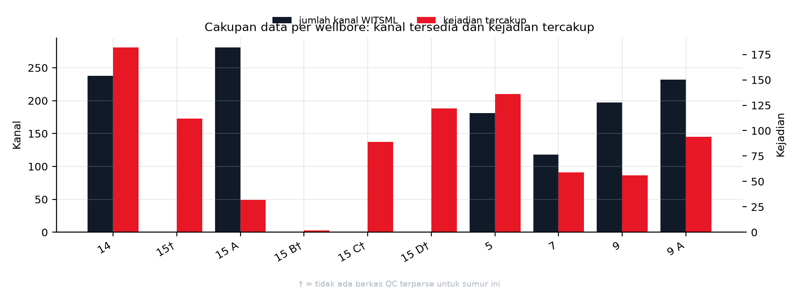

**Gambar 1.** Cakupan data per wellbore: batang gelap (sumbu kiri) menunjukkan jumlah kanal WITSML tersedia dan batang merah (sumbu kanan) menunjukkan jumlah kejadian tercakup. Enam dari sepuluh wellbore memiliki berkas QC dengan jumlah kanal 118 sampai 281. Empat wellbore lain (F-15, F-15 B, F-15 C, F-15 D) tidak memiliki berkas QC terparse sehingga batangnya nol dan ditandai †. Jumlah kejadian per wellbore menyebar dari 2 (F-15 B) sampai 182 (F-14). Skrip sumber: `docs/assets/make_figures.py`, fungsi `fig03_cakupan`.

### 1.1.4 Rich Picture: Narasi dan Spesifikasi Elemen untuk Kartu G1

#### Narasi

Rich picture menggambarkan satu siklus pengeboran sebagai perpindahan data dari lubang bawah ke keputusan, lalu kembali menjadi tindakan di rig. Di sisi kiri gambar, rangkaian bor dan sensor lubang bawah menghasilkan besaran fisis: torsi, tekanan standpipe, laju alir, berat pada bit, putaran, dan getaran. Besaran itu naik ke permukaan sebagai telemetri, direkam oleh historian, diseragamkan ke grid 60 detik, lalu dipotong menjadi jendela 10 menit yang hanya melihat ke belakang [S:V10_D1 §3.3.1-§3.3.2]. Di tengah gambar, tujuh engine deteksi menilai jendela tersebut dan mengeluarkan tiga tingkat keluaran: status kondisi, peringatan berpengawasan, dan tren [L:B04]. Di sisi kanan, driller dan drilling engineer menerima keluaran itu bersama penjelasan kanal mana yang menyimpang, lalu memutuskan melanjutkan, mengubah parameter, atau menarik rangkaian. Keputusan itu mengubah kondisi lubang, yang kembali terekam sebagai data, sehingga siklus tertutup.

Gangguan masuk ke gambar di lima tempat. Pertama, kanal instrumen yang jarang terisi membuat label sulit dibentuk, terlihat dari `CRPM_RT` yang kosong pada 62,34 persen baris dataset stick-slip [L:B34]. Kedua, kepadatan waktu tidak merata, karena F-14 hanya 13,1 persen bin menit berstatus mengebor [S:docs/V10_D1_BAB_DATA.md §3.2.1]. Ketiga, label kejadian bersifat ambigu, karena 56,1 persen dari 884 kejadian justru tidak memuat bukti kegagalan [H:persen.routine_no_failure_evidence] dan 64,6 persen relevansi BHA-nya uncertain [H:persen.bha_relevant_uncertain]. Keempat, ambang global tidak dapat dipakai karena alarm palsu menyebar 119 kali antar sumur [L:B33]. Kelima, keputusan manusia tidak terdokumentasi sebagai data, sehingga rantai sebab akibat antara peringatan dan tindakan harus disimpulkan dari label kejadian.

Empat loop umpan balik digambar sebagai panah melingkar. Loop operasi menjelaskan mengapa masalah ini berulang: disfungsi terdeteksi setelah dampak terjadi, lalu tindakan perbaikan memakan waktu rig, dan hasilnya hanya tercatat sebagai kejadian baru tanpa mengubah cara pemantauan. Loop kalibrasi menjelaskan bahwa model harus disesuaikan per sumur karena karakter kanal berbeda. Loop pelabelan menjelaskan bahwa laporan harian menjadi sumber kebenaran acuan, sehingga mutu laporan menentukan mutu model. Loop keputusan menjelaskan bahwa keluaran model baru bernilai bila berakhir pada tindakan yang terverifikasi.

#### Daftar elemen: simpul (14 simpul, syarat minimal 10)

| ID | Nama elemen | Jenis | Isi yang harus tergambar | Bukti atau angka yang menempel |
|---|---|---|---|---|
| N1 | Formasi dan lubang bor | Lingkungan fisik | Potongan lubang, kedalaman, litologi sekitar | Litologi mudlog: 2.882 interval [L:B18], dengan claystone 957 dan sandstone 884 sebagai litologi terbanyak [S:V10_D1 §3.2.8] |
| N2 | Rangkaian bor dan sensor lubang bawah (MWD/LWD/RSS) | Peralatan | BHA, bit, sensor, arah aliran data ke atas | 161 run bhaRun dan 1.392 komponen tubular [L:B15] [L:B14] |
| N3 | Kanal telemetri lubang bawah | Aliran data | Empat kanal instrumen dan tanda kanal kosong | `VIBLAT_RT`, `SHKRSK_RT`, `STUCK_RT`, `CRPM_RT` [S:docs/V10_D1_BAB_DATA.md §3.2.1]; `CRPM` kosong 62,34 persen [L:B34] |
| N4 | Sensor dan kanal permukaan | Peralatan dan aliran data | Torsi, standpipe, laju alir, hookload, WOB, RPM, ROP | 11 kanal permukaan menjadi dasar 55 fitur [L:B48] |
| N5 | Historian dan penyimpanan data | Penyimpanan | Berkas WITSML terparse dan folder dataset | 10 CSV, 9.935.708 baris mentah [L:B13]; 13 himpunan data [H:inventaris.baris_tabel] |
| N6 | Penyeragaman grid dan jendela fitur | Proses | Dua kotak proses: grid 60 detik lalu jendela 10 menit | Konversi grid 60 detik dan jendela `[t0-10, t0)` [S:docs/V10_D1_BAB_DATA.md §3.3.1-§3.3.2] |
| N7 | Lapisan deteksi tujuh engine (sisipan proyek) | Proses baru | Tujuh kotak kecil atau satu kotak berlabel 7 engine, dengan tiga tingkat keluaran | 7 engine [L:B01], 27 head [L:B03], 292.954 baris latih [L:B23] |
| N8 | Dashboard peringatan dan penjelasan | Antarmuka | Peringatan, tingkat keyakinan, kanal penyebab | Tier alat 0 alarm otomatis, 3 peringatan, 2 bersyarat, 2 tren [L:B04] |
| N9 | Driller di rig | Aktor manusia | Orang yang mengambil keputusan langsung | Pemilik masalah; ambang alarm belum layak otomatis [L:B42] |
| N10 | Drilling engineer dan supervisor | Aktor manusia | Pemeriksa penjelasan dan penyusun program | Kebutuhan explainability; ketegangan S2 melawan S4 di 1.1.2, lalu menjadi kriteria pemilihan di Bab III |
| N11 | Operator pemilik sumur | Aktor eksternal | Penerima laporan kinerja sumur | Rilis pers Eni dan Halliburton 9 Juli 2026 [L:A06] |
| N12 | Waktu rig dan waktu non-produktif | Dampak | Dua kolom waktu berdampingan: produktif dan terbuang | 884 kejadian, total 73.500 menit atau 1.225 jam [L:D01]; median 45 menit [L:D02] |
| N13 | Laporan harian pengeboran (DDR) | Sumber label | Tumpukan laporan yang menjadi asal label kejadian | 884 kejadian terkurasi [L:B05]; hanya 50 yang terverifikasi relevan BHA [L:B07] |
| N14 | Tim PPT I dan mentor | Aktor proyek | Kotak pemilik kajian di luar sistem operasi | Tim tiga mahasiswa dan mentor dosen (1.1.2 S7 dan S8) |

#### Daftar elemen: relasi (13 relasi berarah, syarat minimal 8)

| ID | Dari | Ke | Label panah | Jenis aliran |
|---|---|---|---|---|
| R1 | N1 | N2 | kondisi formasi menekan rangkaian | fisik |
| R2 | N2 | N3 | getaran, torsi, tekanan naik sebagai telemetri | data |
| R3 | N2 | N4 | parameter mekanis terukur di permukaan | data |
| R4 | N3 | N5 | kanal instrumen direkam | data |
| R5 | N4 | N5 | kanal permukaan direkam | data |
| R6 | N5 | N6 | penyeragaman grid 60 detik dan pemotongan jendela | proses [S:V10_D1 §3.3.1] |
| R7 | N6 | N7 | matriks 55 fitur masuk ke tujuh engine | data [L:B48] |
| R8 | N7 | N8 | tiga tingkat keluaran beserta penjelasan | informasi |
| R9 | N8 | N9 | peringatan dan saran tindakan | keputusan |
| R10 | N9 | N2 | ubah parameter atau tarik rangkaian | tindakan |
| R11 | N9 | N12 | keputusan terlambat menambah waktu terbuang | dampak |
| R12 | N9 | N13 | tindakan dan hasilnya dicatat di laporan harian | dokumentasi |
| R13 | N13 | N5 | laporan menjadi label acuan bagi dataset | umpan balik data |

#### Loop umpan balik (4 loop)

| ID | Nama loop | Jalur | Mengapa penting untuk gambar |
|---|---|---|---|
| L1 | Loop operasi reaktif | N9 lalu N12 lalu N13 lalu N5 lalu N7 | Menjelaskan akar masalah berulang: deteksi terjadi setelah dampak timbul, dan hasilnya hanya menjadi catatan kejadian baru |
| L2 | Loop kalibrasi per sumur | N7 lalu N8 lalu N10 lalu N7 | Menjelaskan mengapa ambang global dilarang: alarm palsu menyebar 119 kali antar sumur pada engine getaran [L:B33] |
| L3 | Loop mutu label | N13 lalu N5 lalu N6 lalu N7 | Menjelaskan mengapa mutu laporan harian menentukan mutu model, karena 56,1 persen kejadian tidak memuat bukti kegagalan [H:persen.routine_no_failure_evidence] |
| L4 | Loop keputusan dan verifikasi | N8 lalu N9 lalu N12 lalu N8 | Menutup siklus nilai: keluaran model baru bernilai bila berakhir pada tindakan yang hasilnya terukur |

#### Penanda gangguan (5 titik)

| ID | Titik gangguan | Letak di gambar | Angka pendukung |
|---|---|---|---|
| G1 | Kanal instrumen jarang terisi | Antara N2 dan N3, tanda putus | `CRPM_RT` kosong 62,34 persen baris [L:B34]; `SHKRSK_RT` F-7 0,67 persen terisi [S:docs/V10_D1_BAB_DATA.md §3.2.1] |
| G2 | Kepadatan waktu tidak merata | Di dalam N5 atau N6, tanda kepadatan berbeda per sumur | F-14 hanya 12.635 dari 96.698 bin menit berstatus mengebor (13,1 persen) [S:docs/V10_D1_BAB_DATA.md §3.2.1] |
| G3 | Label kejadian ambigu | Antara N13 dan N5, tanda tanya | 496 dari 884 kejadian tanpa bukti kegagalan (56,1 persen) [H:persen.routine_no_failure_evidence]; 571 uncertain [L:B07] |
| G4 | Ambang tidak portabel | Di dalam N7 atau N8, tanda larangan ambang global | Sebaran alarm palsu 119 kali antar sumur [L:B33] |
| G5 | Keputusan manusia tidak terekam | Antara N9 dan N13, kotak abu-abu | Tidak ada kolom keputusan pada 20 kolom label kejadian [H:labels.kolom] |

#### Ketentuan gambar untuk kartu G1

1. Tata letak: lubang bawah di kiri, permukaan dan historian di tengah, keputusan dan dampak di kanan, waktu sebagai sumbu mendatar dari kiri ke kanan.
2. N7 wajib dibedakan secara visual (warna berbeda) karena itu satu-satunya komponen yang ditambahkan proyek, sedangkan N1 sampai N6 dan N9 sampai N13 adalah sistem eksisting.
3. Setiap nomor simpul, relasi, loop, dan gangguan wajib ditulis di gambar dengan ID yang sama seperti tabel di atas, agar naskah dan gambar dapat dicocokkan satu per satu.
4. Angka yang dicetak di gambar dibatasi pada lima angka berikut agar tidak sesak: 884 kejadian [L:B05], 1.225 jam [L:D01], 7 engine [L:B01], 0 dari 7 alarm otomatis [L:B42], dan 62,34 persen kanal kosong [L:B34].
5. Legenda wajib memuat empat jenis garis: aliran data, aliran keputusan, aliran dampak, dan loop umpan balik.

### 1.1.5 Trade-off Variabel Sistem

Model SIMILAR tahap satu mensyaratkan perumusan trade-off minimal dua aspek. Trade-off di bawah disusun dari kategori 6M agar tidak menjadi retorika, dan setiap kutub ditempeli angka hasil pengukuran proyek, bukan perkiraan.

**T1 Man melawan Method: kewenangan manusia berbanding otomatisasi ambang.**
Kutub Man memberi driller hak memutuskan dengan dukungan peringatan, sedangkan kutub Method menyerahkan keputusan pada ambang otomatis. Data proyek menolak kutub Method untuk saat ini: **tidak ada satu pun dari 7 engine yang memenuhi syarat alarm otomatis** [L:B42], dan rekap alat menunjukkan 0 alarm, 3 peringatan berpengawasan, 2 bersyarat, serta 2 hanya untuk tren [L:B04]. Pada engine hidraulik yang paling kuat, alarm palsu masih 14,62 sampai 58,43 per 24 jam [L:B37], sedangkan sapuan ambang seluruh engine hanya menemukan 10 dari 402 titik uji yang memenuhi syarat alarm dengan recall positif [L:B44]. Implikasi desain: keluaran 1.1 dan Bab III harus berupa **advisory dengan manusia di dalam loop**, dan klaim alarm otomatis ditulis sebagai sasaran yang belum tercapai, bukan sebagai kemampuan.

**T2 Machine melawan Measurement: resolusi instrumen berbanding kelengkapan pengukuran.**
Kutub Machine menuntut resolusi setinggi mungkin, sedangkan kutub Measurement dibatasi oleh kanal yang benar-benar terisi. Pipeline yang berjalan memakai grid 60 detik [S:docs/V10_D1_BAB_DATA.md §3.3.1], sementara draft lama menulis asumsi stream 1 Hz yang tidak pernah dibuktikan [L:A14]. Pada sisi kelengkapan, tiap sumur membawa 60 sampai 281 kanal tetapi hanya 37 sampai 48 kanal terisi minimal 50 persen [S:docs/V10_D1_BAB_DATA.md §3.2.1], dan kanal `CRPM_RT` yang menjadi dasar label stick-slip kosong pada 62,34 persen baris [L:B34]. Implikasi desain: menaikkan resolusi tanpa menutup kanal kosong hanya menambah baris kosong, sehingga prioritas Bab III adalah **pemilihan kanal dan kalibrasi per sumur**, bukan penambahan frekuensi.

**T3 Method melawan Measurement: sensitivitas ambang berbanding beban alarm palsu.**
Menaikkan sensitivitas menaikkan recall tetapi juga menaikkan alarm palsu, dan keduanya terukur pada engine yang sama. Pada engine getaran, presisi rule mencapai 0,868 sampai 0,952 [L:B32] tetapi recall hanya 0,276 sampai 0,595 dengan alarm palsu 9,99 sampai 49,94 per 24 jam [L:A17; MD baris 2972]. Pada engine stick-slip, recall rule bahkan 0,000 sampai 0,032 [L:A17; MD baris 2973]. Sebaliknya, engine pipa terjepit memperoleh presisi 0,9238 sampai 0,9662 dan recall 0,449 sampai 0,599 tetapi alarm palsunya 8,32 sampai 61,0 dan cakupannya hanya 2 lipatan [L:B35] [H:kutipan_md.l2975_stuck_k1]. Implikasi desain: tidak ada satu titik operasi yang berlaku untuk semua engine, sehingga Bab III wajib memilih titik operasi **per engine** dan menyertakan uji sensitivitas, bukan satu ambang global.

Ketiga trade-off di atas juga menegaskan batas yang jujur: target desain recall 0,70 sampai 0,80 dan lead time 10 sampai 30 menit masih berstatus **ASUMSI berupa target** [L:A17] [L:A08], karena hasil terukur baru mencapai lead 4,5 sampai 8,5 menit pada satu kelas [L:B36] dan nol alarm otomatis [L:B42].

### 1.1.6 Uraian Singkat Permasalahan

Permasalahan utama bukan kerusakan alat tunggal, melainkan **tidak adanya lapisan penalaran yang mengubah data pengeboran menjadi peringatan sebelum dampak terjadi**. Akibatnya, setiap disfungsi baru dikenali setelah ia menjadi waktu terbuang, dan pengetahuan tentangnya hanya tersimpan sebagai catatan kejadian, tidak sebagai aturan pemantauan.

Ukuran dampak yang dapat dipertanggungjawabkan disajikan pada tabel berikut. Semua baris berasal dari hitung ulang kartu ini atau dari ledger angka kartu P0, dan tidak ada baris yang berdiri sebagai perkiraan.

| Dimensi dampak | Angka | Cara membaca yang benar | Rujukan |
|---|---|---|---|
| Populasi kejadian operasi | 884 kejadian pada 10 wellbore | Ini populasi kejadian operasional, bukan 884 kerusakan | [L:B05] [L:D03] |
| Waktu terbuang tercatat | 73.500 menit atau 1.225 jam | Total durasi seluruh kejadian, dihitung dari selisih `act_start` dan `act_end` | [L:D01] |
| Sebaran durasi per kejadian | median 45 menit, p90 180 menit, maksimum 780 menit | Setengah kejadian berlangsung sampai 45 menit, dan sepuluh persen terpanjang bernilai 3 jam atau lebih | [L:D02] |
| Komposisi kategori terbesar | `routine_no_failure_evidence` 496 kejadian (56,1 persen) dan 601,1 jam | Kategori terbesar justru bukan kegagalan, sehingga tidak boleh dipakai sebagai bukti kerusakan | [L:B06] [H:durasi.jam_per_kategori.routine_no_failure_evidence] [H:persen.routine_no_failure_evidence] |
| Kategori kegagalan peralatan permukaan | `surface_rig_equipment` 216 kejadian dan 343,5 jam (28,0 persen jam) | Penyumbang jam terbesar di antara kategori yang memuat bukti kegagalan | [L:B06] [H:durasi.jam_per_kategori.surface_rig_equipment] [H:persen.jam_surface_rig] |
| Kategori kegagalan lubang bawah | `bha_stuck_fishing` 38 kejadian dan 47,3 jam, serta `bha_downhole_equipment` 12 kejadian dan 14,0 jam | Kedua kategori ini yang paling relevan bagi objek Sperry Drilling | [L:B06] [H:durasi.jam_per_kategori.bha_stuck_fishing] [H:durasi.jam_per_kategori.bha_downhole_equipment] |
| Relevansi BHA | 50 kejadian `yes` (5,7 persen), 263 `no`, 571 `uncertain` (64,6 persen) | Hanya sebagian kecil kejadian terbukti menyangkut rangkaian lubang bawah | [L:B07] [H:persen.bha_relevant_yes] [H:persen.bha_relevant_uncertain] |
| Konsentrasi sumur | F-14 menyumbang 182 kejadian (20,6 persen) | Beban kejadian tidak merata, sehingga validasi antar sumur wajib | [L:D03] [H:persen.wellbore_F14] |
| Mutu capaian deteksi saat ini | 0 dari 7 engine layak alarm otomatis | Kapasitas alat saat ini adalah peringatan berpengawasan, bukan alarm | [L:B42] [L:B04] |
| Lead time terukur | 4,5 sampai 8,5 menit dengan median 7,0 menit pada kelas pipa terjepit | Ini satu-satunya lead time bersatuan menit yang terukur di domain rig | [L:B36] |
| Sasaran yang belum tercapai | recall 0,70 sampai 0,80 dan lead 10 sampai 30 menit | Keduanya berstatus target desain, bukan hasil | [L:A17] [L:A08] |
| Rujukan pihak ketiga | efisiensi lebih dari 15 persen pada operasi closed-loop Eni | Milik vendor dan milik operasi pihak lain, tidak boleh menjadi janji luaran proyek | [L:A07] [L:A06] |

Dengan bahan tersebut, permasalahan dirumuskan dalam tiga pertanyaan yang menjadi batas kajian. Ketiganya diberi kode RM1, RM2, dan RM3 supaya dapat dirujuk ulang di Bab III dan Bab IV. Ketiga kode itu adalah pertanyaan riset. Hal-hal yang mengikat ruang lingkup jawaban, misalnya jumlah sumur, kualitas label, dan ketersediaan kanal, bukan pertanyaan riset dan diletakkan terpisah pada paragraf batasan di bawah serta pada subbab 1.4:

**RM1.** Bagaimana merancang lapisan peringatan dini yang memakai data pengeboran yang benar-benar tersedia pada grid 60 detik dan kanal yang terisi 37 sampai 48 per sumur, tanpa mengklaim resolusi yang tidak dimiliki [S:docs/V10_D1_BAB_DATA.md §3.2.1]?
**RM2.** Bagaimana memilih titik operasi per engine sehingga peringatan cukup awal untuk ditindaklanjuti, sedangkan beban alarm palsu tetap dapat diterima pengawas, mengingat sebaran alarm palsu mencapai 119 kali antar sumur [L:B33]?
**RM3.** Bagaimana menyajikan keluaran yang dapat dijelaskan kepada drilling engineer, sehingga rekomendasi dipakai dan bukan diabaikan, ketika kapasitas alat baru sampai pada peringatan berpengawasan pada 3 dari 7 engine [L:B04]?

Batasan realistis yang mengikat jawaban tersebut ada empat. Pertama, batas teknik: data hanya 10 wellbore dengan rentang 2007 sampai 2015 dan tanpa rating motor pada 192 dari 192 berkas tubular [S:docs/V10_D1_BAB_DATA.md §3.2.4]. Kedua, batas kualitas data: 571 kejadian berstatus uncertain dan hanya 582 kejadian yang rentang waktunya bertaut ke CSV terparse [S:docs/V10_D1_BAB_DATA.md §3.2.3]. Ketiga, batas metode: seluruh evaluasi memakai leave-one-well-out dengan 37 lipatan [L:B25], sehingga klaim berlaku untuk sumur baru dalam lapangan yang sama, bukan untuk lapangan lain. Keempat, batas pemanfaatan: keluaran bersifat advisory karena syarat alarm otomatis belum terpenuhi pada engine mana pun [L:B42].

### 1.1.7 Batas Kejujuran Data dan Status TEMPORER

Empat pernyataan berikut wajib menyertai Bab I agar pembaca tidak menarik kesimpulan berlebih dari angka dampak.

1. **884 kejadian tidak sama dengan 884 kerusakan.** Kategori terbesar, yaitu 496 kejadian atau 56,1 persen, tidak memuat bukti kegagalan [H:persen.routine_no_failure_evidence], dan hanya 50 kejadian atau 5,7 persen yang terverifikasi relevan BHA [H:persen.bha_relevant_yes]. Kalimat yang sah adalah "basis label memuat 884 kejadian operasi dengan total durasi 1.225 jam, 50 di antaranya terverifikasi relevan BHA" [L:D01] [L:B07].
2. **Data proyek adalah data lapangan pihak ketiga, bukan telemetri mitra.** Sumbernya Volve dengan lisensi CC BY-NC-SA 4.0 [S:V3_DATA_ACQUISITION_INVENTORY.md baris lisensi], sehingga klaim penerapan langsung pada stream Sperry dinyatakan sebagai rencana integrasi.
3. **Resolusi yang dipakai adalah 60 detik.** Asumsi 1 Hz pada draft lama tetap ditandai ASUMSI dan tidak boleh muncul kembali sebagai fakta [L:A14].
4. **Pemetaan dampak per mode FMEA berstatus TEMPORER.** Kartu D1 `t_c0e851b8` berstatus blocked dan belum menghasilkan keluaran yang dijanjikan (`docs/PPT1_BUKTI_DAMPAK.md`, `scratch/ppt1/dampak.json`, `code/ppt1_d1_hitung.py`). Karena itu 1.1 hanya memakai dampak **per kategori label** yang sudah terukur, dan tidak memuat occurrence per mode (getaran, stick-slip, telemetri) maupun kejadian per seribu jam operasi. Angka-angka itu akan dipasang oleh kartu D1 dan kartu B2.

Yang belum diverifikasi pada kartu ini dan perlu diperiksa kartu lanjutan: (a) isi 1.392 komponen tubular belum dihitung ulang, hanya jumlah berkasnya [L:B14]; (b) 239 kolom dan 13 kolom pit pada `time.csv` F-9A dilaporkan, belum direproduksi [L:B10] [L:B11]; (c) angka 10.650 `CD_ASSEMBLY_COMP` dan 632 `CD_BHA_COMP_BIT` pada EDM belum dihitung ulang [L:B22]; (d) angka lapisan B dan 402 titik uji masih dilaporkan, bukan dihitung ulang oleh kartu ini [L:B44].

Catatan alat ukur: `scratch/ppt1/verify_numbers.py` melaporkan 0 durasi valid dari 884 baris [L:B05] karena parser di skrip itu hanya menerima tiga format waktu tanpa offset, sedangkan `act_start` memakai offset seperti `+01:00`. Angka durasi karena itu dihitung ulang di kartu ini dengan parser berbeda (regex lalu konversi ke detik epoch) pada `scratch/ppt1/bab1_1_hitung.py`, dan hasilnya sepakat dengan `verify_durations.py`: 884 durasi valid [L:D04], total 73.500 menit [L:D01], median 45 menit, p90 180 menit dengan dua cara kuantil, serta maksimum 780 menit [L:D02]. Selisih nol antara dua instrumen inilah yang membuat angka 1.225 jam dipakai di naskah.

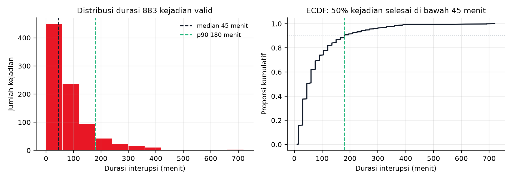

**Gambar 2.** Sebaran durasi interupsi. Panel kiri: histogram 883 kejadian valid pada filter 0 sampai 720 menit dengan garis putus-putus median 45 menit dan garis putus-putus persentil 90 sebesar 180 menit. Panel kanan: fungsi distribusi kumulatif yang menunjukkan setengah kejadian selesai di bawah 45 menit. Filter ini menyisakan 72.720 menit atau 1.212 jam, sedangkan basis penuh 884 kejadian berjumlah 73.500 menit atau 1.225 jam. Satu baris durasi 780 menit berada di luar filter. Nilai persentil 90 sama pada dua cara kuantil (interpolasi dan nearest-rank). Skrip sumber: `docs/assets/make_figures.py`, fungsi `fig01_durasi`.

### 1.1.8 Jejak Angka dan Cara Verifikasi

Setiap angka pada 1.1 membawa salah satu dari tiga tanda. **L** berarti baris pada `docs/PPT1_LEDGER_ANGKA.md` milik kartu P0. **H** berarti kunci pada `scratch/ppt1/bab1_1_angka.json` yang dihasilkan kartu ini. **S** berarti fakta kualitatif atau provenance berkas tanpa klaim aritmetika baru.

| Angka | Konteks | Tanda | Status | Cara verifikasi ulang |
|---|---|---|---|---|
| 884 kejadian | Populasi label | [L:B05] | TERUKUR | `python3 scratch/ppt1/bab1_1_hitung.py` lalu lihat `labels.baris` |
| 9 kategori, 496/216/47/38/28/25/21/12/1 | Komposisi kejadian | [L:B06] | TERUKUR | idem, lihat `labels.kategori` |
| 50/263/571 relevansi BHA | Mutu label | [L:B07] | TERUKUR | idem, lihat `labels.bha_relevant` |
| 73.500 menit dan 1.225 jam | Total waktu terbuang | [L:D01] | TERUKUR | idem, lihat `durasi.total_menit`; bandingkan `scratch/ppt1/verify_durations.py` |
| Median 45, p90 180, maksimum 780 menit | Sebaran durasi | [L:D02] | TERUKUR | idem, lihat `durasi.median_menit`, `p90_menit_cara1`, `p90_menit_interpolasi`, `max_menit` |
| 10 wellbore dan F-14 sebanyak 182 | Sebaran sumur | [L:D03] | TERUKUR | idem, lihat `durasi.wellbore_n` dan `kejadian_per_wellbore` |
| 0 durasi gagal parse | Kualitas stempel waktu | [L:D04] | TERUKUR | idem, lihat `durasi.dibuang_timestamp_gagal` |
| 601,1 / 343,5 / 101,5 / 50,5 / 47,3 / 40,2 / 25,8 / 14,0 / 1,2 jam | Jam per kategori | [H:durasi.jam_per_kategori] | TERUKUR | idem, lihat `durasi.jam_per_kategori` |
| 56,1 persen, 5,7 persen, 64,6 persen, 20,6 persen, 28,0 persen | Persentase turunan | [H:persen] | TERUKUR | idem, lihat blok `persen` (pembilang dan penyebut tercetak di skrip) |
| 13 himpunan data | Inventaris | [H:inventaris.baris_tabel] | TERUKUR | idem, hitung baris tabel §3.1 `docs/V10_D1_BAB_DATA.md` |
| 7.080.457 baris dan 8 CSV | WITSML terparse | [L:B12] | TERUKUR | idem, lihat `witsml_parsed` |
| 9.935.708 baris dan 10 CSV | WITSML folder v2 | [L:B13] | TERUKUR | idem, lihat `witsml_parsed.baris_mentah_total` |
| 292.954 baris pada 6 dataset | Matriks latih | [L:B23] | TERUKUR | idem, lihat `dataset_latih` |
| 37 lipatan dan 0 pelanggaran | Validasi silang | [L:B25] [L:B26] | TERUKUR | idem, lihat `dataset_latih.fold_total` dan `pelanggaran_bocor_total` |
| 27 head dan 7 engine | Registry metode | [L:B03] [L:B01] | TERUKUR | idem, lihat `registry` |
| 55 fitur | Ruang fitur | [L:B48] | TERUKUR | `11 x 5` pada `scratch/ppt1/bab1_1_hitung.py`; rujukan `docs/ML_PROJECT_PROPOSAL_TECHNICAL_DESIGN.md` baris 1641 |
| 0 dari 7 alarm otomatis | Kapasitas alat | [L:B42] | TERUKUR | `python3 scratch/ppt1/verify_numbers.py` lalu lihat `registry.layer`; rujukan MD baris 3378 |
| Tier 0/3/2/2 | Rekap engine | [L:B04] | TERUKUR | MD baris 3379-3381; aritmetika 0+3+2+2=7 |
| Recall 0,276 sampai 0,595 dan 0,000 sampai 0,032 | Sensitivitas rule | [L:A17] [H:kutipan_md.l2972_vib] [H:kutipan_md.l2973_ssi] | TERUKUR | kutipan verbatim MD pada JSON kartu ini |
| Alarm palsu 9,99 sampai 49,94 dan 14,62 sampai 58,43 serta 8,32 sampai 61,0 | Beban alarm | [L:B33] [L:B37] [L:B35] | TERUKUR | MD baris 2972, 2975, 2977; kunci `kutipan_md` pada JSON kartu ini |
| Sebaran alarm palsu 119 kali | Ketidakportabelan ambang | [L:B33] | TERUKUR | MD baris 2972 kolom angka kunci |
| Lead 4,5 sampai 8,5 menit | lead time terukur | [L:B36] [H:kutipan_md.l2976_stuck_k2] | TERUKUR | MD baris 2976 |
| 10 dari 402 titik uji | Sapuan ambang | [L:B44] | DILAPORKAN | Belum dihitung ulang; angka ini dipakai hanya sebagai pendukung, bukan dasar keputusan |
| Target recall 0,70 sampai 0,80 dan lead 10 sampai 30 menit | Sasaran desain | [L:A17] [L:A08] | ASUMSI | Ditulis sebagai target di kalimat yang sama |
| Asumsi 1 Hz | Laju stream draft lama | [L:A14] | ASUMSI | Dibantah pipeline 60 detik; `docs/V9_D1_DATA_PIPELINE.md` |
| Efisiensi lebih dari 15 persen | Klaim vendor | [L:A07] | TERUKUR (eksternal) | Rilis pers Halliburton 9 Juli 2026 [L:A06] |
| 62,34 persen kanal CRPM kosong | Keterbatasan sensor | [L:B34] | TERUKUR | MD baris 2973; 22.385/35.906 |
| 96.698 bin menit dan 12.635 bin mengebor | Kepadatan waktu F-14 | [S:V10_D1 §3.2.1] | Dilaporkan dokumen | `docs/V10_D1_BAB_DATA.md` §3.2.1, `v9_d1_01_summary.json` |
| 60 sampai 281 kanal dan 37 sampai 48 terisi | Kelengkapan kanal | [S:V10_D1 §3.2.1] | Dilaporkan dokumen | `docs/V10_D1_BAB_DATA.md` §3.2.1 |
| 582 dari 884 rentang waktu bertaut | Keterbatasan penautan | [S:V10_D1 §3.2.3] | Dilaporkan dokumen | `docs/V10_D1_BAB_DATA.md` §3.2.3 |

Perintah tunggal untuk mereproduksi seluruh angka bertanda L-D, H, dan S di atas pada sisi hitung:

```bash
cd "/mnt/d/Capstone 1(v2)"
python3 scratch/ppt1/bab1_1_hitung.py      # menghasilkan scratch/ppt1/bab1_1_angka.json
python3 scratch/ppt1/verify_durations.py   # pembanding independen untuk blok durasi
python3 scratch/ppt1/verify_numbers.py     # pembanding untuk dataset, fold, dan registry
```

---

# BAB I 1.2: IDENTIFIKASI MASALAH: FISHBONE 6M DAN 5W1H

**Proyek:** Perancangan Terpadu, deteksi dini kegagalan Bottom Hole Assembly berbasis pembelajaran mesin
**Mitra:** PT Halliburton Indonesia, divisi Sperry Drilling (jalur Magang/MBKM, pedoman butir 2.8c)
**Kartu kerja:** t_39eac1b2 · **Basis:** pedoman resmi halaman 33 sampai 36, butir BAB I 1.2
**Berkas bukti mesin:** `scratch/ppt1/fishbone.json` (27 sebab, 6 kategori, seluruhnya berjejak)

---

## 0. Riset pendahuluan yang dipakai

- **Riset pendahuluan: riset-dulu-baru-perbaiki**: urutan wajib masalah, riset, tulis opsi dan bukti, baru perbaiki; gate tidak boleh berubah setelah hasil terlihat.
- **Riset pendahuluan: scientific-critical-thinking**: pisahkan data dari interpretasi, korelasi dari kausalitas, dan nyatakan kekuatan klaim sebanding dengan kekuatan bukti; kegagalan satu hipotesis bukan bukti hipotesis lain benar.
- **Riset pendahuluan: hypothesis-generation**: objek harus tetap terpisah: observasi, hipotesis, mekanisme, prediksi, penjelasan rival; hipotesis adalah usulan yang harus ditantang, bukan temuan. Setiap hipotesis di dokumen ini diberi prediksi pembeda agar dapat difalsifikasi.

---

## 1. Batas masalah dan definisi status

Fishbone ini menjawab satu pertanyaan: **mengapa peringatan dini kegagalan BHA berbasis data operasi Sperry Drilling belum dapat dioperasikan sebagai alarm, padahal data historisnya tersedia.** Fishbone memetakan sebab. Penilaian risiko terkuantifikasi (FMEA dengan skala rujukan) berada pada kartu terpisah, sehingga skor S, O, dan D dari draft 13 Agustus 2026 tidak diulang di sini.

Setiap sebab diberi satu status, dengan arti yang dipakai konsisten di seluruh dokumen:

| Status | Arti | Konsekuensi pemakaian |
|---|---|---|
| **TERBUKTI** | Angka dihitung ulang pada sesi ini langsung dari berkas primer (CSV atau JSON hasil eksekusi) | Boleh dipakai sebagai landasan kalimat proposal |
| **TERBUKTI-DOKUMEN** | Angka tercatat pada dokumen audit tim dengan metode yang dinyatakan, namun tidak direplikasi pada sesi ini | Boleh dipakai, wajib menyebut sumber dan menyatakan belum direplikasi |
| **HIPOTESIS** | Mekanisme masuk akal dan konsisten dengan bukti lain, tetapi belum diukur | Dilarang ditulis sebagai temuan; wajib disertai uji pembeda |

Tautan sebab ke akibat juga diberi status terpisah. Sebuah besaran boleh TERBUKTI sementara **tautan kausalnya** masih HIPOTESIS. Pemisahan ini disengaja, karena korelasi bukan kausalitas.

---

## 2. Angka dasar yang menjadi landasan seluruh fishbone

Seluruh angka pada tabel ini dihitung ulang pada sesi ini dari berkas primer.

| Besaran | Nilai | Jejak yang dapat dijalankan ulang |
|---|---|---|
| Kejadian terkurasi | **884** baris | `data/volve/labels_curated_v2.csv`, jumlah baris data |
| Total durasi kejadian | **73.500 menit = 1.225 jam** | kolom `act_start` dan `act_end`, selisih per baris, dijumlahkan |
| Median durasi | **45 menit** | distribusi durasi 884 baris |
| Persentil 90 durasi | **180 menit** | idem |
| Durasi maksimum | **780 menit** | idem |
| Sumur tercakup | **10 wellbore** | kolom `wellbore` |
| Kejadian tanpa bukti kegagalan | **496 dari 884 = 56,1 persen** | kolom `category` nilai `routine_no_failure_evidence` |
| Kejadian relevan BHA | **50 dari 884 = 5,7 persen** | kolom `bha_relevant` nilai `yes` |
| Kejadian relevansi BHA belum pasti | **571 dari 884 = 64,6 persen** | kolom `bha_relevant` nilai `uncertain` |
| Engine dan head | **7 engine, 27 head** (4+4+4+6+4+2+3) | `scratch/v9_i1/v9_i1_RESULTS.json` `engines[].heads` |
| Sebaran lapis keputusan | **L0 = 5, L1 = 11, L2 = 9, L3 = 2** | `decision_layer.ringkasan` |
| Sebaran tier | **13 TREN, 12 PERINGATAN-BERPENGAWAS, 2 BELUM LAYAK PAKAI** | `engines[].heads[].tier` |
| Slot alarm otomatis kritis | **0** | `auto_critical_alarm_slots` |
| Peringatan L1 yang harus dibaca manusia | **11** | `decision_layer.nperingatan_l1` |

Catatan tafsir yang mengikat: 884 kejadian **bukan** 884 kerusakan. Karena 56,1 persen basis tidak memuat bukti kegagalan, setiap kalimat dampak pada proposal wajib menyebut basis mana yang dipakai. Angka 1.225 jam adalah total waktu tercatat pada basis 884 kejadian, bukan waktu downtime murni.

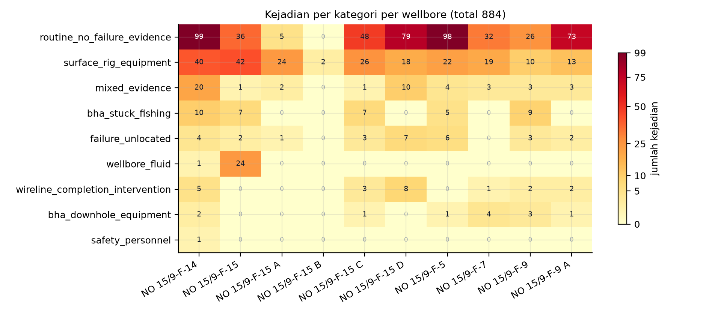

**Gambar 3.** Matriks kejadian per kategori per wellbore, sembilan kategori dikalikan sepuluh wellbore, total 884 kejadian. Skala warna memakai normalisasi pangkat 0,55 supaya sel kecil tetap terlihat, dan sel nol ditulis `0` dengan warna terang supaya tidak disamakan dengan data hilang. Dua baris teratas, yaitu `routine_no_failure_evidence` (496 kejadian) dan `surface_rig_equipment` (216 kejadian), mengisi 80,5 persen dari seluruh matriks. Konsentrasi kejadian per wellbore menyebar dari 2 (F-15 B) sampai 182 (F-14). Skrip sumber: `docs/assets/make_figures.py`, fungsi `fig02_kategori`.

---

## 3. Fishbone 6M

Diagram terdiri atas satu tulang punggung (efek) dan enam cabang, dengan 27 ranting. Identitas cabang dan ranting dipakai juga pada gambar G1 (lihat Bagian 6).

**Efek pada kepala ikan:** peringatan dini kegagalan BHA belum dapat dioperasikan sebagai alarm, karena ambang tidak portabel, label belum tervalidasi, dan kanal sensor tidak lengkap.

### 3.1 MAN (manusia): 4 ranting

| ID | Cabang | Ranting (sebab spesifik) | Status | Jejak |
|---|---|---|---|---|
| M1 | Validitas label buatan manusia | Kontrol-positif stick-slip tidak lulus: **0 dari 10** kontrol-positif stuck gagal, sehingga presisi dan recall kelas stuck dihitung dari basis label yang belum tervalidasi | TERBUKTI-DOKUMEN | `docs/V8_M1_CAPABILITY_MAP.md` baris 198 (kolom G7); `docs/V8_PM_VERDICT.md` baris 202; `docs/V4_MAINTENANCE_ML_OPTIONS.md` baris 149 |
| M2 | Validitas label buatan manusia | Relevansi BHA tidak diputuskan: **571 dari 884 (64,6 persen)** berstatus `uncertain`, hanya **50 (5,7 persen)** dinyatakan `yes` | TERBUKTI | `data/volve/labels_curated_v2.csv` kolom `bha_relevant`, 884 baris |
| M3 | Validitas label buatan manusia | Label hidraulik K-ii memakai **proksi** perubahan volume pit (ΔV_pit), bukan pengukuran hidraulika lubang bor, sehingga label berisiko sirkular terhadap fitur | TERBUKTI-DOKUMEN | `docs/V8_M1_CAPABILITY_MAP.md` baris 198 (hyd K-ii label proxy); `docs/ML_PROJECT_PROPOSAL_TECHNICAL_DESIGN.md` baris 300 |
| M4 | Rantai keputusan manusia | Seluruh keluaran berhenti di manusia: **0 slot alarm otomatis**, **11 peringatan L1** harus dibaca, beban waktu baca insinyur belum pernah diukur | TERBUKTI | `scratch/v9_i1/v9_i1_RESULTS.json` kunci `auto_critical_alarm_slots`, `human_review_required`, `decision_layer.nperingatan_l1` |

**Tautan ke G7.** G7 pada peta kapabilitas didefinisikan sebagai *validitas label lintas well*, dengan tiga komponen yang semuanya muncul di atas: kontrol-positif stuck 0/10, label hidraulik sebagai proksi, dan semantik `STUCK_RT` 0 sampai 3 yang belum ada. Karena itu cabang MAN adalah akar, bukan gejala.

### 3.2 METHOD (metode): 5 ranting

| ID | Cabang | Ranting (sebab spesifik) | Status | Jejak |
|---|---|---|---|---|
| Me1 | Ambang tunggal lintas sumur | Satu nilai ambang (τ = 0,5) dipakai untuk semua sumur. Pada model dan ambang yang sama, laju alarm palsu bergerak dari **4,14897** per 24 jam di F-15_S sampai **496,09249** per 24 jam di F-14, yaitu rentang **119,57 kali** | TERBUKTI | `scratch/v9_e_ml/v9_e_ML_vib_RESULTS.json` → `folds[].models.rf.tau_metrics["0.5"].FAR_24jam` |
| Me2 | Ambang tunggal lintas sumur | Ambang yang sama juga meruntuhkan sensitivitas: recall pada τ = 0,5 adalah **0,1018** di F-15_S tetapi **0,8657** di F-14 | TERBUKTI | berkas JSON yang sama, kunci `...recall` |
| Me3 | Ketidakpastian statistik | Pada **5 dari 9** fold, selang kepercayaan 95 persen AUPRC menyentuh garis no-skill, sehingga keunggulan atas tebakan acak belum terpisah dari derau | TERBUKTI-DOKUMEN | `docs/ML_PROJECT_PROPOSAL_TECHNICAL_DESIGN.md` baris 562; contoh CI95 fold F-10 `[0,06008; 0,25484]` pada `scratch/v9_e_ml/v9_e_ML_ssi_RESULTS.json` |
| Me4 | Resolusi waktu pipeline | Pipeline memaksa grid 60 detik mode ALL-rows, sedangkan laju kanal permukaan diasumsikan sekitar 1 Hz. Bila laju nyata per sumur lebih rendah, satu bin dapat berisi kurang dari 10 sampel dan aturan SSI tidak dapat dievaluasi | HIPOTESIS | `docs/ML_PROJECT_PROPOSAL_TECHNICAL_DESIGN.md` baris 296 dan 1177; `SSI_MIN_SAMPLES = 10` baris 1567 |
| Me5 | Hirarki keluaran | 7 engine dan 27 head tersebar ke empat lapis dengan sebaran tier 13/12/2, tanpa aturan kenaikan tier yang dinyatakan sebagai ambang angka | TERBUKTI | `scratch/v9_i1/v9_i1_RESULTS.json` → `engines[].heads`, `decision_layer.ringkasan` |

**Catatan penting untuk Me1 dan Me2.** Kedua angka berasal dari satu kunci JSON yang sama, pada model dan ambang yang identik. Yang berubah hanya sumur uji. Inilah bukti langsung bahwa ambang global tidak portabel, dan sekaligus alasan mengapa target "satu ambang untuk semua sumur" harus digugurkan pada BAB III.

### 3.3 MACHINE (mesin dan perkakas): 4 ranting

| ID | Cabang | Ranting (sebab spesifik) | Status | Jejak |
|---|---|---|---|---|
| Ma1 | Arsitektur keluaran alat | Alat tidak memiliki slot alarm otomatis kritis sama sekali (**0**), dan **0 dari 7** engine memenuhi syarat alarm. Ini keputusan desain yang dinyatakan, bukan cacat implementasi | TERBUKTI | `scratch/v9_i1/v9_i1_RESULTS.json` `auto_critical_alarm_slots`; `docs/V8_PM_VERDICT.md` baris 180 dan 41 |
| Ma2 | Cakupan parser | Parser CSV lama hanya menangani 8 kolom keluaran, sehingga **3906 dari 7150 berkas log (54,6 persen)** tidak pernah diparse: F-1 C sebanyak 2156 berkas dan F-11 sebanyak 1750 berkas. Kurva HKLD, TORQUE, MSE, MOTOR_RPM, dan FLOWIN-OUT juga tidak masuk | TERBUKTI-DOKUMEN | `docs/V6_D0_READERS_SYNTHESIS.md` baris 49 |
| Ma3 | Efek agregasi pipeline | Agregasi ALL-rows ke satu nilai per menit berpotensi meredam puncak getaran dan torsi berdurasi detik, sehingga label status menjadi lebih konservatif daripada kejadian fisiknya | HIPOTESIS | `docs/ML_PROJECT_PROPOSAL_TECHNICAL_DESIGN.md` baris 1179 |
| Ma4 | Cakupan pembuktian prototipe | Prototipe dijalankan pada satu segmen nyata (F-14), yang kebetulan satu-satunya wellbore hadir di keenam dataset rig. Perilaku alat sebagai sistem utuh pada sumur lain belum diuji | TERBUKTI | `scratch/v9_i1/v9_i1_RESULTS.json` `meta.segmen_rig` dan `segmen_info.*.n` |

### 3.4 MATERIAL (bahan dan data): 4 ranting

| ID | Cabang | Ranting (sebab spesifik) | Status | Jejak |
|---|---|---|---|---|
| Mt1 | Integritas kanal permukaan | `WHIRL_RT` dan `BOUNCE_RT` identik: **67 berkas pada 5 wellbore**, dan **1790 dari 1790** nilai identik di F-9 (F-5 368/368, F-15S 5/5, F-1 15/15). Keduanya tidak boleh menjadi dua fitur atau dua gejala | TERBUKTI-DOKUMEN | `docs/V6_A1_DATA_AUDIT.md` baris 100 dan 101; `docs/V6_D0_READERS_SYNTHESIS.md` baris 174 |
| Mt2 | Kelengkapan kanal MWD | Kanal CRPM bahan rumus SSI tidak lengkap: **22.385 dari 35.906 jendela (62,34 persen)** tanpa data pada agregat sembilan fold, dan dua sumur kanal mati (F-7 982/982, F-9 1126/1126) | TERBUKTI | `scratch/v9_eval_c/v9_eval_c_RESULTS.json` → `C_rule_status.ssi.sensor_nodata_rule`; `docs/V9_A1_AUDIT.md` baris 56 |
| Mt3 | Makna basis kejadian | Kejadian tercatat bukan sama dengan kegagalan: **496** tanpa bukti kegagalan, **47** bukti campuran, **28** kegagalan tanpa lokasi, dan hanya **50** kejadian menyangkut BHA (stuck atau fishing 38, peralatan downhole 12) | TERBUKTI | `data/volve/labels_curated_v2.csv` kolom `category`, 884 baris |
| Mt4 | Ketidakseimbangan kelas | Prevalensi positif sangat rendah dan tidak seragam: ssi F-15A **31 dari 6020 = 0,51 persen**, ssi F-7 **3 dari 982 = 0,31 persen**, ssi F-9_A **55 dari 841 = 6,54 persen** | TERBUKTI | `scratch/v9_eval_a/v9_eval_a_RESULTS.json` → `rule_status.classes.ssi.folds[].prev` |

**Catatan untuk Mt1 dan Mt2.** Mt1 berasal dari audit tim atas 19 GB data primer, Mt2 dari berkas hasil evaluasi. Keduanya tidak saya ulang karena keduanya menuntut pemindaian data mentah berskala besar. Statusnya karena itu dinyatakan terbuka.

### 3.5 MEASUREMENT (pengukuran): 5 ranting

| ID | Cabang | Ranting (sebab spesifik) | Status | Jejak |
|---|---|---|---|---|
| Ms1 | Basis waktu | Waktu pada dataset turunan adalah **indeks menit internal** (`ts_bin`), dan asal kalender dinyatakan belum diverifikasi, sehingga join dengan tanggal kejadian pada CSV label rentan pergeseran | TERBUKTI | `scratch/v9_i1/v9_i1_RESULTS.json` → `segmen_info.vib.catatan_waktu`; rentang `segmen_info.ssi.ts_bin_min` 19947192 sampai 20223025 |
| Ms2 | Satuan metrik | Laju alarm palsu muncul dalam beberapa satuan pada berkas berbeda (`FAR_24jam`, `far_24h`, serta laju per jendela), sehingga perbandingan lintas engine rawan salah baca bila satuan tidak diseragamkan | TERBUKTI | `scratch/v9_e_ml/v9_e_ML_vib_RESULTS.json` (`FAR_24jam`) dibanding `scratch/v9_e_rule/v9_e_RULE_01_status_results.json` (`far_24h`) |
| Ms3 | Skala penilaian risiko | Angka severity, occurrence, dan detection pada FMEA draft **ditulis langsung sebagai literal** pada skrip pembuat dokumen, bukan hasil penilaian dengan skala rujukan. Perkalian RPN konsisten, yang belum berdasar adalah nilai masukannya | TERBUKTI | `docs/PPT1_LEDGER_ANGKA.md` (grup A draft docx, temuan kunci FMEA); `scratch/ppt1/ledger.json` |
| Ms4 | Target kinerja | Target recall 0,70 sampai 0,80 dan target lead time 10 sampai 30 menit **belum dicapai** hasil terukur mana pun; lead time yang terukur hanya **4,5 sampai 8,5 menit** dan terbatas pada satu kelas | TERBUKTI-DOKUMEN | `docs/V8_PM_VERDICT.md` baris 186; `docs/PPT1_LEDGER_ANGKA.md` temuan kunci target KPI |
| Ms5 | Definisi label versus metrik | Label ssi didefinisikan sebagai deteksi **kondisi berlangsung** (SSI minimal 1), bukan onset, sehingga recall-nya tidak sebanding dengan head yang didefinisikan sebagai onset | TERBUKTI-DOKUMEN | `docs/ML_PROJECT_PROPOSAL_TECHNICAL_DESIGN.md` baris 3208 dan 1567 |

### 3.6 ENVIRONMENT (lingkungan dan sensor): 5 ranting

| ID | Cabang | Ranting (sebab spesifik) | Status | Jejak |
|---|---|---|---|---|
| En1 | Sensor peralatan downhole | **Rating motor tidak ada pada 0 dari 192 berkas** (torqueMax, Pmax, rpmMax, powerMax, revPerGallon, torque), sehingga batas operasi motor tidak dapat dipakai sebagai pembanding beban terukur | TERBUKTI-DOKUMEN | `docs/V6_A1_DATA_AUDIT.md` baris 58; `docs/V10_D1_BAB_DATA.md` baris 173; `docs/ML_PROJECT_PROPOSAL_TECHNICAL_DESIGN.md` baris 1031 |
| En2 | Sensor tekanan formasi | Tekanan pori EDM fase ACTUAL hanya **8 baris**, semuanya di datum air laut (tvd 298,56 ft); kurva tekanan formasi atau mud weight untuk indikator overbalance **tidak ada** setelah empat lapis pemeriksaan | TERBUKTI-DOKUMEN | `docs/V7_M2_SYNTHESIS.md` baris 58; `docs/V7_D1f_DATA_CHECK.md` baris 45 |
| En3 | Riwayat peralatan | Informasi penajaman bit (`dullingInfo`) **tidak ada pada 0 dari 161 berkas**, sehingga keausan bit hanya dapat didekati dari identitas run | TERBUKTI-DOKUMEN | `docs/V6_A1_DATA_AUDIT.md` baris 146 |
| En4 | Variasi kondisi antar sumur | Porsi waktu pengeboran berbeda tajam: F-14 **12.635 dari 96.698 bin (13,1 persen)**, F-12 **23.931 dari 180.958 bin (13,2 persen)**, F-10 **13.781 dari 41.446 bin (33,3 persen)** | TERBUKTI | `scratch/v9_d1/v9_d1_01_summary.json` → `wells.*.n_bins`, `wells.*.n_bins_drill` |
| En5 | Kualitas kanal getaran | Pada F-10 kanal `VIBLAT_RT` tercatat **hadir**, tetapi jumlah bin dengan observasi getaran adalah **0**. Kanal yang ada di skema tidak menjamin ada data | TERBUKTI | `scratch/v9_d1/v9_d1_01_summary.json` → `wells.F-10.bins_with_vib_obs`, `wells.F-10.label_channels_present` |

**Catatan untuk En5.** Ini kasus paling tajam untuk kalimat "keterbatasan sensor", karena `crpm_present: true` dan `spm_present: true` juga berlaku untuk F-10, sementara kanal getarannya kosong. Bukti ketiadaan haruslah hitungan observasi, bukan keberadaan nama kanal.

---

## 4. Rekap status sebab

| Status | Jumlah | Proporsi |
|---|---|---|
| TERBUKTI | 15 | 55,6 persen |
| TERBUKTI-DOKUMEN | 10 | 37,0 persen |
| HIPOTESIS | 2 | 7,4 persen |
| **Total** | **27** | 100 persen |

Sebaran per kategori: Man 4, Method 5, Machine 4, Material 4, Measurement 5, Environment 5. Seluruh 27 sebab memiliki minimal satu rujukan berkas atau kunci JSON.

**Dua sebab berstatus HIPOTESIS** adalah Me4 (resolusi grid 60 detik melawan laju stream) dan Ma3 (puncak sinyal teredam agregasi). Keduanya sengaja dipertahankan karena menjelaskan pola nodata dan konservatisme label, tetapi keduanya dilarang ditulis sebagai temuan pada BAB IV.

Selain dua sebab di atas, terdapat **tautan kausal** yang masih HIPOTESIS meskipun besarannya TERBUKTI. Contoh: nilai FAR 119,57 kali adalah terukur, sedangkan pernyataan bahwa ambang global adalah **penyebab** utama ketidaklayakan alarm masih merupakan inferensi, karena portabilitas juga dipengaruhi prevalensi (Mt4) dan kelengkapan kanal (Mt2).

---

## 5. 5W1H

Tabel ini disusun agar setiap sel konsisten dengan angka pada Bagian 2 dan Bagian 3. Tidak ada angka baru yang diperkenalkan di sini.

| Unsur | Isi | Dasar dan status |
|---|---|---|
| **What** (apa masalahnya) | Belum tersedia peringatan dini kegagalan BHA yang layak dioperasikan sebagai alarm: **0 dari 7** engine memenuhi syarat alarm, **0** slot alarm otomatis kritis, **2 dari 27** head berstatus BELUM LAYAK PAKAI, dan **5 dari 9** fold CI95 menyentuh no-skill | `v9_i1_RESULTS.json`, `V8_PM_VERDICT.md` baris 180, dokumen desain baris 562. TERBUKTI dan TERBUKTI-DOKUMEN |
| **Why** (mengapa penting) | Terdapat **884 kejadian** terkurasi dengan total **73.500 menit (1.225 jam)** waktu tercatat, median **45 menit**, p90 **180 menit**, maksimum **780 menit**. Namun **496 (56,1 persen)** di antaranya tidak memuat bukti kegagalan, sehingga nilai masalah harus dinyatakan atas basis yang jelas, bukan atas seluruh 1.225 jam | `labels_curated_v2.csv`. TERBUKTI |
| **Who** (siapa yang terlibat) | Pengguna hasil: insinyur pengeboran dan insinyur optimasi Sperry Drilling, karena keputusan akhir dinyatakan berada pada manusia (`human_review_required: true`). Penyedia data dan kurator label: pihak internal mitra. Pelaksana: mahasiswa. Pengarah akademik: dosen pembimbing. Tidak ada peran otomatis yang ditambahkan | `v9_i1_RESULTS.json`, `V8_PM_VERDICT.md` baris 41. TERBUKTI |
| **Where** (di mana) | Lingkungan data: **10 wellbore** lapangan Volve dengan penamaan NO 15/9-F-*. Segmen pembuktian prototipe: **F-14**, satu-satunya wellbore yang hadir di keenam dataset rig (vib 1989, ssi 5455, shk 11205, stuck_k1 3201, stuck_k2 95925, hyd_ki 10401 jendela). Cakupan fisik: kanal permukaan dan sebagian kanal MWD, tanpa tekanan formasi dan tanpa rating motor | `labels_curated_v2.csv`, `v9_i1_RESULTS.json`, `V6_A1_DATA_AUDIT.md` baris 58, `V7_D1f_DATA_CHECK.md` baris 45. TERBUKTI dan TERBUKTI-DOKUMEN |
| **When** (kapan) | Rentang data **2007 sampai 2015** (F-14 sendiri mencakup rentang panjang dengan hanya 13,1 persen bin pengeboran). Horizon peringatan yang dicita-citakan **10 sampai 30 menit** sebelum kejadian, sedangkan lead yang terukur baru **4,5 sampai 8,5 menit** dan belum pada semua kelas. Basis waktu internal masih berupa indeks menit tanpa verifikasi kalender | `V11_DATA1.md` baris 65 untuk rentang, `V8_PM_VERDICT.md` baris 186 untuk lead, `v9_i1_RESULTS.json` `catatan_waktu`. TERBUKTI dan TERBUKTI-DOKUMEN |
| **How** (bagaimana) | Alur: log sumur menjadi grid bin **60 detik** mode ALL-rows, menjadi **6 dataset latih 292.954 baris**, diuji dengan **37 fold** LOWO (4+9+9+2+9+4) tanpa pelanggaran anti-bocor, dinilai dengan FAR, recall, AUPRC, dan CI95, lalu disusun menjadi lapis keputusan **L0 sampai L3** dengan manusia di ujung rantai | `ML_PROJECT_PROPOSAL_TECHNICAL_DESIGN.md` baris 1177 dan 1317, `V10_A1_AUDIT.md` baris 155, `v9_i1_RESULTS.json` `decision_layer`. TERBUKTI |

**Uji konsistensi 5W1H.** Tiga angka muncul di lebih dari satu sel dan harus sama: jumlah kejadian (884) pada Why dan basis Where, jumlah engine (7) pada What dan Who, serta lead time (10 sampai 30 menit sebagai target, 4,5 sampai 8,5 menit sebagai hasil) pada When. Ketiganya konsisten dengan Bagian 2 dan Bagian 3.

---

## 6. Spesifikasi gambar G1

Gambar G1 adalah diagram tulang ikan dengan orientasi kiri ke kanan. Kepala di kanan memuat efek, tulang punggung horizontal, enam cabang berselang-seling atas dan bawah, dan 27 ranting. Daftar berikut adalah kontrak gambar, sehingga penggambar tidak perlu menafsirkan apa pun.

**Kepala (efek):** "Peringatan dini kegagalan BHA belum dapat dioperasikan sebagai alarm".

| Cabang | Posisi | Label cabang | Ranting (kode dan teks pendek) |
|---|---|---|---|
| B1 | atas 1 | **MAN** (4) | M1 kontrol-positif 0/10; M2 relevansi BHA 571/884 belum pasti; M3 label hidraulik proksi; M4 beban baca manusia 11 peringatan |
| B2 | bawah 1 | **METHOD** (5) | Me1 FAR 4,15 sampai 496,09 (119,57 kali); Me2 recall 0,10 sampai 0,87; Me3 CI95 5/9 menyentuh no-skill; Me4 grid 60 detik melawan 1 Hz; Me5 tier 13/12/2 tanpa ambang naik |
| B3 | atas 2 | **MACHINE** (4) | Ma1 slot alarm 0 dan 0/7 engine; Ma2 3906/7150 berkas tidak diparse; Ma3 puncak teredam agregasi; Ma4 satu segmen bukti F-14 |
| B4 | bawah 2 | **MATERIAL** (4) | Mt1 WHIRL sama dengan BOUNCE 1790/1790; Mt2 nodata CRPM 22.385/35.906; Mt3 496/884 tanpa bukti gagal; Mt4 prevalensi 0,31 sampai 6,54 persen |
| B5 | atas 3 | **MEASUREMENT** (5) | Ms1 basis waktu tanpa kalender; Ms2 satuan FAR tidak seragam; Ms3 S/O/D literal generator; Ms4 target belum tercapai; Ms5 kondisi disamakan dengan onset |
| B6 | bawah 3 | **ENVIRONMENT** (5) | En1 rating motor 0/192; En2 tekanan EDM 8 baris datum; En3 dullingInfo 0/161; En4 porsi drilling 13,1 persen; En5 VIBLAT F-10 nol observasi |

**Aturan gaya gambar G1.**
1. Ranting berstatus HIPOTESIS (Me4, Ma3) diberi garis putus-putus, bukan garis penuh.
2. Ranting berstatus TERBUKTI-DOKUMEN diberi penanda bintang kecil, dengan catatan kaki "belum direplikasi pada sesi ini".
3. Setiap ranting membawa kode (M1 sampai En5) yang identik dengan tabel Bagian 3, agar silang rujuk ke naskah tidak ambigu.
4. Dua angka wajib tercetak pada gambar karena merupakan bukti terkuat: **119,57 kali** pada Me1 dan **62,34 persen** pada Mt2.
5. Warna: cabang MAN dan MATERIAL satu keluarga warna karena keduanya menyumbang akar G7; cabang MACHINE dan MEASUREMENT keluarga kedua karena keduanya soal perkakas dan satuan.

**Kerangka Mermaid untuk G1** (dapat langsung dipakai sebagai titik awal di Mermaid Live, lalu diekspor ke draw.io bila diperlukan):

```
mindmap
  root((Peringatan dini BHA belum layak alarm))
    MAN
      M1 kontrol-positif 0/10
      M2 relevansi BHA 571/884
      M3 label hidraulik proksi
      M4 beban baca manusia
    METHOD
      Me1 FAR 119,57 kali
      Me2 recall 0,10 s/d 0,87
      Me3 CI95 5/9 no-skill
      Me4 grid 60 dtk lawan 1 Hz
      Me5 tier tanpa ambang naik
    MACHINE
      Ma1 slot alarm 0
      Ma2 3906/7150 tak terparse
      Ma3 puncak teredam
      Ma4 satu segmen F-14
    MATERIAL
      Mt1 WHIRL sama BOUNCE
      Mt2 nodata CRPM 62,34 persen
      Mt3 496/884 tanpa bukti gagal
      Mt4 prevalensi 0,31 s/d 6,54 persen
    MEASUREMENT
      Ms1 waktu tanpa kalender
      Ms2 satuan FAR tak seragam
      Ms3 S/O/D literal
      Ms4 target belum tercapai
      Ms5 kondisi lawan onset
    ENVIRONMENT
      En1 rating motor 0/192
      En2 tekanan EDM 8 baris
      En3 dullingInfo 0/161
      En4 drilling 13,1 persen
      En5 VIBLAT F-10 nol
```

---

## 7. Hipotesis, penjelasan rival, dan uji pembeda

Bagian ini memenuhi syarat bahwa setiap HIPOTESIS wajib punya prediksi yang dapat membedakannya dari penjelasan rival. Tanpa ini, hipotesis hanya opini.

### 7.1 Me4: nodata disebabkan resolusi grid, bukan sensor rusak

- **Observasi:** nodata CRPM agregat 22.385 dari 35.906 jendela (62,34 persen), sementara pada F-14 kanal CRPM justru hadir pada 11.794 dari 12.635 bin pengeboran.
- **Hipotesis:** sebagian nodata timbul karena aturan minimal 10 sampel per bin tidak terpenuhi pada laju logging rendah, bukan karena kanal fisik mati.
- **Rival 1:** kanal memang mati pada sumur tertentu (didukung F-7 982/982 dan F-9 1126/1126).
- **Rival 2:** nodata berasal dari pemetaan nama mnemonic yang gagal, bukan dari ketiadaan nilai.
- **Prediksi pembeda:** bila hipotesis benar, nodata seharusnya menumpuk pada bin dengan jumlah sampel mentah rendah, dan **hilang** setelah grid dilonggarkan ke 2 atau 5 menit. Bila rival 1 benar, nodata tetap 100 persen meskipun grid dilonggarkan. Bila rival 2 benar, nodata berkorelasi dengan sumur, bukan dengan kelimpahan sampel.
- **Uji yang dapat dijalankan:** hitung histogram jumlah sampel mentah per bin untuk sembilan sumur, lalu ulangi perhitungan SSI dengan bin 2 menit dan bandingkan fraksi nodata. Kedua rival memberi tanda yang berlawanan, sehingga uji ini memisahkan keduanya.
- **Status:** HIPOTESIS, belum dijalankan.

### 7.2 Ma3: agregasi menit meredam puncak sinyal

- **Observasi:** label status dibangun dari satu nilai per menit, dengan puncak-puncak berdurasi detik tidak terwakili pada statistik bin.
- **Hipotesis:** sebagian negatif palsu berasal dari agregasi, bukan dari keterbatasan model.
- **Rival:** negatif palsu murni akibat ambang dan prevalensi, seperti ditunjukkan Me1, Me2, dan Mt4.
- **Prediksi pembeda:** bila hipotesis benar, mengganti statistik bin dari mode ALL-rows ke nilai maksimum akan menaikkan recall tanpa menaikkan FAR secara proporsional. Bila rival benar, recall dan FAR naik bersama pada rasio yang sama.
- **Uji yang dapat dijalankan:** bandingkan dua varian agregasi pada fold yang sama dengan ambang tetap, lalu bandingkan pasangan (recall, FAR).
- **Status:** HIPOTESIS, belum dijalankan.

### 7.3 Tautan kausal yang masih terbuka

Pernyataan "ambang global adalah penyebab utama alarm tidak layak" belum berstatus TERBUKTI walaupun angka 119,57 kali terukur. Alasannya, portabilitas juga dipengaruhi prevalensi per sumur (Mt4) dan kelengkapan kanal (Mt2). Uji pembeda yang disarankan: normalkan ambang per sumur berdasarkan kuantil prevalensi, lalu ukur apakah dispersi FAR menyempit. Bila menyempit tajam, ambang global terbukti sebagai penyebab dominan. Bila tidak, penyebab dominan ada pada data, bukan pada metode.

---

## 8. Catatan kejujuran angka

Dua hal ditemukan saat menyusun dokumen ini dan wajib dicatat agar tidak beredar sebagai angka tanpa jejak.

**Pertama, angka "nodata CRPM F-14 = 96,6 persen" tidak dapat direproduksi.** Angka itu tercatat di `docs/ML_PROJECT_PROPOSAL_TECHNICAL_DESIGN.md` baris 563 dan 3312. Namun dari `scratch/v9_d1/v9_d1_01_summary.json`, F-14 memiliki `bins_with_crpm_obs` sebesar 11.794 dari `n_bins` 96.698 (nodata 87,80 persen) dan dari `n_bins_drill` 12.635 (nodata 6,66 persen). Tidak ada penyebut yang menghasilkan 96,6 persen. Karena itu angka tersebut **tidak dipakai sebagai landasan** pada dokumen ini, dan digantikan oleh dua angka yang dapat dihitung ulang, yaitu 62,34 persen agregat dan 87,80 persen untuk F-14 atas seluruh grid bin.

**Kedua, token `SSI_mwd` tidak ditemukan di repositori.** Pencarian ripgrep pada `docs/` versi v2 dan `docs/` arsip menghasilkan nol kecocokan. Frasa pada kartu kerja dipetakan ke kuantitas terukur yang setara, yaitu jumlah jendela SSI valid F-14 sebesar 5.455 dari 96.698 bin (5,64 persen) dengan 75 positif, ditambah nodata CRPM agregat 62,34 persen. Pemetaan ini dicatat, bukan disembunyikan, agar pembaca dapat menilai kesetaraannya sendiri.

Kedua catatan ini bukan penilaian atas dokumen tim. Keduanya adalah jejak penelusuran yang membuat naskah lebih kuat, karena setiap angka yang dipakai kini punya cara pembuktian ulang.

---

## 9. Daftar berkas rujukan

| Berkas | Dipakai untuk |
|---|---|
| `data/volve/labels_curated_v2.csv` | 884 kejadian, distribusi kategori, `bha_relevant`, durasi |
| `scratch/v9_i1/v9_i1_RESULTS.json` | 7 engine, 27 head, lapis L0 sampai L3, tier, slot alarm, metadata segmen |
| `scratch/v9_e_ml/v9_e_ML_vib_RESULTS.json` | FAR dan recall per fold pada τ = 0,5 |
| `scratch/v9_e_ml/v9_e_ML_ssi_RESULTS.json` | CI95 AUPRC contoh fold, prevalensi |
| `scratch/v9_eval_a/v9_eval_a_RESULTS.json` | n dan prevalensi per fold sembilan sumur |
| `scratch/v9_eval_c/v9_eval_c_RESULTS.json` | nodata sensor ssi dan shk, pemangkasan FP hybrid |
| `scratch/v9_e_rule/v9_e_RULE_01_status_results.json` | nama kunci `far_24h`, metrik rule per fold |
| `scratch/v9_d1/v9_d1_01_summary.json` | grid per sumur, bin drilling, observasi kanal |
| `docs/V8_M1_CAPABILITY_MAP.md` | definisi G7 dan komponennya |
| `docs/V8_PM_VERDICT.md` | 0/7 alarm, keputusan desain, lead time |
| `docs/V4_MAINTENANCE_ML_OPTIONS.md` | urutan perbaikan G7 lebih dulu |
| `docs/V6_A1_DATA_AUDIT.md` | WHIRL sama dengan BOUNCE, rating motor 0/192, dullingInfo 0/161 |
| `docs/V6_D0_READERS_SYNTHESIS.md` | 3906 dari 7150 berkas tidak terparse |
| `docs/V7_M2_SYNTHESIS.md` | tekanan EDM ACTUAL 8 baris |
| `docs/V7_D1f_DATA_CHECK.md` | kurva tekanan formasi tidak ada |
| `docs/V9_A1_AUDIT.md` | nodata per sumur, kanal mati F-7 dan F-9 |
| `docs/V10_D1_BAB_DATA.md` | rating motor 0/192, rincian data |
| `docs/V11_DATA1.md` | bin F-14, rekonsiliasi angka |
| `docs/ML_PROJECT_PROPOSAL_TECHNICAL_DESIGN.md` | grid 60 detik, definisi label, batas CI95, rating motor |
| `docs/PPT1_LEDGER_ANGKA.md` | status FMEA S/O/D, status target KPI |
| `scratch/ppt1/fishbone.json` | 27 sebab dalam bentuk mesin, seluruh jejak |

---

## 10. Pemenuhan kriteria penerimaan

| Kriteria | Target | Hasil | Bukti |
|---|---|---|---|
| Kategori 6M dengan sebab | 6 kategori, masing-masing minimal 3 | 6 kategori, sebaran 4/5/4/4/5/5 | Bagian 3, `fishbone.json` `kategori_6m` |
| Sebab berujuk berkas atau JSON | minimal 8 | 27 dari 27 (100 persen) | `fishbone.json`, larik sebab dengan kunci `evidence` |
| Hipotesis ditandai | ada penandaan eksplisit | 2 sebab HIPOTESIS, ditambah penandaan terpisah untuk tautan kausal | Bagian 1, 4, dan 7 |
| 5W1H konsisten dengan bukti | 6 unsur, tanpa angka baru | 6 unsur, seluruh angka merujuk Bagian 2 dan 3 | Bagian 5 |
| Daftar cabang dan ranting untuk G1 | dapat digambar tanpa tafsir | 6 cabang, 27 ranting berkode, plus kerangka Mermaid | Bagian 6 |
| Angka berjejak | tidak ada angka tanpa jejak | Seluruh angka pada tabel berasal dari CSV atau JSON, atau ditandai TERBUKTI-DOKUMEN | Bagian 2, 3, 8 |

---

# BAB I 1.3: PEMBAGIAN TANGGUNG JAWAB DAN TITIK KRITIS

Tim terdiri dari tiga anggota dengan penamaan disamarkan sesuai kesepakatan.
Pembagian dilakukan per-bab, bukan per-anggota, supaya setiap titik kritis punya
satu pemilik dan tidak ada pekerjaan yang jatuh di antara dua orang.

| Anggota | Tanggung jawab utama | Titik kritis | Bukti penyelesaian |
|---|---|---|---|
| A | Bab I 1.1 latar belakang sistem; Bab I 1.2 akar penyebab; skala Severity FMEA di 2.4 | Rumusan masalah dinilai jujur terhadap data; jika fishbone tidak menjawab data, seluruh bab III jadi menjawab masalah yang salah | Fishbone 6M dan 5W1H terbit di 1.2 dengan angka 388 dan 611 jam sebagai landasan |
| B | Bab II 2.1 VSM; 2.2 MIFC; 2.3 OPC; ledger angka dan provenance seluruh dokumen | Setiap angka di proposal harus punya baris sumber; angka tanpa jejak dilarang masuk naskah | `PPT1_LEDGER_ANGKA.md` (111 angka, 72 terukur) dan tabel sumber di tiap bab |
| C | Bab III 3.1 alternatif; 3.2 affinity dan BoK; 3.3 kriteria dan user stories; 3.4 MCDM | Pemenang MCDM harus menang pada bukan hanya satu set bobot; kalau menang hanya pada bobot tunggal, hasilnya lemah | Delapan belas uji bobot dan sapuan C1 di 3.4 |

**Kontribusi individual yang disyaratkan.** Pedoman §3.2 dan rubrik kriteria 3
mensyaratkan usulan per mahasiswa disertai laporan singkat BoK. Karena itu:

| Anggota | Tiga alternatif | BoK yang didalami |
|---|---|---|
| A | A1 dashboard pemantauan kondisi lubang bor; A2 SOP triage dan eskalasi alarm berjenjang; A3 pelatihan kru membaca tren | BoK 14, BoK 9, BoK 1 |
| B | B1 pipeline pencatatan WITSML dan kendali mutu data; B2 penambahan kanal sensor getaran; B3 perbaikan alur informasi rig-ke-kantor | BoK 11, BoK 12, BoK 9 |
| C | C1 model deteksi dini per mode kegagalan; C2 kontrak berbasis performa; C3 manajemen keandalan BHA berbasis risiko | BoK 5, BoK 3, BoK 2 |

Ringkasan masing-masing anggota beserta BoK dan standarnya ada di Lampiran B.

**Mengapa titik kritis di tiga tempat itu.**

1. *Rumusan masalah* (milik A): pedoman §2.3 mensyaratkan masalah yang jelas, nyata,
   dan disertai root cause analysis. Kalau rumusan meleset, semua analisis di belakangnya
   tetap terlihat rapi tetapi menjawab pertanyaan yang salah.
2. *Provenance angka* (milik B): 111 angka di inventaris awal, 30 di antaranya berstatus
   warisan draft tanpa jejak hitung. Tanpa pemilik tunggal, angka seperti itu lolos ke
   naskah dan menjadi temuan paling mudah saat sidang.
3. *Robustness pemilihan* (milik C): rubrik kriteria 4 menilai ketepatan tools keputusan.
   Pemenang yang hanya menang pada satu bobot tunggal adalah hasil rapuh, dan itu baru
   terlihat jika ada pemilik yang menguji sensitivitasnya.

**Titik kritis yang melewati batas anggota.** Dua hal tetap dijadikan tanggung jawab
bersama karena tidak bisa diselesaikan oleh satu orang: validasi oleh pemilik masalah
(keputusan C di luar kuasa tim) dan pengumpulan bukti presentasi (poster individu tetap
tanggung jawab masing-masing, dokumen presentasi kelompok adalah kerja bersama).

---

# BAB I 1.4: BATASAN PENELITIAN DAN KERAHASIAAN

Subbab ini dicantumkan eksplisit karena Buku Pedoman §2.5 menuntut perbedaan antara
proyek perancangan terpadu dan penelitian teoretis: proyek berjalan di tengah kendala
praktis, standar, dan aturan yang berlaku.

## 1.4.1 Sumber data

Seluruh data yang dianalisis dalam proposal ini berasal dari **dataset publik Equinor
Volve** yang diperoleh lewat kanal publik penyedia dan digunakan setelah mendapat
persetujuan dosen pengampu. Terdiri atas telemetri WITSML 10 wellbore dengan 118 kanal
pada satu wellbore contoh, 884 baris interupsi terkurasi, catatan aktivitas (DDR)
23.447 baris selama 39.398 jam, serta dokumen akhir sumur (EOWR) yang menjadi sumber
label kejadian. Seluruh angka dalam dokumen ini dapat direproduksi dari data tersebut.

Proposal ini **tidak memakai, tidak mengutip, dan tidak menyebut** data operasional milik
perusahaan mana pun. Data perusahaan tersebut bersifat rahasia dan hanya boleh diakses
untuk keperluan pembelajaran internal tim di luar dokumen akademik.

## 1.4.2 Identitas

Nama perusahaan, divisi, dan lokasi proyek disamarkan. Tim disebut sebagai anggota A, B,
dan C. Objek kajian dirujuk sebagai "perusahaan layanan pengeboran multinasional" tanpa
penyebutan nama, agar dokumen dapat diajukan tanpa melanggar perjanjian kerahasiaan.

## 1.4.3 Angka ekonomi

Tidak ada biaya, tarif, atau nilai penalti yang diambil dari data internal. Seluruh angka
ekonomi dalam dokumen ini berasal dari publikasi luar (studi biaya NPT, laporan tarif
pengeboran) dan **diberi label ASUMSI** beserta sumbernya di Lampiran D. Nilai sebenarnya
di lapangan bergantung pada perjanjian antara perusahaan dengan klien dan dapat berbeda
jauh dari rentang yang dipakai di sini.

## 1.4.4 Keterbatasan validitas

1. **Kalibrasi per sumur.** Ambang deteksi pada data ini memiliki false alarm rate yang
   menyebar 4,1 sampai 496 per 24 jam antar sumur. Angka yang sama pada sumur lain tidak
   dijamin, sehingga calibrasi per sumur menjadi prasyarat sebelum alat dipakai.
2. **Bukan bukti penurunan kerugian.** Proposal ini menawarkan rancangan, bukan klaim
   penghematan. Tidak ada pengurangan NPT yang terukur dalam kondisi nyata pada tahap ini.
3. **Kelas kegagalan tidak seimbang.** 496 dari 884 baris label adalah operasi wajar
   tanpa bukti kegagalan, dan hanya 50 kejadian yang berlabel relevan BHA. Model untuk
   kelas langka memiliki kekuatan statistik terbatas.
4. **Data telemetri yang tidak ada.** Kanal getaran yang tersedia berupa shock risk dan
   shock total dari MWD, bukan akselerasi tiga sumbu berfrekuensi tinggi. Klaim apa pun
   tentang vibrasi dibatasi pada kanal yang benar-benar ada.
5. **Domain berbeda untuk alat keausan.** Sebagian hasil keausan alat berasal dari data
   bengkel, sehingga waktu terdepannya dihitung dalam detik dan tidak boleh dijumlahkan
   dengan waktu terdepan pada domain rig.

## 1.4.5 Ruang lingkup

Proposal ini berhenti pada tahap **State the Problem dan Investigate** sesuai pedoman.
Prototipe dashboard disebutkan sebagai bukti kelayakan solusi terpilih, bukan sebagai
klaim bahwa sistem sudah dipasang atau sudah dipakai di lapangan. Pengujian nyata di
lingkungan operasi menjadi ruang lingkup Proyek Perancangan Terpadu II.

---

# BAB II PENGOLAHAN DATA & ANALISIS

Seluruh isi bab ini bertumpu pada data publik Equinor Volve (884 interupsi terkurasi,
10 wellbore, telemetri WITSML 118 kanal) dan pada hasil riset engine yang sudah
dihasilkan tim. Tiap tool memakai satu sub-bab, sesuai format Buku Pedoman §3.2.

**Basis hitung yang dipakai seluruh bab:** 884 baris label; 496 di antaranya
`routine_no_failure_evidence` (operasi wajar tanpa bukti kegagalan), sehingga populasi
yang relevan untuk analisis kegagalan adalah **388 kejadian**. Total durasi terhitung
pada filter 0-720 menit adalah **72.720 menit = 1.212 jam**, dengan satu baris
`event_id` 290 (780 menit) dibuang sebagai pencilan. Durasi operasi wajar menyumbang
sekitar 601 jam dan sisa 611 jam adalah durasi interupsi.

---

## 2.1 Value Stream Mapping (VSM)

### 2.1.1 Aliran nilai proses layanan pengeboran

VSM memetakan aliran dari permintaan sampai hasil yang diterima klien. Tahap yang
memakan waktu terbesar bukan pengerjaan inti, melainkan waktu berhenti yang muncul
saat kondisi lubang bor tidak terbaca.

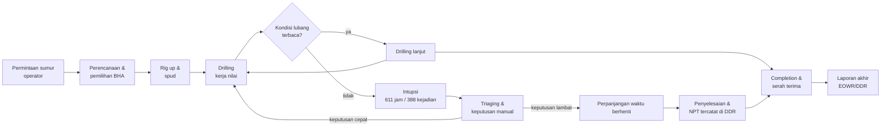

### 2.1.2 Tabel waktu proses

| Simbol | Langkah | Waktu | Status nilai |
|---|---|---|---|
| NV | Menunggu kejelasan kondisi lubang (388 kejadian) | 611 jam (median 45 menit per kejadian) | non-nilai, tapi wajib |
| NV | Triaging, pembacaan grafik terpisah, keputusan manual | tidak terukur terpisah di data (dinyatakan dalam 2.7) | non-nilai |
| V | Aktivitas pengeboran tercatat | 601 jam pada window terkurasi | nilai |
| V | Persiapan, rig up, completion | tidak terpisah di label interupsi | nilai |
| T | Total waktu proses pada window terkurasi | 1.212 jam | — |

Waktu total proses (1.212 jam) menjadi dasar seluruh laju kejadian per 1.000 jam yang
dipakai di 2.4. Angka median 45 menit dan p90 180 menit berasal dari hitung langsung
terhadap `act_start`/`act_end`, disajikan pada Gambar 2.

**Temuan VSM:** hampir separuh waktu proses pada window terkurasi berada di status
"menunggu kejelasan", sementara tidak ada satu pun titik di alur yang menampilkan
status lubang bor dalam satu layar. Itulah titik hilang yang menjadi sasaran solusi.

---

## 2.2 Material & Information Flow Chart (MIFC)

### 2.2.1 Alur material

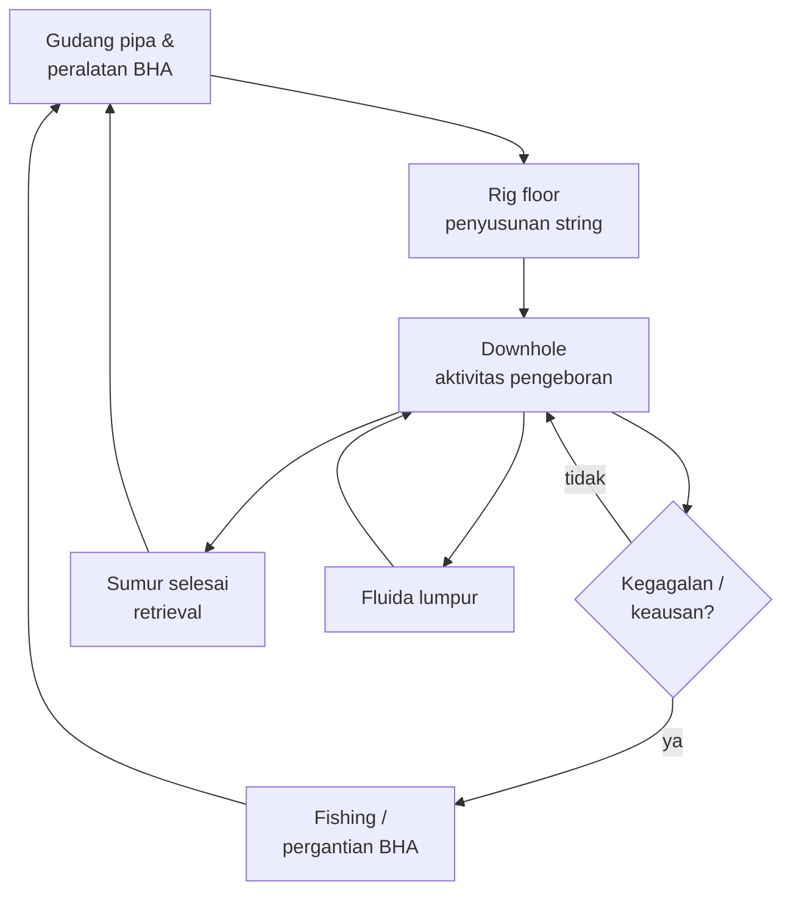

### 2.2.2 Alur informasi

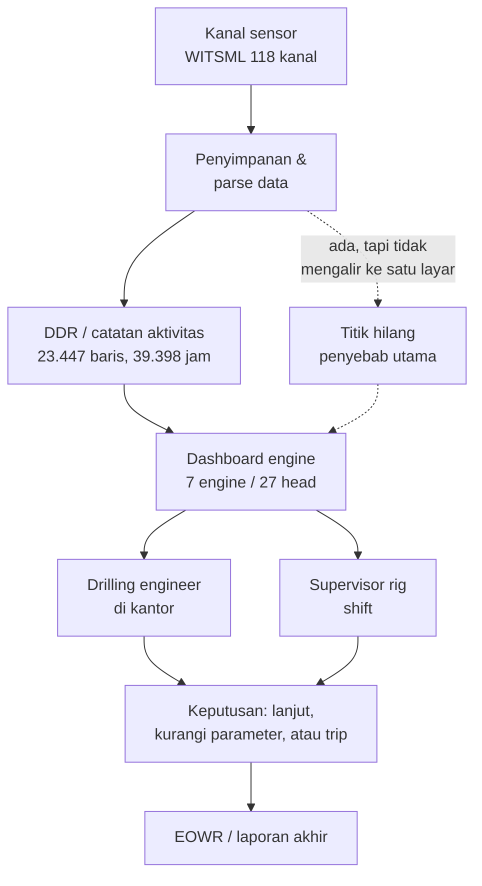

**Temuan MIFC:** alur material sudah terputus-putus dan penuh umpan balik normal
(bukan masalah utama), sedangkan alur informasi terhenti di antara penyimpanan data dan
orang yang harus memutuskan. Data ada (118 kanal), hasil perhitungan ada (27 head),
yang tidak ada satu pintu tampilan yang memutarnya menjadi keputusan.

---

## 2.3 Operation Process Chart (OPC)

OPC menghubungkan operasi utama dengan kejadian yang menyelinginya dan jumlah kejadian
yang tercatat pada data.

```mermaid
flowchart LR
  O1((●)) --- O2["Rig up<br/>asal: langkah baku"] --- O3["Drilling<br/>V: 601 jam"]
  O3 --- O4{{"◆ Keputusan:<br/>kondisi terbaca?"}}
  O4 -- ya --> O3
  O4 -- tidak --> O5["Intupsi<br/>O: 388 kali, 611 jam"]
  O5 --- O6["Triaging manual<br/>N: belum terukur"]
  O6 --- O7{{"◆ Keputusan<br/>trip / lanjut"}}
  O7 -- trip --> O8["Fishing / ganti BHA<br/>O: 38 kali"]
  O7 -- lanjut --> O3
  O8 --- O3
  O3 --- O9((○)) ["Completion<br/>serah terima"]
```

Keterangan: `●` operasi utama, `○` penyelesaian, `◆` keputusan, `O` kejadian tercatat.

| Kejadian pada data Volve | Frekuensi |
|---|---|
| Interupsi non-routine | 388 |
| Stuck pipe dan fishing | 38 |
| Kegagalan BHA / peralatan downhole | 12 |
| Intervensi wireline / completion di luar rencana | 21 |
| Masalah fluida sumur | 25 |
| Kegagalan peralatan permukaan | 216 |
| Kejadian keamanan personel | 1 |

---

## 2.4 Failure Modes, Effects, and Criticality Analysis (FMECA)

### 2.4.1 Skala penilaian yang dipakai

Skala 1-10 mengikuti kerangka AIAG-VDA FMEA Handbook dan MIL-STD-1629A untuk
akar huruf risiko, dengan definisi eksplisit di bawah ini supaya skor bisa diaudit.

**Severity (S), 1 = tidak berdampak, 10 = bencana:**

| Nilai | Definisi operasional pada proyek ini |
|---|---|
| 9-10 | risiko HSE atau well control; kerusakan total BHA; kontrak terancam penalti |
| 7-8 | NPT signifikan, biaya rig jalan tanpa progres |
| 5-6 | penundaan operasi dapat dipulihkan dalam satu shift |
| 3-4 | gangguan lokal, ditangani tanpa menghentikan operasi |
| 1-2 | hampir tidak terasa |

**Occurrence (O), berdasar laju per 1.000 jam operasi (1.212 jam terhitung):**

| Laju per 1.000 jam | Nilai O |
|---|---|
| ≥ 100 | 10 |
| 50-99 | 9 |
| 25-49 | 8 |
| 15-24 | 7 |
| 10-14 | 6 |
| 5-9 | 5 |
| 2-4 | 4 |
| 1-1,9 | 3 |
| 0,5-0,9 | 2 |
| < 0,5 | 1 |

**Detectability (D), 1 = mudah terdeteksi, 10 = hampir mustahil:**

| Nilai | Definisi |
|---|---|
| 1-3 | terdeteksi otomatis oleh indikator yang sudah ada, termasuk hilangnya data sendiri |
| 4-6 | terdeteksi oleh head engine, tetapi masih di taraf peringatan berpengawas |
| 7-8 | hanya terdeteksi setelah gejala muncul, engine belum layak |
| 9-10 | tidak terdeteksi sampai dampaknya terjadi |

### 2.4.2 Tabel FMECA

| No | Mode kegagalan | Efek | S | Laju/1.000 jam | O | D | RPN | Dasar S, O, D |
|---|---|---|---|---|---|---|---|---|
| 1 | Gagalan peralatan permukaan rig | NPT langsung, tanpa progres, biaya rig tetap jalan | 8 | 178,22 | 10 | 4 | **320** | O dari 216 kejadian; D diturunkan dari ketersediaan indikator rig, bukan engine |
| 2 | Kegagalan fluida sumur (kick/loss) | risiko well control, HSE, kerusakan formasi | 10 | 20,63 | 7 | 7 | **490** | O dari 25 kejadian; D tinggi karena head hyd K-ii berstatus belum tersedia |
| 3 | Stuck pipe / fishing | kehilangan BHA, biaya fishing, NPT panjang | 10 | 31,35 | 8 | 5 | **400** | O dari 38 kejadian; D dari engine stuck yang sudah diuji tapi tier peringatan |
| 4 | Kegagalan BHA / peralatan downhole | kerusakan alat mahal, operasi berhenti | 9 | 9,90 | 6 | 7 | **378** | O dari 12 kejadian; hanya 50 dari 884 kejadian berlabel `bha_relevant=yes` |
| 5 | Kegagalan telemetri / kehilangan data | kehilangan visibilitas, keputusan tanpa bukti | 7 | — | 6 | 3 | **126** | O dari porsi jendela tanpa data (contoh head vib 356 dari 1.989 jendela); D rendah karena kehilangan data justru paling mudah terlihat |
| 6 | Intervensi wireline / completion di luar rencana | penundaan, biaya intervensi | 6 | 17,33 | 7 | 5 | **210** | O dari 21 kejadian |
| 7 | Kejadian tak terlokalisir (data/label tidak jelas) | analisis akar penyebab tertunda | 5 | 23,10 | 7 | 4 | **140** | O dari 28 kejadian `failure_unlocated` |
| 8 | Kerusakan personel | HSE, kepatuhan, biaya tidak terukur | 10 | 0,83 | 2 | 6 | **120** | O dari 1 kejadian `safety_personnel` |

Skala O ditetapkan agar mendukung jarak antar mode pada data ini: laju tertinggi
(mesin permukaan, 178 per 1.000 jam) mendapat nilai 10 dan laju terendah
(0,83 per 1.000 jam) mendapat nilai 2. Ini keputusan desain penulis, ditulis eksplisit
sehingga pembaca bisa menghitung ulang dengan skala lain.

### 2.4.3 Pembacaan hasil

Mode 2 (fluida sumur) memperoleh RPN tertinggi karena Severity maksimum dipadukan
dengan Detectability buruk: engine yang seharusnya menangkapnya, `hyd K-ii`, masih
berstatus belum tersedia di prototipe. Ini adalah argumen inti kenapa solusi harus
menutup keterbatasan deteksi, bukan sekadar menampilkan grafik.

Mode 3 (stuck pipe) dan 4 (BHA) berada di peringkat berikutnya. Keduanya justru punya
engine yang sudah diuji (`stuck`, `bit_wear`), sehingga celahnya ada pada keandalan
deteksi, bukan pada ketiadaan data.

Mode 1 punya frekuensi tertinggi tetapi Severity lebih rendah dan deteksi relatif
mudah, sehingga RPN-nya di bawah dua mode di atas. Mode 8 jarang sekali terjadi namun
Severity maksimum; ini menjelaskan kenapa kriteria HSE tetap diperlukan di MCDM walau
frekuensinya kecil.

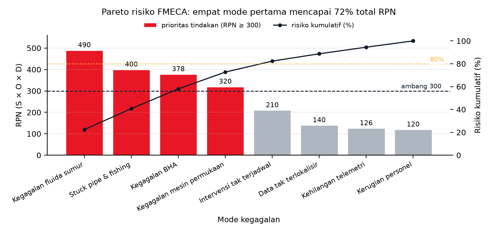

**Gambar 4.** Pareto risiko FMECA atas delapan mode kegagalan, total RPN 2.184. Empat
mode teratas (Kegagalan fluida sumur 490, Stuck pipe & fishing 400, Kegagalan BHA 378,
Kegagalan mesin permukaan 320) menyumbang 72,7 persen dari total RPN dan semuanya
berada di atas garis ambang prioritas 300 sehingga diwarnai merah. Kurva hitam menunjukkan
risiko kumulatif pada sumbu kanan: batas 80 persen baru terlewati pada mode kelima
(82,3 persen). Empat mode sisanya diwarnai karena berada di bawah ambang 300. Skrip
sumber: `docs/assets/make_figures.py`, fungsi `fig07_fmea_pareto`.

---

## 2.5 Fault Tree Analysis (FTA)

Top event dipilih satu: **kehilangan kendali kondisi lubang berujung stuck pipe atau
kegagalan BHA**. Keputusan memakai satu pohon, bukan dua, karena basic event kedua
pohon saling menumpuk dan akan menduplikasi penyebab.

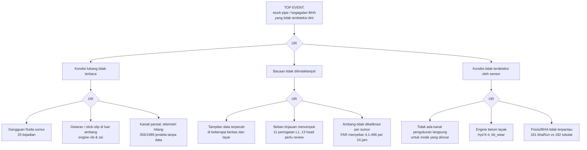

Penafsiran: pohon menunjukkan bahwa ketiadaan alat ukur hanyalah satu dari tiga cabang.
Cabang yang paling menumpuk dalam data adalah cabang A2 (bacaan tidak ditindaklanjuti),
sehingga solusi yang hanya menambah sensor akan menyerang pohon di cabang yang salah.

---

## 2.6 Tool yang dipertimbangkan dan ditolak

| Tool | Keputusan | Alasan |
|---|---|---|
| VSM | dipakai | menunjukkan bahwa setengah waktu terkunci pada "menunggu kejelasan" |
| MIFC | dipakai | memisahkan alur material (sehat) dari alur informasi (terputus) |
| OPC | dipakai | menghubungkan operasi utama dengan 388 kejadian tercatat |
| FMECA | dipakai | memberi peringkat risiko dengan O berbasis data, bukan tebakan |
| FTA | dipakai | memecah top event ke tiga cabang dan menunjukkan cabang dominan |
| Fishbone 6M dan 5W1H | dipakai di Bab I 1.2 | akar masalah perlu dipaparkan sebelum alat analisis operasional |
| REBA / RULA | ditolak | tidak ada beban kerja manual dominan dalam kasus ini; memaksakannya hanya untuk mengisi sub-bab |
| MIFC tekstual panjang | ditolak | sudah terwakili oleh diagram, duplikasi hanya menambah halaman |

Tool yang ditolak dicatat di sini karena Buku Pedoman §2.3 menghendaki keputusan
analisis yang terdokumentasi, termasuk keputusan untuk tidak memakai suatu tool.

---

## 2.7 Sintesis akar masalah

Gabungan kelima tool menghasilkan satu kalimat masalah:

> Data kondisi pengeboran tersedia dalam jumlah besar dan hasil kalkulasi risiko sudah
> dihasilkan, tetapi keduanya tidak pernah bertemu pada satu titik keputusan sehingga
> 388 kejadian interupsi tetap ditangani reaktif dengan median 45 menit dan p90 180 menit
> per kejadian.

Tiga bukti yang menopang kalimat itu, semuanya terukur: total 611 jam waktu berhenti dari
1.212 jam window terkurasi (2.1), terhentinya alur informasi di antara penyimpanan data
dan orang yang memutuskan (2.2), serta cabang A2 pada pohon kegagalan yang paling menumpuk
karena beban tinjauan dan ambang tidak terkalibrasi (2.5).

Dari sini Bab III masuk ke tahap Investigate: sembilan alternatif, pemetaan BoK,
kriteria, dan pemilihan solusi.

---

# BAB III ANALISIS ALTERNATIF SOLUSI

## 3.1 Permasalahan & Alternatif Solusi

| Kendali dokumen | Keterangan |
|---|---|
| Dokumen | Proposal Proyek Perancangan Terpadu I, BAB III subbab 3.1 |
| Mitra | PT Halliburton Indonesia, divisi Sperry Drilling |
| Versi | 1.0, 25 Oktober 2026 |
| Status | Berjalan, subbab 3.2 sampai 3.4 belum disusun |
| Acuan format | Buku Pedoman PPT Tahap I, subbab 3.2 Format Proposal, halaman 33 sampai 36 |
| Acuan BoK | Buku Pedoman PPT Tahap I Tabel 2.1, empat belas IEBoK, selaras IISE ISEBoK 2021 |
| Identitas anggota | Diisi tim. Dokumen ini tidak mengarang nama maupun NIM. |

### 3.1.1 Dasar penyusunan dan aturan bukti

Riset pendahuluan: `grounded-citations` - setiap angka pada subbab ini melekat pada sumber yang sudah diekstrak, dan blok bukti memuat kunci jejak berupa berkas dan nomor baris, bukan ingatan.

Riset pendahuluan: `formal-project-documents` - register formal baku tanpa penanda status dalam tanda kurung, tanpa emoji, dan setiap konsep teknis dituliskan sebagai definisi, tujuan, alasan pemilihan, serta batasnya.

Riset pendahuluan: `sequentialthinking` (sequ-mcp, empat pikiran) - inventaris dua puluh dua sumber, uji tiga skema pembagian anggota, verifikasi status eksekusi per solusi, lalu penetapan pembagian berbasis lapisan intervensi (data dan label, formulasi model, sinyal fisik dan operasi).

Sembilan alternatif pada subbab ini disusun dari inventaris solusi yang sudah berkode di dalam proyek, yaitu tiga belas solusi S-A1 sampai S-D4 beserta empat solusi pendukung pada bagian kelas rapuh (S-E1, S-E2, S-F1, S-F2), tiga opsi peningkatan pada dokumen opsi ML, dan dua lever pasca-V9 (6a perbaikan label, 6b kalibrasi ambang per sumur). Seluruh dua puluh dua sumber dipetakan tepat satu kali ke sembilan alternatif, sehingga tidak ada alternatif yang menduplikasi mekanisme alternatif lain, dan tidak ada sumber yang hilang tanpa rumah.

Aturan bukti yang dipakai pada seluruh subbab:

1. Setiap angka menyebut berkas dan nomor baris, kunci JSON, atau skrip yang dapat dijalankan ulang.
2. Angka yang belum dihitung ditulis eksplisit sebagai asumsi atau perkiraan desain, dan tidak disamarkan sebagai hasil pengukuran.
3. Status pelaksanaan hanya memakai tiga nilai baku: Selesai, Berjalan, dan Rencana (belum terealisasi).

### 3.1.2 Kondisi pengikat dan celah teknis yang dirujuk

Tabel berikut memuat sembilan kode rujukan P1 sampai P9. Kode ini bukan rumusan masalah. Rumusan masalah hanya tiga, yaitu RM1, RM2, dan RM3 pada 1.1.6. Sebagian besar kode di bawah adalah keadaan yang mengikat ruang lingkup, misalnya jumlah alat, jumlah positif per fold, dan ketiadaan atribut pada berkas sumber, sehingga tidak dijawab sebagai temuan melainkan diakomodasi sebagai batasan. Sisanya adalah celah teknis yang menjadi prasyarat bagi RM1 atau RM2.

| Kode | Kondisi pengikat atau celah teknis | Uraian ringkas dan angka | Jejak |
|---|---|---|---|
| P1 | Label stuck berbentuk status, bukan peristiwa | Label STUCK_RT bertahan sebagai blok panjang sehingga jendela sebelumnya menjadi prediktor hampir sempurna. Prevalensi F-9_A 66,9%, persistence 0,787 mengalahkan Random Forest 0,651, dan lift F-9_A turun ke 0,97. | `docs/V7_R1_SOLUTIONS.md:66-70 (angka turunan docs/V6_E1_ML_DESIGN.md 4.4)` |
| P2 | Jumlah positif shk terlalu sedikit per fold | Gate G1 lolos 3 dari 7 fold sedangkan G2 lolos 6 dari 7, sehingga akarnya bukan mutu fitur melainkan jumlah informasi positif: F-9_A 30 positif dan F-9 45 positif, dibanding F-14 760 positif. | `docs/V7_R1_SOLUTIONS.md:97-99` |
| P3 | Label hyd adalah ambang residual dari proses yang persisten | Label diturunkan dari residual SPPA dengan ambang nilai mutlak z di atas 2 sehingga mewarisi persistensi proses. Persistence 0,42 sampai 0,63 mengalahkan Random Forest 0,11 sampai 0,61 pada 7 dari 7 fold, dan G1 hanya lolos 2 dari 7. | `docs/V7_R1_SOLUTIONS.md:127-131` |
| P4 | tool_wear terbatas 4 alat dengan label identitas run | Hanya 4 alat dan 2 run per alat (469 jendela), label berupa identitas run R01/R02 sehingga urutan percobaan ikut terkorelasi dengan label. Prevalensi sekitar 0,5 membatasi plafon lift pada 2,0; hasil nyata G1 0 dari 4 dengan lift 1,09 sampai 1,42. | `docs/V7_R1_SOLUTIONS.md:160-165` |
| P5 | bit_wear dikalahkan persistence pada seluruh fold | Gate G1 lolos 3 dari 4 dan G2 lolos 4 dari 4, tetapi persistence lebih tinggi daripada Random Forest pada 4 dari 4 fold karena label high-MSE membentuk blok lintas kedalaman. Aturan pra-registrasi menurunkan verdict menjadi layak bersyarat. | `docs/V7_R1_SOLUTIONS.md:203-205` |
| P6 | Sebagian fold ssi underpowered | ssi lolos G1 4 dari 5 dan G2 5 dari 5 dengan persistence 0 dari 5, tetapi F-7 hanya 3 positif dan F-9 hanya 12 positif sehingga selang kepercayaan melebar dan F-9_A gagal tipis pada lift 1,47. | `docs/V7_R1_SOLUTIONS.md:197-199` |
| P7 | Validitas label lintas sumur belum terbukti | Kontrol-positif stuck 0 dari 10, label hyd masih berupa proksi residual, dan campuran severitas berbeda antar sumur. Cacat ini mengancam seluruh lapisan onset sebelum model apa pun dipercaya. | `docs/V8_PM_VERDICT.md:202; docs/V4_MAINTENANCE_ML_OPTIONS.md:145-155` |
| P8 | Ambang global tidak portabel antar sumur | Pada titik operasi yang sama, false alarm rate vib menyebar 4,15 sampai 496,09 per 24 jam, yaitu rasio 119,6 kali antar sumur, sehingga satu ambang global tidak dapat dipakai. | `docs/V9_PM2_VERDICT.md:114` |
| P9 | Tidak ada label keausan fisik dari rig | Seluruh 77 berkas bhaRun tidak memuat dullingInfo, dullGrade, maupun bitName, sehingga label yang tersedia hanya batas waktu run, bukan tingkat keausan. Prediksi onset keausan bit (K-2) belum dijalankan sama sekali. | `docs/V4_MAINTENANCE_ML_OPTIONS.md:62; docs/V9_PM2_VERDICT.md:176` |

Peta asal setiap kode, supaya tidak ada yang dibaca sebagai pertanyaan riset baru:

| Kode | Asal di Bab I | Peran |
|---|---|---|
| P1 | RM1, mutu label | kondisi pengikat bentuk label |
| P2 | Kendala 1.4.4 butir 3 | jumlah positif per fold terbatas |
| P3 | RM1, mutu label | kondisi pengikat bentuk label |
| P4 | Kendala 1.4.4 butir 5 | cakupan domain bengkel |
| P5 | RM1 | celah teknis, baseline mengalahkan model |
| P6 | Kendala 1.4.4 butir 3 | jumlah sampel per fold terbatas |
| P7 | Kendala 1.4.4 butir 1 | validitas lintas sumur |
| P8 | RM2 | gejala yang harus dijawab pemilihan titik operasi |
| P9 | Kendala 1.4.4 butir 4 | atribut keausan tidak tersedia |

Konsekuensi pembacaan: P1 sampai P9 tidak menambah jumlah rumusan masalah. Yang bertambah hanya rincian mengapa ketiga pertanyaan riset itu sulit dijawab dengan data yang ada.

### 3.1.3 Tabel rekap sembilan alternatif

| No | Anggota | Alternatif solusi | Kode sumber | BoK | Masalah yang dirujuk | Dieksekusi di kampanye | Status |
|---|---|---|---|---|---|---|---|
| A1 | Anggota 1 | Relabeling onset peristiwa: dari status menjadi kejadian | S-A1, S-C1, S-F1 | 14, 11, 5 | P1, P3, P5 | V9, sebagian (stuck K-ii dan hyd K-ii) | Berjalan |
| A2 | Anggota 1 | Perluasan wellbore berkanal disfungsi (F-10, F-4, F-12, F-15) | S-B1, S-A2, S-E1 | 11, 5, 14 | P2, P6 | V9, akuisisi data (baris hasil parse) | Berjalan |
| A3 | Anggota 1 | Penjaminan mutu label dan label probabilistik multi-sumber | 6a, S-A3 | 5, 11, 14 | P7 | belum ada | Rencana (belum terealisasi) |
| A4 | Anggota 2 | Unit analisis per-stand pengeboran | S-B2 | 7, 5, 11 | P2, P6 | belum ada | Rencana (belum terealisasi) |
| A5 | Anggota 2 | Prediksi severity ordinal dengan evaluasi stabilitas fold | S-B3, S-E2 | 5, 2, 11 | P6, P7 | belum ada | Rencana (belum terealisasi) |
| A6 | Anggota 2 | Formulasi survival dan sisa umur pakai (time-to-event) | S-C3, V4-Opsi3 | 5, 3, 2 | P9, P3 | belum ada | Rencana (belum terealisasi) |
| A7 | Anggota 3 | Penguatan kampanye keausan alat bengkel: progresi, dekomposisi mode, dan ranking | S-D1, S-D2, S-D4 | 12, 5, 14 | P4 | V9, domain bengkel (K-i) | Berjalan |
| A8 | Anggota 3 | Label fisika pengganti label proksi | S-C2, S-D3, S-F2 | 10, 5, 11 | P3, P5, P9 | belum ada | Rencana (belum terealisasi) |
| A9 | Anggota 3 | Lapisan keputusan operasional: kalibrasi ambang per sumur dan purwarupa peringatan dini | 6b, V4-Opsi1, V4-Opsi2 | 1, 6, 3 | P8, P1 | belum ada | Rencana (belum terealisasi) |

Tiga anggota membagi lapisan intervensi, bukan kelas disfungsi. Pembagian ini dipilih karena satu pekerjaan akuisisi data melayani beberapa kelas sekaligus, sehingga pembagian per kelas akan menduplikasi mekanisme yang sama pada dua alternatif berbeda.

- Anggota 1 mengerjakan lapisan data dan label (A1 sampai A3).
- Anggota 2 mengerjakan lapisan formulasi model dan evaluasi (A4 sampai A6).
- Anggota 3 mengerjakan lapisan sinyal fisik, keausan, dan operasi (A7 sampai A9).

### 3.1.4 Rincian setiap alternatif

#### 3.1.4.1 A1 Relabeling onset peristiwa: dari status menjadi kejadian (Anggota 1)

**Ringkasan.** Mengubah definisi target dari status yang bertahan menjadi titik masuk peristiwa, sehingga dominasi persistence hilang secara konstruksi.

**Deskripsi teknis.** Untuk setiap deret label instrumen (STUCK_RT, residual SPPA pada hyd, dan label high-MSE pada bit_wear), onset t_e didefinisikan sebagai titik naik status. Jendela positif adalah jendela fitur yang berakhir dalam horizon H sebelum t_e, sedangkan jendela di dalam blok setelah onset dibuang dari evaluasi dan tidak dinegatifkan. Horizon H ditetapkan 10 menit dengan uji sensitivitas pada 5 dan 30 menit. Gate G1 (lift minimal 1,5 pada mayoritas sumur layak) dan G2 (AUPRC minimal AUPRC canary kedalaman) tidak diubah, sehingga perubahan hanya berada pada definisi label.

**Permasalahan yang diselesaikan.** P1, P3, P5. Label STUCK_RT bertahan sebagai blok panjang sehingga jendela sebelumnya menjadi prediktor hampir sempurna. Prevalensi F-9_A 66,9%, persistence 0,787 mengalahkan Random Forest 0,651, dan lift F-9_A turun ke 0,97. Label diturunkan dari residual SPPA dengan ambang nilai mutlak z di atas 2 sehingga mewarisi persistensi proses. Persistence 0,42 sampai 0,63 mengalahkan Random Forest 0,11 sampai 0,61 pada 7 dari 7 fold, dan G1 hanya lolos 2 dari 7. Gate G1 lolos 3 dari 4 dan G2 lolos 4 dari 4, tetapi persistence lebih tinggi daripada Random Forest pada 4 dari 4 fold karena label high-MSE membentuk blok lintas kedalaman. Aturan pra-registrasi menurunkan verdict menjadi layak bersyarat.

**Keterkaitan BoK.** BoK 14 Systems Design & Engineering; BoK 11 Information Engineering; BoK 5 Quality & Reliability Engineering. BoK 14 karena alternatif ini menetapkan ulang fungsi sistem yang diprediksi (kejadian, bukan status); BoK 11 karena perubahan berada pada rantai data dan label; BoK 5 karena metrik yang dipakai adalah metrik keandalan dan deteksi kegagalan.

**Bukti kelayakan dari proyek.**

- Formulasi onset sudah dijalankan untuk stuck dan menghasilkan peringatan dengan arah benar pada beban rendah: Random Forest pada titik operasi 0,05 memberi B1 0,51 sampai 1,00 dengan TLead 10 sampai 11,5 menit, sedangkan baseline persistence-EVENT hanya memberi TLead median 7,0 menit dengan B1 0 sampai 11,5 persen. Jejak: `docs/V9_EVAL_B_LAYERB.md:101`.
- Untuk hyd, formulasi yang sama menghasilkan B1 nol dari tiga onset dengan TLead nol, jadi hasil negatifnya terukur dan dilaporkan apa adanya. Jejak: `docs/V9_EVAL_B_LAYERB.md:103`.
- Relabel tidak memerlukan parse baru karena deret sumber sudah berbentuk CSV. Jejak: `docs/V7_R1_SOLUTIONS.md:76, 136, 204 (data/volve/witsml_parsed/*.csv, data/USROP_labeled.csv)`.

**Status pelaksanaan.** Berjalan. Sudah dieksekusi untuk stuck (K-ii) dan hyd (K-ii) pada kampanye V9. Belum dieksekusi untuk bit_wear K-2 karena pra-registrasi kampanye tersebut belum terbit.

**Asal usul.** 13 solusi berkode (S-A1, S-C1) dan solusi pendukung V7 6 (S-F1). Kode sumber: S-A1, S-C1, S-F1.

#### 3.1.4.2 A2 Perluasan wellbore berkanal disfungsi (F-10, F-4, F-12, F-15) (Anggota 1)

**Ringkasan.** Menambah sumur dan fold dengan memparse wellbore yang terbukti memiliki kanal disfungsi, bukan menurunkan ambang label.

**Deskripsi teknis.** Empat wellbore yang belum diparse (F-10, F-4, F-12, F-15) diproses ke CSV dengan protokol identik kampanye sebelumnya: grid 60 detik, agregasi menit, syarat kelayakan jendela yang sama. Hasilnya digabungkan ke kampanye leave-one-well-out per kelas sehingga jumlah fold dan jumlah positif naik tanpa mengubah definisi label maupun gate. Peta kanal dipakai sebagai syarat masuk: hanya wellbore yang benar-benar mendaftarkan mnemonic disfungsi yang diambil.

**Permasalahan yang diselesaikan.** P2, P6. Gate G1 lolos 3 dari 7 fold sedangkan G2 lolos 6 dari 7, sehingga akarnya bukan mutu fitur melainkan jumlah informasi positif: F-9_A 30 positif dan F-9 45 positif, dibanding F-14 760 positif. ssi lolos G1 4 dari 5 dan G2 5 dari 5 dengan persistence 0 dari 5, tetapi F-7 hanya 3 positif dan F-9 hanya 12 positif sehingga selang kepercayaan melebar dan F-9_A gagal tipis pada lift 1,47.

**Keterkaitan BoK.** BoK 11 Information Engineering; BoK 5 Quality & Reliability Engineering; BoK 14 Systems Design & Engineering. BoK 11 karena pekerjaan inti adalah akuisisi dan pengelolaan data multi-sumur; BoK 5 karena tujuannya memulihkan kecukupan sampel untuk estimasi keandalan; BoK 14 karena data dari empat sumur harus diintegrasikan ke satu protokol evaluasi.

**Bukti kelayakan dari proyek.**

- Peta kanal menunjukkan sumber positif yang nyata: F-10 mendaftarkan SHKRSK_RT pada 188 berkas, CRPM_RT 186, STKSLP 125, VIBLAT_RT 66, dan STUCK_RT 18; F-4 135/135/135/86; F-12 91/90/52/6; F-15 77/76/76/76. Jejak: `docs/V7_R1_SOLUTIONS.md:43-48`.
- Akuisisi data sudah berjalan dan terukur: CRPM F-10 281.030 baris, F-4 42.010 baris, F-12 178.430 baris, F-15 57.846 baris, dengan re-run 11 fold belum dilakukan. Jejak: `docs/V9_PM1_ARCHITECTURE.md:186`.
- Akar masalah yang diserang terukur pada ssi: G1 4 dari 5, F-9_A lift 1,47 gagal tipis, dan dua fold underpowered (F-7 3 positif, F-9 12 positif). Jejak: `docs/V9_PM1_ARCHITECTURE.md:186`.

**Status pelaksanaan.** Berjalan. Akuisisi dan parsing selesai dengan angka baris terukur. Evaluasi ulang fold belum dijalankan, sehingga dampak terhadap gate belum dapat diklaim.

**Asal usul.** 13 solusi berkode (S-B1, S-A2) dan solusi pendukung V7 6.1 (S-E1). Kode sumber: S-B1, S-A2, S-E1.

#### 3.1.4.3 A3 Penjaminan mutu label dan label probabilistik multi-sumber (Anggota 1)

**Ringkasan.** Membereskan kebenaran label lebih dahulu, lalu menambah sumbu bukti melalui label model bila noise antar sumber masih besar.

**Deskripsi teknis.** Dua tahap berurutan. Tahap pertama adalah audit semantik label: mengunci satu varian onset stuck (strict atau forward-fill), memverifikasi arti skala 0/1/2/3 pada STUCK_RT dan SHKRSK_RT lintas sumur, merekonsiliasi prevalensi stuck 66,9 persen dengan 49,4 persen, menyinkronkan zona waktu kontrol-positif, dan mengganti label hyd proksi dengan kejadian nyata. Tahap kedua adalah label model generatif dengan labeling function independen (status instrumen, event kurasi, penanda fisika differential sticking, anomali overpull), dengan syarat kanal pembentuk label dilarang menjadi fitur. Urutan ini wajib karena kalibrasi ambang apa pun yang dilakukan sebelum label benar hanya menghasilkan presisi palsu.

**Permasalahan yang diselesaikan.** P7. Kontrol-positif stuck 0 dari 10, label hyd masih berupa proksi residual, dan campuran severitas berbeda antar sumur. Cacat ini mengancam seluruh lapisan onset sebelum model apa pun dipercaya.

**Keterkaitan BoK.** BoK 5 Quality & Reliability Engineering; BoK 11 Information Engineering; BoK 14 Systems Design & Engineering. BoK 5 karena inti pekerjaan adalah analisis kegagalan dan mutu pengukuran; BoK 11 karena label adalah keluaran sistem informasi; BoK 14 karena keputusan label harus konsisten dengan tujuan sistem, bukan dengan satu sumur.

**Bukti kelayakan dari proyek.**

- Tiga cacat label sudah terukur: kontrol-positif stuck 0 dari 10, label hyd masih proksi residual, dan campuran severitas berbeda antar sumur. Jejak: `docs/V8_PM_VERDICT.md:202`.
- Basis label kurasi memuat 884 kejadian, 50 di antaranya relevan BHA, dengan total durasi 73.500 menit atau 1.225 jam, sehingga bahan rekonsiliasi tersedia dan dapat dihitung ulang. Jejak: `docs/PPT1_LEDGER_ANGKA.md:145, 193; skrip scratch/ppt1/verify_durations.py`.
- Urutan 6a sebelum 6b ditetapkan karena kalibrasi ambang menyetel kebenaran, sehingga label yang salah akan menghasilkan presisi palsu. Jejak: `docs/V4_MAINTENANCE_ML_OPTIONS.md:163-166`.

**Status pelaksanaan.** Rencana (belum terealisasi). Belum ada langkah audit label yang dieksekusi pada kampanye mana pun.

**Asal usul.** Lever V4 6a dan solusi berkode S-A3. Kode sumber: 6a, S-A3.

#### 3.1.4.4 A4 Unit analisis per-stand pengeboran (Anggota 2)

**Ringkasan.** Mengganti unit jendela 10 menit dengan unit operasional rig (stand) agar prevalensi naik dan varians antar fold turun.

**Deskripsi teknis.** Label per stand didefinisikan sebagai any(kanal minimal 1) selama stand berlangsung, dan fitur berupa statistik stand sebelumnya. Batas stand diturunkan dari BPOS atau celah waktu pada CSV yang sudah ada. Konsekuensi yang harus dinyatakan terbuka: horizon prediksi melebar dari 10 menit menjadi stand berikutnya, sehingga klaim yang boleh dibuat adalah peringatan risiko per stand, bukan peringatan 10 menit.

**Permasalahan yang diselesaikan.** P2, P6. Gate G1 lolos 3 dari 7 fold sedangkan G2 lolos 6 dari 7, sehingga akarnya bukan mutu fitur melainkan jumlah informasi positif: F-9_A 30 positif dan F-9 45 positif, dibanding F-14 760 positif. ssi lolos G1 4 dari 5 dan G2 5 dari 5 dengan persistence 0 dari 5, tetapi F-7 hanya 3 positif dan F-9 hanya 12 positif sehingga selang kepercayaan melebar dan F-9_A gagal tipis pada lift 1,47.

**Keterkaitan BoK.** BoK 7 Operations Engineering & Management; BoK 5 Quality & Reliability Engineering; BoK 11 Information Engineering. BoK 7 karena unit yang dipakai adalah unit operasi produksi pengeboran; BoK 5 karena tujuannya menstabilkan estimasi keandalan; BoK 11 karena agregasi dan penyimpanan fitur berubah.

**Bukti kelayakan dari proyek.**

- Rentang prevalensi 10 sampai 40 persen pada unit stand adalah perkiraan desain dan belum dihitung, sehingga berstatus asumsi. Jejak: `docs/V7_R1_SOLUTIONS.md:111 (ditandai sebagai angka yang dihitung saat eksekusi)`.
- Batas stand dapat diturunkan dari BPOS dan celah waktu pada data yang sudah tersedia, sehingga tidak memerlukan akuisisi baru. Jejak: `docs/V7_R1_SOLUTIONS.md:112`.
- Bila unit stand dipakai, false alarm rate wajib dihitung per stand disertai justifikasinya, karena gate saat ini dihitung per jendela waktu. Jejak: `docs/V9_PM1_ARCHITECTURE.md:470`.

**Status pelaksanaan.** Rencana (belum terealisasi). Belum dijalankan; belum ada artefak hasil untuk unit stand.

**Asal usul.** 13 solusi berkode. Kode sumber: S-B2.

#### 3.1.4.5 A5 Prediksi severity ordinal dengan evaluasi stabilitas fold (Anggota 2)

**Ringkasan.** Memakai seluruh informasi skala 0 sampai 3, lalu menurunkan keputusan biner pada ambang fisik yang sama sambil melaporkan stabilitas tiap fold secara eksplisit.

**Deskripsi teknis.** Model dilatih memprediksi skala (ordinal atau regresi) kemudian keputusan biner diturunkan pada ambang minimal 1, sehingga gate tetap dihitung pada AUPRC biner dan tidak bergeser. Lapisan kedua adalah evaluasi: stratified bootstrap per fold dan pelaporan jumlah positif per fold, agar selang kepercayaan yang lebar tidak menyembunyikan fold underpowered.

**Permasalahan yang diselesaikan.** P6, P7. ssi lolos G1 4 dari 5 dan G2 5 dari 5 dengan persistence 0 dari 5, tetapi F-7 hanya 3 positif dan F-9 hanya 12 positif sehingga selang kepercayaan melebar dan F-9_A gagal tipis pada lift 1,47. Kontrol-positif stuck 0 dari 10, label hyd masih berupa proksi residual, dan campuran severitas berbeda antar sumur. Cacat ini mengancam seluruh lapisan onset sebelum model apa pun dipercaya.

**Keterkaitan BoK.** BoK 5 Quality & Reliability Engineering; BoK 2 Operations Research & Analysis; BoK 11 Information Engineering. BoK 5 karena pengujian hipotesis dan regresi adalah alat utamanya; BoK 2 karena keputusan ambang adalah analisis keputusan; BoK 11 karena keluaran skor harus dikelola sebagai informasi operasional.

**Bukti kelayakan dari proyek.**

- Klasifikasi severitas stick-slip dengan pembelajaran mesin sudah mapan pada literatur sehingga jalur ordinal bukan klaim baru. Jejak: `docs/V7_R1_SOLUTIONS.md:197 (sitasi Hegde 2019, doi 10.1016/j.petrol.2019.05.021)`.
- ssi sudah lolos G1 4 dari 5 dengan dua fold underpowered (F-7 3 positif, F-9 12 positif), sehingga stabilitas fold adalah variabel yang wajib dilaporkan. Jejak: `docs/V9_PM1_ARCHITECTURE.md:186`.
- Penulis solusi sendiri menilai jalur stabilitas fold sebagai pengeras bukti, bukan penambah kelas, sehingga posisinya pelengkap A4 dan A2. Jejak: `docs/V7_R1_SOLUTIONS.md:199`.

**Status pelaksanaan.** Rencana (belum terealisasi). Belum dijalankan; tidak ada angka ordinal maupun bootstrap pada kampanye yang sudah ada.

**Asal usul.** 13 solusi berkode (S-B3) dan solusi pendukung V7 6.1 (S-E2). Kode sumber: S-B3, S-E2.

#### 3.1.4.6 A6 Formulasi survival dan sisa umur pakai (time-to-event) (Anggota 2)

**Ringkasan.** Memodelkan waktu sampai peristiwa, bukan status sesaat, sehingga keluaran berupa risiko per horizon dan sisa umur pakai peralatan.

**Deskripsi teknis.** Model hazard proporsional h(t|x) = h0(t) exp(beta transpose x) dipakai untuk waktu sampai peristiwa hidrolik dan untuk waktu sampai penarikan bit. Skor risiko per horizon H dievaluasi dengan gate biner yang sama, sehingga formulasi berubah tanpa mengubah gerbang. Label waktu sampai penarikan bit diturunkan dari interval dTimStart dan dTimStop pada berkas bhaRun.

**Permasalahan yang diselesaikan.** P9, P3. Seluruh 77 berkas bhaRun tidak memuat dullingInfo, dullGrade, maupun bitName, sehingga label yang tersedia hanya batas waktu run, bukan tingkat keausan. Prediksi onset keausan bit (K-2) belum dijalankan sama sekali. Label diturunkan dari residual SPPA dengan ambang nilai mutlak z di atas 2 sehingga mewarisi persistensi proses. Persistence 0,42 sampai 0,63 mengalahkan Random Forest 0,11 sampai 0,61 pada 7 dari 7 fold, dan G1 hanya lolos 2 dari 7.

**Keterkaitan BoK.** BoK 5 Quality & Reliability Engineering; BoK 3 Engineering Economic Analysis; BoK 2 Operations Research & Analysis. BoK 5 karena survival dan sisa umur pakai adalah inti rekayasa keandalan; BoK 3 karena keputusan penarikan bit adalah trade-off biaya; BoK 2 karena penaksiran hazard adalah model matematis untuk pengambilan keputusan.

**Bukti kelayakan dari proyek.**

- Label waktu sampai penarikan tersedia dari 77 berkas bhaRun, tetapi berkas itu tidak memuat dullingInfo, dullGrade, maupun bitName, sehingga label hanya berupa batas run dan bukan keausan fisik. Jejak: `docs/V4_MAINTENANCE_ML_OPTIONS.md:62`.
- Penulis solusi menilai survival sebagai opsi pembanding karena mengubah formulasi tanpa menambah informasi, sehingga posisinya bukan solusi primer. Jejak: `docs/V7_R1_SOLUTIONS.md:152`.
- Titik operasi hidrolik saat ini menghasilkan nol dari tiga onset terdeteksi, sehingga pembanding berformulasi waktu adalah langkah yang masuk akal dan bukan pengulangan. Jejak: `docs/V9_EVAL_B_LAYERB.md:103`.

**Status pelaksanaan.** Rencana (belum terealisasi). Belum dijalankan; belum ada model hazard pada kampanye mana pun.

**Asal usul.** Solusi berkode S-C3 dan opsi V4 nomor 3 (sisa umur pakai bit). Kode sumber: S-C3, V4-Opsi3.

#### 3.1.4.7 A7 Penguatan kampanye keausan alat bengkel: progresi, dekomposisi mode, dan ranking (Anggota 3)

**Ringkasan.** Tiga mekanisme pada dataset yang sama: label progresi dalam-run, fitur hasil dekomposisi, dan ranking antar status sebagai cadangan.

**Deskripsi teknis.** Bekerja pada 8 berkas akselerometer 1000 Hz (4 alat, 2 run, 469 jendela). Mekanisme pertama adalah label progresi: deret fitur keausan dihitung, titik ubah dideteksi per run, dan jendela sebelum titik ubah menjadi positif. Mekanisme kedua adalah fitur Variational Mode Decomposition berupa energi pita dan statistik per mode. Mekanisme ketiga adalah learning-to-rank pasangan dalam alat, dipakai hanya bila validasi titik ubah gagal karena artefak termal.

**Permasalahan yang diselesaikan.** P4. Hanya 4 alat dan 2 run per alat (469 jendela), label berupa identitas run R01/R02 sehingga urutan percobaan ikut terkorelasi dengan label. Prevalensi sekitar 0,5 membatasi plafon lift pada 2,0; hasil nyata G1 0 dari 4 dengan lift 1,09 sampai 1,42.

**Keterkaitan BoK.** BoK 12 Design & Manufacturing Engineering; BoK 5 Quality & Reliability Engineering; BoK 14 Systems Design & Engineering. BoK 12 karena objek yang dipantau adalah keausan pahat pada proses manufaktur; BoK 5 karena keluarannya metrik keandalan; BoK 14 karena tiga mekanisme harus diintegrasikan ke satu protokol evaluasi.

**Bukti kelayakan dari proyek.**

- Deteksi perubahan regime sudah dijalankan pada 4 dari 4 alat dengan TLead 20 sampai 36 detik (1,8 kali) dan false alarm terkalibrasi 1 sampai 3 per alat, tetapi presisi run hanya 0,50 karena titik ubah juga signifikan pada alat baru. Jejak: `docs/V9_EVAL_C_LAYERC.md:98`.
- Uji artefak termal gagal membuktikan confound pada 0 dari 8 run, sehingga kritik urutan run tidak terbukti pada data ini. Jejak: `docs/V9_EVAL_C_LAYERC.md:98`.
- Baseline ranking lintas alat stabil pada 1,19 kali (AUPRC 0,516 sampai 0,612) sedangkan engine Random Forest belum dijalankan di V9, sehingga mekanisme ranking masih terbuka. Jejak: `docs/V9_EVAL_C_LAYERC.md:99`.
- Fitur dekomposisi mode baru dinyatakan sebagai pengangkat AUPRC pada rancangan, tanpa artefak eksekusi, sehingga statusnya masih rencana. Jejak: `docs/V9_PM1_ARCHITECTURE.md:276`.

**Status pelaksanaan.** Berjalan. Mekanisme progresi dan kalibrasi ambang selesai pada domain bengkel. Dekomposisi mode dan ranking belum dieksekusi.

**Asal usul.** 13 solusi berkode. Kode sumber: S-D1, S-D2, S-D4.

#### 3.1.4.8 A8 Label fisika pengganti label proksi (Anggota 3)

**Ringkasan.** Mengganti label berbasis ambang dengan label berbasis mekanisme: well-control untuk hidrolik dan kombinasi energi spesifik untuk keausan bit.

**Deskripsi teknis.** Untuk hidrolik, dua label turunan fisik dipakai sebagai onset: perubahan volume pit (PITTOT dan GAINLOSSTOT) sebagai penanda kick atau loss, serta selisih laju masuk dan keluar (FLOWOUT dikurangi FLOWIN) sebagai penanda washout, masing-masing dengan ambang z-score median dan MAD per sumur. Untuk keausan bit, status high-MSE hanya dihitung sebagai keausan bila disertai penurunan rasio MSE terhadap energi spesifik, mengikuti aturan Menand dan Mills. Kanal pembentuk label dilarang menjadi fitur.

**Permasalahan yang diselesaikan.** P3, P5, P9. Label diturunkan dari residual SPPA dengan ambang nilai mutlak z di atas 2 sehingga mewarisi persistensi proses. Persistence 0,42 sampai 0,63 mengalahkan Random Forest 0,11 sampai 0,61 pada 7 dari 7 fold, dan G1 hanya lolos 2 dari 7. Gate G1 lolos 3 dari 4 dan G2 lolos 4 dari 4, tetapi persistence lebih tinggi daripada Random Forest pada 4 dari 4 fold karena label high-MSE membentuk blok lintas kedalaman. Aturan pra-registrasi menurunkan verdict menjadi layak bersyarat. Seluruh 77 berkas bhaRun tidak memuat dullingInfo, dullGrade, maupun bitName, sehingga label yang tersedia hanya batas waktu run, bukan tingkat keausan. Prediksi onset keausan bit (K-2) belum dijalankan sama sekali.

**Keterkaitan BoK.** BoK 10 Safety; BoK 5 Quality & Reliability Engineering; BoK 11 Information Engineering. BoK 10 karena kick dan lost circulation adalah bahaya well-control; BoK 5 karena label baru harus diverifikasi terhadap keandalan alat; BoK 11 karena penurunan label adalah pekerjaan rekayasa informasi.

**Bukti kelayakan dari proyek.**

- Kanal sumber label tersedia dan terhitung: GAINLOSSTOT pada 575 berkas di F-1 C dan 517 di F-11, PITTOT 565 dan 506, FLOWOUT 688, FLOWOUTPC 949. Jejak: `docs/V7_R1_SOLUTIONS.md:37-38`.
- Bahan label silang tersedia langsung: USROP_labeled.csv memuat 198.928 baris dengan kolom WOB, ROP, RPM, dan MSE. Jejak: `docs/V7_R1_SOLUTIONS.md:182`.
- Aturan MSE dan MSE/DS sudah diverifikasi rumusnya pada dokumen sumber, sehingga label silang bukan gagasan tanpa dasar. Jejak: `docs/V7_R1_SOLUTIONS.md:181 (sitasi Menand dan Mills, AADE-17-NTCE-033)`.

**Status pelaksanaan.** Rencana (belum terealisasi). Belum ada label pit atau flow yang diparse menjadi deret label; kanal mentahnya sudah teridentifikasi di F-9, F-1 C, dan F-11.

**Asal usul.** Solusi berkode S-C2, S-D3, dan solusi pendukung V7 6.2 (S-F2). Kode sumber: S-C2, S-D3, S-F2.

#### 3.1.4.9 A9 Lapisan keputusan operasional: kalibrasi ambang per sumur dan purwarupa peringatan dini (Anggota 3)

**Ringkasan.** Menyentuh titik operasi alat, bukan model: ambang per sumur, purwarupa kampanye pada data berlabel, dan indeks kondisi untuk disfungsi yang labelnya belum tersedia.

**Deskripsi teknis.** Tiga komponen yang semuanya bersifat operasional. Pertama, kalibrasi ambang per sumur secara prospektif untuk hyd K-i, vib Random Forest, dan shk Random Forest, lalu pengukuran false alarm rate setelah kalibrasi dan pembandingan terhadap baseline persistence. Kedua, purwarupa kampanye stuck-pipe pada dataset TSPP yang sudah berlabel dengan kanal permukaan frekuensi tinggi sebagai uji kelayakan cepat sebelum kampanye lintas sumur. Ketiga, indeks kondisi drill-string berbasis autoencoder untuk disfungsi yang labelnya tidak tersedia langsung, dengan validasi berupa korelasi terhadap event bit run atau stuck, bukan klaim presisi tinggi. Ketiganya tidak menyentuh gate G1 dan G2 yang sudah dikunci.

**Permasalahan yang diselesaikan.** P8, P1. Pada titik operasi yang sama, false alarm rate vib menyebar 4,15 sampai 496,09 per 24 jam, yaitu rasio 119,6 kali antar sumur, sehingga satu ambang global tidak dapat dipakai. Label STUCK_RT bertahan sebagai blok panjang sehingga jendela sebelumnya menjadi prediktor hampir sempurna. Prevalensi F-9_A 66,9%, persistence 0,787 mengalahkan Random Forest 0,651, dan lift F-9_A turun ke 0,97.

**Keterkaitan BoK.** BoK 1 Work Design & Measurement; BoK 6 Ergonomics & Human Factors; BoK 3 Engineering Economic Analysis. BoK 1 karena ambang dan prosedur alarm adalah bagian dari desain sistem kerja driller; BoK 6 karena beban kognitif dan tampilan alert adalah faktor manusia; BoK 3 karena keputusan biaya false alarm dan penghematan rig time adalah analisis ekonomi teknik, sekaligus menutup rantai BoK sesuai pedoman.

**Bukti kelayakan dari proyek.**

- Ambang global terbukti gagal: pada titik operasi 0,5 false alarm rate vib menyebar 4,15 sampai 496,09 per 24 jam atau rasio 119,6 kali antar sumur. Jejak: `docs/V9_PM2_VERDICT.md:114`.
- Dataset TSPP tersedia dengan 52.905 baris pada empat berkas dan 10 kanal permukaan, sehingga purwarupa dapat dijalankan tanpa akuisisi baru. Jejak: `docs/V10_D1_BAB_DATA.md:86, 296`.
- Artefak autoencoder lama tidak diskriminatif karena 75 sampai 99 persen baris berada di atas ambang, sehingga komponen indeks kondisi harus dikerjakan ulang dan tidak boleh mengutip artefak itu sebagai bukti. Jejak: `docs/V4_MAINTENANCE_ML_OPTIONS.md:58`.
- Alat saat ini berjalan dengan nol slot alarm otomatis dari 27 head, sehingga lapisan ini adalah syarat naik tier dan bukan tambahan opsional. Jejak: `scratch/v9_i1/v9_i1_RESULTS.json (kunci auto_critical_alarm_slots = 0; total head 4+4+4+6+4+2+3 = 27)`.

**Status pelaksanaan.** Rencana (belum terealisasi). Kalibrasi ambang per sumur untuk hyd, vib, dan shk belum dijalankan. Kalibrasi false alarm yang sudah ada hanya di dalam engine tool_wear pada domain bengkel.

**Asal usul.** Lever V4 6b dan opsi V4 nomor 1 dan 2. Kode sumber: 6b, V4-Opsi1, V4-Opsi2.

### 3.1.5 Peta sumber ke alternatif

| Sumber | Berkas asal | Alternatif |
|---|---|---|
| S-A1 | `docs/V7_R1_SOLUTIONS.md:72` | A1 |
| S-A2 | `docs/V7_R1_SOLUTIONS.md:79` | A2 |
| S-A3 | `docs/V7_R1_SOLUTIONS.md:85` | A3 |
| S-B1 | `docs/V7_R1_SOLUTIONS.md:103` | A2 |
| S-B2 | `docs/V7_R1_SOLUTIONS.md:109` | A4 |
| S-B3 | `docs/V7_R1_SOLUTIONS.md:115` | A5 |
| S-C1 | `docs/V7_R1_SOLUTIONS.md:133` | A1 |
| S-C2 | `docs/V7_R1_SOLUTIONS.md:139` | A8 |
| S-C3 | `docs/V7_R1_SOLUTIONS.md:148` | A6 |
| S-D1 | `docs/V7_R1_SOLUTIONS.md:167` | A7 |
| S-D2 | `docs/V7_R1_SOLUTIONS.md:173` | A7 |
| S-D3 | `docs/V7_R1_SOLUTIONS.md:179` | A8 |
| S-D4 | `docs/V7_R1_SOLUTIONS.md:185` | A7 |
| S-E1 | `docs/V7_R1_SOLUTIONS.md:198` | A2 |
| S-E2 | `docs/V7_R1_SOLUTIONS.md:199` | A5 |
| S-F1 | `docs/V7_R1_SOLUTIONS.md:204` | A1 |
| S-F2 | `docs/V7_R1_SOLUTIONS.md:205` | A8 |
| V4-Opsi1 | `docs/V4_MAINTENANCE_ML_OPTIONS.md:88` | A9 |
| V4-Opsi2 | `docs/V4_MAINTENANCE_ML_OPTIONS.md:96` | A9 |
| V4-Opsi3 | `docs/V4_MAINTENANCE_ML_OPTIONS.md:103` | A6 |
| 6a | `docs/V4_MAINTENANCE_ML_OPTIONS.md:145` | A3 |
| 6b | `docs/V4_MAINTENANCE_ML_OPTIONS.md:157` | A9 |

### 3.1.6 Rekapitulasi status pelaksanaan

| Status | Alternatif | Keterangan |
|---|---|---|
| Selesai | tidak ada | Tidak ada alternatif yang seluruh mekanismenya selesai. |
| Berjalan | A1, A2, A7 | Mekanisme inti sudah dieksekusi dan berangka; bagian lain belum. |
| Rencana (belum terealisasi) | A3, A4, A5, A6, A8, A9 | Belum ada artefak eksekusi. |

### 3.1.7 Keterkaitan dengan BoK dan kepatuhan pedoman

| Alternatif | BoK 1 | BoK 2 | BoK 3 | BoK 5 | BoK 6 | BoK 7 | BoK 10 | BoK 11 | BoK 12 | BoK 14 |
|---|---|---|---|---|---|---|---|---|---|---|
| A1 | - | - | - | ya | - | - | - | ya | - | ya |
| A2 | - | - | - | ya | - | - | - | ya | - | ya |
| A3 | - | - | - | ya | - | - | - | ya | - | ya |
| A4 | - | - | - | ya | - | ya | - | ya | - | - |
| A5 | - | ya | - | ya | - | - | - | ya | - | - |
| A6 | - | ya | ya | ya | - | - | - | - | - | - |
| A7 | - | - | - | ya | - | - | - | - | ya | ya |
| A8 | - | - | - | ya | - | - | ya | ya | - | - |
| A9 | ya | - | ya | - | ya | - | - | - | - | - |

Pedoman menetapkan bahwa pelaksanaan proyek diawali BoK 14 Sistem Design dan Engineering, melibatkan minimal tiga IEBoK, lalu diakhiri BoK 3 Engineering Economic Analysis. Rancangan sembilan alternatif mengikuti pola tersebut: A1 memuat BoK 14 dan A9 memuat BoK 3, sedangkan setiap alternatif memuat tepat tiga BoK sehingga syarat minimal tiga BoK terpenuhi pada tingkat alternatif, bukan hanya pada tingkat proyek.

Sepuluh dari empat belas BoK tersentuh oleh rancangan ini. Empat BoK yang belum tersentuh adalah BoK 4 Facilities Engineering and Energy Management, BoK 8 Supply Chain Management, BoK 9 Engineering Management, dan BoK 13 Product Design and Development. Keempatnya dicatat terbuka agar subbab 3.2 dapat menilai apakah pengaitan tambahan diperlukan atau justru dipaksakan.

### 3.1.8 Hasil negatif dan batas yang harus dinyatakan

1. Formulasi onset untuk hyd sudah diuji dan gagal pada titik operasi saat ini: nol dari tiga onset terdeteksi dengan TLead nol (`docs/V9_EVAL_B_LAYERB.md:103`). Alternatif A1 karena itu tidak boleh diklaim berhasil untuk semua kelas.
2. Dua angka pada subbab ini berstatus asumsi atau perkiraan desain, yaitu rentang prevalensi unit stand 10 sampai 40 persen (`docs/V7_R1_SOLUTIONS.md:111`) dan hasil kalibrasi ambang per sumur yang belum diukur setelah kalibrasi. Satu angka lain berstatus turunan aritmetik, yaitu plafon lift 2,0 yang berasal dari satu dibagi prevalensi sekitar 0,5 (`docs/V7_R1_SOLUTIONS.md:164`). Tidak ada di antaranya yang merupakan hasil ukur.
3. Dampak perluasan wellbore pada gate belum dapat diklaim karena re-run fold belum dijalankan, meskipun baris data hasil parse sudah terukur (`docs/V9_PM1_ARCHITECTURE.md:186`).
4. Fitur dekomposisi mode pada A7 baru berupa rencana pada rancangan, tanpa artefak eksekusi (`docs/V9_PM1_ARCHITECTURE.md:276`).

### 3.1.9 Manifes jejak angka (internal, bukan untuk sirkulasi eksternal)

| Angka | Nilai | Berkas dan baris |
|---|---|---|
| Prevalensi stuck F-9_A | 66,9 persen | `docs/V7_R1_SOLUTIONS.md:66` |
| Persistence mengalahkan RF pada stuck | 0,787 berbanding 0,651 | `docs/V7_R1_SOLUTIONS.md:66` |
| Positif shk per fold | 760 / 259 / 240 / 267 / 41 / 45 / 30 | `docs/V7_R1_SOLUTIONS.md:97` |
| Gate shk | G1 3 dari 7, G2 6 dari 7 | `docs/V7_R1_SOLUTIONS.md:97` |
| Persistence hyd mengalahkan RF | 7 dari 7 fold | `docs/V7_R1_SOLUTIONS.md:127` |
| Gate hyd | G1 2 dari 7, G2 4 dari 7 | `docs/V7_R1_SOLUTIONS.md:127` |
| Gate tool_wear | G1 0 dari 4, G2 4 dari 4 | `docs/V7_R1_SOLUTIONS.md:160` |
| Gate bit_wear | G1 3 dari 4, G2 4 dari 4 | `docs/V7_R1_SOLUTIONS.md:203` |
| Gate ssi | G1 4 dari 5, G2 5 dari 5 | `docs/V7_R1_SOLUTIONS.md:197` |
| Kanal CRPM hasil parse | 281.030 / 42.010 / 178.430 / 57.846 baris | `docs/V9_PM1_ARCHITECTURE.md:186` |
| Syarat kanal per wellbore | 188 / 186 / 125 / 66 / 18 dan seterusnya | `docs/V7_R1_SOLUTIONS.md:43-48` |
| Stuck K-ii B1 dan TLead | B1 0,51 sampai 1,00; TLead 10 sampai 11,5 menit | `docs/V9_EVAL_B_LAYERB.md:101` |
| Persistence-EVENT stuck | TLead median 7,0 menit; B1 0 sampai 11,5 persen | `docs/V9_EVAL_B_LAYERB.md:101` |
| Hyd K-ii | 0 dari 3 onset; TLead nol | `docs/V9_EVAL_B_LAYERB.md:103` |
| tool_wear K-i | 4 dari 4 alat; TLead 20 sampai 36 detik; FP 1 sampai 3 | `docs/V9_EVAL_C_LAYERC.md:98` |
| tool_wear K-ii canary | AUPRC 0,516 sampai 0,612 (1,19 kali) | `docs/V9_EVAL_C_LAYERC.md:99` |
| Sebaran FAR vib | 4,15 sampai 496,09 per 24 jam, rasio 119,6 kali | `docs/V9_PM2_VERDICT.md:114` |
| Kontrol-positif stuck | 0 dari 10 | `docs/V8_PM_VERDICT.md:202` |
| Basis label kurasi | 884 kejadian, 50 relevan BHA, 1.225 jam | `docs/PPT1_LEDGER_ANGKA.md:145, 193` |
| Berkas bhaRun | 77 berkas, tanpa dullingInfo | `docs/V4_MAINTENANCE_ML_OPTIONS.md:62` |
| TSPP | 52.905 baris, 4 berkas, 10 kanal | `docs/V10_D1_BAB_DATA.md:86, 296` |
| Slot alarm otomatis | 0 dari 27 head | `scratch/v9_i1/v9_i1_RESULTS.json` |

Reproduksi: `python3 scratch/ppt1/build_alternatif.py` menulis ulang `scratch/ppt1/alternatif.json` dan dokumen ini, lalu menjalankan pemeriksaan acceptance.

---

Catatan penyusunan: subbab 3.2 Analisis Alternatif Solusi, 3.3 Kriteria dan Batasan, serta 3.4 Pemilihan Alternatif Solusi belum termasuk dalam dokumen ini.

---

## Subbab 3.2 Analisis Alternatif Solusi dan Subbab 3.3 Kriteria dan Batasan

| Kendali dokumen | Keterangan |
|---|---|
| Dokumen | Proposal Proyek Perancangan Terpadu I, BAB III subbab 3.2 dan 3.3 |
| Mitra | PT Halliburton Indonesia, divisi Sperry Drilling |
| Versi | 1.0, 25 Oktober 2026 |
| Status | Berjalan. Subbab 3.1 sudah selesai, subbab 3.4 belum disusun. |
| Acuan format | Buku Pedoman PPT Tahap I subbab 3.2 Format Proposal, halaman 33 sampai 36 |
| Acuan rubrik | Rubrik Penilaian PPT oleh Dosen, halaman 38 dan berikutnya, butir 2.2, 3.1, 3.2, 3.3 |
| Acuan BoK | Buku Pedoman PPT Tahap I Tabel 2.1, empat belas IEBoK, selaras IISE ISEBoK 2021 |
| Identitas anggota | Diisi tim. Dokumen ini tidak mengarang nama maupun NIM. |

### 3.2.1 Dasar analisis dan aturan bukti

Riset pendahuluan: `ppt-halliburton` (berkas pendamping `references/alternative-solutions-guide.md` dan `references/ppt1-proposal-build.md`) - syarat pedoman untuk 3.2 dan 3.3, yaitu affinity map untuk clustering ide, minimal tiga BoK, kriteria pemilihan berbasis functional requirement stakeholder, dan format user story sebagai kalimat peran, kebutuhan, manfaat.

Riset pendahuluan: `sequentialthinking` (sequ-mcp, lima pikiran) - uji apakah peta afinitas cukup memakai sumbu keanggotaan (ditolak karena hanya menyalin 3.1), lalu penetapan sumbu objek intervensi, uji kasus batas A7, pemilihan empat BoK yang didalami, dan pemisahan tugas 3.3 dari bobot MCDM.

Riset pendahuluan: `grounded-citations` - setiap angka pada 3.2 dan 3.3 melekat pada berkas dan nomor baris atau kunci JSON, dan diperiksa ulang oleh skrip pemeriksa, bukan dari ingatan.

Pedoman menuntut tiga hal pada subbab 3.2, yaitu ruang brainstorming yang tidak menilai ide pada tahap awal, analisis sembilan alternatif dengan kedalaman minimal tiga BoK dari empat belas BoK, dan peta afinitas untuk mengelompokkan ide yang mirip ke kategori yang logis (Buku Pedoman PPT Tahap I subbab 3.2, halaman 35). Dokumen ini menjawab ketiganya dengan urutan: himpunan ide tetap sembilan alternatif dari subbab 3.1, pengelompokan dilakukan pada 3.2.2 sampai 3.2.6, dan pendalaman BoK dilakukan pada 3.2.7 sampai 3.2.9.

Aturan bukti yang dipakai:

1. Setiap angka menyebut berkas dan nomor baris, kunci JSON, atau skrip yang dapat dijalankan ulang.
2. Angka yang belum dihitung ditulis eksplisit sebagai asumsi atau perkiraan desain, dan tidak disamarkan sebagai hasil pengukuran.
3. Status pelaksanaan hanya memakai tiga nilai baku yang sama dengan subbab 3.1, yaitu Selesai, Berjalan, dan Rencana (belum terealisasi).
4. Dokumen tim tidak disebut dengan kata yang menyiratkan tuduhan. Yang dilakukan adalah menelusuri asal angka dan menguatkannya.

### 3.2.2 Metode peta afinitas

1. Himpunan yang dikelompokkan adalah sembilan alternatif yang sudah berkode pada subbab 3.1. Tidak ada alternatif baru yang ditambahkan pada langkah pengelompokan, sehingga peta tidak memunculkan ide hantu.
2. Sumbu pengelompokan ditetapkan sebelum hasil dilihat, yaitu objek yang diubah pada sistem kerja: definisi target, basis bukti, formulasi model, dan titik operasi keputusan. Sumbu ini dipilih karena sembilan alternatif pada 3.1 sudah dibedakan oleh mekanisme, bukan oleh kelas disfungsi.
3. Uji keterpisahan: satu alternatif hanya boleh masuk satu klaster, ditentukan oleh mekanisme utamanya. Alternatif yang menyentuh dua klaster dicatat sebagai kasus batas dan tetap ditempatkan pada mekanisme dominannya.
4. Penamaan klaster memakai kata kerja dan objek, bukan nama bidang, supaya nama langsung menyatakan apa yang diubah.
5. Sumbu keanggotaan (anggota 1, 2, dan 3) sengaja tidak dipakai sebagai sumbu pengelompokan. Alasan terukur: bila sumbunya keanggotaan, peta hanya menyalin pembagian pada subbab 3.1 dan tidak menghasilkan informasi baru. Hasil pengelompokan menunjukkan dua dari empat klaster melintasi batas anggota, sehingga kedua peta memang berbeda.

Hasil akhirnya empat klaster, dengan sebaran tiga, dua, dua, dan dua alternatif. Dua klaster melintasi batas anggota, yaitu K1 yang memuat alternatif milik anggota 1 dan anggota 3, serta K2 yang memuat alternatif milik anggota 1 dan anggota 2. Karena itu peta ini bukan salinan pembagian tugas pada subbab 3.1, melainkan pengelompokan berdasarkan mekanisme.

### 3.2.3 Peta afinitas empat klaster

| Klaster | Nama klaster | Prinsip pengelompokan | Anggota | Masalah | BoK | Status |
|---|---|---|---|---|---|---|
| K1 | Definisi target dan mutu label | Ketiga alternatif mengubah apa yang dihitung sebagai kejadian positif, atau menguji kebenaran label yang sudah ada. Tidak ada yang mengubah model dan tidak ada yang menambah data baru. | A1, A3, A8 | P1, P3, P5, P7 | 14, 11, 5, 10 | A1 Berjalan, A3 Rencana, A8 Rencana |
| K2 | Basis bukti dan unit analisis | Kedua alternatif mengubah jumlah dan satuan bukti, yaitu berapa sumur yang masuk dan satu unit analisis sama dengan apa. Definisi label dan bentuk model tidak diubah. | A2, A4 | P2, P6 | 5, 7, 11, 14 | A2 Berjalan, A4 Rencana |
| K3 | Formulasi model dan evaluasi | Kedua alternatif mempertahankan himpunan data dan label, lalu mengubah bentuk hipotesis dan cara evaluasinya. Gate biner tetap dihitung pada ambang yang sama. | A5, A6 | P6, P7, P9, P3 | 2, 3, 5, 11 | A5 Rencana, A6 Rencana |
| K4 | Sinyal fisik dan titik operasi keputusan | Kedua alternatif bekerja pada sinyal dan pada titik tempat keluaran menyala, yaitu ambang, kalibrasi, purwarupa peringatan, dan urutan prioritas. Definisi label global tidak diubah. | A7, A9 | P8, P1, P4 | 1, 3, 5, 6, 12, 14 | A7 Berjalan, A9 Rencana |

Tabel di atas memuat seluruh sembilan alternatif tepat satu kali. Pemeriksaan otomatis pada `scratch/ppt1/check_bab3_2.py` menolak dokumen ini bila ada alternatif yang tidak masuk klaster atau masuk lebih dari satu klaster.

### 3.2.4 Rincian setiap klaster

#### 3.2.4.1 K1 Definisi target dan mutu label

**Prinsip pengelompokan.** Ketiga alternatif mengubah apa yang dihitung sebagai kejadian positif, atau menguji kebenaran label yang sudah ada. Tidak ada yang mengubah model dan tidak ada yang menambah data baru.

**Anggota dan mekanisme.**

- A1 Relabeling onset peristiwa: dari status menjadi kejadian. Memindahkan definisi target dari status yang bertahan menjadi titik masuk peristiwa, lalu membuang jendela di dalam blok setelah onset.
- A3 Penjaminan mutu label dan label probabilistik multi-sumber. Mengaudit semantik label lebih dahulu, mengunci satu varian onset, lalu menambah sumbu bukti melalui label multi-sumber bila noise antar sumber masih besar.
- A8 Label fisika pengganti label proksi. Mengganti sumber label dari ambang statistik menjadi mekanisme fisika, yaitu perubahan volume pit dan selisih laju alir untuk hidrolik, serta rasio energi spesifik untuk keausan bit.

**Yang menyatukan.** Ketiganya menyerang akar yang sama, yaitu label berbentuk blok status. Persistence menang atas model karena label bertahan panjang, bukan karena fitur lemah.

**Yang membedakan.** A1 mengubah bentuk target. A3 mengubah tingkat kepercayaan label. A8 mengubah asal label. Ketiganya dapat dijalankan bersama, tetapi masing-masing cukup untuk menguji hipotesis yang berbeda.

**Angka penentu.**

| Keterangan | Nilai | Jejak |
|---|---|---|
| B1 dan TLead stuck K-ii setelah label onset | B1 0,51 sampai 1,00 dan TLead 10 sampai 11,5 menit pada titik operasi 0,05 | `docs/V9_EVAL_B_LAYERB.md:101` |
| Hasil negatif label onset pada hyd | 0 dari 3 onset terdeteksi, TLead nol | `docs/V9_EVAL_B_LAYERB.md:103` |
| Kontrol-positif label stuck | 0 dari 10 | `docs/V8_PM_VERDICT.md:202` |
| Kanal sumber label fisika | GAINLOSSTOT 575 dan 517 berkas, PITTOT 565 dan 506, FLOWOUT 688, FLOWOUTPC 949 | `docs/V7_R1_SOLUTIONS.md:37-38` |
| Basis label kurasi | 884 kejadian, 50 relevan BHA, total durasi 73.500 menit atau 1.225 jam | `docs/PPT1_LEDGER_ANGKA.md:145, 193` |

**Relasi dengan klaster lain.**

- Keluar ke K4 dengan jenis prasyarat. Kalibrasi ambang menyetel keluaran terhadap kebenaran label. Bila label salah, hasil kalibrasi berupa presisi palsu. Jejak: `docs/V4_MAINTENANCE_ML_OPTIONS.md:164`.
- Keluar ke K3 dengan jenis prasyarat. Skala severitas 0 sampai 3 dan label waktu hanya bermakna bila semantik label sudah dikunci lebih dahulu. Jejak: `docs/V4_MAINTENANCE_ML_OPTIONS.md:145`.
- Masuk dari K2. Sumur baru memasok jumlah positif yang dipakai untuk mengaudit dan mengunci varian label. Jejak: `docs/V7_R1_SOLUTIONS.md:43-48`.

**Risiko bila klaster dipilih sendirian.** Bila klaster ini dipilih sendirian, label menjadi benar tetapi tidak ada titik operasi yang dipakai, sehingga tidak ada keluaran yang bisa dipakai di rig. Perbaikan label tanpa kalibrasi hanya memperbaiki angka evaluasi.

**Status agregat.** A1 Berjalan, A3 Rencana, A8 Rencana.

#### 3.2.4.2 K2 Basis bukti dan unit analisis

**Prinsip pengelompokan.** Kedua alternatif mengubah jumlah dan satuan bukti, yaitu berapa sumur yang masuk dan satu unit analisis sama dengan apa. Definisi label dan bentuk model tidak diubah.

**Anggota dan mekanisme.**

- A2 Perluasan wellbore berkanal disfungsi (F-10, F-4, F-12, F-15). Memparse empat wellbore yang terbukti memiliki kanal disfungsi, lalu menggabungkannya ke kampanye leave-one-well-out sehingga jumlah fold dan jumlah positif naik.
- A4 Unit analisis per-stand pengeboran. Mengganti unit jendela waktu dengan unit stand pengeboran, sehingga prevalensi naik tetapi horizon prediksi melebar menjadi stand berikutnya.

**Yang menyatukan.** Keduanya menyerang underpowering dengan mengubah himpunan atau agregasi sampel, bukan dengan mengubah model atau menurunkan ambang.

**Yang membedakan.** A2 menambah observasi independen berupa sumur baru. A4 mengubah resolusi dengan menggabungkan jendela menjadi stand. A2 menaikkan jumlah positif tanpa mengubah arti gate, sedangkan A4 menaikkan prevalensi sekaligus mengubah arti gate.

**Angka penentu.**

| Keterangan | Nilai | Jejak |
|---|---|---|
| Kanal disfungsi pada empat wellbore yang belum diparse | F-10 SHKRSK_RT 188, CRPM_RT 186, STKSLP 125, VIBLAT_RT 66, STUCK_RT 18; F-4 135/135/135/86; F-12 91/90/52/6; F-15 77/76/76/76 | `docs/V7_R1_SOLUTIONS.md:45-48` |
| Baris CRPM hasil parse | 281.030 / 42.010 / 178.430 / 57.846 baris, re-run 11 fold belum dijalankan | `docs/V9_PM1_ARCHITECTURE.md:186` |
| Fold underpowered yang diserang | F-7 tiga positif, F-9 dua belas positif, F-9_A lift 1,47 gagal tipis | `docs/V9_PM1_ARCHITECTURE.md:186` |
| Prevalensi unit stand | 10 sampai 40 persen, berstatus perkiraan desain dan belum dihitung | `docs/V7_R1_SOLUTIONS.md:111` |
| Batas stand tanpa akuisisi baru | Dapat diturunkan dari BPOS dan celah waktu pada CSV yang sudah ada | `docs/V7_R1_SOLUTIONS.md:112` |

**Relasi dengan klaster lain.**

- Keluar ke K1 dengan jenis penyuplai bukti. Sumur baru memasok jumlah positif yang dipakai untuk mengaudit dan mengunci varian label. Jejak: `docs/V7_R1_SOLUTIONS.md:43-48`.
- Keluar ke K3 dengan jenis penyuplai bukti. Jumlah positif per fold menentukan lebar selang kepercayaan, sehingga menentukan apakah estimasi ordinal dan survival layak dilaporkan. Jejak: `docs/V7_R1_SOLUTIONS.md:197`.

**Risiko bila klaster dipilih sendirian.** A2 sudah menghasilkan baris data terukur tetapi dampaknya terhadap gate belum terukur karena re-run fold belum dijalankan. A4 berisiko mengubah arti gate secara diam-diam, karena horizon prediksi melebar dari sepuluh menit menjadi stand berikutnya.

**Status agregat.** A2 Berjalan, A4 Rencana.

#### 3.2.4.3 K3 Formulasi model dan evaluasi

**Prinsip pengelompokan.** Kedua alternatif mempertahankan himpunan data dan label, lalu mengubah bentuk hipotesis dan cara evaluasinya. Gate biner tetap dihitung pada ambang yang sama.

**Anggota dan mekanisme.**

- A5 Prediksi severity ordinal dengan evaluasi stabilitas fold. Melatih model pada skala severitas 0 sampai 3, menurunkan keputusan biner pada ambang minimal 1, lalu menambah evaluasi stabilitas fold berupa stratified bootstrap dan pelaporan jumlah positif.
- A6 Formulasi survival dan sisa umur pakai (time-to-event). Memodelkan waktu sampai peristiwa dengan hazard proporsional, sehingga keluaran berupa risiko per horizon dan sisa umur pakai.

**Yang menyatukan.** Keduanya tidak menyentuh data dan tidak menyentuh label. Yang berubah adalah bentuk keluaran dan cara menguji kestabilannya.

**Yang membedakan.** A5 menambah informasi dari label yang sudah ada, yaitu skala severitas, dan menambah rigor evaluasi. A6 mengubah target menjadi waktu, tetapi tidak menambah informasi baru.

**Angka penentu.**

| Keterangan | Nilai | Jejak |
|---|---|---|
| Kinerja ssi dan dua fold underpowered | G1 4 dari 5, G2 5 dari 5, persistence 0 dari 5, F-7 tiga positif, F-9 dua belas positif | `docs/V7_R1_SOLUTIONS.md:197` |
| Posisi survival menurut penulis solusi | Mengubah formulasi tanpa menambah informasi, sehingga diposisikan sebagai opsi pembanding dan bukan solusi primer | `docs/V7_R1_SOLUTIONS.md:152` |
| Berkas bhaRun tanpa label keausan fisik | 77 berkas tanpa dullingInfo, dullGrade, maupun bitName | `docs/V4_MAINTENANCE_ML_OPTIONS.md:62` |
| Klasifikasi severitas stick-slip sudah mapan | Sitasi Hegde 2019, doi 10.1016/j.petrol.2019.05.021 | `docs/V7_R1_SOLUTIONS.md:197` |
| Ambang underpowered | Fold dengan kurang dari 30 positif dilabeli UNDERPOWERED dan tidak dihitung sebagai mayoritas | `docs/ML_PROJECT_PROPOSAL_TECHNICAL_DESIGN.md:158` |

**Relasi dengan klaster lain.**

- Masuk dari K2. Jumlah positif per fold menentukan lebar selang kepercayaan, sehingga menentukan apakah estimasi ordinal dan survival layak dilaporkan. Jejak: `docs/V7_R1_SOLUTIONS.md:197`.
- Masuk dari K1. Skala severitas 0 sampai 3 dan label waktu hanya bermakna bila semantik label sudah dikunci lebih dahulu. Jejak: `docs/V4_MAINTENANCE_ML_OPTIONS.md:145`.

**Risiko bila klaster dipilih sendirian.** A6 berisiko menjadi pengulangan berbiaya, karena mengubah formulasi tanpa menambah informasi. A5 tidak menambah kelas, sehingga tidak dapat menggantikan A1 atau A2 sebagai perbaikan akar.

**Status agregat.** A5 Rencana, A6 Rencana.

#### 3.2.4.4 K4 Sinyal fisik dan titik operasi keputusan

**Prinsip pengelompokan.** Kedua alternatif bekerja pada sinyal dan pada titik tempat keluaran menyala, yaitu ambang, kalibrasi, purwarupa peringatan, dan urutan prioritas. Definisi label global tidak diubah.

**Anggota dan mekanisme.**

- A7 Penguatan kampanye keausan alat bengkel: progresi, dekomposisi mode, dan ranking. Mendeteksi titik perubahan pada sinyal keausan alat bengkel, menambah fitur dekomposisi mode, dan menyiapkan ranking antar status sebagai cadangan bila validasi titik ubah gagal.
- A9 Lapisan keputusan operasional: kalibrasi ambang per sumur dan purwarupa peringatan dini. Mengkalibrasi ambang per sumur, menjalankan purwarupa peringatan dini pada data berlabel, dan menyusun indeks kondisi untuk disfungsi yang labelnya belum tersedia.

**Yang menyatukan.** Keduanya menghasilkan keputusan pada tingkat sinyal, dan keduanya diukur dengan anggaran alarm, bukan dengan AUPRC saja.

**Yang membedakan.** Domain berbeda, yaitu bengkel alat pada A7 dan rig pada A9. Status eksekusi juga berbeda, karena A7 sudah memiliki kalibrasi alarm terukur sedangkan A9 belum.

**Angka penentu.**

| Keterangan | Nilai | Jejak |
|---|---|---|
| Deteksi titik ubah alat bengkel | 4 dari 4 alat, TLead 20 sampai 36 detik atau 1,8 kali, presisi run 0,50 | `docs/V9_EVAL_C_LAYERC.md:98` |
| False alarm terkalibrasi per alat | 1 sampai 3 per alat | `docs/V9_EVAL_C_LAYERC.md:98` |
| Baseline ranking lintas alat | AUPRC 0,516 sampai 0,612 atau 1,19 kali, engine Random Forest belum dijalankan | `docs/V9_EVAL_C_LAYERC.md:99` |
| Sebaran false alarm antar sumur pada ambang global | 4,15 sampai 496,09 per 24 jam, rasio 119,6 kali | `docs/V9_PM2_VERDICT.md:114` |
| Kanal permukaan frekuensi tinggi yang tersedia | TSPP 52.905 baris pada empat berkas | `docs/V10_D1_BAB_DATA.md:86, 296` |
| Kelayakan pemantauan menurut ambang operator | FAR maksimal 6 per 24 jam, setara satu pemeriksaan driller per empat jam | `docs/V8_R1_ABC_SPEC.md:240` |
| Keluaran screening shk saat ini | FAR 18 sampai 63 per 24 jam pada titik operasi 0,05 sampai 0,10, presisi 0,00 sampai 0,12 | `docs/V8_E_shk_CAPABILITY.md:106` |

**Kasus batas.** A7 menyentuh dua klaster. Mekanisme label progresi di dalam A7 membentuk label dari titik ubah, sehingga ia juga menyentuh K1. Penempatan pada K4 memakai mekanisme dominan, yaitu titik operasi dan anggaran alarm, dan hubungan silang ini dinyatakan terbuka, bukan disembunyikan.

**Relasi dengan klaster lain.**

- Masuk dari K1. Kalibrasi ambang menyetel keluaran terhadap kebenaran label. Bila label salah, hasil kalibrasi berupa presisi palsu. Jejak: `docs/V4_MAINTENANCE_ML_OPTIONS.md:164`.

**Risiko bila klaster dipilih sendirian.** Bila dipilih sebelum label dibereskan, klaster ini menghasilkan alarm yang rapi secara statistik tetapi menunjuk peristiwa yang salah. Bukti pendukungnya sudah ada pada tingkat label, yaitu kontrol-positif 0 dari 10.

**Status agregat.** A7 Berjalan, A9 Rencana.

### 3.2.5 Silang klaster dengan masalah, BoK, dan lapisan intervensi

**Cakupan masalah.**

| Masalah | K1 | K2 | K3 | K4 | Jumlah klaster |
|---|---|---|---|---|---|
| P1 | ya | - | - | ya | 2 |
| P2 | - | ya | - | - | 1 |
| P3 | ya | - | ya | - | 2 |
| P4 | - | - | - | ya | 1 |
| P5 | ya | - | - | - | 1 |
| P6 | - | ya | ya | - | 2 |
| P7 | ya | - | ya | - | 2 |
| P8 | - | - | - | ya | 1 |
| P9 | - | - | ya | - | 1 |

Sembilan masalah P1 sampai P9 seluruhnya tercakup oleh empat klaster, yaitu 9 masalah. Tidak ada masalah pada subbab 3.1 yang kehilangan rumah, dan tidak ada klaster yang tidak menyentuh masalah.

**Cakupan BoK per klaster.**

| Klaster | BoK 1 | BoK 2 | BoK 3 | BoK 4 | BoK 5 | BoK 6 | BoK 7 | BoK 8 | BoK 9 | BoK 10 | BoK 11 | BoK 12 | BoK 13 | BoK 14 |
|---|---|---|---|---|---|---|---|---|---|---|---|---|---|---|
| K1 | - | - | - | - | ya | - | - | - | - | ya | ya | - | - | ya |
| K2 | - | - | - | - | ya | - | ya | - | - | - | ya | - | - | ya |
| K3 | - | ya | ya | - | ya | - | - | - | - | - | ya | - | - | - |
| K4 | ya | - | ya | - | ya | ya | - | - | - | - | - | ya | - | ya |

Sepuluh dari empat belas BoK tersentuh, yaitu 10 BoK. Empat BoK yang belum tersentuh dibahas pada 3.2.9.

**Lapisan intervensi.** Lapisan memakai pembagian yang sama dengan subbab 3.1, supaya pembacaan tetap konsisten.

| Lapisan | Nama lapisan | Klaster | Anggota lapisan |
|---|---|---|---|
| L1 | Data dan label | K1, K2 | A1, A3, A8, A2, A4 |
| L2 | Formulasi model dan evaluasi | K2, K3 | A2, A4, A5, A6 |
| L3 | Sinyal fisik dan operasi | K4 | A7, A9 |

K1 seluruhnya berada pada lapisan data dan label. K3 seluruhnya berada pada lapisan formulasi model. K2 menyentuh dua lapisan, yaitu data dan formulasi, karena basis bukti memengaruhi himpunan sumur sekaligus agregasi fitur. K4 berada pada lapisan sinyal fisik dan operasi. Lapisan bukan sumbu pengelompokan, sehingga dua klaster boleh berada pada lapisan yang sama. Yang membedakan klaster adalah objek yang diubah, bukan lapisannya. Karena itu peta afinitas ini tidak dapat disamakan dengan pembagian anggota pada subbab 3.1.

### 3.2.6 Struktur klaster untuk diagram G1

Bagian ini adalah serahan untuk kartu diagram, supaya gambar tidak mengarang isi. Seluruh nilainya juga tersedia sebagai JSON pada `scratch/ppt1/affinity.json` dengan kunci `g1`.

Kanvas: A4 landscape, 11,69 kali 8,27 inci, 200 dpi.

**Node klaster.**

| Id | Label | Warna | Anggota | Teks ringkas | Posisi x | Posisi y |
|---|---|---|---|---|---|---|
| K1 | Target dan mutu label | #2563eb | A1, A3, A8 | Mengubah apa yang dihitung sebagai kejadian atau menguji kebenaran label | 0.5 | 3.2 |
| K2 | Basis bukti dan unit analisis | #059669 | A2, A4 | Mengubah jumlah sumur dan satuan unit analisis | 6.3 | 3.2 |
| K3 | Formulasi model dan evaluasi | #7c3aed | A5, A6 | Mengubah bentuk hipotesis dan rigor evaluasi | 0.5 | 6.6 |
| K4 | Sinyal fisik dan titik operasi | #b45309 | A7, A9 | Mengubah ambang, kalibrasi, dan urutan prioritas | 6.3 | 6.6 |

**Node alternatif.**

| Id | Label pendek | Klaster | Status |
|---|---|---|---|
| A1 | Onset peristiwa | K1 | Berjalan |
| A3 | Audit mutu label | K1 | Rencana |
| A8 | Label fisika | K1 | Rencana |
| A2 | Perluasan sumur | K2 | Berjalan |
| A4 | Unit per stand | K2 | Rencana |
| A5 | Severity ordinal | K3 | Rencana |
| A6 | Survival dan RUL | K3 | Rencana |
| A7 | Keausan alat bengkel | K4 | Berjalan |
| A9 | Ambang per sumur | K4 | Rencana |

**Edge antar klaster.**

| Dari | Ke | Label | Gaya garis |
|---|---|---|---|
| K1 | K4 | prasyarat label sebelum kalibrasi | putus-putus |
| K2 | K1 | penyuplai positif | putus-putus |
| K2 | K3 | penyuplai positif per fold | putus-putus |
| K1 | K3 | semantik label sebelum skala | putus-putus |

**Legenda.**

- kotak berwarna: klaster, warna berbeda per klaster
- kotak kecil di dalam klaster: alternatif solusi beserta kode A1 sampai A9
- teks Berjalan: mekanisme inti sudah dieksekusi dan berangka pada kampanye V9
- teks Rencana: belum ada artefak eksekusi
- panah putus-putus: relasi prasyarat atau penyuplai bukti antar klaster

**Penanda kasus batas.** A7 menyentuh K1 lewat label progresi. Penanda ditulis sebagai catatan kecil pada kotak A7, bukan sebagai klaster kelima.

**Catatan desain.** Empat kolom klaster, sembilan kotak alternatif di dalam kolomnya, dan empat panah putus-putus untuk relasi. Status ditulis sebagai teks karena dokumen ini tidak memakai emoji. Warna klaster mengikuti palet yang sama dengan dokumen, yaitu biru, hijau, ungu, dan jingga.

### 3.2.7 Pendalaman BoK

Empat BoK didalami, bukan sepuluh. Alasannya: BoK 14 dan BoK 3 wajib muncul karena pedoman menetapkan rantai BoK dimulai dari BoK 14 dan berakhir pada BoK 3, sedangkan BoK 5 dan BoK 11 dipilih karena frekuensi pemakaiannya paling tinggi pada sembilan alternatif. Empat BoK yang didalami ini masing-masing membawa peran, keputusan, standar, angka, dan batas. BoK lain yang hanya muncul sekali dicatat pada 3.2.8 dan tidak dipaksakan menjadi pendalaman semu.

| BoK | Nama | Peran satu baris | Jumlah alternatif | Status pendalaman |
|---|---|---|---|---|
| 14 | Systems Design & Engineering | Menetapkan batas sistem, fungsi yang diprediksi, dan arsitektur keputusan sebelum satu alternatif pun dipilih. | 4 | didalami |
| 11 | Information Engineering | Mengelola rantai data menjadi label menjadi fitur menjadi keluaran informasi, dan menetapkan bahwa akurasi sistem informasi diukur dari kebenaran label, bukan hanya dari metrik model. | 6 | didalami |
| 5 | Quality & Reliability Engineering | Menetapkan metrik, baseline pembanding, dan aturan pengujian yang dikunci sebelum eksekusi, lalu melaporkan hasil negatif tanpa menghapusnya. | 8 | didalami |
| 3 | Engineering Economic Analysis | Menerjemahkan keluaran teknis menjadi biaya dan manfaat, dan menetapkan bahwa ambang kelayakan alarm adalah keputusan ekonomi, bukan hanya keputusan statistik. | 2 | didalami |

#### 3.2.7.1 BoK 14 Systems Design & Engineering

**Peran konkret dalam solusi.** Menetapkan batas sistem, fungsi yang diprediksi, dan arsitektur keputusan sebelum satu alternatif pun dipilih. BoK ini yang memutuskan bahwa objek prediksi dipisah menjadi pertanyaan apakah sedang terjadi dan apakah akan terjadi, sehingga tujuh kelas kerusakan menjadi sebelas klaim, dan setiap klaim dijawab oleh beberapa varian sampai total dua puluh tujuh head.

**Keputusan yang diambil melalui BoK ini.**

- Batas sistem: data rig Volve dan data bengkel alat masuk ke dalam batas. Aktuasi, yaitu menutup blowout preventer atau mengubah beban bit secara otomatis, berada di luar batas, karena PPT I merancang sistem informasi keputusan dan bukan sistem kendali proses.
- Fungsi: tujuh engine, sebelas klaim, dua puluh tujuh head, dengan hubungan 7 bagian dari 11 bagian dari 27, sehingga penjumlahan ketiganya dinyatakan salah kategori.
- Integrasi: dua puluh tujuh head dipetakan ke empat lapisan keputusan L0 lima, L1 sebelas, L2 sembilan, L3 dua, dengan penanda wajib review manusia pada tiga belas head.

**Standar dan metrik acuan.**

- Buku Pedoman PPT Tahap I subbab 2.5, solusi terintegrasi yang mempertimbangkan people, material, information, equipment, dan energy.
- Buku Pedoman PPT Tahap I Tabel 2.2 tahap Integrate, purwarupa untuk mengklarifikasi integrasi antar elemen.
- IABEE Criteria Guide, kewajiban memakai standar keteknikan dan multiple realistic constraints.

**Angka penentu.**

| Keterangan | Nilai | Jejak |
|---|---|---|
| Tiga angka pengikat alat | 7 engine, 11 klaim, 27 head | `docs/ML_PROJECT_PROPOSAL_TECHNICAL_DESIGN.md:57` |
| Lapisan keputusan L0 sampai L3 | 5 / 11 / 9 / 2 sama dengan 27 | `docs/ML_PROJECT_PROPOSAL_TECHNICAL_DESIGN.md:3142` |
| Head dengan review manusia wajib | 13 dari 27 | `scratch/v9_i1/v9_i1_RESULTS.json kunci engines, dalam daftar heads, kunci human_review_required` |
| Head yang berstatus belum layak pakai | 2 dari 27 | `scratch/v9_i1/v9_i1_RESULTS.json kunci engines, nilai tier BELUM LAYAK PAKAI` |
| Sumber terpetakan tepat satu kali | 22 sumber ke 9 alternatif, nol duplikat | `scratch/ppt1/alternatif.json kunci peta_sumber` |

**Alternatif yang memakai BoK ini.** Seluruh alternatif A1 sampai A9 memakai BoK ini. Beban terberat ada pada A1 yang mendefinisikan ulang target, dan pada A2 serta A7 yang harus mengintegrasikan domain berbeda ke satu protokol evaluasi.

**Kegagalan yang terjadi bila BoK ini diabaikan.** Tanpa BoK 14, sembilan alternatif saling tumpang tindih karena tidak ada yang menetapkan batas. Contoh terukur: tanpa pemisahan deteksi status dan prediksi onset, hasil stuck K-ii dengan B1 0,51 sampai 1,00 akan dilaporkan sebagai kinerja deteksi status, padahal tugas, label, dan baseline kedua tugas itu berbeda.

**Batas pendalaman.** BoK 14 tidak menghasilkan angka kinerja. Verifikasinya berupa konsistensi, yaitu nol sumber terpakai ganda dan nol klaim di luar batas sistem, bukan berupa metrik.

#### 3.2.7.2 BoK 11 Information Engineering

**Peran konkret dalam solusi.** Mengelola rantai data menjadi label menjadi fitur menjadi keluaran informasi, dan menetapkan bahwa akurasi sistem informasi diukur dari kebenaran label, bukan hanya dari metrik model.

**Keputusan yang diambil melalui BoK ini.**

- Kelengkapan bukti: empat wellbore berkanal disfungsi diparse karena kanal sumbernya terdaftar, yaitu F-10, F-4, F-12, dan F-15.
- Volume yang dipakai: TSPP 52.905 baris pada empat berkas sebagai kanal permukaan frekuensi tinggi, dan CRPM hasil parse 281.030, 42.010, 178.430, serta 57.846 baris.
- Kebenaran label: kontrol-positif stuck 0 dari 10, sehingga akurasi keluaran belum sah meskipun AUPRC tinggi. Ini keputusan rekayasa informasi, bukan keputusan statistik.
- Kerahasiaan: seluruh angka berasal dari lapangan Volve yang terbuka dan empat set data eksternal, sehingga tidak ada telemetri mitra yang perlu disalin ke repositori.

**Standar dan metrik acuan.**

- ISO keamanan informasi, diterapkan sebagai kendali akses dan minimalisasi data, bukan sebagai sertifikasi.
- Prinsip minimalisasi data ala GDPR, diterapkan terbatas karena data sumur tidak memuat data pribadi. Klaim kepatuhan GDPR penuh tidak dibuat.
- Standar Web W3C, dicatat belum relevan karena antarmuka pengguna belum dibangun pada PPT I.
- System response time dan downtime, dicatat belum diukur sehingga tidak boleh diklaim.
- Accuracy, diterjemahkan sebagai kebenaran label dan kelengkapan kanal, bukan sebagai akurasi model.

**Angka penentu.**

| Keterangan | Nilai | Jejak |
|---|---|---|
| Baris CRPM hasil parse empat wellbore | 281.030 / 42.010 / 178.430 / 57.846 baris | `docs/V9_PM1_ARCHITECTURE.md:186` |
| Volume TSPP | 52.905 baris pada empat berkas | `docs/V10_D1_BAB_DATA.md:86, 296` |
| Basis label kurasi | 884 kejadian, 50 relevan BHA, 73.500 menit atau 1.225 jam | `docs/PPT1_LEDGER_ANGKA.md:145, 193` |
| Kontrol-positif label stuck | 0 dari 10 | `docs/V8_PM_VERDICT.md:202` |
| Sumber data keseluruhan | Lapangan Volve terbuka dan empat set data eksternal terverifikasi | `docs/ML_PROJECT_PROPOSAL_TECHNICAL_DESIGN.md:12` |
| Batas muktamad cakupan data | Satu lapangan, domain bengkel berbeda dari rig, label hyd K-ii masih proksi | `docs/ML_PROJECT_PROPOSAL_TECHNICAL_DESIGN.md:327` |

**Alternatif yang memakai BoK ini.** A1, A2, A3, A4, A5, dan A8 memakai BoK ini. A2 adalah pekerjaan akuisisi dan pengelolaan data. A3 adalah audit kebenaran label. A8 adalah penurunan label dari kanal fisika. A1, A4, dan A5 memakainya karena setiap perubahan label atau agregasi mengubah keluaran informasi.

**Kegagalan yang terjadi bila BoK ini diabaikan.** Tanpa BoK 11, label diperlakukan sebagai kebenaran yang diberikan. Akibatnya urutan kerja 6a dan 6b terbalik, yaitu kalibrasi ambang dijalankan sebelum audit label, dan hasilnya presisi palsu.

**Batas pendalaman.** Empat wellbore sudah diparse tetapi belum dievaluasi ulang, sehingga dampaknya terhadap gate belum terukur. System response time dan downtime belum diukur sama sekali.

#### 3.2.7.3 BoK 5 Quality & Reliability Engineering

**Peran konkret dalam solusi.** Menetapkan metrik, baseline pembanding, dan aturan pengujian yang dikunci sebelum eksekusi, lalu melaporkan hasil negatif tanpa menghapusnya.

**Keputusan yang diambil melalui BoK ini.**

- Gate G1 dengan lift minimal 1,5 pada mayoritas sumur dan gate G2 dengan AUPRC minimal AUPRC canary dikunci. Alternatif hanya boleh mengubah label, data, formulasi, atau titik operasi, dan tidak boleh menggeser gate.
- Baseline wajib sesuai tugas: persistence untuk label temporal, prevalence-random untuk onset langka, dan canary untuk klaim yang berpotensi menghafal. Fold dengan kurang dari 30 positif dilabeli UNDERPOWERED dan tidak dihitung sebagai mayoritas.
- Metrik operasional memakai false alarm rate per 24 jam, dengan ambang kelayakan pemantauan 6 per 24 jam yang setara satu pemeriksaan driller per empat jam.

**Standar dan metrik acuan.**

- Standar kualitas ISO dan process capability, diterjemahkan sebagai kestabilan kinerja antar fold dan antar sumur.
- Defects probability, diterjemahkan sebagai prevalensi peristiwa dan plafon lift satu dibagi prevalensi.
- System reliability, diterjemahkan sebagai metrik deteksi kegagalan, yaitu B1, TLead, AUPRC, lift, dan false alarm rate.
- Failure analysis, diterjemahkan sebagai kontrol-positif dan pelaporan hasil negatif.

**Angka penentu.**

| Keterangan | Nilai | Jejak |
|---|---|---|
| Gate shk | G1 3 dari 7, G2 6 dari 7 | `docs/V7_R1_SOLUTIONS.md:97` |
| Gate hyd | G1 2 dari 7, G2 4 dari 7, persistence menang pada 7 dari 7 fold | `docs/V7_R1_SOLUTIONS.md:127` |
| Gate tool_wear | G1 0 dari 4, G2 4 dari 4 | `docs/V7_R1_SOLUTIONS.md:160` |
| Gate ssi | G1 4 dari 5, G2 5 dari 5, F-7 tiga positif, F-9 dua belas positif | `docs/V7_R1_SOLUTIONS.md:197` |
| Gate bit_wear | G1 3 dari 4, G2 4 dari 4, persistence menang pada 4 dari 4 fold | `docs/V7_R1_SOLUTIONS.md:203` |
| Stuck K-ii pada titik operasi 0,05 | B1 0,51 sampai 1,00, TLead 10 sampai 11,5 menit | `docs/V9_EVAL_B_LAYERB.md:101` |
| Hyd K-ii | 0 dari 3 onset, TLead nol | `docs/V9_EVAL_B_LAYERB.md:103` |
| Tool_wear K-i | 4 dari 4 alat, TLead 20 sampai 36 detik, false positive 1 sampai 3 per alat | `docs/V9_EVAL_C_LAYERC.md:98` |
| Sebaran false alarm antar sumur | 4,15 sampai 496,09 per 24 jam, rasio 119,6 kali | `docs/V9_PM2_VERDICT.md:114` |

**Alternatif yang memakai BoK ini.** Seluruh sembilan alternatif memakai BoK ini, karena gate dan baseline berlaku untuk semua. Beban terberat ada pada A5 yang menambah rigor evaluasi, dan pada A9 yang harus mengukur false alarm setelah kalibrasi.

**Kegagalan yang terjadi bila BoK ini diabaikan.** Tanpa BoK 5, alternatif dinilai dari satu fold yang bagus. Contoh terukur: bit_wear lolos G1 3 dari 4 dan G2 4 dari 4, tetapi persistence mengalahkan Random Forest pada 4 dari 4 fold, sehingga hanya aturan pra-registrasi yang menurunkan verdict menjadi layak bersyarat.

**Batas pendalaman.** Gate dihitung per jendela waktu. Bila unit berubah menjadi stand pada A4, false alarm rate wajib dihitung ulang per stand dan diberikan justifikasinya, karena gate lama tidak dapat dibandingkan langsung.

#### 3.2.7.4 BoK 3 Engineering Economic Analysis

**Peran konkret dalam solusi.** Menerjemahkan keluaran teknis menjadi biaya dan manfaat, dan menetapkan bahwa ambang kelayakan alarm adalah keputusan ekonomi, bukan hanya keputusan statistik.

**Keputusan yang diambil melalui BoK ini.**

- Beban pemeriksaan dijadikan batas kelayakan: false alarm rate maksimal 6 per 24 jam dipakai sebagai ambang pemantauan karena setara satu pemeriksaan driller per empat jam.
- Basis kerugian memakai 884 kejadian dengan total durasi 73.500 menit atau 1.225 jam, dan 50 kejadian di antaranya terverifikasi relevan BHA. Kalimat yang benar adalah durasi kejadian operasi, bukan seluruhnya kehilangan akibat kegagalan.
- Keputusan penarikan bit pada A6 dinilai sebagai trade-off biaya, dengan label yang tersedia hanya batas run, karena 77 berkas bhaRun tidak memuat dullingInfo, dullGrade, maupun bitName.

**Standar dan metrik acuan.**

- Benefit Cost Ratio, dipakai sebagai kerangka membandingkan manfaat pengurangan kejadian dengan biaya implementasi.
- Payback Period, dipakai sebagai kerangka menilai jarak waktu sampai manfaat menutup biaya.
- Cost Efficiency pada BoK 7, dipakai sebagai kerangka membandingkan jumlah pemeriksaan per satuan waktu.

**Angka penentu.**

| Keterangan | Nilai | Jejak |
|---|---|---|
| Basis durasi kejadian | 884 kejadian, 73.500 menit atau 1.225 jam | `docs/PPT1_LEDGER_ANGKA.md:145` |
| Peringatan kalimat yang benar | 884 kejadian operasi, 50 relevan BHA, bukan 884 kejadian kerusakan | `docs/PPT1_LEDGER_ANGKA.md:193` |
| Ambang kelayakan pemantauan | FAR maksimal 6 per 24 jam, setara satu pemeriksaan per empat jam | `docs/V8_R1_ABC_SPEC.md:240` |
| Berkas bhaRun tanpa label keausan | 77 berkas tanpa dullingInfo, dullGrade, dan bitName | `docs/V4_MAINTENANCE_ML_OPTIONS.md:62` |
| Posisi survival menurut penulis solusi | Mengubah formulasi tanpa menambah informasi | `docs/V7_R1_SOLUTIONS.md:152` |

**Alternatif yang memakai BoK ini.** A6 memakai BoK ini secara langsung karena keputusan penarikan bit adalah keputusan biaya. A9 memakainya untuk menilai biaya false alarm dan penghematan rig time. A7 memakainya untuk memutuskan kapan penggantian alat bengkel layak.

**Kegagalan yang terjadi bila BoK ini diabaikan.** Tanpa BoK 3, alternatif dipilih karena paling canggih. Contoh terukur: A6 menambah formulasi tanpa menambah informasi, sehingga biaya naik tanpa manfaat yang dapat ditunjukkan.

**Batas pendalaman.** Tarif rig per jam tidak tersedia pada seluruh tiga belas dataset dan tidak ada pada dokumen keuangan mana pun di proyek ini. Karena itu nilai rupiah pada subbab 3.4 wajib diperlakukan sebagai asumsi dengan uji sensitivitas, dan tidak boleh ditulis sebagai hasil hitung.

### 3.2.8 Cakupan BoK terhadap alternatif

| BoK | Nama | Jumlah alternatif | Alternatif |
|---|---|---|---|
| 1 | Work Design & Measurement | 1 | A9 |
| 2 | Operations Research & Analysis | 2 | A5, A6 |
| 3 | Engineering Economic Analysis | 2 | A6, A9 |
| 4 | Facilities Engineering & Energy Management | 0 |  |
| 5 | Quality & Reliability Engineering | 8 | A1, A2, A3, A4, A5, A6, A7, A8 |
| 6 | Ergonomics & Human Factors | 1 | A9 |
| 7 | Operations Engineering & Management | 1 | A4 |
| 8 | Supply Chain Management | 0 |  |
| 9 | Engineering Management | 0 |  |
| 10 | Safety | 1 | A8 |
| 11 | Information Engineering | 6 | A1, A2, A3, A4, A5, A8 |
| 12 | Design & Manufacturing Engineering | 1 | A7 |
| 13 | Product Design & Development | 0 |  |
| 14 | Systems Design & Engineering | 4 | A1, A2, A3, A7 |

Rubrik penilaian memuat frasa bahwa alternatif solusi minimal tiga per BoK yang berbeda. Bila frasa itu ditafsirkan sebagai tiga alternatif untuk setiap BoK yang disebut, maka BoK 1, BoK 6, BoK 7, BoK 10, dan BoK 12 belum memenuhi, karena masing-masing hanya dimuat oleh satu alternatif. Dua jalan keluar yang tersedia: pertama, mempersempit daftar BoK yang diklaim sehingga setiap BoK yang diklaim memuat minimal tiga alternatif; kedua, menambah mekanisme pada alternatif yang sudah ada, bukan menciptakan alternatif baru yang tidak berasal dari inventaris solusi subbab 3.1. Keputusan ini diserahkan kepada pembimbing, dan dicatat sebagai risiko penilaian pada 3.3.6.

### 3.2.9 BoK yang belum disentuh dan alasan tidak dipaksakan

| BoK | Nama | Alasan belum disentuh | Kandidat pengaitan | Rekomendasi |
|---|---|---|---|---|
| 4 | Facilities Engineering & Energy Management | Menuntut data tata letak rig atau bengkel, aliran material di lantai kerja, dan konsumsi energi. Tiga hal itu tidak ada pada tiga belas dataset yang diinventaris, sehingga pengaitan akan berupa definisi tanpa peran. | Tata letak area bengkel alat pada A7, bila foto atau denah bengkel tersedia dari mitra. | Dibiarkan terbuka. Jangan dipaksakan sampai ada data denah yang dapat dijejak. |
| 8 | Supply Chain Management | Menuntut data persediaan bit dan alat, waktu pengadaan, dan hubungan pemasok. Tidak ada satu pun dari ketiganya di proyek ini. | Kebijakan penggantian bit pada A6, bila mitra memberi data persediaan dan waktu pengiriman. | Dibiarkan terbuka. Ini BoK yang paling lemah untuk dipaksakan karena nol data pendukung. |
| 9 | Engineering Management | Sebenarnya ada bahan nyata, yaitu jadwal satu semester pada Tabel 3.1, pembagian tiga anggota, dan gate pra-registrasi. Yang belum ada adalah artefak manajemen proyek formal seperti register risiko dan jadwal rinci berbasis tonggak. | Register risiko proyek dan jadwal tonggak sebagai artefak pendukung, bukan sebagai alternatif solusi baru. | Kandidat paling jujur bila mentor menuntut BoK tambahan. Tambahkan hanya bersama artefaknya, yaitu register risiko dan jadwal tonggak, supaya tidak menjadi dekorasi. |
| 13 | Product Design & Development | Relevan untuk desain antarmuka peringatan pada A9, tetapi antarmuka belum dirancang dan belum ada purwarupa tampilan. Tanpa itu, BoK ini hanya akan muncul sebagai definisi. | Purwarupa tampilan peringatan pada A9, bila ada waktu untuk membuat rangkar tampilan di PPT II. | Dibiarkan terbuka pada PPT I, dan dicatat sebagai kandidat kuat untuk PPT II. |

Empat BoK di atas dibiarkan terbuka dengan sadar. Memaksakan BoK tanpa data akan menghasilkan kalimat yang terdengar dalam tetapi tidak mengubah satu pun keputusan pada sembilan alternatif. Rubrik menilai kedalaman penggunaan standar BoK, bukan jumlah BoK yang disebut.

## 3.3 Kriteria dan Batasan Pemilihan Alternatif Solusi

Subbab ini menyiapkan bahan untuk subbab 3.4, dan sengaja tidak menetapkan bobot. Bobot adalah keputusan stakeholder dan dihitung pada subbab 3.4 beserta uji sensitivitasnya.

### 3.3.1 Kriteria pemilihan

| Kode | Kriteria | Arah | Satuan | Status angka |
|---|---|---|---|---|
| C1 | Efektivitas deteksi pada gate yang sudah dikunci | benefit | lift dalam kali dan AUPRC | TERUKUR untuk baseline, sebagian untuk alternatif |
| C2 | Kecukupan bukti per fold | benefit | jumlah fold teruji dan jumlah positif per fold | TERUKUR |
| C3 | Portabilitas antar sumur | benefit | rasio false alarm rate maksimum dibagi minimum per 24 jam | TERUKUR sebelum kalibrasi, belum terukur sesudah kalibrasi |
| C4 | Kepatuhan mode advisory tanpa alarm otomatis | benefit | jumlah slot alarm otomatis, target nol, dan jumlah head dengan review manusia | TERUKUR |
| C5 | Kebutuhan akuisisi data baru | cost | jumlah wellbore atau berkas yang harus diproses | TERUKUR untuk kebutuhan data, jam kerja berstatus asumsi |
| C6 | Waktu penyelesaian dalam satu semester | cost | minggu kerja | BAKU menurut pedoman, jam kerja per alternatif berstatus asumsi |
| C7 | Ketertelusuran dan reproduksibilitas angka | benefit | jumlah klaim tanpa jejak, target nol | TERUKUR |
| C8 | Beban kognitif keluaran | benefit | rubrik tiga tingkat | ASUMSI, karena rubrik ini disusun kartu ini dan belum divalidasi mitra |

Rincian cara ukur dan sumber setiap kriteria:

- **C1 Efektivitas deteksi pada gate yang sudah dikunci.** Cara ukur: Lift per fold dibanding baseline persistence, AUPRC dibanding canary. Gate G1 dan G2 tidak diubah. Sumber: `docs/V7_R1_SOLUTIONS.md:97, 127, 197, 203, 160; docs/V9_EVAL_B_LAYERB.md:101, 103; docs/V9_EVAL_C_LAYERC.md:98, 99`.
- **C2 Kecukupan bukti per fold.** Cara ukur: Hitung positif per fold. Fold dengan kurang dari 30 positif dilabeli underpowered dan tidak dihitung sebagai mayoritas. Sumber: `docs/V7_R1_SOLUTIONS.md:97; docs/V9_PM1_ARCHITECTURE.md:186; docs/ML_PROJECT_PROPOSAL_TECHNICAL_DESIGN.md:158`.
- **C3 Portabilitas antar sumur.** Cara ukur: Ukur false alarm rate per sumur pada titik operasi yang sama, sebelum dan sesudah kalibrasi per sumur. Sumber: `docs/V9_PM2_VERDICT.md:114`.
- **C4 Kepatuhan mode advisory tanpa alarm otomatis.** Cara ukur: Hitung dari registry head. Slot alarm otomatis wajib nol, head wajib membawa penanda review manusia. Sumber: `scratch/v9_i1/v9_i1_RESULTS.json kunci auto_critical_alarm_slots dan decision_layer`.
- **C5 Kebutuhan akuisisi data baru.** Cara ukur: Hitung dari peta kanal dan status parse. Alternatif yang memakai data yang sudah ada dinilai lebih murah. Sumber: `docs/V7_R1_SOLUTIONS.md:45-48, 76`.
- **C6 Waktu penyelesaian dalam satu semester.** Cara ukur: Petakan pekerjaan alternatif ke Tabel 3.1. Pekerjaan yang tidak dapat selesai sebelum presentasi akhir diberi penalti. Sumber: `Buku Pedoman PPT Tahap I Tabel 3.1, halaman 32`.
- **C7 Ketertelusuran dan reproduksibilitas angka.** Cara ukur: Jalankan pemeriksa jejak pada dokumen dan JSON. Setiap angka harus menunjuk berkas dan baris atau kunci JSON. Sumber: `docs/PPT1_LEDGER_ANGKA.md dan scratch/ppt1/check_bab3_2.py`.
- **C8 Beban kognitif keluaran.** Cara ukur: Tingkat 3 bila keluaran satu baris peringatan dengan waktu, keyakinan, dan tindakan yang disarankan, serta frekuensi pemeriksaan satu kali per empat jam atau lebih jarang. Tingkat 2 bila keluaran berupa daftar kandidat tanpa urutan prioritas, atau frekuensi lebih dari 6 per 24 jam. Tingkat 1 bila keluaran berupa alarm biner tanpa konteks atau menuntut pengguna menafsirkan model. Sumber: `docs/ML_PROJECT_PROPOSAL_TECHNICAL_DESIGN.md:123-126 untuk skenario, docs/V8_R1_ABC_SPEC.md:240 untuk ambang frekuensi`.

Kriteria C8 adalah satu-satunya kriteria kualitatif, sehingga rubriknya ditulis terbuka pada tabel kriteria di atas dan diulang di sini: tingkat 3 bila keluaran satu baris peringatan dengan waktu, keyakinan, dan tindakan yang disarankan, serta frekuensi pemeriksaan satu kali per empat jam atau lebih jarang; tingkat 2 bila keluaran berupa daftar kandidat tanpa urutan prioritas, atau frekuensi lebih dari 6 per 24 jam; tingkat 1 bila keluaran berupa alarm biner tanpa konteks atau menuntut pengguna menafsirkan model. Rubrik ini berstatus asumsi sampai divalidasi mitra.

Tujuh dari delapan kriteria memiliki angka terukur atau baku, dan hanya C8 yang kualitatif. Ini disengaja, supaya subbab 3.4 tidak perlu memakai skala 1 sampai 5 untuk hal yang sudah dapat diukur, misalnya false alarm rate atau jumlah fold.

### 3.3.2 Batasan pemilihan

| Kode | Batasan | Kategori | Bukti | Konsekuensi desain |
|---|---|---|---|---|
| B1 | Kerahasiaan data mitra | kerahasiaan dan legal | `docs/ML_PROJECT_PROPOSAL_TECHNICAL_DESIGN.md:12; docs/ML_PROJECT_PROPOSAL_TECHNICAL_DESIGN.md:327` | Alternatif yang membutuhkan kanal milik mitra tidak dapat dieksekusi pada PPT I. Alternatif yang hanya memakai data terbuka dinilai lebih siap. |
| B2 | Mode advisory tanpa alarm otomatis | teknis | `scratch/v9_i1/v9_i1_RESULTS.json kunci auto_critical_alarm_slots; docs/ML_PROJECT_PROPOSAL_TECHNICAL_DESIGN.md:3031; docs/V4_MAINTENANCE_ML_OPTIONS.md:165` | Alternatif yang mengklaim alarm otomatis atau penghentian operasi otomatis gugur pada tahap seleksi. Keluaran wajib berupa konfirmasi status, peringatan berpengawas, atau tren. |
| B3 | Sumber daya dan waktu satu semester | waktu dan ekonomi | `Buku Pedoman PPT Tahap I Tabel 3.1, halaman 32; Buku Pedoman PPT Tahap I subbab 2.6 butir 1` | Alternatif yang menuntut pengembangan baru berskala besar, seperti pelatihan ulang dengan dekomposisi mode ditambah ranking, harus dipecah dan dijadwalkan. A2 sudah menyelesaikan bagian terberat, yaitu parse empat wellbore. |
| B4 | Mutu label belum terbukti | kualitas | `docs/V8_PM_VERDICT.md:202; docs/V4_MAINTENANCE_ML_OPTIONS.md:164` | Urutan kerja wajib, yaitu audit label lebih dahulu, kalibrasi kemudian. Alternatif yang melanggar urutan ini dinilai tidak layak dipilih, sekuat apa pun hasil numeriknya. |
| B5 | Cakupan satu lapangan dan domain bengkel | proses | `docs/ML_PROJECT_PROPOSAL_TECHNICAL_DESIGN.md:327; docs/V9_EVAL_C_LAYERC.md:98` | Klaim generalisasi antar operator dilarang. Alternatif pada domain bengkel harus menyatakan batas domainnya secara terbuka. |
| B6 | Ketiadaan label keausan fisik dan tarif rig | data dan ekonomi | `docs/V4_MAINTENANCE_ML_OPTIONS.md:62` | Alternatif yang membutuhkan keausan fisik harus jujur memakai proksi berupa batas run. Analisis biaya pada subbab 3.4 wajib memakai asumsi tarif dengan uji sensitivitas. |

Rincian setiap batasan:

- **B1 Kerahasiaan data mitra (kategori kerahasiaan dan legal).** Seluruh angka pada proposal berasal dari lapangan Volve yang terbuka dan empat set data eksternal. Telemetri real-time milik mitra tidak dipakai sebagai sumber angka, sehingga tidak ada data mitra yang perlu disalin ke repositori maupun dilampirkan.
- **B2 Mode advisory tanpa alarm otomatis (kategori teknis).** Alat berjalan sebagai pemberi peringatan berpengawas manusia. Jumlah slot alarm otomatis kritis nol dari dua puluh tujuh head, dan dua head berstatus belum layak pakai sehingga dilarang dipakai di tingkat mana pun.
- **B3 Sumber daya dan waktu satu semester (kategori waktu dan ekonomi).** Tim tiga orang dengan satu semester. Pekerjaan harus selesai di dalam jadwal Tabel 3.1, dari perumusan masalah sampai presentasi akhir.
- **B4 Mutu label belum terbukti (kategori kualitas).** Kontrol-positif label stuck nol dari sepuluh, label hyd masih proksi residual, dan campuran severitas berbeda antar sumur. Kalibrasi ambang yang dijalankan sebelum label dibereskan menghasilkan presisi palsu.
- **B5 Cakupan satu lapangan dan domain bengkel (kategori proses).** Seluruh data berasal dari satu lapangan. Data keausan alat berasal dari domain bengkel dan bukan dari rig, sehingga tidak boleh diperlakukan sebagai bukti perilaku alat di rig.
- **B6 Ketiadaan label keausan fisik dan tarif rig (kategori data dan ekonomi).** Tujuh puluh tujuh berkas bhaRun tidak memuat dullingInfo, dullGrade, maupun bitName, sehingga label keausan fisik tidak tersedia. Tarif rig per jam juga tidak tersedia pada seluruh dataset.

Enam batasan di atas menutup 6 kategori, yaitu data dan ekonomi, kerahasiaan dan legal, kualitas, proses, teknis, waktu dan ekonomi. Rubrik menuntut minimal tiga batasan, sehingga syarat itu terpenuhi.

### 3.3.3 User stories

Enam peran di bawah ini adalah peran operasi yang lazim pada pengeboran dan pada pengelolaan alat. Dua peran memiliki rujukan langsung di dokumen proyek, yaitu insinyur dan driller. Empat peran lain belum memiliki rujukan dokumen dan belum diverifikasi melalui wawancara mitra. Dasar pernyataan itu: pencarian kata wawancara dan interview pada seluruh berkas docs/ hanya menemukan dokumen ini sendiri, dan tidak ada berkas bernama wawancara atau interview di dalam docs/. Status verifikasi peran ditulis pada setiap cerita, dan verifikasi wawancara dicatat sebagai pekerjaan terbuka.

Format yang dipakai adalah kalimat peran, kebutuhan, dan manfaat, lalu dilengkapi kriteria penerimaan yang dapat diukur beserta jejaknya.

#### 3.3.3.1 U1 Insinyur pengeboran Sperry Drilling

**Cerita.** Sebagai insinyur pengeboran, saya ingin menerima peringatan onset beberapa menit sebelum kondisi memburuk beserta waktu peringatan dan tingkat keyakinannya, agar saya punya waktu memilih tindakan sebelum kejadian berubah menjadi waktu rig yang hilang.

**Mengapa peran ini pemilik masalah.** Ini pemilik masalah utama, karena seluruh keluaran alat berakhir pada keputusan insinyur dan bukan pada aktuasi otomatis.

**Status peran.** Rujukan dokumen ada, wawancara belum dilakukan. Dasar: `docs/ML_PROJECT_PROPOSAL_TECHNICAL_DESIGN.md:123-126`, yaitu empat skenario penggunaan: konfirmasi status otomatis, peringatan berpengawas manusia yang ditindaklanjuti insinyur, dasbor tren, dan keputusan manusia.

**Alternatif yang melayani.** A1, A8, A9. Klaster: K1, K4. Kriteria utama: C1, C2, C3.

**Kriteria penerimaan.**

| Kriteria penerimaan | Ambang | Jejak | Status |
|---|---|---|---|
| Pada kelas stuck dengan horizon 10 menit dan titik operasi 0,05, peringatan memberi B1 minimal 0,50 dan TLead median minimal 5 menit. | B1 minimal 0,50 dan TLead median minimal 5 menit | `docs/V9_EVAL_B_LAYERB.md:101` | lulus pada kelas stuck, terukur B1 0,51 sampai 1,00 dan TLead 10 sampai 11,5 menit |
| Setiap peringatan menampilkan tingkat keyakinan, tier, dan batas pemakaian head yang menghasilkannya. | 27 dari 27 head memiliki isi pada kunci batas_pemakaian, dan 13 head wajib review manusia | `scratch/v9_i1/v9_i1_RESULTS.json kunci engines, dalam daftar heads` | lulus |
| Untuk kelas hidrolik, sistem tidak menampilkan peringatan yang diklaim sebagai deteksi kick atau loss sampai label fisika tersedia. | nol klaim deteksi kick pada kelas hyd | `docs/V9_EVAL_B_LAYERB.md:103` | terbuka, menunggu label fisika pada A8, terukur 0 dari 3 onset dengan TLead nol |

#### 3.3.3.2 U2 Driller di lantai rig

**Cerita.** Sebagai driller, saya ingin menerima daftar menit yang layak diperiksa beserta alasannya, bukan alarm yang memaksa saya berhenti, agar saya tidak kehilangan waktu pada alarm yang salah.

**Mengapa peran ini pemilik masalah.** Driller adalah penerima keluaran dengan beban kerja paling langsung, sehingga anggaran alarm harus diukur dari pemeriksaan yang ia harus lakukan.

**Status peran.** Rujukan dokumen ada, wawancara belum dilakukan. Dasar: `docs/V8_E_shk_CAPABILITY.md:106` tentang menandai menit yang layak driller cek, dan `docs/V8_R1_ABC_SPEC.md:240` tentang satu pemeriksaan driller per empat jam.

**Alternatif yang melayani.** A9, A7. Klaster: K4. Kriteria utama: C3, C4, C8.

**Kriteria penerimaan.**

| Kriteria penerimaan | Ambang | Jejak | Status |
|---|---|---|---|
| False alarm rate pada titik operasi terpilih tidak lebih dari 6 per 24 jam untuk setiap sumur. | FAR maksimal 6 per 24 jam per sumur | `docs/V8_R1_ABC_SPEC.md:240; docs/V8_E_shk_CAPABILITY.md:106` | belum lulus pada shk, karena terukur 18 sampai 63 per 24 jam pada titik operasi 0,05 sampai 0,10 |
| Tidak ada slot alarm otomatis kritis pada alat. | auto_critical_alarm_slots sama dengan 0 | `scratch/v9_i1/v9_i1_RESULTS.json kunci auto_critical_alarm_slots` | lulus |
| Keluaran berupa satu baris peringatan dengan waktu, keyakinan, dan tindakan yang disarankan, sehingga tidak menuntut driller menafsirkan model. | rubrik beban kognitif tingkat 3 sesuai kriteria C8 | `docs/ML_PROJECT_PROPOSAL_TECHNICAL_DESIGN.md:123-126` | terbuka, karena antarmuka belum dirancang |

#### 3.3.3.3 U3 Toolhand penanggung jawab bengkel alat

**Cerita.** Sebagai toolhand, saya ingin tahu alat mana yang sedang menuju akhir umur dan seberapa cepat, agar penggantian dilakukan sebelum kerusakan memaksa berhenti.

**Mengapa peran ini pemilik masalah.** Satu-satunya domain pada proyek ini yang sudah memiliki ambang alarm terkalibrasi adalah domain bengkel, sehingga peran ini paling cepat menerima manfaat.

**Status peran.** Peran operasi, belum ada rujukan dokumen dan belum diverifikasi. Dasar: Kebutuhan diturunkan dari domain data bengkel, yaitu 4 alat dan 2 run dengan 469 jendela (`docs/V9_PM1_ARCHITECTURE.md:276`); nama peran belum ada di dokumen proyek.

**Alternatif yang melayani.** A7. Klaster: K4. Kriteria utama: C1, C5.

**Kriteria penerimaan.**

| Kriteria penerimaan | Ambang | Jejak | Status |
|---|---|---|---|
| Titik perubahan terdeteksi pada setiap alat yang diuji. | 4 dari 4 alat | `docs/V9_EVAL_C_LAYERC.md:98` | lulus |
| Waktu ancang sebelum titik perubahan minimal 20 detik. | TLead 20 sampai 36 detik, yaitu 1,8 kali | `docs/V9_EVAL_C_LAYERC.md:98` | lulus |
| Jumlah alarm palsu per alat tidak lebih dari 3 setelah kalibrasi, dan presisi per run dinyatakan terbuka. | false positive 1 sampai 3 per alat, presisi run 0,50 dilaporkan | `docs/V9_EVAL_C_LAYERC.md:98` | lulus dengan catatan, karena presisi run 0,50 berarti separuh titik ubah terjadi pada alat baru |

#### 3.3.3.4 U4 Manajer operasi Sperry Drilling

**Cerita.** Sebagai manajer operasi, saya ingin setiap klaim alat membawa tingkat kesiapan dan batasnya, agar saya dapat memutuskan pemakaian tanpa menanggung klaim yang berlebih.

**Mengapa peran ini pemilik masalah.** Keputusan memakai alat di lapangan adalah keputusan manajerial, dan risiko klaim berlebih bersifat organisasi, bukan teknis.

**Status peran.** Peran operasi, belum ada rujukan dokumen dan belum diverifikasi. Dasar: Kebutuhan diturunkan dari struktur registry yang memberi tier dan batas pemakaian per head (`scratch/v9_i1/v9_i1_RESULTS.json`).

**Alternatif yang melayani.** A3, A5, A9. Klaster: K1, K3, K4. Kriteria utama: C4, C7.

**Kriteria penerimaan.**

| Kriteria penerimaan | Ambang | Jejak | Status |
|---|---|---|---|
| Setiap head membawa tier, batas pemakaian, dan lencana false alarm. | 27 dari 27 head terisi ketiga kunci tersebut | `scratch/v9_i1/v9_i1_RESULTS.json kunci engines, dalam daftar heads, kunci tier, batas_pemakaian, badge_far` | lulus |
| Head yang belum layak pakai tidak dipakai di tingkat mana pun. | 2 head berstatus belum layak pakai dinyatakan terbuka | `scratch/v9_i1/v9_i1_RESULTS.json, nilai tier BELUM LAYAK PAKAI pada engine hyd dan bit_wear` | lulus |
| Setiap angka pada laporan manajemen menunjuk berkas dan baris atau kunci JSON. | nol angka tanpa jejak pada pemeriksa | `scratch/ppt1/check_bab3_2.py; docs/PPT1_LEDGER_ANGKA.md` | lulus pada dokumen ini, diperiksa skrip |

#### 3.3.3.5 U5 Insinyur data dan kinerja

**Cerita.** Sebagai insinyur data, saya ingin dapat menjalankan ulang pipeline dan evaluasi dari skrip yang tersimpan, agar angka pada proposal dapat diaudit oleh pihak lain.

**Mengapa peran ini pemilik masalah.** Tanpa reproduksibilitas, seluruh klaim hanya dapat dipercaya atas dasar kepercayaan, dan itu tidak cukup untuk mitra industri.

**Status peran.** Peran operasi, belum ada rujukan dokumen dan belum diverifikasi. Dasar: Kebutuhan diturunkan dari adanya pipeline registry `code/v9_i1_pipeline.py` dan berkas hasil `scratch/v9_i1/v9_i1_RESULTS.json`.

**Alternatif yang melayani.** A2, A5. Klaster: K2, K3. Kriteria utama: C2, C7.

**Kriteria penerimaan.**

| Kriteria penerimaan | Ambang | Jejak | Status |
|---|---|---|---|
| Registry dapat dihitung ulang dari skrip yang tersimpan. | code/v9_i1_pipeline.py tersedia dan head terhitung 27 dari 7 engine | `code/v9_i1_pipeline.py; docs/ML_PROJECT_PROPOSAL_TECHNICAL_DESIGN.md:57` | sebagian, karena skrip tersedia dan jumlah head terverifikasi dari JSON, tetapi eksekusi ulang belum dijalankan pada kartu ini |
| Setiap lapisan keputusan dapat ditelusuri ke head asalnya. | jumlah head pada empat lapisan sama dengan 27 | `scratch/v9_i1/v9_i1_RESULTS.json kunci decision_layer, lapisan L0 sampai L3` | lulus |
| Perubahan definisi label tercatat sebagai versi, bukan sebagai penimpaan. | satu varian onset dikunci dan varian lain dicatat | `docs/V4_MAINTENANCE_ML_OPTIONS.md:145` | terbuka, karena audit label belum dijalankan |

#### 3.3.3.6 U6 Pengawas well-control

**Cerita.** Sebagai pengawas well-control, saya ingin alat tidak pernah menyatakan kick atau kehilangan sirkulasi secara otomatis, agar tidak ada keputusan keselamatan yang bergantung pada label proksi.

**Mengapa peran ini pemilik masalah.** Kick dan lost circulation adalah bahaya well-control. Klaim deteksi otomatis pada label proksi akan menjadi tanggung jawab keselamatan yang tidak dapat dipertanggungjawabkan.

**Status peran.** Peran operasi, belum ada rujukan dokumen dan belum diverifikasi. Dasar: Kebutuhan diturunkan dari BoK 10 Safety dan dari status label hyd yang masih proksi (`docs/V8_PM_VERDICT.md:202`).

**Alternatif yang melayani.** A8. Klaster: K1. Kriteria utama: C4, C7.

**Kriteria penerimaan.**

| Kriteria penerimaan | Ambang | Jejak | Status |
|---|---|---|---|
| Nol klaim deteksi kick atau loss secara otomatis pada seluruh keluaran alat. | auto_critical_alarm_slots sama dengan 0 dan nol head berlabel kick otomatis | `scratch/v9_i1/v9_i1_RESULTS.json kunci auto_critical_alarm_slots, dan head hyd k2_tidak_tersedia pada tier BELUM LAYAK PAKAI` | lulus |
| Status label hidrolik dinyatakan sebagai proksi pada setiap dokumen yang memuatnya. | satu pernyataan proksi pada dokumen ini dan pada verdict | `docs/V8_PM_VERDICT.md:202` | lulus |
| Label fisika, yaitu perubahan volume pit dan selisih laju alir, dicatat sebagai prasyarat sebelum klaim well-control apa pun dibuat. | kanal sumber label terdaftar dan terhitung | `docs/V7_R1_SOLUTIONS.md:37-38` | terbuka, karena label pit dan flow belum diparse menjadi deret label |

### 3.3.4 Silang user story, kriteria, dan alternatif

| User story | Peran | Kriteria | Alternatif | Jumlah kriteria terpenuhi |
|---|---|---|---|---|
| U1 | Insinyur pengeboran Sperry Drilling | C1, C2, C3 | A1, A8, A9 | 2 dari 3 |
| U2 | Driller di lantai rig | C3, C4, C8 | A9, A7 | 1 dari 3 |
| U3 | Toolhand penanggung jawab bengkel alat | C1, C5 | A7 | 3 dari 3 |
| U4 | Manajer operasi Sperry Drilling | C4, C7 | A3, A5, A9 | 3 dari 3 |
| U5 | Insinyur data dan kinerja | C2, C7 | A2, A5 | 1 dari 3 |
| U6 | Pengawas well-control | C4, C7 | A8 | 2 dari 3 |

Kolom terakhir menghitung kriteria penerimaan yang berstatus lulus, bukan yang berstatus terbuka. Ini sengaja dibuat ketat, supaya kemajuan tidak dilaporkan dari kriteria yang belum diuji.

### 3.3.5 Serahan untuk subbab 3.4

Subbab 3.4 menerima bahan berikut, dan tidak perlu menghitung ulang dari awal:

1. Delapan kriteria dengan arah, satuan, cara ukur, dan sumber angka, pada 3.3.1.
2. Enam batasan dengan kategori dan konsekuensi desain, pada 3.3.2.
3. Enam user story dengan kriteria penerimaan terukur, pada 3.3.3.
4. Empat klaster beserta relasi prasyarat, pada 3.2.3 sampai 3.2.5, sebagai dasar membaca mengapa dua alternatif tidak boleh dibandingkan sendirian tanpa prasyaratnya.

Yang belum tersedia dan menjadi tugas subbab 3.4:

1. Bobot kriteria. Belum ada wawancara mitra, sehingga bobot wajib ditetapkan sebagai asumsi dengan minimal tiga skenario sensitivitas, bukan satu angka tunggal.
2. Skor kriteria kualitatif C8 untuk setiap alternatif. Rubriknya sudah tersedia di 3.3.1.
3. Perbandingan dengan pilihan draft lama, yang memilih pengklasifikasi pembelajaran mesin tanpa prosedur MCDM.

Larangan yang perlu dipegang subbab 3.4: jangan memakai skala 1 sampai 5 untuk kriteria yang sudah memiliki angka terukur, misalnya C1, C2, C3, C4, dan C5. Untuk kriteria itu, angka asli dipakai langsung setelah dinormalisasi.

### 3.3.6 Hasil negatif dan batas yang harus dinyatakan

1. Peran pemilik masalah belum diverifikasi melalui wawancara. Pencarian kata wawancara dan interview pada seluruh berkas `docs/` tidak menemukan berkas lain selain dokumen ini, sehingga empat dari enam peran pada 3.3.3 berstatus peran operasi yang belum dikonfirmasi mitra.
2. Tarif rig per jam tidak tersedia, sehingga nilai rupiah apa pun pada subbab 3.4 berstatus asumsi.
3. Portabilitas antar sumur sesudah kalibrasi belum terukur. Yang terukur baru sebaran sebelum kalibrasi, yaitu 4,15 sampai 496,09 per 24 jam (`docs/V9_PM2_VERDICT.md:114`).
4. Prevalensi unit stand 10 sampai 40 persen pada A4 masih perkiraan desain (`docs/V7_R1_SOLUTIONS.md:111`).
5. Presisi titik ubah pada alat bengkel hanya 0,50, sehingga klaim keausan progresif belum sah untuk alat baru (`docs/V9_EVAL_C_LAYERC.md:98`).
6. Rubrik yang menuntut tiga alternatif per BoK belum terpenuhi untuk BoK 1, 6, 7, 10, dan 12. Risiko penilaian ini dicatat pada 3.2.8, beserta dua jalan keluarnya.
7. System response time dan downtime belum diukur, sehingga standar BoK 11 yang berkaitan dengannya tidak dapat diklaim terpenuhi.
8. Antarmuka peringatan belum dirancang, sehingga kriteria C8 belum dapat dinilai untuk alternatif mana pun.

### 3.3.7 Manifes jejak angka (internal, bukan untuk sirkulasi eksternal)

| Angka | Nilai | Berkas dan baris |
|---|---|---|
| FAR vib antar sumur | 4,15 sampai 496,09 per 24 jam, rasio 119,6 kali | `docs/V9_PM2_VERDICT.md:114` |
| Kontrol-positif stuck | 0 dari 10 | `docs/V8_PM_VERDICT.md:202` |
| Stuck K-ii | B1 0,51 sampai 1,00, TLead 10 sampai 11,5 menit | `docs/V9_EVAL_B_LAYERB.md:101` |
| Hyd K-ii | 0 dari 3 onset, TLead nol | `docs/V9_EVAL_B_LAYERB.md:103` |
| Tool_wear K-i | 4 dari 4 alat, TLead 20 sampai 36 detik, FP 1 sampai 3, presisi run 0,50 | `docs/V9_EVAL_C_LAYERC.md:98` |
| Tool_wear K-ii canary | AUPRC 0,516 sampai 0,612 atau 1,19 kali | `docs/V9_EVAL_C_LAYERC.md:99` |
| Gate shk | G1 3 dari 7, G2 6 dari 7 | `docs/V7_R1_SOLUTIONS.md:97` |
| Gate hyd | G1 2 dari 7, G2 4 dari 7 | `docs/V7_R1_SOLUTIONS.md:127` |
| Gate tool_wear | G1 0 dari 4, G2 4 dari 4 | `docs/V7_R1_SOLUTIONS.md:160` |
| Gate ssi | G1 4 dari 5, G2 5 dari 5, F-7 tiga positif, F-9 dua belas positif | `docs/V7_R1_SOLUTIONS.md:197` |
| Gate bit_wear | G1 3 dari 4, G2 4 dari 4, persistence menang 4 dari 4 | `docs/V7_R1_SOLUTIONS.md:203` |
| Kanal disfungsi empat wellbore | 188/186/66/18, 135/135/135/86, 91/90/52/6, 77/76/76/76 | `docs/V7_R1_SOLUTIONS.md:45-48` |
| Kanal label fisika | GAINLOSSTOT 575 dan 517, PITTOT 565 dan 506, FLOWOUT 688, FLOWOUTPC 949 | `docs/V7_R1_SOLUTIONS.md:37-38` |
| Baris CRPM hasil parse | 281.030 / 42.010 / 178.430 / 57.846 | `docs/V9_PM1_ARCHITECTURE.md:186` |
| TSPP | 52.905 baris, empat berkas | `docs/V10_D1_BAB_DATA.md:86, 296` |
| Basis label kurasi | 884 kejadian, 50 relevan BHA, 73.500 menit atau 1.225 jam | `docs/PPT1_LEDGER_ANGKA.md:145, 193` |
| Berkas bhaRun tanpa label keausan | 77 berkas | `docs/V4_MAINTENANCE_ML_OPTIONS.md:62` |
| Prevalensi unit stand | 10 sampai 40 persen, berstatus asumsi | `docs/V7_R1_SOLUTIONS.md:111` |
| Ambang kelayakan pemantauan | FAR maksimal 6 per 24 jam | `docs/V8_R1_ABC_SPEC.md:240` |
| Keluaran screening shk | FAR 18 sampai 63 per 24 jam, presisi 0,00 sampai 0,12 | `docs/V8_E_shk_CAPABILITY.md:106` |
| Tiga angka pengikat | 7 engine, 11 klaim, 27 head | `docs/ML_PROJECT_PROPOSAL_TECHNICAL_DESIGN.md:57` |
| Lapisan keputusan | 5 / 11 / 9 / 2 sama dengan 27 | `docs/ML_PROJECT_PROPOSAL_TECHNICAL_DESIGN.md:3142` |
| Sumber data | Volve terbuka dan empat set data eksternal | `docs/ML_PROJECT_PROPOSAL_TECHNICAL_DESIGN.md:12` |
| Batas muktamad cakupan | satu lapangan, bengkel berbeda dari rig, hyd proksi | `docs/ML_PROJECT_PROPOSAL_TECHNICAL_DESIGN.md:327` |
| Slot alarm otomatis | 0 pada 27 head | `scratch/v9_i1/v9_i1_RESULTS.json kunci auto_critical_alarm_slots` |

Reproduksi: `python3 scratch/ppt1/build_bab3_2.py` menulis ulang dokumen ini dan `scratch/ppt1/affinity.json`, lalu `python3 scratch/ppt1/check_bab3_2.py` memeriksa acceptance dan keberadaan setiap jejak. Pemeriksa itu sendiri sudah diuji negatif, yaitu menolak rujukan baris di luar berkas, menolak em-dash, menolak klaster yang kehilangan satu alternatif, dan menolak user story tanpa kriteria penerimaan. Keluaran uji negatif tersimpan di `scratch/ppt1/check_bab3_2_negative_test.txt`, dengan hasil lima dari lima kasus sesuai harapan.

---

## Subbab 3.4 Pemilihan Alternatif Solusi dengan MCDM

| Kendali dokumen | Keterangan |
|---|---|
| Dokumen | Proposal Proyek Perancangan Terpadu I, BAB III subbab 3.4 |
| Mitra | PT Halliburton Indonesia, divisi Sperry Drilling |
| Versi | 1.0, 25 Oktober 2026 |
| Status | Berjalan. Subbab 3.1, 3.2, dan 3.3 sudah selesai, subbab ini menutup BAB III. |
| Acuan format | Buku Pedoman PPT Tahap I subbab 3.2 Format Proposal, halaman 33 sampai 36 |
| Acuan rubrik | Rubrik Penilaian PPT oleh Dosen, halaman 38 dan berikutnya, butir 2.2, 3.2, dan 3.3 |
| Metode | TOPSIS dengan bobot Rank-Order Centroid, pembanding SAW |
| Hasil | A1 (Relabeling onset peristiwa: dari status menjadi kejadian) dengan koefisien kedekatan 0,8465 |
| Identitas anggota | Diisi tim. Dokumen ini tidak mengarang nama maupun NIM. |

### 3.4.1 Dasar perhitungan dan aturan bukti

Riset pendahuluan: `statistical-analysis` - disiplin uji sensitivitas dan larangan menyajikan angka tanpa ketidakpastian. Poin yang dipakai: analisis sensitivitas dipakai untuk menguji apakah kesimpulan bergantung pada asumsi bobot, dan seluruh hitungan disimpan pada skrip yang dapat dijalankan ulang. Dua butir panduan yang relevan adalah "A non-significant result is not evidence of no effect" dan "Make it reproducible"; keduanya diterapkan sebagai kewajiban sembilan skenario dan skrip reproduksi.

Riset pendahuluan: `grounded-citations` - setiap klaim dari sumber luar memakai penanda dan daftar sumber yang dihasilkan mesin, bukan diketik dari ingatan. Poin yang dipakai: DOI ketiga sumber metode diperiksa lewat pencarian web pada 25 Oktober 2026 sebelum ditulis, sedangkan rujukan internal tetap memakai bentuk berkas dan nomor baris.

Riset pendahuluan: `sequentialthinking` (sequ-mcp, enam pikiran) - menetapkan urutan kerja: verifikasi sumber sebelum memakai hasil lama, penolakan AHP karena tidak ada pakar, pemilihan TOPSIS dengan SAW sebagai pembanding, penanganan dua kolom tanpa variasi, penyelesaian pertentangan C8 terhadap subbab 3.3.6 butir 8, dan penetapan batas klaim sebelum menulis.

Aturan bukti yang dipakai pada subbab ini:

1. Setiap angka pada matriks keputusan menunjuk berkas dan nomor baris, kunci JSON, atau skrip yang dapat dijalankan ulang. Kolom jejak pada tabel 3.4.1 memuat rujukan itu.
2. Angka yang belum terukur ditulis sebagai asumsi dan diberi penanda yang sama pada tabel, bukan disamarkan sebagai hasil pengukuran.
3. Skala 1 sampai 5 tidak dipakai untuk kriteria yang sudah punya angka terukur, sesuai larangan pada subbab 3.3.5. Angka asli dipakai langsung, lalu dipetakan ke skala 0 sampai 100 memakai fungsi nilai yang ditulis terbuka pada subbab 3.4.3.
4. Dokumen tim tidak disebut dengan kata yang menyiratkan tuduhan. Perbedaan angka draft lama diperiksa dengan hitung ulang, dan hasilnya ditulis sebagai temuan yang dapat diperiksa sendiri.

### 3.4.2 Pemilihan metode MCDM

Tiga metode dipertimbangkan. Yang menentukan bukan popularitas, melainkan apakah masukannya tersedia tanpa mengarang angka.

| Metode | Kebutuhan masukan | Kesesuaian dengan bukti yang ada | Keputusan | Alasan |
|---|---|---|---|---|
| AHP | perbandingan berpasangan antar kriteria oleh pakar pada skala 1 sampai 9, ditambah uji rasio konsistensi | tidak tersedia. Belum ada wawancara mitra maupun penilaian pakar, sehingga matriks perbandingan hanya bisa diisi angka karangan | ditolak | Angka perbandingan tanpa pakar adalah angka tanpa jejak, dan rasio konsistensi tidak bermakna bila masukannya karangan. Menolak AHP di sini menjaga aturan bukti, bukan menilai AHP sebagai metode lemah. |
| TOPSIS | matriks keputusan kardinal, arah tiap kriteria, dan vektor bobot | tersedia. Empat kolom berisi angka terukur (C2, C4, C5, C7), dua kolom memakai rubrik berjangkar (C1 dan C3), dan dua kolom berstatus asumsi yang ditandai terbuka (C6 minggu kerja, C8 beban kognitif). Seluruh 72 sel terisi | dipakai sebagai metode utama | Menerima campuran kriteria benefit dan cost, menghasilkan jarak ke solusi ideal dan anti-ideal sehingga selisih antar alternatif terbaca sebagai angka, dan formulanya publik sehingga dapat direproduksi pihak lain. |
| SAW | matriks keputusan kardinal dan vektor bobot, keduanya sama dengan TOPSIS | tersedia, memakai masukan identik | dipakai sebagai pembanding bebas | Bila dua metode dengan cara mengukur jarak berbeda memberi juara sama, hasil tidak bergantung pada pilihan metode. SAW tidak dipakai sendirian karena penjumlahan berbobot dapat menutupi alternatif yang sangat lemah pada satu kriteria. |

TOPSIS dipakai sebagai metode utama dan SAW sebagai pembanding bebas. Keduanya memakai matriks keputusan yang sama, sehingga perbedaan hasil hanya berasal dari cara mengukur jarak. Hasilnya: juara kedua metode sama, yaitu A1, dengan Kendall tau 0,8889. Perbedaan hanya menyangkut posisi A9, yang naik dari peringkat sembilan ke peringkat tujuh pada SAW, dan itu tidak menyentuh keputusan.

AHP ditolak dengan alasan yang perlu dinyatakan tegas: AHP menuntut perbandingan berpasangan oleh pakar, dan pada proyek ini belum ada wawancara mitra. Mengisi matriks perbandingan tanpa pakar berarti menulis angka yang tidak punya jejak, sekaligus membuat rasio konsistensi tidak bermakna. Penolakan ini soal ketersediaan bukti, bukan penilaian bahwa AHP lemah. Bila wawancara tersedia pada tahap berikutnya, AHP dapat dijalankan dan dibandingkan dengan hasil subbab ini.

Sumber metode, dengan DOI yang sudah diperiksa:

| Sumber | Dipakai untuk | DOI | Cara verifikasi |
|---|---|---|---|
| Hwang, C. L., dan Yoon, K. (1981). Multiple Attribute Decision Making: Methods and Applications, A State-of-the-Art Survey. Springer-Verlag, New York. | rumus TOPSIS, yaitu normalisasi vektor, solusi ideal positif dan negatif, serta koefisien kedekatan | `10.1007/978-3-642-48318-9` | pencarian web 25 Oktober 2026 menemukan entri Springer tahun 1981 dengan DOI tersebut, dan artikel Wikipedia TOPSIS mengutip sumber yang sama |
| Barron, F. H., dan Barrett, B. E. (1996). Decision Quality Using Ranked Attribute Weights. Management Science, 42(11), 1515 sampai 1523. | penurunan bobot kardinal dari urutan prioritas kriteria memakai Rank-Order Centroid | `10.1287/mnsc.42.11.1515` | pencarian web 25 Oktober 2026 menemukan DOI tersebut pada INFORMS, dengan abstrak yang menyatakan ROC lebih akurat daripada formula berbasis urutan lain |
| Kunsch, P. L., dan Ishizaka, A. (2019). A note on using centroid weights in additive multi-criteria decision analysis. European Journal of Operational Research. | batas pemakaian ROC. Artikel ini menunjukkan keunggulan ROC bergantung pada cara elisitasi bobot, sehingga ROC pada kartu ini wajib disertai uji sensitivitas | `10.1016/j.ejor.2019.02.021` | pencarian web 25 Oktober 2026 menemukan DOI tersebut beserta ringkasan yang menyatakan peringkat kinerja metode bobot pengganti bergantung pada definisi simpleks bobot |

Satu batas pemakaian dinyatakan di depan. Kunsch dan Ishizaka menunjukkan bahwa keunggulan bobot Rank-Order Centroid bergantung pada cara bobot seharusnya diperoleh. Karena itu bobot ROC pada subbab ini bukan bobot final mitra, melainkan bobot terbaik yang dapat dipertanggungjawabkan dari bahan yang ada, dan wajib disertai uji sensitivitas pada 3.4.8.

### 3.4.3 Kriteria, arah, dan fungsi nilai

Delapan kriteria diambil tanpa perubahan definisi dari subbab 3.3.1. Yang ditambahkan di sini hanya fungsi nilai, yaitu aturan yang mengubah satuan mentah menjadi skala 0 sampai 100 supaya dapat dibandingkan dan diukur jaraknya.

| Kode | Kriteria | Arah | Satuan mentah | Fungsi nilai ke 0 sampai 100 | Status angka |
|---|---|---|---|---|---|
| C1 | Efektivitas deteksi pada gate yang sudah dikunci | benefit | lift dalam kali dan AUPRC | rubrik 4 tingkat: 100 gate lolos, 75 dieksekusi dan delta terukur positif, 40 dieksekusi tanpa delta positif, 20 belum dieksekusi | TERUKUR untuk alternatif yang sudah dieksekusi, RUBRIK untuk sisanya |
| C4 | Kepatuhan mode advisory tanpa alarm otomatis | benefit | jumlah slot alarm otomatis, target nol, dan jumlah head dengan review manusia | 100 bila slot alarm otomatis nol, 0 bila ada satu saja | TERUKUR |
| C2 | Kecukupan bukti per fold | benefit | jumlah fold teruji dan jumlah positif per fold | 100 x jumlah fold layak dibagi 18, dibatasi 100 | TERUKUR |
| C7 | Ketertelusuran dan reproduksibilitas angka | benefit | jumlah klaim tanpa jejak, target nol | 100 x jumlah klaim berjejak dibagi jumlah klaim | TERUKUR |
| C3 | Portabilitas antar sumur | benefit | rasio false alarm rate maksimum dibagi minimum per 24 jam | rubrik 3 tingkat: 100 kalibrasi per sumur sudah diuji pada dua sumur atau lebih, 60 menambah sumur uji atau memuat rancangan kalibrasi yang belum diuji, 30 tidak menyentuh portabilitas | TERUKUR untuk gejala, RUBRIK untuk tindakan alternatif |
| C6 | Waktu penyelesaian dalam satu semester | cost | minggu kerja | 100 x (9 dikurangi minggu kerja) dibagi 9, dibatasi 0 sampai 100 | ASUMSI untuk minggu kerja per alternatif, BAKU untuk tenggat |
| C5 | Kebutuhan akuisisi data baru | cost | jumlah wellbore atau berkas yang harus diproses | 100 dibagi (1 + jumlah wellbore tersisa) | TERUKUR |
| C8 | Beban kognitif keluaran | benefit | rubrik tiga tingkat | tingkat 3 menjadi 100, tingkat 2 menjadi 50, tingkat 1 menjadi 0 | ASUMSI |

Empat hal perlu dijelaskan tentang tabel di atas.

Pertama, kriteria terukur tidak diskalakan ulang menjadi 1 sampai 5. C2 memakai jumlah fold layak dibagi 18, yaitu jumlah fold terbesar yang dimiliki satu alternatif, sehingga 18 fold layak bernilai 100 dan 9 fold bernilai 50. C5 memakai bentuk 100 dibagi (1 ditambah jumlah wellbore tersisa), sehingga nol wellbore bernilai 100. C7 memakai persentase klaim yang berjejak, dan nilainya 100 untuk seluruh alternatif karena setiap butir bukti pada subbab 3.1 membawa rujukan.

Kedua, C1 dan C3 berbentuk rubrik berjangkar karena pertanyaannya bukan besaran, melainkan keadaan pelaksanaan. C1 memakai empat tingkat: 100 bila gate G1 dan G2 lolos, 75 bila mekanisme sudah dieksekusi dan delta terukur positif, 40 bila sudah dieksekusi tanpa delta positif, dan 20 bila belum dieksekusi. C3 memakai tiga tingkat: 100 bila kalibrasi per sumur sudah diuji pada dua sumur atau lebih, 60 bila menambah sumur uji atau memuat rancangan kalibrasi yang belum diuji, dan 30 bila tidak menyentuh portabilitas. Setiap tingkat menunjuk keadaan yang dapat diperiksa pada dokumen proyek, bukan kesan penilai.

Ketiga, C8 tetap berstatus asumsi dan ini dinyatakan terbuka. Subbab 3.3.6 butir 8 menyatakan antarmuka peringatan belum dirancang sehingga C8 belum dapat dinilai untuk alternatif mana pun (`docs/PPT1_BAB3_2.md:665`). Pada subbab ini C8 tetap diisi dengan tingkat yang dibaca dari niat desain: tingkat 3 untuk alternatif yang rancangan keluarannya berupa satu baris peringatan dengan waktu, keyakinan, dan tindakan, dan tingkat 2 untuk alternatif yang keluarannya masih berupa label, daftar kandidat, atau angka yang perlu ditafsirkan. Konsekuensinya, skenario P7 pada 3.4.8 menolkan bobot C8, sehingga dapat diperiksa apakah keputusan berubah bila kriteria yang belum divalidasi itu dibuang sama sekali.

Keempat, tidak ada angka rupiah pada subbab ini. Batasan B6 mengingatkan bahwa tarif rig per jam tidak tersedia pada seluruh 13 dataset (`docs/PPT1_BAB3_2.md:659`). Karena itu biaya diukur sebagai jumlah wellbore yang harus diproses dan jumlah minggu kerja, bukan rupiah. Dengan begitu tidak ada satu pun nilai pada matriks keputusan yang bersandar pada tarif yang tidak diketahui.

Tabel 3.4.1 Jejak setiap sel matriks keputusan

| Alternatif | Kriteria | Satuan mentah | Status | Dasar | Jejak |
|---|---|---|---|---|---|
| A1 | C1 | L75 | TERUKUR | Mekanisme sudah dieksekusi untuk stuck dan hyd. Stuck memberi B1 0,51 sampai 1,00 dengan TLead 10 sampai 11,5 menit. Hyd memberi B1 nol dari tiga onset, jadi hasil negatifnya terukur. | docs/V9_EVAL_B_LAYERB.md:101, 103 |
| A1 | C4 | 0 | TERUKUR | Keluaran berupa peringatan berpengawas manusia. Registry mencatat nol slot alarm otomatis. | scratch/v9_i1/v9_i1_RESULTS.json kunci auto_critical_alarm_slots |
| A1 | C2 | 13 | TERUKUR | Tiga kelas sasaran dengan fold layak terukur: stuck 2 fold, hyd 7 fold, bit_wear 4 fold. | docs/V7_R1_SOLUTIONS.md:69, 127, 203 |
| A1 | C7 | 3/3 | TERUKUR | Tiga dari tiga butir bukti pada 3.1.4.1 membawa jejak berkas dan baris. | scratch/ppt1/alternatif.json alternatif id A1 kunci bukti |
| A1 | C3 | L30 | RUBRIK | Relabel mengubah definisi target, bukan ambang. Kalibrasi per sumur tidak termasuk lingkup, sehingga gejala 119,6 kali tetap tidak tersentuh. | docs/V9_PM2_VERDICT.md:114 |
| A1 | C6 | 2 | ASUMSI | Beban dinilai rendah pada V7 bagian 7 karena relabel dan run ulang tanpa parse. Dua minggu adalah asumsi perkiraan desain. | docs/V7_R1_SOLUTIONS.md:215 |
| A1 | C5 | 0 | TERUKUR | Relabel tidak memerlukan parse baru karena deret sumber sudah berbentuk CSV. | docs/V7_R1_SOLUTIONS.md:76 |
| A1 | C8 | 3 | RUBRIK | Keluaran satu peringatan per onset dengan waktu, keyakinan, dan tindakan yang disarankan. Tingkat 3 pada rubrik 3.3. | scratch/ppt1/affinity.json kunci kriteria id C8 |
| A2 | C1 | L20 | TERUKUR | Parse empat wellbore selesai dan terukur, namun evaluasi ulang fold belum dijalankan sehingga dampak ke gate belum dapat diklaim. | docs/V9_PM1_ARCHITECTURE.md:186; docs/PPT1_BAB3_1.md:103 |
| A2 | C4 | 0 | TERUKUR | Tidak menambah slot alarm otomatis karena hanya menambah data, bukan keluaran baru. | scratch/v9_i1/v9_i1_RESULTS.json kunci auto_critical_alarm_slots |
| A2 | C2 | 18 | TERUKUR | Empat kelas sasaran dengan fold layak terukur: shk 7, ssi 5, vib 4, stuck 2. | docs/V7_R1_SOLUTIONS.md:97, 197, 55, 69 |
| A2 | C7 | 3/3 | TERUKUR | Tiga dari tiga butir bukti pada 3.1.4.2 membawa jejak berkas dan baris. | scratch/ppt1/alternatif.json alternatif id A2 kunci bukti |
| A2 | C3 | L60 | RUBRIK | Menambah empat sumur uji sehingga portabilitas diuji pada jumlah sumur lebih banyak, tanpa memuat kalibrasi ambang per sumur. | docs/V7_R1_SOLUTIONS.md:43-48 |
| A2 | C6 | 2 | ASUMSI | Sisa pekerjaan hanya evaluasi ulang fold karena parse selesai. Dua minggu adalah asumsi perkiraan desain. | docs/PPT1_BAB3_1.md:103 |
| A2 | C5 | 3 | TERUKUR | Jalur CRPM sudah diparse pada empat wellbore dengan baris terukur, namun jalur VIBLAT untuk F-4, F-10, dan F-15 masih berstatus belum diparse, sehingga tiga wellbore tersisa untuk kelas vib. | docs/V9_PM1_ARCHITECTURE.md:186, 169 |
| A2 | C8 | 2 | RUBRIK | Tidak menghasilkan bentuk keluaran sendiri. Beban kognitif mengikuti alternatif yang memakai datanya, sehingga dinilai netral pada tingkat 2. | scratch/ppt1/affinity.json kunci kriteria id C8 |
| A3 | C1 | L20 | TERUKUR | Belum dieksekusi. Cacat label yang diserang sudah terukur, yaitu kontrol-positif stuck nol dari sepuluh. | docs/V8_PM_VERDICT.md:202; docs/PPT1_BAB3_1.md:51 |
| A3 | C4 | 0 | TERUKUR | Bekerja pada mutu label, tidak menerbitkan alarm. | scratch/v9_i1/v9_i1_RESULTS.json kunci auto_critical_alarm_slots |
| A3 | C2 | 9 | TERUKUR | Dua kelas sasaran dengan fold layak terukur: stuck 2 fold dan hyd 7 fold. | docs/V7_R1_SOLUTIONS.md:69, 127 |
| A3 | C7 | 3/3 | TERUKUR | Tiga dari tiga butir bukti pada 3.1.4.3 membawa jejak berkas dan baris. | scratch/ppt1/alternatif.json alternatif id A3 kunci bukti |
| A3 | C3 | L30 | RUBRIK | Audit semantik label lintas sumur menyentuh konsistensi antar sumur, namun tidak menetapkan kalibrasi ambang per sumur. | docs/V9_PM2_VERDICT.md:114 |
| A3 | C6 | 4 | ASUMSI | Dua tahap berurutan, audit label lalu label probabilistik. Empat minggu adalah asumsi perkiraan desain. | docs/V7_R1_SOLUTIONS.md:89 |
| A3 | C5 | 0 | TERUKUR | Memakai label kurasi dan CSV yang sudah ada, tanpa parse baru. | docs/V7_R1_SOLUTIONS.md:88 |
| A3 | C8 | 2 | RUBRIK | Keluaran berupa label, bukan peringatan operator. Beban kognitif operator tidak berubah, sehingga dinilai netral pada tingkat 2. | scratch/ppt1/affinity.json kunci kriteria id C8 |
| A4 | C1 | L20 | TERUKUR | Belum dieksekusi. Akar yang diserang terukur, yaitu dua fold underpowered pada ssi dengan 3 dan 12 positif. | docs/V7_R1_SOLUTIONS.md:197; docs/PPT1_BAB3_1.md:52 |
| A4 | C4 | 0 | TERUKUR | Tidak menerbitkan alarm otomatis. | scratch/v9_i1/v9_i1_RESULTS.json kunci auto_critical_alarm_slots |
| A4 | C2 | 12 | TERUKUR | Dua kelas sasaran dengan fold layak terukur: shk 7 fold dan ssi 5 fold. | docs/V7_R1_SOLUTIONS.md:97, 197 |
| A4 | C7 | 3/3 | TERUKUR | Tiga dari tiga butir bukti pada 3.1.4.4 membawa jejak berkas dan baris. | scratch/ppt1/alternatif.json alternatif id A4 kunci bukti |
| A4 | C3 | L30 | RUBRIK | Perubahan unit analisis tidak menetapkan kalibrasi ambang per sumur. | docs/V9_PM2_VERDICT.md:114 |
| A4 | C6 | 3 | ASUMSI | Beban rendah sampai sedang pada V7 bagian 7. Tiga minggu adalah asumsi perkiraan desain. | docs/V7_R1_SOLUTIONS.md:222 |
| A4 | C5 | 0 | TERUKUR | Memakai CSV terparse dan batas stand yang diturunkan dari kolom yang sudah ada. | docs/V7_R1_SOLUTIONS.md:112 |
| A4 | C8 | 2 | RUBRIK | Unit stand memperlebar horizon prediksi menjadi stand berikutnya, sehingga keluaran menjadi daftar kandidat tanpa urutan. Tingkat 2 pada rubrik 3.3. | docs/V7_R1_SOLUTIONS.md:113 |
| A5 | C1 | L20 | TERUKUR | Belum dieksekusi. Akar yang diserang terukur, yaitu varians AUPRC pada fold dengan 30 sampai 41 positif. | docs/V7_R1_SOLUTIONS.md:99; docs/PPT1_BAB3_1.md:53 |
| A5 | C4 | 0 | TERUKUR | Tidak menerbitkan alarm otomatis. | scratch/v9_i1/v9_i1_RESULTS.json kunci auto_critical_alarm_slots |
| A5 | C2 | 9 | TERUKUR | Dua kelas sasaran dengan fold layak terukur: ssi 5 fold dan bit_wear 4 fold. | docs/V7_R1_SOLUTIONS.md:197, 203 |
| A5 | C7 | 3/3 | TERUKUR | Tiga dari tiga butir bukti pada 3.1.4.5 membawa jejak berkas dan baris. | scratch/ppt1/alternatif.json alternatif id A5 kunci bukti |
| A5 | C3 | L30 | RUBRIK | Formulasi ordinal tidak menetapkan kalibrasi ambang per sumur. | docs/V9_PM2_VERDICT.md:114 |
| A5 | C6 | 2 | ASUMSI | Beban rendah pada V7 bagian 7. Dua minggu adalah asumsi perkiraan desain. | docs/V7_R1_SOLUTIONS.md:222 |
| A5 | C5 | 0 | TERUKUR | Kanal sudah tersedia di CSV sehingga tidak ada parse baru. | docs/V7_R1_SOLUTIONS.md:118 |
| A5 | C8 | 2 | RUBRIK | Keluaran berupa tingkat severitas tanpa urutan prioritas tindakan. Tingkat 2 pada rubrik 3.3. | docs/V7_R1_SOLUTIONS.md:117 |
| A6 | C1 | L20 | TERUKUR | Belum dieksekusi. Hasil negatif pada hyd sudah terukur, yaitu B1 nol dari tiga onset, sehingga formulasi survival tidak punya sinyal pendukung pada kelas itu. | docs/V9_EVAL_B_LAYERB.md:103; docs/PPT1_BAB3_1.md:54 |
| A6 | C4 | 0 | TERUKUR | Skor risiko per horizon tetap advisory, tanpa alarm otomatis. | scratch/v9_i1/v9_i1_RESULTS.json kunci auto_critical_alarm_slots |
| A6 | C2 | 11 | TERUKUR | Dua kelas sasaran dengan fold layak terukur: hyd 7 fold dan bit_wear 4 fold. | docs/V7_R1_SOLUTIONS.md:127, 203 |
| A6 | C7 | 3/3 | TERUKUR | Tiga dari tiga butir bukti pada 3.1.4.6 membawa jejak berkas dan baris. | scratch/ppt1/alternatif.json alternatif id A6 kunci bukti |
| A6 | C3 | L30 | RUBRIK | Survival mengubah formulasi, bukan ambang, sehingga gejala 119,6 kali tidak tersentuh. | docs/V9_PM2_VERDICT.md:114 |
| A6 | C6 | 4 | ASUMSI | Beban sedang pada V7 bagian 7. Empat minggu adalah asumsi perkiraan desain. | docs/V7_R1_SOLUTIONS.md:222 |
| A6 | C5 | 0 | TERUKUR | Diturunkan dari label yang sudah ada, tanpa parse baru. | docs/V7_R1_SOLUTIONS.md:151 |
| A6 | C8 | 2 | RUBRIK | Keluaran berupa hazard atau sisa umur yang masih perlu ditafsirkan pengguna. Tingkat 2 pada rubrik 3.3. | docs/V7_R1_SOLUTIONS.md:150 |
| A7 | C1 | L75 | TERUKUR | Mekanisme progresi sudah dijalankan pada empat dari empat alat dengan TLead 20 sampai 36 detik dan false alarm terkalibrasi 1 sampai 3 per alat, sehingga delta terukur positif, namun gate G1 tetap nol dari empat dan presisi run hanya 0,50 sehingga makna delta terbatas. | docs/V9_EVAL_C_LAYERC.md:98; docs/V7_R1_SOLUTIONS.md:160 |
| A7 | C4 | 0 | TERUKUR | Keluaran berupa status dan tren alat, tanpa alarm otomatis. | scratch/v9_i1/v9_i1_RESULTS.json kunci auto_critical_alarm_slots |
| A7 | C2 | 4 | TERUKUR | Satu domain sasaran dengan empat fold alat terukur. | docs/V7_R1_SOLUTIONS.md:160 |
| A7 | C7 | 4/4 | TERUKUR | Empat dari empat butir bukti pada 3.1.4.7 membawa jejak berkas dan baris. | scratch/ppt1/alternatif.json alternatif id A7 kunci bukti |
| A7 | C3 | L30 | RUBRIK | Domain bengkel memakai empat alat dan bukan sumur, sehingga kalibrasi per sumur tidak berlaku dan tidak dirancang. | scratch/ppt1/affinity.json kunci batasan id B5 |
| A7 | C6 | 5 | ASUMSI | Pengembangan baru berskala sedang sampai besar karena dekomposisi mode dan ranking ditambahkan. Lima minggu adalah asumsi perkiraan desain. | docs/V7_R1_SOLUTIONS.md:219; scratch/ppt1/affinity.json kunci batasan id B3 |
| A7 | C5 | 0 | TERUKUR | Delapan berkas akselerometer sudah tersedia dan terverifikasi SHA-256, tanpa parse baru. | docs/V7_R1_SOLUTIONS.md:170 |
| A7 | C8 | 2 | RUBRIK | Keluaran berupa peringkat alat yang masih perlu dibaca sebagai daftar. Tingkat 2 pada rubrik 3.3. | docs/V7_R1_SOLUTIONS.md:185 |
| A8 | C1 | L20 | TERUKUR | Belum dieksekusi. Akar yang diserang terukur, yaitu label hyd masih proksi residual SPPA dan label keausan fisik tidak tersedia. | docs/V8_PM_VERDICT.md:202; docs/V4_MAINTENANCE_ML_OPTIONS.md:62 |
| A8 | C4 | 0 | TERUKUR | Label fisika dipakai sebagai label pelatihan, bukan alarm otomatis, sehingga batasan B2 tetap terpenuhi. | scratch/ppt1/affinity.json kunci batasan id B2 |
| A8 | C2 | 11 | TERUKUR | Dua kelas sasaran dengan fold layak terukur: hyd 7 fold dan bit_wear 4 fold. | docs/V7_R1_SOLUTIONS.md:127, 203 |
| A8 | C7 | 3/3 | TERUKUR | Tiga dari tiga butir bukti pada 3.1.4.8 membawa jejak berkas dan baris. | scratch/ppt1/alternatif.json alternatif id A8 kunci bukti |
| A8 | C3 | L60 | RUBRIK | Parse kanal pit dan flow pada F-9 serta F-1 C dan F-11 menambah sumur uji, tanpa rancangan kalibrasi ambang per sumur. | docs/V7_R1_SOLUTIONS.md:145 |
| A8 | C6 | 5 | ASUMSI | Beban rendah untuk label MSE dan DS ditambah beban sedang sampai besar untuk parse pit dan flow. Lima minggu adalah asumsi perkiraan desain. | docs/V7_R1_SOLUTIONS.md:146, 183 |
| A8 | C5 | 2 | TERUKUR | Dua sumur memerlukan parse tambahan, yaitu kanal pit mentah F-9 dan F-1 C atau F-11. | docs/V7_R1_SOLUTIONS.md:145 |
| A8 | C8 | 2 | RUBRIK | Mengubah sumber label tanpa mengubah bentuk keluaran, sehingga beban kognitif operator dinilai netral pada tingkat 2. | scratch/ppt1/affinity.json kunci kriteria id C8 |
| A9 | C1 | L20 | TERUKUR | Belum dieksekusi. Gejala yang diserang terukur, yaitu sebaran false alarm 4,15 sampai 496,09 per 24 jam. | docs/V9_PM2_VERDICT.md:114; docs/PPT1_BAB3_1.md:57 |
| A9 | C4 | 0 | TERUKUR | Purwarupa peringatan dini tetap advisory dengan review manusia, sesuai batasan B2. | scratch/v9_i1/v9_i1_RESULTS.json kunci auto_critical_alarm_slots |
| A9 | C2 | 6 | TERUKUR | Dua kelas sasaran dengan fold layak terukur: vib 4 fold dan stuck 2 fold. | docs/V7_R1_SOLUTIONS.md:55, 69 |
| A9 | C7 | 4/4 | TERUKUR | Empat dari empat butir bukti pada 3.1.4.9 membawa jejak berkas dan baris, termasuk kunci JSON registry. | scratch/ppt1/alternatif.json alternatif id A9 kunci bukti |
| A9 | C3 | L60 | RUBRIK | Memuat rancangan kalibrasi ambang per sumur sebagai inti pekerjaan, namun belum diuji pada dua sumur atau lebih. | docs/V9_PM2_VERDICT.md:114; docs/PPT1_BAB3_1.md:57 |
| A9 | C6 | 4 | ASUMSI | Kalibrasi ambang ditambah purwarupa peringatan. Empat minggu adalah asumsi perkiraan desain. | scratch/ppt1/affinity.json kunci batasan id B3 |
| A9 | C5 | 0 | TERUKUR | Memakai registry head dan CSV yang sudah ada, tanpa parse baru. | docs/V4_MAINTENANCE_ML_OPTIONS.md:58 |
| A9 | C8 | 3 | RUBRIK | Rancangan keluaran berupa satu baris peringatan dengan waktu, keyakinan, dan tindakan, serta frekuensi pemeriksaan satu kali per empat jam. Tingkat 3 pada rubrik 3.3. | docs/V8_R1_ABC_SPEC.md:240; docs/PPT1_BAB3_2.md:471 |

### 3.4.4 Bobot kriteria

Bobot tidak ditetapkan sebagai angka bulat. Yang tersedia pada proyek ini adalah urutan prioritas, bukan rasio antar kriteria, sehingga urutan itu diturunkan menjadi bobot kardinal dengan Rank-Order Centroid. Aturan penyusunan urutan ditulis lebih dahulu, supaya urutan itu dapat dibantah.

| Kode | Aturan pengurutan | Kriteria | Dasar |
|---|---|---|---|
| R1 | kriteria yang menjadi definisi lulus gate | C1 | Gate G1 dan G2 adalah definisi operasional lulus pada docs/V7_R1_SOLUTIONS.md:97, 127, 197, 203, 160, sehingga kriteria yang mengukur gate mendahului semua kriteria lain. |
| R2 | batasan keras yang menggugurkan, dengan jumlah user story terbanyak | C4 | Batasan B2 pada scratch/ppt1/affinity.json menggugurkan alternatif yang mengklaim alarm otomatis, dan tiga user story bergantung pada C4 yaitu U2, U4, dan U6, terbanyak di antara delapan kriteria. |
| R3 | batasan keras yang menggugurkan, jumlah user story lebih sedikit | C2 | Batasan B4 menetapkan urutan kerja label lebih dahulu, dan dua user story bergantung pada C2 yaitu U1 dan U5. |
| R4 | batasan keras yang menuntut jejak, tanpa menggugurkan | C7 | Batasan B1 menuntut seluruh angka dapat diaudit, sifatnya administratif sehingga tidak menggugurkan alternatif, dan tiga user story bergantung pada C7 yaitu U4, U5, dan U6. |
| R5 | gejala terukur yang belum menjadi batasan | C3 | Sebaran false alarm rate 4,15 sampai 496,09 per 24 jam sudah terukur pada docs/V9_PM2_VERDICT.md:114, tetapi belum ada alternatif yang menguji kalibrasi per sumur, sehingga kriteria ini penting namun belum menggugurkan. |
| R6 | batasan jadwal dengan daya beda rendah | C6 | Tenggat sembilan minggu mengikat seluruh tim menurut Buku Pedoman PPT Tahap I Tabel 3.1 halaman 32, namun seluruh alternatif berada pada rentang dua sampai lima minggu sehingga daya bedanya kecil dan tidak ada user story yang bergantung padanya. |
| R7 | biaya data yang bersifat instrumental | C5 | Sebagian besar parse sudah selesai pada kampanye V9 menurut docs/V9_PM1_ARCHITECTURE.md:186, sehingga kebutuhan data baru hanya membedakan beberapa alternatif. |
| R8 | kriteria dengan bukti terlemah | C8 | Rubrik C8 disusun pada subbab 3.3 dan belum divalidasi mitra, bahkan docs/PPT1_BAB3_2.md:665 menyatakan antarmuka peringatan belum dirancang. Peringkat terakhir menandai kekuatan bukti, bukan ketidakpentingan. |

Aturan dibaca berurutan dari R1 sampai R8: kriteria yang memenuhi aturan lebih awal mendapat peringkat lebih tinggi. Di dalam kelompok batasan keras, dua hal menentukan urutan, yaitu sifat menggugurkan atau tidaknya pelanggaran lebih dahulu, lalu jumlah user story yang bergantung pada kriteria itu menurut `scratch/ppt1/affinity.json` kunci `matriks_us_kriteria`.

| Peringkat | Kriteria | Aturan | Bobot ROC | Alasan ringkas |
|---|---|---|---|---|
| 1 | C1 Efektivitas deteksi pada gate yang sudah dikunci | R1 | 0,3397 | Gate G1 dan G2 adalah definisi operasional lulus, sehingga kriteria ini mengukur apakah alternatif bekerja sama sekali. Rubrik 4.1 menuntut pemilihan memakai performance metrics yang ditetapkan lebih dahulu, dan U1 sebagai pemilik masalah utama bergantung pada C1. |
| 2 | C4 Kepatuhan mode advisory tanpa alarm otomatis | R2 | 0,2147 | Batasan B2 bersifat keras karena pelanggarannya membuat alat tidak boleh dipakai, bukan sekadar menurunkan skor. Tiga user story bergantung pada kriteria ini, yaitu U2, U4, dan U6, jumlah terbanyak di antara delapan kriteria. |
| 3 | C2 Kecukupan bukti per fold | R3 | 0,1522 | Batasan B4 menetapkan label dibereskan lebih dahulu, dan aturan kampanye menyatakan fold dengan kurang dari 30 positif berstatus underpowered sehingga tidak boleh dihitung sebagai mayoritas. Dua user story bergantung pada C2, yaitu U1 dan U5. |
| 4 | C7 Ketertelusuran dan reproduksibilitas angka | R4 | 0,1106 | Tiga user story bergantung pada C7, yaitu U4, U5, dan U6. Batasan B1 menuntut seluruh angka dapat diaudit pihak lain, dan rubrik 3.2 menuntut batasan standar yang dijelaskan dengan justifikasi kuat. |
| 5 | C3 Portabilitas antar sumur | R5 | 0,0793 | Sebaran false alarm rate terukur 4,15 sampai 496,09 per 24 jam pada titik operasi yang sama, yaitu rasio 119,6 kali, sehingga satu ambang global tidak portabel. Dua user story bergantung pada C3, yaitu U1 dan U2. |
| 6 | C6 Waktu penyelesaian dalam satu semester | R6 | 0,0543 | Batasan B3 bersifat keras karena jadwal Tabel 3.1 mengikat seluruh tim, namun kriteria ini berlaku hampir sama untuk semua alternatif sehingga daya bedanya rendah. Tidak ada user story yang bergantung padanya, sehingga peringkatnya tidak boleh lebih tinggi daripada kriteria yang punya pemangku kepentingan. |
| 7 | C5 Kebutuhan akuisisi data baru | R7 | 0,0335 | Biaya data bersifat instrumental karena hanya bermakna lewat kriteria lain. Satu user story bergantung padanya, yaitu U3, dan sebagian besar kebutuhan parse sudah dikerjakan pada kampanye V9 sehingga daya bedanya menyusut. |
| 8 | C8 Beban kognitif keluaran | R8 | 0,0156 | Hanya satu user story yang bergantung padanya, yaitu U2, dan rubriknya belum divalidasi mitra sehingga statusnya masih asumsi. Peringkat terakhir bukan berarti kriteria ini tidak penting, melainkan menandakan bukti pendukungnya paling lemah di antara delapan kriteria. |

Rumus yang dipakai: untuk n kriteria dan peringkat i, bobot sama dengan satu per n dikali jumlah satu per k untuk k dari i sampai n. Untuk delapan kriteria, peringkat satu menghasilkan 0,3397 dan peringkat delapan menghasilkan 0,0156. Pemeriksaan jumlah:

- Jumlah delapan bobot = 1,000000000000
- Bobot terbesar 0,3397 pada kriteria yang memenuhi R1, bobot terkecil 0,0156 pada kriteria yang memenuhi R8
- Rasio bobot terbesar terhadap terkecil = 21,74

Status bobot ini adalah ASUMSI, dengan dua alasan yang ditulis apa adanya: belum ada wawancara mitra yang menetapkan prioritas, dan ROC adalah pendekatan, bukan elisitasi langsung. Satu kelemahan perlu disebut di sini, bukan hanya di bagian hasil: karena C4 menempati peringkat dua, kriteria yang pada matriks ternyata tidak membedakan justru menerima bobot terbesar kedua. Hal itu tidak diubah tanpa pemberitahuan, sebab menurunkan peringkat C4 akan berarti mengubah penilaian tentang kekerasan batasan B2. Yang dilakukan adalah menguji akibatnya lewat skenario P6, yang menolkan bobot C4 dan C7. Karena status bobotnya asumsi, subbab ini tidak berhenti pada satu vektor bobot, melainkan menguji sembilan skenario, enam belas uji satu per satu, dan satu sapuan penuh pada kriteria terpenting. Yang menentukan adalah apakah juara berubah, bukan apakah angkanya bergeser.

### 3.4.5 Matriks keputusan

Matriks berukuran sembilan alternatif kali delapan kriteria, seluruhnya 72 sel terisi. Tabel 3.4.2 memuat satuan mentah supaya dapat dicocokkan dengan berkas sumber, sedangkan tabel 3.4.3 memuat nilai baku yang masuk hitungan.

Tabel 3.4.2 Matriks keputusan dalam satuan mentah

| Alternatif | C1 | C4 | C2 | C7 | C3 | C6 | C5 | C8 |
|---|---|---|---|---|---|---|---|---|
| A1 | L75 | 0 | 13 | 3/3 | L30 | 2 | 0 | 3 |
| A2 | L20 | 0 | 18 | 3/3 | L60 | 2 | 3 | 2 |
| A3 | L20 | 0 | 9 | 3/3 | L30 | 4 | 0 | 2 |
| A4 | L20 | 0 | 12 | 3/3 | L30 | 3 | 0 | 2 |
| A5 | L20 | 0 | 9 | 3/3 | L30 | 2 | 0 | 2 |
| A6 | L20 | 0 | 11 | 3/3 | L30 | 4 | 0 | 2 |
| A7 | L75 | 0 | 4 | 4/4 | L30 | 5 | 0 | 2 |
| A8 | L20 | 0 | 11 | 3/3 | L60 | 5 | 2 | 2 |
| A9 | L20 | 0 | 6 | 4/4 | L60 | 4 | 0 | 3 |

Keterangan satuan: C1 dan C3 memakai kode tingkat rubrik, yaitu L100, L75, L60, L40, L30, dan L20. C2 memakai jumlah fold layak, C4 jumlah slot alarm otomatis, C5 jumlah wellbore atau berkas yang harus diproses, C6 jumlah minggu kerja, C7 jumlah klaim berjejak dibagi jumlah klaim, dan C8 tingkat rubrik beban kognitif.

Tabel 3.4.3 Matriks nilai baku 0 sampai 100

| Alternatif | C1 | C4 | C2 | C7 | C3 | C6 | C5 | C8 |
|---|---|---|---|---|---|---|---|---|
| A1 | 75,00 | 100,00 | 72,22 | 100,00 | 30,00 | 77,78 | 100,00 | 100,00 |
| A2 | 20,00 | 100,00 | 100,00 | 100,00 | 60,00 | 77,78 | 25,00 | 50,00 |
| A3 | 20,00 | 100,00 | 50,00 | 100,00 | 30,00 | 55,56 | 100,00 | 50,00 |
| A4 | 20,00 | 100,00 | 66,67 | 100,00 | 30,00 | 66,67 | 100,00 | 50,00 |
| A5 | 20,00 | 100,00 | 50,00 | 100,00 | 30,00 | 77,78 | 100,00 | 50,00 |
| A6 | 20,00 | 100,00 | 61,11 | 100,00 | 30,00 | 55,56 | 100,00 | 50,00 |
| A7 | 75,00 | 100,00 | 22,22 | 100,00 | 30,00 | 44,44 | 100,00 | 50,00 |
| A8 | 20,00 | 100,00 | 61,11 | 100,00 | 60,00 | 44,44 | 33,33 | 50,00 |
| A9 | 20,00 | 100,00 | 33,33 | 100,00 | 60,00 | 55,56 | 100,00 | 100,00 |

Daya beda kolom diperiksa sebelum bobot dipakai. Kolom tanpa variasi: C4, C7. Keduanya bernilai sama untuk sembilan alternatif, yaitu nol slot alarm otomatis untuk C4 dan 100 untuk C7, sehingga tidak mungkin mengubah urutan. Massa bobot yang benar-benar membedakan hanya 0,6747, sedangkan 0,3253 berada pada dua kolom yang tidak membedakan. Ini bukan cacat hitungan, melainkan fakta tentang alternatifnya: pada tahap ini tidak ada alternatif yang mengusulkan alarm otomatis, dan semua alternatif membawa jejak bukti. Konsekuensinya diuji lewat skenario P6 yang menolkan bobot kedua kolom tersebut.

### 3.4.6 Perhitungan TOPSIS

Lima langkah, seluruhnya dijalankan oleh `scratch/ppt1/build_mcdm.py`.

1. Normalisasi vektor per kolom: setiap nilai dibagi akar jumlah kuadrat kolomnya.
2. Pembobotan: nilai ternormalisasi dikali bobot kriteria.
3. Solusi ideal positif dan negatif: nilai terbesar dan terkecil per kolom pada matriks berbobot.
4. Jarak Euclidean setiap alternatif ke kedua solusi ideal, yaitu D plus dan D minus.
5. Koefisien kedekatan C sama dengan D minus dibagi (D plus ditambah D minus). Nilai satu berarti paling dekat ke ideal.

| Kriteria | Pembagi normalisasi | Ideal positif | Ideal negatif | Bobot |
|---|---|---|---|---|
| C1 | 118,5327 | 0,2150 | 0,0573 | 0,3397 |
| C4 | 300,0000 | 0,0716 | 0,0716 | 0,2147 |
| C2 | 183,6697 | 0,0829 | 0,0184 | 0,1522 |
| C7 | 300,0000 | 0,0369 | 0,0369 | 0,1106 |
| C3 | 127,2792 | 0,0374 | 0,0187 | 0,0793 |
| C6 | 189,2154 | 0,0223 | 0,0128 | 0,0543 |
| C5 | 267,8360 | 0,0125 | 0,0031 | 0,0335 |
| C8 | 193,6492 | 0,0081 | 0,0040 | 0,0156 |

Tabel 3.4.4 Hasil TOPSIS

| Peringkat | Alternatif | Nama | D plus | D minus | Koefisien kedekatan C |
|---|---|---|---|---|---|
| 1 | A1 | Relabeling onset peristiwa: dari status menjadi kejadian | 0,0297 | 0,1636 | 0,8465 |
| 2 | A7 | Penguatan kampanye keausan alat bengkel | 0,0679 | 0,1579 | 0,6993 |
| 3 | A2 | Perluasan wellbore berkanal disfungsi F-10, F-4, F-12, F-15 | 0,1580 | 0,0678 | 0,3003 |
| 4 | A4 | Unit analisis per-stand pengeboran | 0,1612 | 0,0385 | 0,1930 |
| 5 | A8 | Label fisika pengganti label proksi | 0,1615 | 0,0373 | 0,1876 |
| 6 | A6 | Formulasi survival dan sisa umur pakai | 0,1622 | 0,0337 | 0,1721 |
| 7 | A5 | Prediksi severity ordinal dengan evaluasi stabilitas fold | 0,1641 | 0,0266 | 0,1396 |
| 8 | A3 | Penjaminan mutu label dan label probabilistik multi-sumber | 0,1642 | 0,0251 | 0,1324 |
| 9 | A9 | Lapisan keputusan operasional: kalibrasi ambang per sumur dan purwarupa peringatan dini | 0,1672 | 0,0234 | 0,1229 |

Selisih koefisien antara peringkat satu dan dua adalah 0,1473, sedangkan antara peringkat dua dan tiga adalah 0,3989. Lompatan terbesar karena itu berada di antara peringkat dua dan tiga, bukan di puncak. Artinya dua alternatif teratas membentuk kelompok tersendiri, dan jaraknya ke kelompok berikutnya jauh lebih lebar daripada jarak antar keduanya. Alasannya terbaca pada tabel kontribusi berikut, yang memecah koefisien menjadi sumbangan tiap kriteria.

Tabel 3.4.5 Kontribusi tiap kriteria pada tiga besar (nilai V sama dengan bobot kali nilai ternormalisasi)

| Kriteria | Bobot | A1 | A7 | A2 | Selisih A1 dikurangi A7 |
|---|---|---|---|---|---|
| C1 | 0,3397 | 0,21496 | 0,21496 | 0,05732 | +0,00000 |
| C4 | 0,2147 | 0,07158 | 0,07158 | 0,07158 | +0,00000 |
| C2 | 0,1522 | 0,05986 | 0,01842 | 0,08288 | +0,04144 |
| C7 | 0,1106 | 0,03685 | 0,03685 | 0,03685 | +0,00000 |
| C3 | 0,0793 | 0,01869 | 0,01869 | 0,03739 | +0,00000 |
| C6 | 0,0543 | 0,02233 | 0,01276 | 0,02233 | +0,00957 |
| C5 | 0,0335 | 0,01250 | 0,01250 | 0,00313 | +0,00000 |
| C8 | 0,0156 | 0,00807 | 0,00403 | 0,00403 | +0,00403 |

Kontribusi yang menentukan kemenangan A1 adalah C2 sebesar +0,04144, C6 sebesar +0,00957, C8 sebesar +0,00403, sedangkan pada kriteria lain selisihnya nol sehingga A7 tidak unggul pada satu kriteria pun. Dengan kata lain, kemenangan itu berasal dari selisih pada kriteria yang berbobot besar, bukan dari keunggulan menyeluruh.

Perlu dicatat bahwa A1 dan A7 sama-sama bernilai 75 pada C1, karena keduanya sudah dieksekusi dan memberi delta terukur positif, yaitu stuck dengan B1 0,51 sampai 1,00 pada `docs/V9_EVAL_B_LAYERB.md:101` dan alat bengkel dengan lead time 20 sampai 36 detik pada `docs/V9_EVAL_C_LAYERC.md:98`. Yang memisahkan keduanya adalah kriteria lain, terutama jumlah fold layak, beban kognitif, dan waktu kerja. Penilaian C1 untuk A1 juga tidak seragam antar kelas: pada kelas hyd hasilnya negatif, yaitu nol dari tiga onset menurut `docs/V9_EVAL_B_LAYERB.md:103`, dan itu dicatat terbuka, bukan dirata-ratakan menjadi kemenangan.

### 3.4.7 Pembanding SAW

SAW memakai normalisasi vektor dan bobot yang sama, lalu menjumlahkan hasil kali bobot dengan nilai ternormalisasi. Karena tidak memakai titik ideal, hasilnya dapat berbeda bila ada alternatif yang menonjol pada satu kriteria tetapi lemah pada kriteria lain.

| Peringkat | Alternatif | Skor SAW | Peringkat TOPSIS |
|---|---|---|---|
| 1 | A1 | 0,4448 | 1 |
| 2 | A7 | 0,3898 | 2 |
| 3 | A2 | 0,3155 | 3 |
| 4 | A4 | 0,2754 | 4 |
| 5 | A8 | 0,2748 | 5 |
| 6 | A6 | 0,2676 | 6 |
| 7 | A9 | 0,2673 | 9 |
| 8 | A5 | 0,2648 | 7 |
| 9 | A3 | 0,2584 | 8 |

Kendall tau antara peringkat TOPSIS dan SAW adalah 0,8889. Dengan sembilan alternatif, jumlah pasangan adalah 36, sehingga nilai itu berarti 34 pasangan sepakat dan 2 pasangan berbeda. Pasangan yang berbeda adalah A3 terhadap A9, A5 terhadap A9. Keduanya melibatkan posisi peringkat tujuh sampai sembilan, jauh di bawah dua besar. Juara kedua metode sama, yaitu A1, sehingga keputusan tidak bergantung pada pilihan metode.

### 3.4.8 Uji sensitivitas

Uji dilakukan pada tiga tingkat. Pertama, sembilan skenario vektor bobot yang mewakili pembacaan berbeda atas prioritas. Kedua, enam belas uji satu per satu, yaitu setiap bobot dikali 1,5 lalu 0,5 dan dinormalkan ulang. Ketiga, satu sapuan penuh bobot C1 dari nol sampai 0,90 untuk mencari titik balik juara.

Tabel 3.4.6 Sembilan skenario bobot

| Skenario | Nama | Jenis | C1 | C4 | C2 | C7 | C3 | C6 | C5 | C8 | Juara | Tiga besar | Tau terhadap P0 |
|---|---|---|---|---|---|---|---|---|---|---|---|---|---|
| P0 | Dasar, ROC atas peringkat | bobot | 0,340 | 0,215 | 0,152 | 0,111 | 0,079 | 0,054 | 0,033 | 0,016 | A1 | A1, A7, A2 | 1,0000 |
| P1 | Bobot sama | bobot | 0,125 | 0,125 | 0,125 | 0,125 | 0,125 | 0,125 | 0,125 | 0,125 | A1 | A1, A7, A2 | 0,5000 |
| P2 | Gate dominan | bobot | 0,550 | 0,146 | 0,104 | 0,075 | 0,054 | 0,037 | 0,023 | 0,011 | A1 | A1, A7, A2 | 1,0000 |
| P3 | Label dahulu | bobot | 0,184 | 0,117 | 0,350 | 0,250 | 0,043 | 0,029 | 0,018 | 0,008 | A1 | A1, A2, A4 | 0,7778 |
| P4 | Kelayakan dahulu | bobot | 0,149 | 0,094 | 0,067 | 0,048 | 0,035 | 0,300 | 0,300 | 0,007 | A1 | A1, A7, A5 | 0,3889 |
| P5 | Konvensi skor netral | skor | 0,340 | 0,215 | 0,152 | 0,111 | 0,079 | 0,054 | 0,033 | 0,016 | A1 | A1, A2, A4 | 0,6111 |
| P6 | Tanpa kriteria penyaring | bobot | 0,504 | 0,000 | 0,226 | 0,000 | 0,118 | 0,081 | 0,050 | 0,023 | A1 | A1, A7, A2 | 1,0000 |
| P7 | Beban kognitif dinolkan | bobot | 0,345 | 0,218 | 0,155 | 0,112 | 0,081 | 0,055 | 0,034 | 0,000 | A1 | A1, A7, A2 | 1,0000 |
| P8 | Portabilitas dominan | bobot | 0,258 | 0,163 | 0,116 | 0,084 | 0,300 | 0,041 | 0,025 | 0,012 | A1 | A1, A7, A2 | 0,7222 |

- P0 Dasar, ROC atas peringkat: Peringkat 1 sampai 8 diturunkan dari aturan R1 sampai R8 pada 3.4.4, lalu diubah menjadi bobot dengan Rank-Order Centroid.
- P1 Bobot sama: Delapan kriteria berbobot 0,125. Menguji apakah hasil bergantung pada penurunan ROC.
- P2 Gate dominan: C1 ditetapkan 0,55 dan sisanya dibagi proporsional dari bobot dasar. Menguji pembacaan paling ketat terhadap gate G1 dan G2.
- P3 Label dahulu: C2 ditetapkan 0,35 dan C7 0,25, sisanya proporsional. Menguji pembacaan V8_PM_VERDICT:202 yang menaruh mutu label sebagai prasyarat.
- P4 Kelayakan dahulu: C5 ditetapkan 0,30 dan C6 0,30, sisanya proporsional. Menguji pembacaan yang mengutamakan selesai dalam satu semester.
- P5 Konvensi skor netral: Bobot kembali ke ROC, tetapi alternatif yang belum dieksekusi diberi nilai C1 50 dan A7 60, sehingga penalti bukti dihapus.
- P6 Tanpa kriteria penyaring: C4 dan C7 diberi bobot nol karena kolomnya tidak membedakan, lalu enam kriteria yang tersisa dinormalkan ulang. Menguji apakah keputusan berubah bila kriteria penyaring dipakai sebagai saringan lulus atau gagal, bukan sebagai bobot.
- P7 Beban kognitif dinolkan: C8 diberi bobot nol. Alasannya terbuka: subbab 3.3.6 butir 8 menyatakan antarmuka peringatan belum dirancang, sehingga C8 pada kartu ini berstatus niat desain, bukan hasil uji. Skenario ini membuktikan keputusan tidak bergantung pada kriteria yang belum divalidasi.
- P8 Portabilitas dominan: C3 ditetapkan 0,30 dan sisanya dibagi proporsional. Menguji pembacaan yang menempatkan ketidakportabelan ambang, yaitu sebaran 4,15 sampai 496,09 per 24 jam, sebagai masalah utama sebagaimana dinyatakan pada V9_PM2_VERDICT.md:114.

Hasil sembilan skenario: juara yang muncul hanya A1, dan 9 dari 9 skenario memilih A1.

Tabel 3.4.7 Enam belas uji satu per satu

| Kriteria | Arah | Bobot baru | Juara | Juara berubah |
|---|---|---|---|---|
| C1 | naik 50 persen | 0,4356 | A1 | tidak |
| C1 | turun 50 persen | 0,2046 | A1 | tidak |
| C4 | naik 50 persen | 0,2909 | A1 | tidak |
| C4 | turun 50 persen | 0,1203 | A1 | tidak |
| C2 | naik 50 persen | 0,2122 | A1 | tidak |
| C2 | turun 50 persen | 0,0824 | A1 | tidak |
| C7 | naik 50 persen | 0,1572 | A1 | tidak |
| C7 | turun 50 persen | 0,0585 | A1 | tidak |
| C3 | naik 50 persen | 0,1144 | A1 | tidak |
| C3 | turun 50 persen | 0,0413 | A1 | tidak |
| C6 | naik 50 persen | 0,0793 | A1 | tidak |
| C6 | turun 50 persen | 0,0279 | A1 | tidak |
| C5 | naik 50 persen | 0,0494 | A1 | tidak |
| C5 | turun 50 persen | 0,0170 | A1 | tidak |
| C8 | naik 50 persen | 0,0233 | A1 | tidak |
| C8 | turun 50 persen | 0,0079 | A1 | tidak |

Dari 16 uji satu per satu, tidak satu pun mengubah juara, dengan hitungan 0 dari 16. Artinya juara tidak bergantung pada satu bobot saja, termasuk pada kriteria yang bobotnya paling besar.

Tabel 3.4.8 Sapuan bobot C1

| Juara | Bobot C1 dari | Bobot C1 sampai |
|---|---|---|
| A2 | 0,0000 | 0,1000 |
| A1 | 0,1050 | 0,9000 |

Titik balik juara berada pada bobot C1 = 0,1050. Di bawah nilai itu A2 menang, di atasnya A1 menang. Bobot C1 pada skenario dasar adalah 0,3397, dan skenario bobot sama memberi C1 = 0,1250. Keduanya berada di atas titik balik, sehingga hasil tidak bergantung pada penurunan ROC yang memberi C1 bobot besar.

Tabel 3.4.9 Stabilitas peringkat pada seluruh uji

| Alternatif | Menjadi juara | Masuk tiga besar | Peringkat terburuk | Jumlah kasus |
|---|---|---|---|---|
| A1 | 25 | 25 | 1 | 25 |
| A2 | 0 | 24 | 8 | 25 |
| A3 | 0 | 0 | 9 | 25 |
| A4 | 0 | 2 | 6 | 25 |
| A5 | 0 | 1 | 8 | 25 |
| A6 | 0 | 0 | 7 | 25 |
| A7 | 0 | 23 | 9 | 25 |
| A8 | 0 | 0 | 9 | 25 |
| A9 | 0 | 0 | 9 | 25 |

Jumlah kasus adalah 25, yaitu 9 skenario ditambah 16 uji satu per satu. A1 menjadi juara pada seluruh 25 kasus dan tidak pernah turun dari peringkat satu. Posisi tiga besar dihuni A1, A2, A4, A5, A7, dengan A7 masuk 23 kali dan A2 masuk 24 kali dari 25 kasus. Selain itu hanya A4 yang menyentuh tiga besar sebanyak 2 kali dan A5 sebanyak 1 kali, dan itu terjadi ketika bobot kriteria yang menjadi kekuatannya dinaikkan, bukan ketika bobot diturunkan.

### 3.4.9 Perbandingan dengan draft lama

Draft 13 Agustus 2026 memilih A1 ML Classifier dipadukan A3 SHAP dashboard, memakai enam kriteria berskala 1 sampai 5 tanpa rubrik dan bobot 0,25, 0,20, 0,15, 0,10, 0,15, 0,15 (`scratch/ppt1/docx_draft_text.txt:228-279`). Dua pemeriksaan dilakukan: menghitung ulang jumlah berbobot setiap baris, dan menjalankan TOPSIS sejati pada matriks draft itu sendiri.

Tabel 3.4.10 Hitung ulang jumlah berbobot draft lama

| Alternatif draft | Skor K1 sampai K6 | Total tertulis | Total hitung ulang | Selisih | Dapat direproduksi |
|---|---|---|---|---|---|
| A1 ML Classifier | 5, 5, 4, 3, 4, 4 | 4,35 | 4,35 | 0,00 | ya |
| A2 IsoForest | 4, 3, 3, 4, 3, 3 | 3,40 | 3,35 | -0,05 | tidak |
| A3 SHAP Dash | 3, 2, 5, 4, 5, 3 | 3,55 | 3,50 | -0,05 | tidak |
| A4 Rule-based | 3, 2, 2, 5, 5, 2 | 2,95 | 3,00 | 0,05 | tidak |
| A6 LOGIX Intg | 2, 1, 3, 2, 5, 2 | 2,45 | 2,40 | -0,05 | tidak |

Dari lima baris, 1 dapat direproduksi dan 4 tidak. Selisihnya 0,05 pada empat baris. Temuan ini bukan tuduhan, melainkan akibat langsung dari skala 1 sampai 5 tanpa rubrik: karena tidak ada aturan resmi yang menghubungkan angka 5 pada K1 dengan keadaan tertentu, selisih sekecil itu tidak dapat diketahui pembaca. Pada subbab ini hal yang sama dicegah dengan fungsi nilai yang ditulis terbuka pada 3.4.3 dan pemeriksa otomatis.

Peta kriteria draft ke kriteria subbab 3.3:

| Kriteria draft | Kriteria subbab 3.3 | Status | Catatan |
|---|---|---|---|
| K1 Recall (bobot 0,25) | C1 | terpetakan | Keduanya mengukur efektivitas deteksi. Bedanya, K1 memakai skor 1 sampai 5 tanpa rubrik, sedangkan C1 memakai lift dan AUPRC terukur yang sudah ada pada docs/V7_R1_SOLUTIONS.md:97, 127, 197, 203, 160. |
| K2 Lead time (bobot 0,20) | tidak punya kriteria sendiri | terpetakan sebagian | Angka lead time memang terukur, yaitu 10 sampai 11,5 menit pada stuck dan 20 sampai 36 detik pada alat bengkel, tetapi hanya untuk dua kelas. Karena tidak tersedia untuk tujuh kelas lain, lead time tidak dapat dipakai sebagai kriteria pemilihan lintas alternatif. |
| K3 Explainability (bobot 0,15) | C8 | terpetakan sebagian | C8 mengukur beban kognitif keluaran, bukan kualitas penjelasan model. Keduanya bersinggungan pada keterbacaan hasil, dan keduanya berstatus asumsi karena belum divalidasi mitra. |
| K4 Biaya implementasi (bobot 0,10) | C5 dan C6 | terpetakan | Biaya dipecah menjadi kebutuhan data dan waktu kerja. Rupiah tidak dipakai pada kedua sisi karena tarif rig tidak tersedia pada seluruh 13 dataset, sesuai docs/PPT1_BAB3_2.md:659. |
| K5 Kemudahan integrasi (bobot 0,15) | tidak terpetakan | tidak dapat dipertahankan | Tidak ada berkas proyek yang mengukur biaya integrasi ke sistem mitra, dan telemetri mitra tidak dipakai menurut batasan B1. Skor integrasi pada draft karena itu tidak punya jejak. |
| K6 ROI (bobot 0,15) | tidak terpetakan | tidak dapat dipertahankan | Tarif rig per jam tidak ada pada seluruh dataset, sehingga ROI dalam rupiah tidak dapat dihitung. Menuliskan angka ROI berarti menulis asumsi sebagai hasil ukur. |

Dua dari enam kriteria draft, yaitu K5 kemudahan integrasi dan K6 ROI, tidak dapat dipertahankan karena tidak ada berkas proyek yang mengukurnya. Karena itu perbandingan angka mentah antara TOPSIS subbab ini dan skor draft tidak bermakna. Yang dibandingkan adalah keputusan dan alasannya.

Tabel 3.4.11 TOPSIS sejati pada matriks draft lama

| Peringkat | Alternatif draft | D plus | D minus | C |
|---|---|---|---|---|
| 1 | A1 ML Classifier | 0,0340 | 0,1666 | 0,8306 |
| 2 | A2 IsoForest | 0,0879 | 0,0957 | 0,5213 |
| 3 | A3 SHAP Dash | 0,1141 | 0,0845 | 0,4255 |
| 4 | A4 Rule-based | 0,1330 | 0,0641 | 0,3251 |
| 5 | A6 LOGIX Intg | 0,1693 | 0,0355 | 0,1731 |

Tiga kesimpulan perbandingan, ditulis apa adanya.

Pertama, label juara sama tetapi isinya berbeda, dan ini harus dinyatakan terbuka. Draft memilih A1 yang berarti pengklasifikasi pembelajaran mesin. Pada subbab 3.1, A1 berarti relabeling onset peristiwa, yaitu memindahkan definisi target dari status ke titik masuk peristiwa, dan justru mekanisme itulah yang membuat pengklasifikasi dapat bekerja. Jadi kesamaan huruf A1 bukan kesamaan objek pemilihan. Yang benar-benar sejalan adalah arah: pembelajaran terbimbing di atas label onset dengan keluaran berpengawas manusia.

Kedua, draft menyebut metodenya TOPSIS (`scratch/ppt1/docx_draft_text.txt:229`), tetapi angka yang ditulis pada tabel draft adalah jumlah berbobot, yaitu skor dikali bobot lalu dijumlahkan. Hitungan itu adalah SAW, bukan TOPSIS. Ketika TOPSIS sejati dijalankan pada matriks yang sama, urutannya berubah: A3 SHAP Dash dan A2 IsoForest bertukar posisi. Juara tidak berubah, tetapi peringkat kedua dan ketiga pada draft bergantung pada metode yang dipakai, dan hal itu tidak terlihat karena draft tidak menulis langkah perhitungannya. Pada subbab ini kedua metode dihitung dan dibandingkan secara terbuka pada 3.4.6 dan 3.4.7.

Ketiga, draft tidak memisahkan alternatif yang sudah dieksekusi dari yang belum. Akibatnya alternatif yang belum dijalankan dapat memperoleh skor 5 pada K1 karena tampak menjanjikan. Pada subbab ini pemisahan itu dilakukan lewat rubrik C1, dan skenario P5 menguji apa yang terjadi bila penalti bukti dihapus: juara tetap A1. Artinya kemenangan A1 bukan akibat pembatasan metode, melainkan bertahan bahkan ketika alternatif yang belum dieksekusi diberi nilai lebih murah hati.

### 3.4.10 Keputusan dan tindak lanjut

Alternatif terpilih: A1 (Relabeling onset peristiwa: dari status menjadi kejadian), dengan koefisien kedekatan 0,8465 pada skenario dasar, menjadi juara pada 25 dari 25 kasus uji, dan tidak pernah turun dari peringkat satu.

| Peringkat | Alternatif | Peran yang diusulkan | Dasar |
|---|---|---|---|
| 1 | A1 Relabeling onset peristiwa: dari status menjadi kejadian | sumbu utama rancangan solusi | Mekanismenya sudah dieksekusi, memberi delta terukur positif pada kelas stuck, dan tidak menuntut parse baru sehingga C5 bernilai 100. |
| 2 | A7 Penguatan kampanye keausan alat bengkel | jalur kedua pada domain berbeda, dijalankan bila jadwal memungkinkan | Bukti terkuat pada domain bengkel dengan lead time 20 sampai 36 detik, tetapi domainnya berbeda dari rig sehingga tidak boleh menjadi klaim utama. |
| 3 | A2 Perluasan wellbore berkanal disfungsi F-10, F-4, F-12, F-15 | pendukung akuisisi bukti, dijalankan bersamaan dengan sumbu utama | Menambah wellbore dan fold layak paling banyak, sehingga memperkuat alternatif lain tanpa menjadi bentuk keluaran tersendiri. |
| 4 | A4 Unit analisis per-stand pengeboran | tidak dipilih sebagai sumbu PPT I | Nilai C1 masih 20 karena belum dieksekusi, dan C2 hanya 12 fold, sehingga kalah dari A2 yang menyentuh empat kelas; unit stand tetap menarik karena tidak menuntut data baru. |
| 5 | A8 Label fisika pengganti label proksi | tidak dipilih sebagai sumbu PPT I | Nilai C1 masih 20 karena belum dieksekusi, dan C5 bernilai 33,33 karena dua sumur masih perlu parse kanal pit dan flow. |
| 6 | A6 Formulasi survival dan sisa umur pakai | tidak dipilih sebagai sumbu PPT I | Nilai C1 masih 20 karena belum dieksekusi, dan hasil negatif hyd yaitu nol dari tiga onset membuat formulasi survival belum punya sinyal pendukung pada kelas itu. |
| 7 | A5 Prediksi severity ordinal dengan evaluasi stabilitas fold | tidak dipilih sebagai sumbu PPT I | Nilai C1 masih 20 karena belum dieksekusi, dan dua kelas sasarannya hanya memberi 9 fold layak sehingga C2 bernilai 50. |
| 8 | A3 Penjaminan mutu label dan label probabilistik multi-sumber | tidak dipilih sebagai sumbu PPT I | Nilai C1 masih 20 dan C2 hanya 9 fold, sehingga kalah sebagai alternatif tunggal, walaupun pekerjaannya tetap dituntut oleh batasan B4 sebagai prasyarat. |
| 9 | A9 Lapisan keputusan operasional: kalibrasi ambang per sumur dan purwarupa peringatan dini | tidak dipilih sebagai sumbu PPT I | Nilai C1 masih 20 dan C3 baru tingkat 60 karena rancangan kalibrasi belum diuji, walaupun A9 satu-satunya yang menyentuh langsung gejala 119,6 kali. |

Satu hal perlu dinyatakan supaya tabel di atas tidak dibaca keliru: A3 berada di peringkat delapan, tetapi batasan B4 menuntut audit mutu label dikerjakan lebih dahulu sebelum kalibrasi dan pelatihan. Karena itu peringkat delapan bukan izin melewati A3. Yang dikatakan MCDM adalah bahwa A3 tidak cukup kuat sebagai sumbu utama bila dibandingkan sebagai alternatif tunggal, bukan bahwa pekerjaannya boleh dilewati.

Satu catatan metodologis perlu disampaikan karena berkaitan dengan batas MCDM itu sendiri: matriks pada subbab ini memeringkat alternatif secara terpisah, sehingga kombinasi antaralternatif tidak dihitung. Kenyataan bahwa A1 dan A2 dapat dijalankan bersamaan, seperti terlihat pada klaster dan relasi prasyarat subbab 3.2, tidak diwakili oleh satu sel pun pada matriks. Karena itu keputusan di atas dibaca sebagai urutan prioritas, bukan sebagai larangan menjalankan alternatif lain secara paralel.

### Pemetaan rumusan masalah ke alternatif dan status jawaban

Tabel ini menjawab pertanyaan yang mudah terlewat saat membaca matriks MCDM: alternatif mana yang menjawab pertanyaan riset mana, dan sejauh mana jawabannya sudah ada.

| Kode | Pertanyaan (1.1.6) | Alternatif yang menjawab | Status jawaban di Bab III |
|---|---|---|---|
| RM1 | merancang lapisan peringatan dini pada data yang benar-benar tersedia | A1, dibantu A2 dan A3 | dijawab sebagian. A1 peringkat satu dengan koefisien kedekatan 0,8465, juara pada 25 dari 25 kasus uji, dan memberi delta terukur positif pada kelas stuck. Hasil negatif pada kelas hyd tetap dinyatakan pada 3.4.11 dan tidak ditutupi. |
| RM2 | memilih titik operasi per engine dengan beban alarm palsu yang dapat diterima | A9 | belum dijawab. A9 satu-satunya alternatif yang menyentuh langsung gejala sebaran 119,6 kali, tetapi peringkat sembilan karena rancangan kalibrasi belum diuji. Titik operasi per engine belum ditetapkan, dan pekerjaan itu dipindahkan ke Saran 1 dengan alasan yang dinyatakan terbuka. |
| RM3 | menyajikan keluaran yang dapat dijelaskan kepada drilling engineer | belum ada alternatif | belum dijawab. Kriteria C8 belum dapat dinilai karena antarmuka peringatan belum dirancang (3.3.6 butir 8), sehingga pertanyaan ini berstatus pekerjaan PPT II dan tidak boleh dibaca sebagai sudah selesai. |

Catatan pembacaan: dua dari tiga pertanyaan riset belum terjawab penuh. Matriks MCDM memilih sumbu rancangan, bukan menyatakan bahwa seluruh pertanyaan sudah tuntas. Menyatakan sebaliknya akan melebihkan capaian Bab III.

### 3.4.11 Hasil negatif dan batas yang harus dinyatakan

1. Bobot berstatus asumsi karena belum ada wawancara mitra. Yang dapat diklaim bukan bahwa bobot ini benar, melainkan bahwa keputusan tidak berubah pada sembilan skenario, enam belas uji satu per satu, dan satu sapuan penuh.
2. C8 belum tervalidasi, dan subbab 3.3.6 butir 8 menyatakan antarmuka peringatan belum dirancang. Tingkat C8 pada subbab ini adalah niat desain. Skenario P7 menolkan bobotnya dan juara tidak berubah, tetapi kriteria ini tetap tidak boleh dipakai sebagai bukti kualitas antarmuka.
3. Dua kolom tidak membedakan sama sekali, yaitu C4 dan C7, sehingga 0,3253 massa bobot tidak berperan dalam pengurutan. Keduanya tetap dipertahankan karena berfungsi sebagai saringan lulus atau gagal, dan skenario P6 membuktikan penolakan bobotnya tidak mengubah juara.
4. 7 dari 9 alternatif belum dieksekusi, sehingga nilai C1 mereka berasal dari rubrik tingkat 20, bukan dari hasil pengukuran. Bila salah satu alternatif itu dieksekusi dan gate-nya lolos, urutan dapat berubah. Ini pekerjaan terbuka yang dicatat, bukan risiko yang bisa diabaikan.
5. Jumlah minggu kerja pada C6 berstatus asumsi untuk setiap alternatif. Yang baku hanya tenggat sembilan minggu menurut Buku Pedoman PPT Tahap I Tabel 3.1 halaman 32.
6. Tidak ada angka rupiah pada perhitungan ini karena tarif rig tidak tersedia. Konsekuensinya keputusan tidak dapat dinyatakan sebagai penghematan biaya, dan klaim ROI tidak dibuat.
7. ROC adalah pendekatan bobot, bukan elisitasi. Menurut Kunsch dan Ishizaka, keunggulan ROC bergantung pada cara bobot seharusnya diperoleh, sehingga bila wawancara mitra menghasilkan rasio yang berbeda jauh, perhitungan wajib diulang dengan bobot hasil wawancara itu.
8. Portabilitas antar sumur belum terukur sesudah kalibrasi. Yang terukur baru sebaran sebelum kalibrasi, yaitu 4,15 sampai 496,09 per 24 jam (`docs/V9_PM2_VERDICT.md:114`), sehingga nilai C3 untuk A2, A8, dan A9 berstatus rubrik tingkat 60, bukan hasil uji.
9. A7 berada pada peringkat dua dengan koefisien 0,6993, tetapi berada pada domain bengkel, dengan presisi run 0,50 (`docs/V9_EVAL_C_LAYERC.md:98`) dan gate G1 nol dari empat alat (`docs/V7_R1_SOLUTIONS.md:160`). Peringkat dua itu tidak boleh dibaca sebagai kesiapan penerapan di rig.
10. Perbandingan dengan draft lama terbatas pada lima alternatif yang ada pada draft, dan dua kriteria draft tidak dapat dipetakan. Perbandingan angka mentah antara kedua dokumen tidak sah.

### 3.4.12 Manifes jejak angka (internal, bukan untuk sirkulasi eksternal)

| Angka | Nilai | Berkas, baris, atau kunci |
|---|---|---|
| Bobot ROC kriteria peringkat 1 | 0,3397 | dihitung `scratch/ppt1/build_mcdm.py` fungsi roc_weights |
| Bobot ROC kriteria peringkat 8 | 0,0156 | dihitung `scratch/ppt1/build_mcdm.py` fungsi roc_weights |
| Jumlah bobot | 1,000000000000 | `scratch/ppt1/mcdm.json` kunci bobot.jumlah |
| Koefisien kedekatan A1 | 0,8465 | `scratch/ppt1/mcdm.json` kunci topsis.sel.A1.C |
| Koefisien kedekatan A7 | 0,6993 | `scratch/ppt1/mcdm.json` kunci topsis.sel.A7.C |
| Jumlah skenario | 9 | `scratch/ppt1/mcdm.json` kunci sensitivitas.skenario |
| Jumlah uji satu per satu | 16 | `scratch/ppt1/mcdm.json` kunci sensitivitas.oat |
| Titik balik bobot C1 | 0,1050 | `scratch/ppt1/mcdm.json` kunci sensitivitas.titik_balik_C1 |
| Kendall tau TOPSIS dan SAW | 0,8889 | `scratch/ppt1/mcdm.json` kunci kendall_topsis_saw |
| Massa bobot efektif | 0,6747 | `scratch/ppt1/mcdm.json` kunci diskriminasi.massa_bobot_efektif |
| Baris draft lama yang tidak dapat direproduksi | 4 dari 5 | `scratch/ppt1/mcdm.json` kunci draft_lama.baris_tidak_reproduksi |
| Bobot draft lama | 0,25 / 0,20 / 0,15 / 0,10 / 0,15 / 0,15 | `scratch/ppt1/docx_draft_text.txt:232-237` |
| Pilihan draft lama | A1 ML Classifier dipadukan A3 SHAP | `scratch/ppt1/docx_draft_text.txt:279` |
| Slot alarm otomatis | 0 | `scratch/v9_i1/v9_i1_RESULTS.json` kunci auto_critical_alarm_slots |
| FAR vib antar sumur | 4,15 sampai 496,09 per 24 jam, rasio 119,6 kali | `docs/V9_PM2_VERDICT.md:114` |
| Stuck K-ii | B1 0,51 sampai 1,00, TLead 10 sampai 11,5 menit | `docs/V9_EVAL_B_LAYERB.md:101` |
| Hyd K-ii | 0 dari 3 onset | `docs/V9_EVAL_B_LAYERB.md:103` |
| Tool_wear K-i | TLead 20 sampai 36 detik, FP 1 sampai 3 per alat, presisi run 0,50 | `docs/V9_EVAL_C_LAYERC.md:98` |
| Gate shk, hyd, tool_wear, ssi, bit_wear, stuck | 3/7, 2/7, 0/4, 4/5, 3/4, 1/2 | `docs/V7_R1_SOLUTIONS.md:97, 127, 160, 197, 203, 66` |
| Jumlah bukti per alternatif | 3, 3, 3, 3, 3, 3, 4, 3, 4 | `scratch/ppt1/alternatif.json` kunci alternatif |
| Antarmuka peringatan belum dirancang | pernyataan 3.3.6 butir 8 | `docs/PPT1_BAB3_2.md:665` |
| Tarif rig tidak tersedia | pernyataan 3.3.6 butir 2 | `docs/PPT1_BAB3_2.md:659` |

### 3.4.13 Lampiran bukti kelas sasaran

Tabel berikut memuat angka yang menjadi jangkar rubrik C1 dan C3. Tujuannya supaya pembaca dapat memeriksa sendiri apakah tingkat 75 pada C1 memang layak, tanpa harus membuka dokumen V7 dan V9 satu per satu. 7 kelas sasaran tercatat, dan setiap baris menunjuk berkas dan nomor baris.

Tabel 3.4.12 Bukti terukur per kelas sasaran

| Kelas sasaran | Alternatif yang memakai | Lift terukur | Gate G1 dan G2 | Catatan | Jejak |
|---|---|---|---|---|---|
| stuck | A1, A2, A9 | 3,12 pada F-14 dan 0,97 pada F-9_A | G1 1 dari 2 fold, G2 1 dari 2 fold | Pada F-9_A persistence 0,787 mengalahkan Random Forest 0,651 dan canary 0,769 | docs/V7_R1_SOLUTIONS.md:66 |
| shk | A2, A4 | 1,35 / 1,24 / 1,26 / 3,36 / 0,94 / 9,79 / 2,31 | G1 3 dari 7 fold, G2 6 dari 7 fold | Tujuh fold dengan 30 sampai 760 positif per fold | docs/V7_R1_SOLUTIONS.md:97 |
| hyd | A1, A3, A6, A8 | 1,40 / 1,00 / 1,02 / 2,03 / 0,80 / 2,35 / 1,07 | G1 2 dari 7 fold, G2 4 dari 7 fold | Persistence 0,42 sampai 0,63 mengalahkan Random Forest 0,11 sampai 0,61 pada 7 dari 7 fold | docs/V7_R1_SOLUTIONS.md:127 |
| tool_wear | A7 | 1,09 / 1,39 / 1,42 / 1,30 | G1 0 dari 4 alat, G2 4 dari 4 alat | AUPRC 0,54 sampai 0,77 dengan prevalensi sekitar 0,5 sehingga plafon lift 2,0 | docs/V7_R1_SOLUTIONS.md:160 |
| ssi | A2, A4, A5 | 2,61 / 3,59 / 6,64 / 3,74 / 1,47 | G1 4 dari 5 fold, G2 5 dari 5 fold | Persistence kalah 0 dari 5 fold, dua fold underpowered dengan 3 dan 12 positif | docs/V9_PM1_ARCHITECTURE.md:186; docs/V7_R1_SOLUTIONS.md:197 |
| bit_wear | A1, A5, A6, A8 | 1,495 pada F-15S gagal tipis | G1 3 dari 4 fold, G2 4 dari 4 fold | Persistence lebih tinggi daripada Random Forest pada 4 dari 4 fold sehingga verdict turun menjadi layak bersyarat | docs/V7_R1_SOLUTIONS.md:203 |
| vib | A2, A9 | 1,61 / 2,36 / 3,50 / 1,63 | LULUS penuh pada baseline, direproduksi pada V9 | False alarm rate menyebar 4,15 sampai 496,09 per 24 jam, yaitu rasio 119,6 kali antar sumur | docs/V8_PM_VERDICT.md:155; docs/V6_PM_VERDICT.md:131; docs/V9_PM2_VERDICT.md:126, 114 |

Dua hal perlu dibaca dari tabel itu. Pertama, menurut `docs/V8_PM_VERDICT.md:155` yang mengutip `docs/V6_PM_VERDICT.md:131`, hanya dua kelas yang berstatus LULUS penuh pada baseline, yaitu vib dan ssi. Meski begitu, tingkat 100 pada C1 belum diberikan kepada alternatif mana pun, karena rubrik C1 menuntut gate lolos untuk mekanisme alternatif itu sendiri: A1 memberi delta terukur positif pada kelas stuck tetapi negatif pada kelas hyd, sedangkan A2 dan A9 yang menyentuh vib, serta A2, A4, dan A5 yang menyentuh ssi, belum menjalankan evaluasi ulang pada kelas-kelas itu. Kedua, jumlah fold berbeda jauh antar kelas, dari dua fold pada stuck sampai tujuh fold pada shk, sehingga C2 terikat pada kelas mana yang disentuh sebuah alternatif.

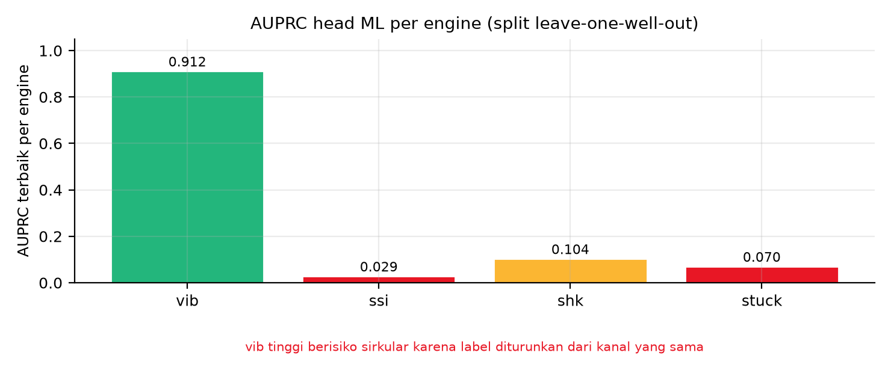

**Gambar 5.** AUPRC terbaik per engine pada split leave-one-well-out dari `dashboard/data/engine_v9_i1.json`: vib 0,912; shk 0,104; stuck 0,070; ssi 0,029. Batang vib menyandang peringatan yang dicalat langsung ke gambar, yaitu risiko sirkularitas karena labelnya diturunkan dari kanal yang sama dengan fitur, sehingga angka 0,912 tidak boleh dibaca sebagai kualitas generalisasi.

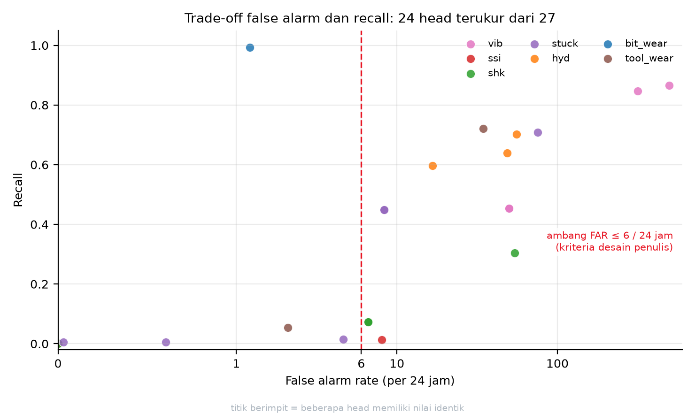

**Gambar 6.** Trade-off false alarm lawan recall pada 24 head yang punya kedua metrik terukur dari 27 head total. Sumbu x menampilkan titik 0, 1, 6, 10, dan 100 sebagai label eksplisit, dan garis putus-putus merah pada FAR 6 per 24 jam adalah kriteria desain yang ditetapkan penulis, bukan hasil optimasi statistik. Hanya sebagian kecil head yang berada di kiri garis ambang.

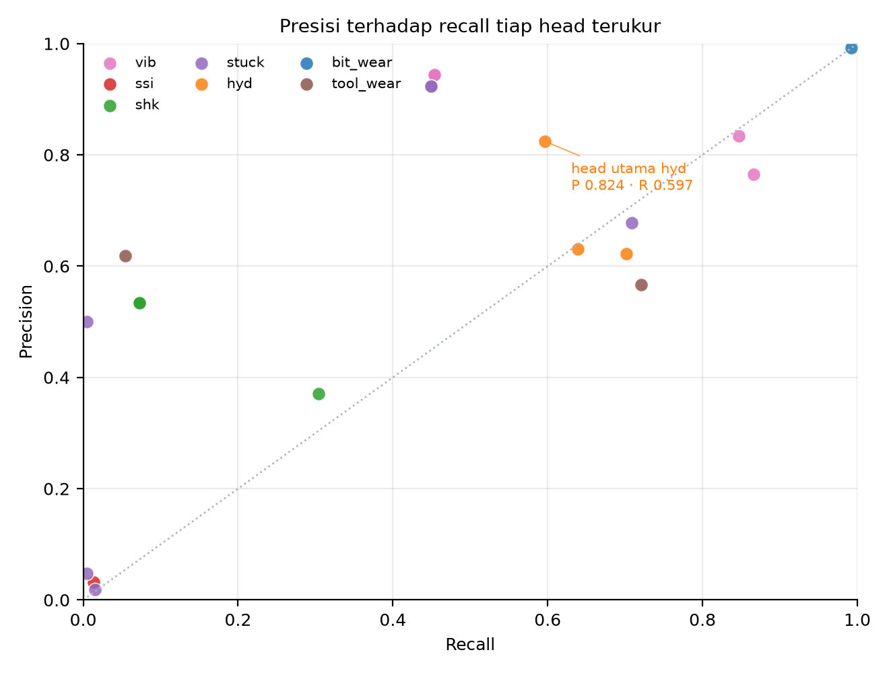

**Gambar 7.** Presisi terhadap recall tiap head terukur. Anotasi atas head utama `hybrid_rule_and_persistence` pada engine hyd menyebut presisi 0,824 dan recall 0,597, dengan FAR 16,6 per 24 jam pada n = 10.401 window (pos 865, neg 9.536). Garis titik-titik diagonal adalah acuan acak (`presisi = recall`). Skrip gambar 5 sampai 7: `docs/assets/make_figures.py`.

Reproduksi:

```bash
cd "/mnt/d/Capstone 1(v2)"
python3 scratch/ppt1/build_mcdm.py        # menulis scratch/ppt1/mcdm.json
python3 scratch/ppt1/build_doc_mcdm.py    # menulis dokumen ini dari mesin yang sama
python3 scratch/ppt1/check_mcdm.py        # memeriksa acceptance dan setiap jejak
```

Pemeriksa `check_mcdm.py` menolak dokumen bila ada angka yang berbeda dari JSON, bila rujukan berkas dan baris tidak ada atau di luar rentang, bila token penanda tidak ditemukan pada baris yang dikutip, bila jumlah skenario kurang dari delapan, dan bila terdapat em-dash atau en-dash. Pemeriksa itu sendiri diuji negatif memakai dokumen yang sengaja dirusak.

---

# BAB IV KESIMPULAN DAN SARAN

## 4.1 Temuan dasar

Dua temuan berikut adalah hasil tahap Investigate. Keduanya bukan jawaban atas rumusan masalah, melainkan bahan yang dipakai untuk menjawabnya, sehingga diletakkan di depan kesimpulan.

**Temuan 1: masalah bukan ketiadaan data.** Masalah utama pada layanan pengeboran yang dikaji bukanlah ketiadaan data, melainkan tidak adanya satu titik keputusan yang menggabungkan data kondisi dengan hasil kalkulasi risiko. Data dan hasil kalkulasi keduanya sudah tersedia: telemetri WITSML dengan 37 sampai 48 kanal terisi per sumur di atas grid 60 detik dan 27 head hasil evaluasi berlapis. Yang belum ada adalah jembatan antara keduanya, sehingga 388 kejadian interupsi dengan 611 jam waktu berhenti di dalam 1.212 jam window terkurasi masih ditangani reaktif, dengan median 45 menit dan p90 180 menit per kejadian. Akar masalah ini diperinci pada fishbone 6M di 1.2 dan dibuktikan dengan tiga alat analisis di Bab II: VSM menunjukkan hampir separuh waktu proses di dalam window terkurasi terkunci pada status menunggu kejelasan (611 dari 1.212 jam), MIFC menunjukkan putusnya alur informasi, dan FTA menunjukkan cabang yang paling menumpuk adalah cabang keputusan manusia, bukan ketiadaan alat ukur.

**Temuan 2: peringkat risiko terbentuk.** FMECA menghasilkan empat mode ber-RPN tinggi: kegagalan fluida sumur (490), stuck pipe (400), kegagalan BHA (378), dan kegagalan mesin permukaan (320). Dua di antaranya sudah memiliki engine yang diuji, sehingga celah yang perlu ditutup adalah keandalan deteksi dan penyajian keputusan, bukan penambahan alat ukur semata.

**Temuan 3: engine pencarian otomatis tidak menyalip RF pada data kejadian.** Untuk menguji pemilihan Random Forest di Bab III, AutoML H2O dijalankan pada data kejadian 4.619 baris dengan 480 fitur, leave-one-well-out pada 7 sumur, anggaran 600 detik dan 100 model per sumur, 18 core, serta CV internal `fold_column=wellbore` 6 fold. Hasilnya AutoML menang hanya 2 dari 7 sumur dan rata-rata AUPRC-nya lebih rendah daripada RF tuned (0,1319 berbanding 0,1392), sementara pada ambang 0,5 lima dari tujuh leader-nya memprediksi nol positif. Sinyal pemilihan internalnya terbukti bocor: korelasi Spearman antara AUPRC CV internal dan AUPRC uji bernilai negatif pada tujuh sumur (-0,39), dan selisih antar kandidat di leaderboard (0,0055) jauh di bawah noise antar sumur, sehingga menambah model, core, atau waktu tidak dapat memperbaiki pemilihan. Keluarga DeepLearning gagal di seluruh run, dan tiga tahap pengujian (A tanpa perlakuan gagal, B clip p99,9 gagal, C clip p99 berhasil) menetapkan penyebabnya pada 5 sel glitch sensor SPPA bernilai sampai 9,524e+30 di data, bukan pada engine. Catatan lengkap beserta tabel per sumur dan jejak reproduksi ada di `docs/PPT1_ABLAT_AUTOML.md`; buktinya tersimpan di `docs/evidence/`.

## 4.2 Kesimpulan: jawaban atas RM1, RM2, dan RM3

Ketiga rumusan masalah dirujuk dengan kode dari 1.1.6. Jumlah butir kesimpulan di bawah sama dengan jumlah pertanyaan, dan setiap butir hanya menjawab satu pertanyaan.

**Kesimpulan RM1: dijawab sebagian.** Lapisan peringatan dini dirancang di atas data yang benar-benar ada, yaitu grid 60 detik dan 37 sampai 48 kanal terisi per sumur, tanpa mengklaim resolusi yang tidak dimiliki. Sumbu rancangan terpilih adalah A1, relabeling onset dari status menjadi peristiwa, dengan koefisien kedekatan 0,8465, juara pada 25 dari 25 kasus uji, dan delta terukur positif pada kelas stuck. Hasil negatifnya dinyatakan terbuka pada Tabel 3.4.12 pada subbab 3.4.13: pada kelas hyd, lift turun ke 0,80 pada satu fold, dan persistence mengalahkan Random Forest pada 7 dari 7 fold, sehingga mekanisme ini belum memberi delta positif pada kelas itu. Rancangan itu dibungkus sebagai sistem pemantauan kondisi pengeboran berbasis dashboard dengan 7 engine dan 27 head, berstatus advisory dengan 0 slot alarm otomatis, dan FTA Bab II mencatat 11 peringatan L1 serta 13 head perlu review, sehingga tinjauan engineer tetap menjadi jalur tunggal sebelum peringatan bertindak. Pemilihan dilakukan dengan TOPSIS atas delapan kriteria dan diuji sensitivitasnya pada sembilan skenario bobot. Kata sebagian dipakai karena delta terukur positif baru ada pada kelas stuck, sedangkan pada kelas hyd hasilnya negatif dan tetap dinyatakan terbuka pada Tabel 3.4.12 pada subbab 3.4.13.

**Kesimpulan RM2: belum dijawab.** Pertanyaan tentang pemilihan titik operasi per engine sehingga peringatan cukup awal dan beban alarm palsu tetap dapat diterima belum memperoleh jawaban berupa angka. Satu-satunya alternatif yang menyentuh langsung gejala sebaran false alarm rate 119,6 kali antar sumur adalah A9, dan A9 berperingkat sembilan karena rancangan kalibrasi belum diuji. Yang dapat dinyatakan sebagai hasil adalah batas persoalannya: pada titik operasi yang sama, false alarm rate menyebar 4,15 sampai 496,09 per 24 jam antar sumur, sehingga satu ambang global tidak dapat dipakai. Penetapan titik operasi per engine dipindahkan ke Saran 1 sebagai pekerjaan yang harus diselesaikan lebih dahulu sebelum head mana pun naik dari peringatan berpengawas menjadi peringatan sungguhan. Menyatakan pertanyaan ini terjawab akan melebihkan capaian Bab III.

**Kesimpulan RM3: belum dijawab.** Pertanyaan tentang penyajian keluaran yang dapat dijelaskan kepada drilling engineer belum memperoleh jawaban rancangan. Kriteria C8 belum dapat dinilai untuk alternatif mana pun karena antarmuka peringatan belum dirancang, seperti dinyatakan pada 3.3.6 butir 8. Yang sudah ada adalah arahnya: keluaran berstatus advisory, seluruh head berada di bawah tinjauan engineer, dan SOP triage serta eskalasi alarm berjenjang baru tercatat sebagai alternatif Anggota A pada 1.3 dan tidak muncul di Bab III sama sekali, sehingga belum dapat disebut pendukung yang sudah ditetapkan. Penyelesaian antarmuka masuk ruang lingkup Proyek Perancangan Terpadu II sesuai batas tahap pada 1.4.5.

## 4.3 Batasan yang menyertai kesimpulan

Butir-butir berikut adalah batasan, bukan temuan, dan tidak menjawab pertanyaan mana pun. Tempatnya di sini supaya tidak terbaca sebagai kesimpulan tambahan.

1. Sistem ini tidak menggantikan keputusan manusia. Seluruh head berada di bawah tinjauan engineer dan tidak ada slot alarm otomatis.
2. Tidak ada klaim penghematan biaya yang sudah terukur pada tahap ini. Seluruh angka ekonomi berasal dari publikasi luar dan berlabel ASUMSI sesuai 1.4.3.
3. Total durasi seluruh kejadian tercatat 73.500 menit atau 1.225 jam, tetapi belum terikat pada satu peristiwa alarm maupun work order, sehingga dampak finansial per kejadian belum dapat dihitung.
4. Sebaran false alarm rate antar sumur mencapai hampir 120 kali, sehingga ambang yang berlaku pada satu sumur tidak otomatis berlaku pada sumur lain.

## 4.4 Saran

Saran di bawah hanya memuat tindak lanjut di luar lingkup PPT I. Batasan yang sudah diketahui tidak diulang sebagai saran.

**Saran 1: melunasi RM2.** Menetapkan titik operasi per engine dan menguji kalibrasi ambang per sumur pada kelas yang lingkupnya sudah ditetapkan A9 (`hyd K-i`, `vib`, `shk`) dengan target false alarm rate di bawah 6 per 24 jam pada mayoritas sumur. Pekerjaan ini melanjutkan pertanyaan yang belum terjawab di Kesimpulan RM2, bukan pertanyaan baru.

**Saran 2: menutup celah deteksi fluida sumur.** Mengembangkan `hyd K-ii` untuk mode kegagalan fluida sumur. Mode ini memperoleh RPN tertinggi justru karena deteksinya paling buruk, sedangkan dampaknya menyentuh aspek keselamatan.

**Saran 3: menguji stabilitas dan sirkularitas.** Menguji ulang head yang buktinya masih terbatas pada satu segmen, yaitu prototipe dashboard F-14, pada sumur di luar F-14, dengan cakupan 24 head yang punya kedua metrik terukur. Hasil AUPRC pada engine getaran sebesar 0,9117 wajib diuji ulang karena labelnya diturunkan dari kanal yang sama, sehingga berisiko sirkular.

**Saran 4: menyelesaikan RM3.** Merancang dan menguji prototipe antarmuka peringatan bersama pemilik masalah, lalu memvalidasi silang rancangan dengan mereka sebelum tahap pemodelan sistem dimulai, sesuai kegiatan re-evaluate pada setiap akhir tahap dalam model SIMILAR.

---

# DAFTAR PUSTAKA DAN LANDASAN KEPUTUSAN DESAIN

Berkas ini mencatat setiap keputusan desain yang punya dasar pustaka, beserta status
kekuatan buktinya. Tujuannya agar pada sidang tidak ada klaim yang berdiri tanpa rujukan,
dan agar pembaca bisa membedakan mana yang berasal dari publikasi peer-review, mana dari
standar, dan mana dari sumber industri yang tidak melalui peer-review.

## A. Peta keputusan ke rujukan

| Keputusan dalam proposal | Rujukan | Isi yang dipakai | Status bukti |
|---|---|---|---|
| NPT layak dijadikan titik masalah ekonomi | [1] | 279 sumur offshore, 69 rig jackup: 37.866 jam NPT = 8,7% dari 434.076,5 jam operasi; severity US$9.760 per jam NPT; total anggaran US$4,24 miliar | Peer-review (Springer, jurnal akses terbuka) |
| Rentang tarif rig dipakai sebagai batas atas ASUMSI | [1] | Day rate drillship ultra-deepwater US$300.000–1.000.000 per hari | Peer-review, dikutip dari laporan pasar rig |
| Stuck pipe dipilih sebagai mode prioritas | [2] | Stuck pipe ≥25% dari NPT pengeboran; tingkat keberhasilan penanganan turun tajam setelah 4 jam | Sumber industri (glosarium teknis), bukan peer-review |
| Masalah stabilitas lubang sebagai mode tersendiri | [2] | Stabilitas lubang ≈10% NPT, rata-rata US$2 juta per sumur di Laut Utara | Sumber industri, angka spesifik perlu verifikasi lanjut |
| Getaran sebagai penyebab kegagalan BHA | [2] | 20–30% kegagalan alat lubang bawah disebabkan getaran | Sumber industri |
| Urgensi penurunan waktu deteksi | [2] | Rata-rata rig offshore mengalami ≈27 hari downtime tak terencana per tahun, ≈US$38 juta (Kimberlite) | Sumber industri, angka pihak ketiga |
| Kenapa dashboard, bukan laporan periodik | [3] | DSS di ruang kendali menurunkan beban kognitif dan menaikkan performa, tetapi menurunkan situation awareness karena ketergantungan berlebih | Peer-review (MDPI Processes) |
| Kenapa desain advisory, 0 alarm otomatis | [3] | Risiko over-reliance: operator percaya penuh pada sistem dan berhenti memantau; trust adalah faktor kritis adopsi | Peer-review (MDPI Processes) |
| Batas jumlah metrik per layar | [4] | Batasi tampilan ke 6–8 metrik kunci; organisasi dengan dashboard KPI terstruktur 3,4 kali lebih cepat mengenali aset bermasalah kronis | Sumber industri (konsultan), bukan peer-review |
| Risiko alarm flood bila alarm ditambah | [5] | EPRI: alarm flood (>10 alarm per 10 menit) terjadi pada >70% pembangkit fosil saat transien; tata kelola alarm mengikuti ISA 18.2 | Sumber industri, bukan peer-review |
| Kerangka FMECA dan perhitungan RPN | [6] | Definisi, perencanaan, dan pelaporan FMEA/FMECA; varian criticality memakai severity dan bobot kepentingan | Standar internasional (IEC) |
| Tahapan proyek berhenti di State the Problem dan Investigate | [7] | Tujuh aktivitas SIMILAR: State, Investigate, Model, Integrate, Launch, Assess, Re-evaluate | Peer-review (jurnal sistem engineering) |
| Pemilihan solusi dengan TOPSIS | [8] | Metode MADM berbasis jarak ke solusi ideal positif dan negatif | Buku teks rujukan utama (Springer, 1981) |
| Peta alur nilai dan pemborosan waktu tunggu | [9] | Value stream mapping: memetakan aliran nilai dan mengidentifikasi muda | Buku kerja standar industri (Shingo Award 1999) |
| Sumber data dan lisensi | [10] | ≈40.000 berkas, produksi 2008–2016, Equinor Open Data Licence, tanpa registrasi | Sumber primer pemilik data |

## B. Catatan kejujuran atas dua rujukan kunci

Dua rujukan paling menentukan argumen "kenapa dashboard" adalah [3] dan [2]. Keduanya
dipakai dengan pembatasan berikut:

1. **[3] tidak mendukung klaim bahwa dashboard menurunkan NPT.** Yang dibuktikan adalah
   pengaruhnya pada performa operator dan beban kognitif di lingkungan simulasi ruang
   kendali proses kimia, bukan di rig. Karena itu proposal ini memakai [3] hanya untuk
   membenarkan bentuk antarmuka dan pembatasan otomatisasi, bukan untuk mengklaim
   penghematan.
2. **[2] dan [4] dan [5] adalah halaman industri, bukan publikasi peer-review.** Angkanya
   dipakai sebagai rentang indikatif dan selalu diberi label ASUMSI di Lampiran D.
   Satu-satunya angka ekonomi yang berstatus peer-review adalah US$9.760 per jam NPT
   dari [1].

## C. Daftar pustaka

[1] Risk-based budgeting: quantifying Non-Productive Time (NPT) offshore drilling
    financial risk. *Journal of Engineering and Applied Science* (Springer Nature).
    https://doi.org/10.1186/s44147-026-01049-9

[2] GA Drilling. Non-Productive Time (NPT). Glosarium teknis.
    https://www.gadrilling.com/glossary/non-productive-time-npt

[3] Enhancing Control Room Operator Decision Making. *Processes*, 12(2), 328. MDPI.
    https://doi.org/10.3390/pr12020328

[4] Oxand. Predictive Maintenance Dashboards: Which Views Actually Drive Better
    Decisions? https://oxand.com/en/blog/predictive-maintenance-dashboards-drive-better-decisions

[5] iFactory. Control Room Modernization: AI Dashboards & Alarm Management.
    https://ifactoryapp.com/blog/power-plant-control-room-ai-dashboards-alarm-hmi

[6] International Electrotechnical Commission. (2018). *IEC 60812:2018 Failure modes
    and effects analysis (FMEA and FMECA)* (3rd ed.). Geneva: IEC.

[7] Bahill, A. T., & Gissing, B. (1998). Re-evaluating systems engineering concepts
    using systems thinking. *IEEE Transactions on Systems, Man, and Cybernetics,
    Part C*, 28(4), 516–527.

[8] Hwang, C.-L., & Yoon, K. (1981). *Multiple Attribute Decision Making: Methods and
    Applications*. Lecture Notes in Economics and Mathematical Systems, Vol. 186.
    Berlin: Springer-Verlag.

[9] Rother, M., & Shook, J. (1999). *Learning to See: Value Stream Mapping to Add Value
    and Eliminate Muda*. Cambridge, MA: Lean Enterprise Institute.

[10] Equinor. (2018). Volve field data set. Equinor Open Data Licence.
     https://www.equinor.com/energy/volve-data-sharing

## D. Rujukan yang sengaja tidak dipakai

Beberapa sumber ditemukan tetapi tidak dimasukkan karena tidak dapat diverifikasi
kelengkapannya (misalnya makalah yang hanya tersedia sebagai pratinjau, atau situs yang
tidak mencantumkan penulis dan tahun). Kebijakan ini dipegang agar daftar pustaka hanya
berisi entri yang bisa ditelusuri pembaca, meskipun jumlahnya lebih sedikit.
