# PROPOSAL PROYEK PERANCANGAN TERPADU I
**Sistem Pemantauan Kondisi Lubang Bor Berbasis Dashboard dengan 7 Mode Kegagalan dan 27 Head (Status Advisory)**

Sumber data adalah dataset publik Equinor Volve dengan lisensi CC BY-NC-SA 4.0. Seluruh perhitungan diturunkan dari data mentah, dan setiap angka disertai rumus, bahan hitung, serta statusnya pada tabel metode subbab terkait.


---

# DAFTAR ISI

- **BAB I PENDAHULUAN**
  - 1.1 Latar Belakang Sistem
  - 1.2 Analisis Akar Penyebab Masalah: Fishbone 6M dan 5W1H
  - 1.3 Pembagian Tanggung Jawab dan Titik Kritis
  - 1.4 Batasan Penelitian dan Kerahasiaan
  - 1.5 Istilah dan Penamaan
  - 1.6 Manfaat bagi Industri dan Pemangku Kepentingan
- **BAB II PENGOLAHAN DATA & ANALISIS**
  - 2.1 Value Stream Mapping (VSM)
  - 2.2 Material & Information Flow Chart (MIFC)
  - 2.3 Operation Process Chart (OPC)
  - 2.4 Failure Modes, Effects, and Criticality Analysis (FMECA)
  - 2.5 Fault Tree Analysis (FTA)
  - 2.6 Tool yang dipertimbangkan dan ditolak
  - 2.7 Sintesis akar masalah
- **BAB III ANALISIS ALTERNATIF SOLUSI**
  - 3.1 Permasalahan & Alternatif Solusi
  - 3.2 Analisis Alternatif Solusi
  - 3.3 Kriteria dan Batasan Pemilihan Alternatif Solusi
  - 3.4 Pemilihan Alternatif Solusi dengan MCDM
  - 3.5 Uji Tambahan Pemilihan Algoritme: Pencarian Otomatis dan Kombinasi Kandidat
- **BAB IV KESIMPULAN DAN SARAN**
  - 4.1 Temuan dasar
  - 4.2 Kesimpulan: jawaban atas RM1 sampai RM4
  - 4.3 Batasan yang menyertai kesimpulan
  - 4.4 Saran
- **LAMPIRAN A. JEJAK REPRODUKSI ANGKA**
- **LAMPIRAN B. DAFTAR ASUMSI**
- **DAFTAR PUSTAKA**

# DAFTAR TABEL

- Tabel 3.1.8a: Setelan pengukuran klasifikasi disfungsi
- Tabel 3.1.8b: F1 per kelas pada pengujian enam kelas
- Tabel 3.1.8c: Hasil uji keparahan ringan
- Tabel 3.1.8d: Sebaran parameter fisika per kelas gangguan
- Tabel 3.1.8e: Rentang keparahan batas yang direncanakan
- Tabel 3.4.1: Jejak setiap sel matriks keputusan
- Tabel 3.4.2: Matriks keputusan dalam satuan mentah
- Tabel 3.4.3: Matriks nilai baku 0 sampai 100
- Tabel 3.4.4: Hasil TOPSIS
- Tabel 3.4.5: Kontribusi tiap kriteria pada tiga besar (nilai V sama dengan bobot kali nilai ternormalisasi)
- Tabel 3.4.6: Sembilan skenario bobot
- Tabel 3.4.7: Enam belas uji satu per satu
- Tabel 3.4.8: Sapuan bobot C1
- Tabel 3.4.9: Stabilitas peringkat pada seluruh uji
- Tabel 3.4.10: Bukti terukur per kelas sasaran

Tabel lain yang tidak bernomor disajikan langsung di dalam subbabnya.

# DAFTAR GAMBAR

- Gambar 1: Cakupan data per wellbore, yaitu jumlah kanal WITSML tersedia dan jumlah kejadian tercakup.
- Gambar 2: Rich picture siklus pengeboran dengan 14 simpul dan 13 relasi berarah.
- Gambar 3: Sebaran durasi interupsi, histogram 883 kejadian dan fungsi distribusi kumulatifnya.
- Gambar 4: Matriks kejadian per kategori per wellbore untuk 884 kejadian.
- Gambar 5: Diagram tulang ikan G1 dengan enam cabang dan 27 ranting.
- Gambar 6: Pareto risiko FMECA atas delapan mode kegagalan dengan total RPN 2.184.
- Gambar 7: AUPRC terbaik per mode pada split leave-one-well-out.
- Gambar 8: Trade-off false alarm melawan recall pada 24 head yang punya kedua metrik terukur.
- Gambar 9: Presisi terhadap recall tiap head terukur.

---

# BAB I PENDAHULUAN

## 1.1 Latar Belakang Sistem

### 1.1.1 Deskripsi Objek Studi dan Sistem yang Dikaji

Objek kajian proyek ini adalah **PT Halliburton Indonesia, divisi Sperry Drilling**, yaitu penyedia jasa pengeboran yang mengoperasikan instrumentasi lubang bawah (MWD, LWD, dan Rotary Steerable System) serta layanan pemantauan parameter pengeboran bagi operator minyak dan gas. Pengajuan objek melalui jalur Magang/MBKM mengikuti ketentuan program Magang/MBKM, sehingga permasalahan yang diangkat harus berasal dari proses kerja nyata mitra dan dimiliki oleh seorang pemilik masalah di lapangan.

Sistem yang dikaji bukan satu alat, melainkan **rantai keputusan pengeboran**: sensor lubang bawah mengirim data fisis ke permukaan, sistem permukaan menampilkan dan menyimpan data tersebut, driller dan drilling engineer membaca tampilan itu, lalu memutuskan apakah pengeboran dilanjutkan, parameter diubah, atau rangkaian ditarik. Mutu rantai ini ditentukan oleh dua hal yang saling bertukar: kelengkapan pengukuran (berapa kanal yang benar-benar terisi) dan kecepatan keputusan (berapa menit antara gejala terbaca dan tindakan diambil).

Basis data yang dipakai proyek berasal dari **lapangan Volve (Equinor, lisensi CC BY-NC-SA 4.0)** karena data operasi mitra tidak dapat dibuka. Inventaris data proyek berisi **10 entri puncak** yang bila ditelusuri rekursif memuat **37.572 berkas** dengan total **27,43 GB** (cacah berkas dan byte per entri, dijumlahkan), dengan tulang punggung berupa **9.935.698 baris log pengeboran WITSML hasil parse** dari 10 berkas CSV, yaitu 9.935.708 baris mentah dikurangi 10 baris header dan matriks latih **292.954 baris** pada **6 dataset siap pakai**. Cakupan sumur adalah **10 wellbore** dengan rentang kejadian dari tahun 2007 sampai 2015 menurut kolom `event_date`.

Perlu dinyatakan sejak awal agar naskah tidak menyesatkan: data yang dipakai adalah **data lapangan nyata beresolusi grid 60 detik**, bukan telemetri real time 1 Hz. Resolusi 1 Hz tidak dipakai karena tidak tersedia pada data, sehingga seluruh klaim kinerja di Bab I dan Bab II terikat pada resolusi 60 detik, dan pemakaian langsung pada stream mitra dinyatakan sebagai rencana integrasi, bukan hasil.

Sistem yang diusulkan proyek berada di antara tahap pengukuran dan tahap keputusan, yaitu lapisan **decision support** yang mengubah data parameter pengeboran menjadi peringatan dini beserta alasannya. Lapisan ini dirancang sebagai **7 mode deteksi** yang direalisasikan dalam **27 varian metode (head)**, dilatih pada matriks 55 fitur dan diuji dengan **37 lipatan leave-one-well-out** tanpa satu pun pelanggaran kebocoran fitur ke label.

### 1.1.2 Stakeholder dan Kepentingannya

Identifikasi pemangku kepentingan beserta kepentingannya diperlukan karena karakteristik masalah kompleks WP6 menuntut adanya pihak dengan tuntutan yang berbeda.

| No | Stakeholder | Peran dalam sistem | Kepentingan utama | Risiko bila sistem salah | Bukti keberadaan pihak |
|---|---|---|---|---|---|
| S1 | Driller / company man di rig | Pemakai keputusan akhir (problem owner) | Peringatan yang cukup awal dan cukup jelas untuk ditindaklanjuti sebelum kerusakan membesar | Kelelahan akibat alarm palsu; keputusan berubah karena saran yang salah | Dokumen mitra menetapkan driller dan tim operasi Sperry sebagai problem owner |
| S2 | Drilling engineer / supervisor Sperry Drilling | Penafsir data dan penyusun program pengeboran | Diagnosis yang dapat dijelaskan, bukan kotak hitam, agar dapat dipertanggungjawabkan ke operator | Kehilangan kepercayaan pada alat; rekomendasi tidak dipakai | Divisi mitra; dokumen mitra halaman 31 sampai 32 (pemantauan parameter pengeboran) |
| S3 | Manajemen Sperry Drilling (mitra MBKM) | Penyedia jasa, pemilik proses kerja | Efisiensi waktu rig dan reputasi layanan | Biaya layanan naik karena waktu non-produktif tidak terdeteksi | Mitra proyek |
| S4 | Operator minyak dan gas (mis. Eni) | Pemilik sumur dan anggaran | Ketepatan waktu penyerahan sumur dan keamanan operasi | Pembengkakan biaya rig dan risiko integritas sumur | Rilis pers Halliburton 9 Juli 2026 tentang operasi closed-loop bersama Eni di Indonesia |
| S5 | Engineer MWD/LWD di lokasi | Penjaga mutu kanal pengukuran | Kanal yang rusak atau kosong dikenali sebagai keterbatasan alat, bukan disalahkan ke manusia | Kanal bermasalah tetap dipakai sebagai dasar peringatan | Kanal instrumen MWD menjadi sumber label (VIBLAT_RT, SHKRSK_RT, STUCK_RT, CRPM_RT) |
| S6 | Fungsi HSE / keselamatan | Penjaga batas keselamatan operasi | Tidak ada insiden sumur (kick, loss, pipa terjepit) yang terlambat ditangani | Peringatan yang terlalu lambat dianggap gagal sistem | Tujuh detektor mencakup hidraulik dan pipa terjepit; kategori `safety_personnel` ada di label kejadian |
| S7 | Tim PPT I (tiga orang) | Perancang dan pelaksana kajian | Metode yang dapat dipertanggungjawabkan, data yang dapat diaudit | Naskah dinilai tidak berbasis bukti | Susunan tim dan pembagian peran pada 1.3 |
| S9 | Pemilik data (Equinor, lewat kanal Volve) | Penyedia data uji | Data dipakai sesuai lisensi dan tidak diklaim sebagai milik proyek | Pelanggaran lisensi CC BY-NC-SA 4.0 | baris lisensi |

Dua ketegangan antarpihak yang akan muncul berulang di Bab III: (a) S1 dan S5 berlawanan soal ambang, karena S1 menuntut peringatan sesedikit mungkin sedangkan S5 menuntut kanal bermasalah tetap dilaporkan; (b) S2 dan S4 berlawanan soal bentuk keluaran, karena S2 menuntut penjelasan yang dapat diperiksa sedangkan S4 menuntut keputusan cepat. Keduanya menjadi bahan sub-bab trade-off 1.1.5.

### 1.1.3 Alur Operasi dan Alur Data

Alur operasi pengeboran terdiri atas delapan tahap. Kolom terakhir menunjukkan **di mana tahap itu meninggalkan jejak data yang benar-benar dipakai proyek**, sehingga alur ini bukan gambar konseptual tanpa kaitan ke berkas.

| Tahap | Aktor utama | Keluaran tahap | Jejak data di proyek | Titik gangguan yang terukur |
|---|---|---|---|---|
| T1 Perencanaan sumur dan desain rangkaian bor | Drilling engineer | Program pengeboran, desain BHA | **161 berkas bhaRun**, **192 assembly tubular berisi 1.392 komponen**, **63 berkas trajectory berisi 5.561 stasiun**, **27 berkas wbGeometry berisi 109 section** | Rating motor (batas torsi dan tekanan) tidak ada pada 192 dari 192 berkas, sehingga perhitungan beban puncak rangkaian tetap terblokir |
| T2 Rakit rangkaian dan masuk lubang (make-up dan RIH) | Rig crew, MWD engineer | Rangkaian siap, run dimulai | `dTimStart`/`dTimStop` per run; 154 dari 161 `uidRef` bhaRun bertaut ke tubular | Hanya 19 dari 161 run memuat batas kedalaman, sehingga penautan waktu ke kedalaman rapuh |
| T3 Pengeboran dengan parameter terkendali | Driller | Lubang bertambah, parameter terekam | Kanal inti `TQA`, `SPPA`, `TFLO`, `RPM`, `SWOB`, `HKLD`, `ROP`, `SPM`, `depth`, `dbtm` | Beban dan getaran berlebih tidak terlihat sebagai satu angka tunggal, melainkan pola beberapa kanal sekaligus |
| T4 Transmisi telemetri lubang bawah ke permukaan | Sistem MWD/LWD | Data lubang bawah di permukaan | Kanal instrumen `VIBLAT_RT`, `SHKRSK_RT`, `STUCK_RT`, `CRPM_RT` | Kanal instrumen jarang terisi: `SHKRSK_RT` di F-7 hanya 0,67 persen baris, `CRPM_RT` F-7 0,51 persen, `VIBLAT_RT` F-14 0,14 persen |
| T5 Perekaman dan penyeragaman grid data | Sistem permukaan dan historian | Data tersimpan dan seragam | Grid **60 detik** dengan mode seluruh baris; jendela fitur 10 menit hanya melihat ke masa lalu | Fill-rate tidak seragam: 60 sampai 281 kanal per sumur, tetapi hanya **37 sampai 48 kanal terisi minimal 50 persen**; F-14 hanya 12.635 dari 96.698 bin menit berstatus mengebor (13,1 persen) |
| T6 Pemantauan dan interpretasi di permukaan | Driller, MWD engineer, drilling engineer | Penilaian kondisi lubang | Tampilan permukaan (LOGIX pada operasi mitra); di proyek digantikan dashboard advisory | Penilaian bergantung pada intuisi dan pengalaman, tanpa ambang adaptif per sumur; laju alarm palsu 0,00 sampai 132,05 per 24 jam antar sumur dan mode pada mode getaran |
| T7 Keputusan operasi | Driller bersama supervisor | Lanjut, ubah parameter, atau tarik rangkaian | Tidak terekam sebagai kolom keputusan; tercermin pada `state_detail`, `category`, dan `outcome` label kejadian | Keputusan yang tidak terdokumentasi menyulitkan penautan sebab dan akibat antara peringatan dan tindakan |
| T8 Pencatatan kejadian dan pelaporan harian | Rig supervisor, DDR | Laporan harian pengeboran | **884 kejadian terkurasi** dengan 9 kategori | Hanya **582 dari 884** kejadian yang rentang waktunya masuk ke rentang CSV terparse; 571 kejadian relevansi BHA-nya masih `uncertain` |

Pembacaan alur di atas menghasilkan satu kesimpulan yang menjadi dasar seluruh bab: **informasi disfungsi sudah tersedia di data, tetapi tidak pernah berubah menjadi keputusan lebih awal**. Nilai tambah bukan terletak pada penambahan sensor, melainkan pada penyisipan satu tahap penalaran antara T5 dan T6. Tahap itulah yang dibangun proyek, dan posisinya dalam rich picture ditandai sebagai simpul N7 pada 1.1.4.

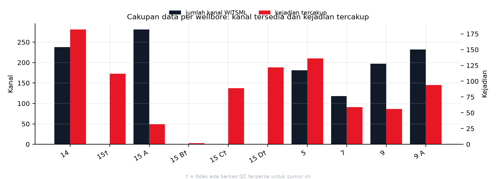

**Gambar 1.** Cakupan data per wellbore: batang gelap (sumbu kiri) menunjukkan jumlah kanal WITSML tersedia dan batang merah (sumbu kanan) menunjukkan jumlah kejadian tercakup. Enam dari sepuluh wellbore memiliki berkas QC dengan jumlah kanal 118 sampai 281. Empat wellbore lain (F-15, F-15 B, F-15 C, F-15 D) tidak memiliki berkas QC terparse sehingga batangnya nol dan ditandai †. Jumlah kejadian per wellbore menyebar dari 2 (F-15 B) sampai 182 (F-14). Nilai tiap batang dihitung dari tabel kanal dan tabel kejadian per wellbore, sebagaimana dijelaskan pada 1.1.8.

### 1.1.4 Rich Picture: Narasi dan Spesifikasi Elemen

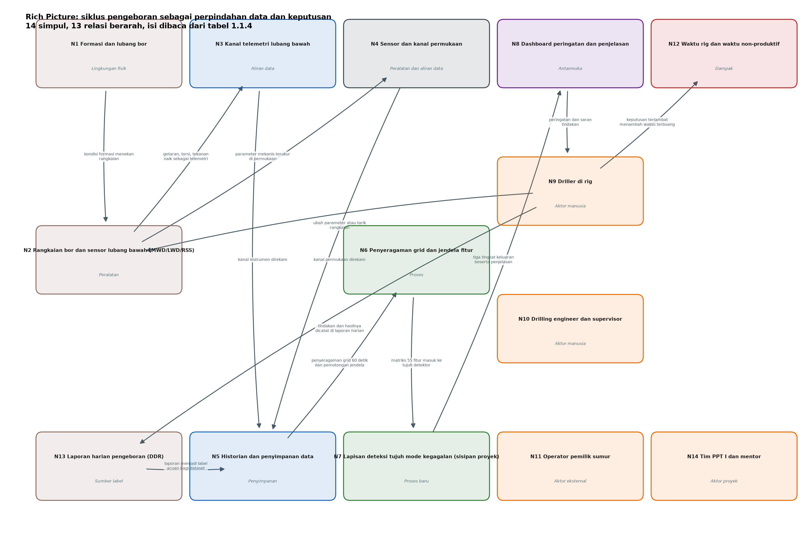

**Gambar 2.** Rich picture siklus pengeboran: 14 simpul dan 13 relasi berarah, digambar dari tabel elemen pada subbab ini. Kotak berwarna menunjukkan jenis elemen, panah menunjukkan arah aliran data dan keputusan.

#### Narasi

Rich picture menggambarkan satu siklus pengeboran sebagai perpindahan data dari lubang bawah ke keputusan, lalu kembali menjadi tindakan di rig. Di sisi kiri gambar, rangkaian bor dan sensor lubang bawah menghasilkan besaran fisis: torsi, tekanan standpipe, laju alir, berat pada bit, putaran, dan getaran. Besaran itu naik ke permukaan sebagai telemetri, direkam oleh historian, diseragamkan ke grid 60 detik, lalu dipotong menjadi jendela 10 menit yang hanya melihat ke belakang. Di tengah gambar, tujuh detektor menilai jendela tersebut dan mengeluarkan tiga tingkat keluaran: status kondisi, peringatan berpengawasan, dan tren. Di sisi kanan, driller dan drilling engineer menerima keluaran itu bersama penjelasan kanal mana yang menyimpang, lalu memutuskan melanjutkan, mengubah parameter, atau menarik rangkaian. Keputusan itu mengubah kondisi lubang, yang kembali terekam sebagai data, sehingga siklus tertutup.

Gangguan masuk ke gambar di lima tempat. Pertama, kanal instrumen yang jarang terisi membuat label sulit dibentuk, terlihat dari `CRPM_RT` yang kosong pada 86,68 persen bin menit, yaitu 537.644 dari 620.288 bin tanpa satu pun bacaan CRPM. Kedua, kepadatan waktu tidak merata, karena F-14 hanya 13,1 persen bin menit berstatus mengebor. Ketiga, label kejadian bersifat ambigu, karena 56,1 persen dari 884 kejadian justru tidak memuat bukti kegagalan dan 64,6 persen relevansi BHA-nya uncertain. Keempat, ambang global tidak dapat dipakai karena laju alarm palsu menyebar 0,00 sampai 132,05 per 24 jam antar sumur dan mode. Kelima, keputusan manusia tidak terdokumentasi sebagai data, sehingga rantai sebab akibat antara peringatan dan tindakan harus disimpulkan dari label kejadian.

Empat loop umpan balik digambar sebagai panah melingkar. Loop operasi menjelaskan mengapa masalah ini berulang: disfungsi terdeteksi setelah dampak terjadi, lalu tindakan perbaikan memakan waktu rig, dan hasilnya hanya tercatat sebagai kejadian baru tanpa mengubah cara pemantauan. Loop kalibrasi menjelaskan bahwa model harus disesuaikan per sumur karena karakter kanal berbeda. Loop pelabelan menjelaskan bahwa laporan harian menjadi sumber kebenaran acuan, sehingga mutu laporan menentukan mutu model. Loop keputusan menjelaskan bahwa keluaran model baru bernilai bila berakhir pada tindakan yang terverifikasi.

#### Daftar elemen: simpul (14 simpul, syarat minimal 10)

| ID | Nama elemen | Jenis | Isi yang harus tergambar | Bukti atau angka yang menempel |
|---|---|---|---|---|
| N1 | Formasi dan lubang bor | Lingkungan fisik | Potongan lubang, kedalaman, litologi sekitar | Litologi mudlog: 2.882 interval, dengan claystone 957 dan sandstone 884 sebagai litologi terbanyak |
| N2 | Rangkaian bor dan sensor lubang bawah (MWD/LWD/RSS) | Peralatan | BHA, bit, sensor, arah aliran data ke atas | 161 run bhaRun dan 1.392 komponen tubular |
| N3 | Kanal telemetri lubang bawah | Aliran data | Empat kanal instrumen dan tanda kanal kosong | `VIBLAT_RT`, `SHKRSK_RT`, `STUCK_RT`, `CRPM_RT`; `CRPM` kosong 86,68 persen |
| N4 | Sensor dan kanal permukaan | Peralatan dan aliran data | Torsi, standpipe, laju alir, hookload, WOB, RPM, ROP | 11 kanal permukaan menjadi dasar 55 fitur |
| N5 | Historian dan penyimpanan data | Penyimpanan | Berkas WITSML terparse dan himpunan data latih | 10 CSV, 9.935.708 baris mentah; 37.572 berkas pada 10 entri puncak, 27,43 GB |
| N6 | Penyeragaman grid dan jendela fitur | Proses | Dua kotak proses: grid 60 detik lalu jendela 10 menit | Konversi grid 60 detik dan jendela `[t0-10, t0)` |
| N7 | Lapisan deteksi tujuh mode kegagalan (sisipan proyek) | Proses baru | Tujuh kotak kecil atau satu kotak berlabel 7 mode, dengan tiga tingkat keluaran | 7 mode, 27 head, 292.954 baris latih |
| N8 | Dashboard peringatan dan penjelasan | Antarmuka | Peringatan, tingkat keyakinan, kanal penyebab | Tier alat 0 alarm otomatis, 3 peringatan, 2 bersyarat, 2 tren |
| N9 | Driller di rig | Aktor manusia | Orang yang mengambil keputusan langsung | Pemilik masalah; ambang alarm belum layak otomatis |
| N10 | Drilling engineer dan supervisor | Aktor manusia | Pemeriksa penjelasan dan penyusun program | Kebutuhan explainability; ketegangan S2 melawan S4 di 1.1.2, lalu menjadi kriteria pemilihan di Bab III |
| N11 | Operator pemilik sumur | Aktor eksternal | Penerima laporan kinerja sumur | Rilis pers Eni dan Halliburton 9 Juli 2026 |
| N12 | Waktu rig dan waktu non-produktif | Dampak | Dua kolom waktu berdampingan: produktif dan terbuang | 884 kejadian, total 73.500 menit atau 1.225 jam; median 45 menit |
| N13 | Laporan harian pengeboran (DDR) | Sumber label | Tumpukan laporan yang menjadi asal label kejadian | 884 kejadian terkurasi; hanya 50 yang terverifikasi relevan BHA |
| N14 | Tim PPT I | Aktor proyek | Kotak pemilik kajian di luar sistem operasi | Tim tiga orang (1.1.2 S7) |

#### Daftar elemen: relasi (13 relasi berarah, syarat minimal 8)

| ID | Dari | Ke | Label panah | Jenis aliran |
|---|---|---|---|---|
| R1 | N1 | N2 | kondisi formasi menekan rangkaian | fisik |
| R2 | N2 | N3 | getaran, torsi, tekanan naik sebagai telemetri | data |
| R3 | N2 | N4 | parameter mekanis terukur di permukaan | data |
| R4 | N3 | N5 | kanal instrumen direkam | data |
| R5 | N4 | N5 | kanal permukaan direkam | data |
| R6 | N5 | N6 | penyeragaman grid 60 detik dan pemotongan jendela | proses |
| R7 | N6 | N7 | matriks 55 fitur masuk ke tujuh detektor | data |
| R8 | N7 | N8 | tiga tingkat keluaran beserta penjelasan | informasi |
| R9 | N8 | N9 | peringatan dan saran tindakan | keputusan |
| R10 | N9 | N2 | ubah parameter atau tarik rangkaian | tindakan |
| R11 | N9 | N12 | keputusan terlambat menambah waktu terbuang | dampak |
| R12 | N9 | N13 | tindakan dan hasilnya dicatat di laporan harian | dokumentasi |
| R13 | N13 | N5 | laporan menjadi label acuan bagi dataset | umpan balik data |

#### Loop umpan balik (4 loop)

| ID | Nama loop | Jalur | Mengapa penting untuk gambar |
|---|---|---|---|
| L1 | Loop operasi reaktif | N9 lalu N12 lalu N13 lalu N5 lalu N7 | Menjelaskan akar masalah berulang: deteksi terjadi setelah dampak timbul, dan hasilnya hanya menjadi catatan kejadian baru |
| L2 | Loop kalibrasi per sumur | N7 lalu N8 lalu N10 lalu N7 | Menjelaskan mengapa ambang global dilarang: laju alarm palsu menyebar 0,00 sampai 132,05 per 24 jam antar sumur dan mode pada mode getaran |
| L3 | Loop mutu label | N13 lalu N5 lalu N6 lalu N7 | Menjelaskan mengapa mutu laporan harian menentukan mutu model, karena 56,1 persen kejadian tidak memuat bukti kegagalan |
| L4 | Loop keputusan dan verifikasi | N8 lalu N9 lalu N12 lalu N8 | Menutup siklus nilai: keluaran model baru bernilai bila berakhir pada tindakan yang hasilnya terukur |

#### Penanda gangguan (5 titik)

| ID | Titik gangguan | Letak di gambar | Angka pendukung |
|---|---|---|---|
| G1 | Kanal instrumen jarang terisi | Antara N2 dan N3, tanda putus | `CRPM_RT` kosong 86,68 persen baris; `SHKRSK_RT` F-7 0,67 persen terisi |
| G2 | Kepadatan waktu tidak merata | Di dalam N5 atau N6, tanda kepadatan berbeda per sumur | F-14 hanya 12.635 dari 96.698 bin menit berstatus mengebor (13,1 persen) |
| G3 | Label kejadian ambigu | Antara N13 dan N5, tanda tanya | 496 dari 884 kejadian tanpa bukti kegagalan (56,1 persen); 571 uncertain |
| G4 | Ambang tidak portabel | Di dalam N7 atau N8, tanda larangan ambang global | Laju alarm palsu 0,00 sampai 132,05 per 24 jam antar sumur dan mode |
| G5 | Keputusan manusia tidak terekam | Antara N9 dan N13, kotak abu-abu | Tidak ada kolom keputusan pada 20 kolom label kejadian |

#### Ketentuan gambar rich picture

1. Tata letak: lubang bawah di kiri, permukaan dan historian di tengah, keputusan dan dampak di kanan, waktu sebagai sumbu mendatar dari kiri ke kanan.
2. N7 wajib dibedakan secara visual (warna berbeda) karena itu satu-satunya komponen yang ditambahkan proyek, sedangkan N1 sampai N6 dan N9 sampai N13 adalah sistem eksisting.
3. Setiap nomor simpul, relasi, loop, dan gangguan wajib ditulis di gambar dengan ID yang sama seperti tabel di atas, agar naskah dan gambar dapat dicocokkan satu per satu.
4. Angka yang dicetak di gambar dibatasi pada lima angka berikut agar tidak sesak: 884 kejadian, 1.225 jam, 7 mode, 0 dari 7 alarm otomatis, dan 86,68 persen kanal kosong.
5. Legenda wajib memuat empat jenis garis: aliran data, aliran keputusan, aliran dampak, dan loop umpan balik.

### 1.1.5 Trade-off Variabel Sistem

Model SIMILAR tahap satu mensyaratkan perumusan trade-off minimal dua aspek. Trade-off di bawah disusun dari kategori 6M agar tidak menjadi retorika, dan setiap kutub ditempeli angka hasil pengukuran proyek, bukan perkiraan.

**T1 Man melawan Method: kewenangan manusia berbanding otomatisasi ambang.**
Kutub Man memberi driller hak memutuskan dengan dukungan peringatan, sedangkan kutub Method menyerahkan keputusan pada ambang otomatis. Data proyek menolak kutub Method untuk saat ini: **tidak ada satu pun dari 7 mode yang memenuhi syarat alarm otomatis**, dan rekap alat menunjukkan 0 alarm, 3 peringatan berpengawasan, 2 bersyarat, serta 2 hanya untuk tren. Pada mode hidraulik yang paling kuat, alarm palsu masih 14,62 sampai 58,43 per 24 jam, sedangkan sapuan ambang seluruh detektor hanya menemukan 10 dari 402 titik uji yang memenuhi syarat alarm dengan recall positif. Implikasi desain: keluaran 1.1 dan Bab III harus berupa **advisory dengan manusia di dalam loop**, dan klaim alarm otomatis ditulis sebagai sasaran yang belum tercapai, bukan sebagai kemampuan.

**T2 Machine melawan Measurement: resolusi instrumen berbanding kelengkapan pengukuran.**
Kutub Machine menuntut resolusi setinggi mungkin, sedangkan kutub Measurement dibatasi oleh kanal yang benar-benar terisi. Pipeline yang berjalan memakai grid 60 detik, sementara laju kanal permukaan dianggap sekitar 1 Hz. Pada sisi kelengkapan, tiap sumur membawa 60 sampai 281 kanal tetapi hanya 37 sampai 48 kanal terisi minimal 50 persen, dan kanal `CRPM_RT` yang menjadi dasar label stick-slip kosong pada 86,68 persen bin menit (537.644 dari 620.288). Implikasi desain: menaikkan resolusi tanpa menutup kanal kosong hanya menambah baris kosong, sehingga prioritas Bab III adalah **pemilihan kanal dan kalibrasi per sumur**, bukan penambahan frekuensi.

**T3 Method melawan Measurement: sensitivitas ambang berbanding beban alarm palsu.**
Menaikkan sensitivitas menaikkan recall tetapi juga menaikkan alarm palsu, dan keduanya terukur pada detektor yang sama. Pada mode getaran, presisi rule mencapai 0,868 sampai 0,952 tetapi recall hanya 0,276 sampai 0,595 dengan alarm palsu 9,99 sampai 49,94 per 24 jam. Pada mode stick-slip, recall rule bahkan 0,000 sampai 0,032. Sebaliknya, detektor pipa terjepit memperoleh presisi 0,9238 sampai 0,9662 dan recall 0,449 sampai 0,599 tetapi alarm palsunya 8,32 sampai 61,0 dan cakupannya hanya 2 lipatan. Implikasi desain: tidak ada satu titik operasi yang berlaku untuk semua detektor, sehingga Bab III wajib memilih titik operasi **per mode** dan menyertakan uji sensitivitas, bukan satu ambang global.

Ketiga trade-off di atas menegaskan batas: target desain recall 0,70 sampai 0,80 dan lead time 10 sampai 30 menit masih berstatus **ASUMSI berupa target**, karena hasil terukur baru mencapai lead 4,5 sampai 8,5 menit pada satu kelas dan nol alarm otomatis.

### 1.1.6 Uraian Singkat Permasalahan

Lima pernyataan berikut diletakkan paling depan supaya pembaca tahu apa yang dikerjakan sebelum masuk ke angka. Angka pendukungnya ada pada tabel di bawah pernyataan ini, pada 1.1.8, dan rumus serta perintah pengulangnya pada 1.1.9.

**Apa yang dikerjakan.** Proyek ini membangun lapisan bantu keputusan yang mengubah data permukaan pengeboran menjadi peringatan dini untuk tujuh mode kegagalan rangkaian lubang bawah: getaran, stick-slip, hentakan, pipa terjepit, masalah hidraulik, keausan mata bor, dan keausan peralatan. Keluaran yang dijanjikan adalah baris peringatan per jendela menit yang menyebut mode, gejala, lama gejala bertahan, sisa waktu untuk bertindak, tingkat kewenangan, dan tindakan yang disarankan. Keluaran itu tidak menyebut komponen mana yang akan rusak, dan ketiadaan itu disengaja.

**Bagaimana pekerjaan itu dijalankan.** Enam langkah, berurutan. Pertama, deret waktu sepuluh wellbore disamakan ke grid 60 detik, dengan kanal yang terisi sedikitnya 50 persen berkisar 28 sampai 48 per sumur, dan pada tujuh sumur uji kendali berkisar 37 sampai 48. Kedua, 884 kejadian pada laporan harian dibaca satu per satu dan diubah menjadi label awal gejala, bukan label status pada satu jam. Ketiga, setiap jendela menit diwakili 480 fitur turunan kanal permukaan. Keempat, tiap mode diuji melalui beberapa varian metode, dengan total 27 head, dan hasilnya dibandingkan langsung. Kelima, seluruh evaluasi memakai skema leave-one-well-out dengan 37 lipatan, sehingga sumur uji tidak pernah ikut berlatih. Keenam, hasil deteksi disusun menjadi lapisan keputusan dengan tiga tingkat kewenangan (tren, peringatan berpengawasan, dan belum layak pakai), anggaran enam pemeriksaan per 24 jam, dan 13 head yang wajib ditinjau manusia. Pada keadaan sekarang, enam dari tujuh mode memiliki sedikitnya satu klaim bertingkat peringatan berpengawasan, mode keausan mata bor baru sampai tingkat tren, dan tidak ada satu pun klaim yang bertingkat alarm otomatis.

**Mengapa arah ini yang dipilih.** Tiga sebab, semuanya bertumpu pada keadaan data dan pada nilai yang bisa dipertanggungjawabkan. Pertama, data tidak memuat komponen penyebab: hanya 50 dari 884 kejadian terverifikasi relevan BHA, 571 berstatus uncertain, dan rating motor tidak ada pada 192 dari 192 berkas tubular menurut ekspor EDM yang belum diuji ulang terhadap data primer sebagaimana dinyatakan pada 1.1.7. Karena itu pertanyaan "komponen mana yang akan rusak" tidak dapat dijawab dengan bahan ini, dan memaksakannya akan menghasilkan klaim tanpa bukti. Kedua, nilai teknisnya terletak pada waktu, bukan pada nama bagian: total waktu terbuang tercatat 73.500 menit atau 1.225 jam, median satu kejadian 45 menit, dan lead time terukur 4,5 sampai 8,5 menit dengan median 7,0 menit pada kelas pipa terjepit. Ketiga, hanya dengan batas yang dinyatakan terbuka hasilnya dapat diperiksa ulang: nol dari 27 head layak dijadikan alarm otomatis, sehingga keluaran proyek dinyatakan sebagai peringatan berpengawasan yang menunggu manusia, bukan alarm.

**Bentuk keluaran yang dijanjikan.** Satu baris per jendela menit yang memicu peringatan, dengan tujuh medan berikut.

| Medan | Isi | Batas yang menyertainya |
|---|---|---|
| Mode | Salah satu dari tujuh mode kegagalan | Bukan nama komponen penyebab |
| Gejala | Kanal dan pola yang menyimpang dari rancangan | Hanya kanal permukaan yang terisi |
| Lama gejala | Berapa menit gejala bertahan | Bukan durasi kerusakan alat |
| Sisa waktu | Perkiraan menit sebelum dampak | Baru terukur pada kelas pipa terjepit, bukan janji seragam |
| Tingkat | Tren, peringatan berpengawasan, atau belum layak pakai | Tidak ada tingkat alarm otomatis |
| Tindakan | Pemeriksaan yang disarankan | Keputusan tetap pada manusia |
| Batas | Syarat berlakunya peringatan itu | Dinyatakan pada baris yang sama |

**Apa yang tidak dikerjakan.** Empat hal berikut dinyatakan tertutup agar tidak ditagih sebagai luaran. Proyek ini tidak melaporkan sisa umur pakai sebagai luaran, sebab formulasi survival A6 masih berstatus belum dikerjakan pada 3.1.4.6; proyek ini juga bukan penamaan komponen yang akan gagal, bukan alarm otomatis yang boleh dipercaya tanpa manusia, dan bukan pengganti insinyur pengeboran. Alasan penutupannya ada pada paragraf berikut serta pada 1.1.7 dan 1.4.

Permasalahan utama bukan kerusakan alat tunggal, melainkan **tidak adanya lapisan penalaran yang mengubah data pengeboran menjadi peringatan sebelum dampak terjadi**. Akibatnya, setiap disfungsi baru dikenali setelah ia menjadi waktu terbuang, dan pengetahuan tentangnya hanya tersimpan sebagai catatan kejadian, tidak sebagai aturan pemantauan.

Ukuran dampak yang dapat dipertanggungjawabkan disajikan pada tabel berikut. Semua baris berasal dari hitung ulang pada subbab ini, dan tidak ada baris yang berdiri sebagai perkiraan.

| Dimensi dampak | Angka | Cara membaca yang benar |
|---|---|---|
| Populasi kejadian operasi | 884 kejadian pada 10 wellbore | Ini populasi kejadian operasional, bukan 884 kerusakan |
| Waktu terbuang tercatat | 73.500 menit atau 1.225 jam | Total durasi seluruh kejadian, dihitung dari selisih `act_start` dan `act_end` |
| Sebaran durasi per kejadian | median 45 menit, p90 180 menit, maksimum 780 menit | Setengah kejadian berlangsung sampai 45 menit, dan sepuluh persen terpanjang bernilai 3 jam atau lebih |
| Komposisi kategori terbesar | `routine_no_failure_evidence` 496 kejadian (56,1 persen) dan 601,1 jam | Kategori terbesar justru bukan kegagalan, sehingga tidak boleh dipakai sebagai bukti kerusakan |
| Kategori kegagalan peralatan permukaan | `surface_rig_equipment` 216 kejadian dan 343,5 jam (28,0 persen jam) | Penyumbang jam terbesar di antara kategori yang memuat bukti kegagalan |
| Kategori kegagalan lubang bawah | `bha_stuck_fishing` 38 kejadian dan 47,3 jam, serta `bha_downhole_equipment` 12 kejadian dan 14,0 jam | Kedua kategori ini yang paling relevan bagi objek Sperry Drilling |
| Relevansi BHA | 50 kejadian `yes` (5,7 persen), 263 `no`, 571 `uncertain` (64,6 persen) | Hanya sebagian kecil kejadian terbukti menyangkut rangkaian lubang bawah |
| Konsentrasi sumur | F-14 menyumbang 182 kejadian (20,6 persen) | Beban kejadian tidak merata, sehingga validasi antar sumur wajib |
| Mutu capaian deteksi saat ini | 0 dari 7 mode layak alarm otomatis | Kapasitas alat saat ini adalah peringatan berpengawasan, bukan alarm |
| Lead time terukur | 4,5 sampai 8,5 menit dengan median 7,0 menit pada kelas pipa terjepit | Ini satu-satunya lead time bersatuan menit yang terukur di domain rig |
| Sasaran yang belum tercapai | recall 0,70 sampai 0,80 dan lead 10 sampai 30 menit | Keduanya berstatus target desain, bukan hasil |
| Rujukan pihak ketiga | efisiensi lebih dari 15 persen pada operasi closed-loop Eni | Milik vendor dan milik operasi pihak lain, tidak boleh menjadi janji luaran proyek |

Dengan bahan tersebut, permasalahan dirumuskan dalam empat pertanyaan yang menjadi batas kajian. Keempatnya diberi kode RM1 sampai RM4 supaya dapat dirujuk ulang di Bab III dan Bab IV. Keempat kode itu adalah pertanyaan riset. Hal-hal yang mengikat ruang lingkup jawaban, misalnya jumlah sumur, kualitas label, dan ketersediaan kanal, bukan pertanyaan riset dan diletakkan terpisah pada paragraf batasan di bawah serta pada subbab 1.4:

**RM1.** Bagaimana merancang lapisan peringatan dini yang memakai data pengeboran yang benar-benar tersedia pada grid 60 detik dan kanal yang terisi 37 sampai 48 per sumur, tanpa mengklaim resolusi yang tidak dimiliki?
**RM2.** Bagaimana memilih titik operasi per mode sehingga peringatan cukup awal untuk ditindaklanjuti, sedangkan beban alarm palsu tetap dapat diterima pengawas, mengingat laju alarm palsu mencapai 0,00 sampai 132,05 per 24 jam antar sumur dan mode?
**RM3.** Bagaimana menyajikan keluaran yang dapat dijelaskan kepada drilling engineer, sehingga rekomendasi dipakai dan bukan diabaikan, ketika kapasitas alat baru sampai pada peringatan berpengawasan pada 6 dari 7 mode?

**Cara menghitung angka 6 dari 7 pada RM3.** Satu mode dihitung memenuhi syarat bila sedikitnya satu klaim di dalamnya bertier peringatan berpengawasan pada tabel §1 dokumen evaluasi Layer C, dan tier per mode diambil dari klaim tertingginya. Dengan cara itu enam mode memenuhi: getaran melalui klaim status dengan aturan, stick-slip melalui klaim status dengan gabungan, hentakan melalui klaim status dengan aturan, pipa terjepit melalui klaim status, hidraulik melalui klaim status, dan keausan peralatan melalui klaim regime bengkel. Mode yang tidak memenuhi hanya keausan mata bor, karena satu-satunya klaimnya bertier tren. Tidak ada mode yang mencapai tier alarm otomatis, sebab syarat tiga komponen sekaligus tidak dipenuhi satu klaim pun. Rincian tiap klaim beserta tier dan batasnya ada pada tabel §1 dokumen tersebut.

**RM4.** Sejauh mana disfungsi pengeboran dapat diklasifikasikan dari telemetri permukaan
yang tersedia, dan seberapa rendah batas deteksinya ketika keparahan gangguan diturunkan
mendekati kondisi normal?

Pertanyaan keempat ini berbeda jenis dari tiga pertanyaan sebelumnya. RM1 sampai RM3
bertumpu pada data kejadian mitra yang labelnya berbentuk status, sedangkan RM4 diukur pada
data simulasi yang parameternya diketahui, sehingga jawabannya berupa angka performa
sekaligus angka batas. Pemisahan ini disengaja: pertanyaan tentang mutu lapisan peringatan
pada data lapangan tidak dapat dijawab oleh simulasi, dan pertanyaan tentang seberapa rendah
gangguan masih terdeteksi tidak dapat dijawab oleh data lapangan yang tidak memuat
keparahan gangguan sebagai besaran terukur. Bukti pengukurannya dilaporkan pada 3.1.8,
dan jawabannya dinyatakan pada Kesimpulan RM4 di 4.2.

Batasan realistis yang mengikat jawaban tersebut ada empat. Pertama, batas teknik: data hanya 10 wellbore dengan rentang 2007 sampai 2015 dan tanpa rating motor pada 192 dari 192 berkas tubular. Kedua, batas kualitas data: 571 kejadian berstatus uncertain dan hanya 582 kejadian yang rentang waktunya bertaut ke CSV terparse. Ketiga, batas metode: seluruh evaluasi memakai leave-one-well-out dengan 37 lipatan, sehingga klaim berlaku untuk sumur baru dalam lapangan yang sama, bukan untuk lapangan lain. Keempat, batas pemanfaatan: keluaran bersifat advisory karena syarat alarm otomatis belum terpenuhi pada detektor mana pun.

### 1.1.7 Batas Data

Empat pernyataan berikut wajib menyertai Bab I agar pembaca tidak menarik kesimpulan berlebih dari angka dampak.

1. **884 kejadian tidak sama dengan 884 kerusakan.** Kategori terbesar, yaitu 496 kejadian atau 56,1 persen, tidak memuat bukti kegagalan, dan hanya 50 kejadian atau 5,7 persen yang terverifikasi relevan BHA. Kalimat yang sah adalah "basis label memuat 884 kejadian operasi dengan total durasi 1.225 jam, 50 di antaranya terverifikasi relevan BHA".
2. **Data proyek adalah data lapangan pihak ketiga, bukan telemetri mitra.** Sumbernya Volve dengan lisensi CC BY-NC-SA 4.0, sehingga klaim penerapan langsung pada stream Sperry dinyatakan sebagai rencana integrasi.
3. **Resolusi yang dipakai adalah 60 detik.**
4. **Pemetaan dampak per mode FMEA masih sementara.** Matriks 27 sebab baru terisi sebagian, sehingga klasifikasi dampak per mode (getaran, stick-slip, telemetri) belum dapat diverifikasi. Karena itu 1.1 memakai dampak **per kategori label** yang sudah terukur dan belum memuat occurrence per mode maupun kejadian per seribu jam operasi.

Empat angka berikut berasal dari sumber sekunder dan belum diuji ulang terhadap data primer: (a) isi 1.392 komponen tubular, yang baru tercatat jumlah berkasnya; (b) 239 kolom dan 13 kolom pit pada berkas waktu F-9A; (c) 10.650 entri `CD_ASSEMBLY_COMP` dan 632 entri `CD_BHA_COMP_BIT` pada EDM; (d) jumlah lapisan B dan 402 titik uji. Keempatnya ditandai sebagai asumsi pada tabel metode di subbab terkait.
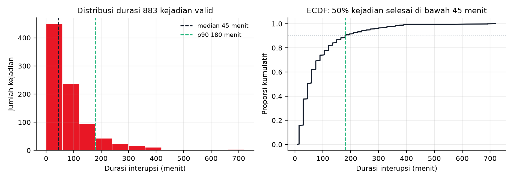

**Gambar 3.** Sebaran durasi interupsi. Panel kiri: histogram 883 kejadian valid pada filter 0 sampai 720 menit dengan garis putus-putus median 45 menit dan garis putus-putus persentil 90 sebesar 180 menit. Panel kanan: fungsi distribusi kumulatif yang menunjukkan setengah kejadian selesai di bawah 45 menit. Filter ini menyisakan 72.720 menit atau 1.212 jam, sedangkan basis penuh 884 kejadian berjumlah 73.500 menit atau 1.225 jam. Satu baris durasi 780 menit berada di luar filter. Nilai persentil 90 sama pada dua cara kuantil (interpolasi dan nearest-rank). Batas median dan persentil 90 diambil dari daftar durasi terurut seperti pada 1.1.8.

### 1.1.8 Cara Memperoleh Setiap Angka

Tabel ini memuat setiap angka yang dipakai pada 1.1 beserta langkah hitungnya, dan definisi pada kolom kedua cukup untuk mengulang perhitungan dari data mentah Volve, sehingga pembaca dapat mengulang perhitungan dengan definisi yang tertulis di kolom kedua.

| Angka | Cara memperoleh | Hasil |
|---|---|---|
| 884 kejadian | Cacah baris tabel label kejadian setelah baris header dikurangi | 884 |
| 9 kategori (496, 216, 47, 38, 28, 25, 21, 12, 1) | Frekuensi tiap nilai unik kolom `category` | sama |
| 50 terverifikasi / 263 no / 571 uncertain | Frekuensi tiap nilai kolom `bha_relevant` | 50 / 263 / 571 |
| 73.500 menit atau 1.225 jam | Jumlah `(act_end - act_start)` per baris dalam menit; 884 baris semuanya terpakai karena 0 gagal parse, 0 negatif, 0 di atas 720 jam | 73.500,0 menit |
| Median 45 menit | Rata-rata dua nilai tengah dari daftar 884 durasi terurut | 45,0 |
| p90 180 menit | Dua cara sekaligus: elemen ke-795 daftar terurut, dan kuantil-10 dengan interpolasi; keduanya 180 | 180,0 |
| Maksimum 780 menit | Elemen terakhir daftar durasi terurut | 780,0 |
| 10 wellbore, F-14 dengan 182 kejadian | Himpunan unik dan frekuensi kolom `wellbore` | sama |
| 2007 sampai 2015 | Nilai terkecil dan terbesar empat digit pertama kolom `event_date`; frekuensi per tahun 95, 425, 96, 7, 101, 21, 139 | 2007 / 2015 |
| 601,1 / 343,5 / 101,5 / 50,5 / 47,3 / 40,2 / 25,8 / 14,0 / 1,2 jam | Jumlah menit per kategori dibagi 60 | sama |
| 56,1 / 5,7 / 64,6 / 20,6 persen | 496/884, 50/884, 571/884, 182/884 | sama |
| 49,1 / 28,0 / 3,9 / 5,0 persen | 601,1/1.225, 343,5/1.225, 47,3/1.225, (47,3+14,0)/1.225 | sama |
| 10 entri puncak, 37.572 berkas, 27,43 GB | Penelusuran rekursif data proyek: jumlah berkas dan ukuran byte tiap entri puncak dijumlahkan | sama |
| 10 berkas, 9.935.708 baris mentah, 9.935.698 baris data | Cacah baris tiap berkas log hasil parse, dikurangi satu baris header per berkas | sama |
| 292.954 baris pada 6 dataset | Cacah baris tiap dataset latih setelah dekompresi, dikurangi satu baris header; rincian hyd_ki 52.509, shk 56.495, ssi 35.906, stuck_k1 5.555, stuck_k2 118.567, vib 23.922 | sama |
| 37 lipatan, 0 pelanggaran kebocoran | Lipatan dihitung sebagai jumlah pasangan dataset dan sumur pada enam dataset, yaitu 9+9+9+2+4+4 dengan rincian pada 1.1.9; pelanggaran dicacah sebagai baris latih yang fiturnya berasal dari waktu setelah labelnya | sama |
| 7 mode, 27 varian metode, tier 13 TREN / 12 PERINGATAN-BERPENGAWAS / 2 BELUM LAYAK PAKAI, lapisan L0 5 / L1 11 / L2 9 / L3 2 | Cacah mode dan varian metode pada daftar metode proyek; tier dan lapisan dihitung dari kolom penandaan tiap varian | sama |
| 6 dari 7 mode bertier peringatan berpengawasan | Tier diambil dari tabel evaluasi lapisan keputusan per klaim, lalu tier per mode diambil dari klaim tertingginya: getaran, stick-slip, hentakan, pipa terjepit, hidraulik, dan keausan peralatan memenuhi; keausan mata bor hanya tren | 6 dari 7 |
| 620.288 bin menit, 86,68 persen tanpa CRPM (537.644) | Setiap menit direkam sebagai satu bin; bin tanpa satu pun bacaan CRPM dicacah (kolom jumlah bacaan bernilai nol), per sumur 74,0 sampai 97,1 persen | sama |
| 96.698 bin dan 12.635 bin mengebor pada F-14 (13,1 persen) | Cacah bin menit pada F-14 dan cacah bin yang berstatus mengebor; perbandingan keduanya 12.635/96.698 | sama |
| 0,67 persen `SHKRSK_RT` terisi pada F-7 | Cacah baris data getaran F-7 yang kolom `SHKRSK_RT`-nya berisi nilai bukan nol: 3.659 dari 547.500 baris | sama |
| Presisi rule 0,868 sampai 0,952, recall 0,276 sampai 0,595 (getaran) | Presisi = positif benar dibagi seluruh alarm; recall = positif benar dibagi seluruh kejadian positif. Nilai tiap fold getaran: presisi 0,9444, 0,8676, 0,8984, 0,9519 dan recall 0,4537, 0,2761, 0,3753, 0,5951 | sama |
| Laju alarm palsu 9,99 sampai 49,94 (getaran), 8,32 sampai 61,0 (pipa terjepit), 38,70 sampai 132,05 (hidraulik) per 24 jam | Alarm palsu per fold dihitung sebagai jumlah alarm pada jendela negatif dibagi lama jendela negatif, dinormalkan ke 24 jam | sama |
| Laju alarm palsu 0,00 sampai 132,05 per 24 jam antar sumur dan mode | Nilai terkecil dan terbesar dari seluruh laju alarm palsu per fold yang dihitung dengan cara baris di atas | sama |
| Target recall 0,70 sampai 0,80 dan lead 10 sampai 30 menit | Bukan hasil hitung; sasaran desain yang dinyatakan pada kalimat yang sama | target |
| Efisiensi lebih dari 15 persen | Klaim vendor, bukan hitungan proyek: rilis pers Halliburton 9 Juli 2026 | sumber vendor |

### 1.1.9 Rumus dan Metode Perolehan Angka 1.1.6

Setiap angka pada 1.1.6 wajib punya rumus atau definisi hitungnya, bahan yang dihitung, dan status. Bahan dinyatakan sebagai jenis data, satuan pengamatan, dan kolom yang dipakai, bukan sebagai nama berkas atau lokasi penyimpanan. Angka yang tidak dapat diturunkan dari bahan yang disebut tidak dipakai sebagai bukti hasil.

**Rumus dasar yang dipakai di seluruh naskah.**

```
presisi        = TP / (TP + FP)
recall         = TP / (TP + FN)
FAR_24jam      = FP / (n_neg / 60) x 24          jendela 60 detik, n_neg = cacah jendela negatif
AUPRC          = average_precision_score(y, skor)
lead (menit)   = t_onset - t_alert               hanya untuk deteksi benar yang mendahului onset
median         = rata-rata dua nilai tengah setelah data durasi diurutkan
p90            = elemen ke-ceil(0,9 x n) pada data terurut, cara nearest-rank
```

Rumus laju alarm palsu mengikuti konvensi evaluasi deteksi, yaitu jumlah alarm pada jendela negatif dibagi lama jendela negatif lalu dinormalkan ke 24 jam, dengan jendela 60 detik.

**Tabel rumus, bahan, dan status setiap angka pada 1.1.6.**

| Angka | Rumus atau definisi | Bahan yang dihitung | Status |
|---|---|---|---|
| 7 mode kegagalan | Cacah nama mode berbeda pada daftar metode proyek | Daftar metode proyek, satu baris per varian metode beserta nama mode yang dideteksi | terukur |
| 60 detik | Satu bin per menit, yaitu pembulatan waktu ke bawah pada kelipatan 60 detik, dengan agregasi seluruh bacaan pada satu menit | Keputusan rancangan penyamaan waktu, tidak ada bahan hitung | konvensi rancangan |
| 10 wellbore | Cacah nama sumur berbeda | Tabel label kejadian, kolom nama sumur | terukur |
| 28 sampai 48 kanal, dan 37 sampai 48 pada tujuh sumur uji kendali | Cacah kanal yang isinya sedikitnya 50 persen baris per sumur; nilai per sumur F-14 48, F-7 47, F-9_A 45, F-15A 42, F-5 42, F-9 42, F-15_S 37, F-12 28, VAR_F-5_alt 44 | Ringkasan mutu kanal per sumur, yaitu cacah kanal yang terisi sedikitnya 50 persen baris | terukur |
| 884 kejadian | Cacah baris tabel label setelah baris header | Tabel label kejadian, satu baris per kejadian interupsi | terukur |
| 480 fitur | Cacah kolom matriks fitur tanpa kolom target | Matriks fitur latih, satu baris per jendela 10 menit | terukur |
| 27 head | Cacah entri daftar varian metode | Daftar metode proyek, satu entri per varian metode | terukur |
| 37 lipatan | Jumlah pasangan dataset dan sumur: hyd 9, shk 9, ssi 9, stuck K-i 2, stuck K-ii 4, vib 4 | Enam dataset latih, cacah sumur berbeda pada tiap dataset | terukur |
| 6 pemeriksaan per 24 jam | Anggaran desain, turunan 24 dibagi 6 sama dengan 4 jam per pemeriksaan | Anggaran desain pada 3.2.7, tidak ada bahan hitung | asumsi D-19 |
| 13 head wajib tinjauan | Cacah head dengan penanda wajib tinjauan bernilai benar | Rekap evaluasi per head, kolom penanda wajib tinjauan | terukur |
| 3 tingkat kewenangan | Himpunan nilai kolom tingkat kewenangan, yaitu TREN, PERINGATAN-BERPENGAWAS, dan BELUM LAYAK PAKAI | Tabel evaluasi lapisan keputusan, kolom tingkat kewenangan per klaim | terukur |
| 50 dari 884 relevan BHA, 571 uncertain, 263 tidak | Frekuensi tiap nilai kolom relevansi BHA, lalu 50/884 sama dengan 5,66 persen dan 571/884 sama dengan 64,59 persen | Tabel label kejadian, kolom relevansi BHA | terukur |
| 192 dari 192 berkas tanpa rating motor | Cacah berkas assembly yang tidak memuat keenam medan rating, yaitu torsi maksimum, tekanan maksimum, putaran maksimum, daya maksimum, volume per putaran, dan torsi | Ekspor berkas assembly dari mitra, pemindaian enam medan rating | sumber sekunder, belum diuji ulang terhadap data primer |
| 73.500 menit atau 1.225 jam | Jumlah selisih waktu selesai dan waktu mulai dalam menit atas 884 kejadian; nilai sebelum pembulatan 73.500,0167 | Tabel label kejadian, kolom waktu mulai dan waktu selesai | terukur |
| median 45 menit | Rata-rata elemen ke-442 dan ke-443 dari 884 durasi terurut | Sama dengan baris di atas, setelah durasi tiap kejadian diurutkan | terukur |
| p90 180 menit | Elemen ke-796 dari 884 durasi terurut, yaitu ceil(0,9 x 884) dengan cara nearest-rank | Sama dengan baris di atas | terukur |
| maksimum 780 menit | Elemen terakhir daftar durasi terurut | Sama dengan baris di atas | terukur |
| lead 4,5 sampai 8,5 menit dengan median 7,0 | Untuk setiap deteksi benar, lead sama dengan waktu onset dikurangi waktu alarm dalam menit, diambil median per lipatan, lalu rentang antar lipatan 4,5 sampai 8,5 dan median antar lipatan 7,0 | Rekap evaluasi varian persistence pada mode pipa terjepit, yaitu pasangan waktu alarm dan waktu onset tiap deteksi benar | terukur pada satu kelas |
| 6 dari 7 mode | Cacah mode yang memiliki sedikitnya satu klaim bertier peringatan berpengawasan, dengan tier per mode diambil dari klaim tertingginya; yang tidak memenuhi hanya keausan mata bor | Tabel evaluasi lapisan keputusan, kolom tingkat kewenangan tiap klaim | terukur |
| 0 dari 27 head bertier alarm otomatis | Cacah klaim bertier alarm otomatis pada tabel evaluasi | Sama dengan baris di atas | terukur |

Dua catatan pembacaan. Pertama, angka 73.500 menit adalah pembulatan dari 73.500,0167 menit, sehingga selisih satu detik atas 884 kejadian tidak dihitung sebagai perbedaan. Kedua, angka 6 pemeriksaan per 24 jam bukan hasil pengukuran beban kerja, melainkan anggaran desain yang dipilih supaya laju alarm palsu yang dapat diterima manusia tetap terpenuhi, dan karena itu dicatat pada Lampiran B sebagai asumsi D-19.

---

## 1.2 Analisis Akar Penyebab Masalah: Fishbone 6M dan 5W1H

**Proyek:** Perancangan Terpadu, deteksi dini kegagalan Bottom Hole Assembly berbasis pembelajaran mesin
**Mitra:** PT Halliburton Indonesia, divisi Sperry Drilling (jalur Magang/MBKM)

---

---

### 1.2.1 Batas masalah dan definisi status

Fishbone ini menjawab satu pertanyaan: **mengapa peringatan dini kegagalan BHA berbasis data operasi Sperry Drilling belum dapat dioperasikan sebagai alarm, padahal data historisnya tersedia.** Fishbone memetakan sebab. Penilaian risiko terkuantifikasi (FMEA dengan skala rujukan) dibahas pada subbab tersendiri, sehingga skor S, O, dan D tidak diulang di sini.

Setiap sebab diberi satu status, dengan arti yang dipakai konsisten di seluruh dokumen:

Tiga keadaan yang dibedakan pada setiap sebab, dan yang penting: keadaan ini menyangkut **cara angka diperoleh**, bukan siapa yang menerbitkannya.

1. **Terukur.** Angkanya dihitung langsung dari data primer (tabel label dan hasil eksekusi detektor) dengan langkah yang ditulis pada tabel. Langkah itu harus cukup untuk diulang orang lain tanpa bertanya.
2. **Tercatat, belum diulang.** Angka berasal dari pengukuran pihak lain yang langkahnya dinyatakan, tetapi belum dihitung ulang di sini. Cara memperolehnya tetap ditulis; bedanya hanya pada siapa yang menjalankan.
3. **Hipotesis.** Mekanisme belum diukur sama sekali. Wajib disertai uji pembeda pada 1.2.7 dan tidak boleh ditulis sebagai temuan.

Tautan sebab ke akibat juga dibedakan dari besarannya. Sebuah angka boleh terukur sementara **tautan kausalnya** masih hipotesis. Pemisahan ini disengaja, karena korelasi bukan kausalitas.

---

### 1.2.2 Angka dasar yang menjadi landasan seluruh fishbone

Seluruh angka pada tabel ini dihitung langsung dari tabel label kejadian dan tabel agregasi dengan cara yang ditulis pada kolom terakhir; .

| Besaran | Nilai | Cara menghitung |
|---|---|---|
| Kejadian terkurasi | **884** baris | cacah baris tabel label terkurasi |
| Total durasi kejadian | **73.500 menit = 1.225 jam** | selisih waktu mulai dan selesai tiap baris lalu dijumlahkan seluruh baris |
| Median durasi | **45 menit** | median dari 884 nilai durasi |
| Persentil 90 durasi | **180 menit** | kuantil 90 dari nilai durasi yang sama |
| Durasi maksimum | **780 menit** | nilai durasi terbesar pada deret yang sama |
| Sumur tercakup | **10 wellbore** | banyak nilai unik pada kolom nama sumur |
| Kejadian tanpa bukti kegagalan | **496 dari 884 = 56,1 persen** | cacah baris berkategori tanpa bukti kegagalan lalu bagi dengan 884 |
| Kejadian relevan BHA | **50 dari 884 = 5,7 persen** | cacah baris berlabel relevan BHA ya lalu bagi dengan 884 |
| Kejadian relevansi BHA belum pasti | **571 dari 884 = 64,6 persen** | cacah baris dengan relevansi belum pasti lalu bagi dengan 884 |
| Detektor dan head | **7 mode, 27 head** (4+4+4+6+4+2+3) | hitung banyak head per detektor pada ringkasan hasil eksekusi lalu dijumlahkan |
| Sebaran lapis keputusan | **L0 = 5, L1 = 11, L2 = 9, L3 = 2** | hitung banyak keputusan per lapis pada ringkasan lapis keputusan |
| Sebaran tier | **13 TREN, 12 PERINGATAN-BERPENGAWAS, 2 BELUM LAYAK PAKAI** | cacah head per tingkat kelayakan pada daftar head |
| Slot alarm otomatis kritis | **0** | nilai slot alarm otomatis kritis pada ringkasan hasil (angka desain, bukan pengukuran) |
| Peringatan L1 yang harus dibaca manusia | **11** | hitung banyak peringatan lapis perantara pada ringkasan lapis keputusan |

Catatan tafsir yang mengikat: 884 kejadian **bukan** 884 kerusakan, karena 56,1 persen basis tidak memuat bukti kegagalan. Angka 1.225 jam adalah total waktu tercatat pada basis 884 kejadian, bukan waktu downtime murni.

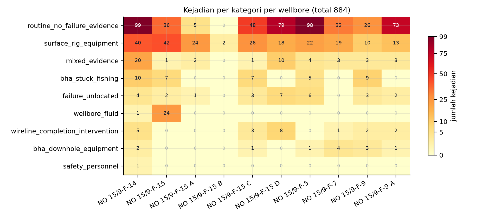

**Gambar 4.** Matriks kejadian per kategori per wellbore, sembilan kategori dikalikan sepuluh wellbore, total 884 kejadian. Skala warna memakai normalisasi pangkat 0,55 supaya sel kecil tetap terlihat, dan sel nol ditulis `0` dengan warna terang supaya tidak disamakan dengan data hilang. Dua baris teratas, yaitu `routine_no_failure_evidence` (496 kejadian) dan `surface_rig_equipment` (216 kejadian), mengisi 80,5 persen dari seluruh matriks. Konsentrasi kejadian per wellbore menyebar dari 2 (F-15 B) sampai 182 (F-14).

---

### 1.2.3 Fishbone 6M

Diagram terdiri atas satu tulang punggung (efek) dan enam cabang, dengan 27 ranting. Identitas cabang dan ranting dipakai juga pada gambar G1 (lihat 1.2.6).

**Efek pada kotak efek diagram tulang ikan:** peringatan dini kegagalan BHA belum dapat dioperasikan sebagai alarm, karena ambang tidak portabel, label belum tervalidasi, dan kanal sensor tidak lengkap.

#### MAN (manusia): 4 ranting

| ID | Cabang | Ranting (sebab spesifik) | Cara menghitung |
| --- | --- | --- | --- |
| M1 | Validitas label buatan manusia | Kontrol-positif stick-slip tidak lulus: **0 dari 10** kontrol-positif stuck gagal, sehingga presisi dan recall kelas stuck dihitung dari basis label yang belum tervalidasi | uji sepuluh kejadian stuck yang seharusnya terdeteksi, lalu hitung berapa yang lolos deteksi; hasilnya nol dari sepuluh lolos |
| M2 | Validitas label buatan manusia | Relevansi BHA tidak diputuskan: **571 dari 884 (64,6 persen)** berstatus `uncertain`, hanya **50 (5,7 persen)** dinyatakan `yes` | hitung jumlah dan proporsi baris relevansi BHA belum pasti serta baris yang yakin relevan, dari 884 baris tabel label |
| M3 | Validitas label buatan manusia | Label hidraulik K-ii memakai **proksi** perubahan volume pit (ΔV_pit), bukan pengukuran hidraulika lubang bor, sehingga label berisiko sirkular terhadap fitur | teliti definisi label hidraulik pada dokumen capstone teknis dan dokumen peta kapabilitas |
| M4 | Rantai keputusan manusia | Seluruh keluaran berhenti di manusia: **0 slot alarm otomatis**, **11 peringatan L1** harus dibaca, beban waktu baca insinyur belum pernah diukur | hitung banyak slot alarm otomatis pada ringkasan hasil eksekusi lalu hitung peringatan lapis perantara |

**Tautan ke G7.** Tiga komponen validitas label lintas sumur muncul di atas: kontrol-positif stuck 0 dari 10, label hidraulik sebagai proksi, dan semantik `STUCK_RT` 0 sampai 3 yang belum ada. Karena itu cabang MAN adalah akar, bukan gejala.

#### METHOD (metode): 5 ranting

| ID | Cabang | Ranting (sebab spesifik) | Cara menghitung |
| --- | --- | --- | --- |
| Me1 | Ambang tunggal lintas sumur | Satu nilai ambang (τ = 0,5) dipakai untuk semua sumur. Pada model dan ambang yang sama, laju alarm palsu bergerak dari **4,14897** per 24 jam di F-15_S sampai **496,09249** per 24 jam di F-14, yaitu rentang **119,57 kali** | hitung laju alarm palsu per 24 jam pada model dan ambang yang sama untuk tiap sumur uji pada fold uji, lalu bandingkan terbesar dengan terkecil |
| Me2 | Ambang tunggal lintas sumur | Ambang yang sama juga meruntuhkan sensitivitas: recall pada τ = 0,5 adalah **0,1018** di F-15_S tetapi **0,8657** di F-14 | hitung recall pada ambang yang sama untuk tiap sumur uji pada fold yang sama |
| Me3 | Ketidakpastian statistik | Pada **5 dari 9** fold, selang kepercayaan 95 persen AUPRC menyentuh garis no-skill, sehingga keunggulan atas tebakan acak belum terpisah dari derau | hitung selang kepercayaan 95 persen AUPRC pada tiap fold lalu periksa apakah batas bawahnya menyentuh garis no-skill |
| Me4 | Resolusi waktu pipeline | Pipeline memaksa grid 60 detik mode ALL-rows, sedangkan laju kanal permukaan dianggap sekitar 1 Hz. Bila laju nyata per sumur lebih rendah, satu bin dapat berisi kurang dari 10 sampel dan aturan SSI tidak dapat dievaluasi | **Isi asumsi:** laju sampling kanal permukaan sekitar 1 Hz. **Dasar:** laju 1 Hz diambil dari laju standar log permukaan dan belum diukur pada data mitra.
| Me5 | Hirarki keluaran | 7 mode dan 27 head tersebar ke empat lapis dengan sebaran tier 13/12/2, tanpa aturan kenaikan tier yang dinyatakan sebagai ambang angka | hitung banyak head per lapis pada ringkasan lapis keputusan lalu periksa apakah ada ambang angka syarat naik kelas |

**Catatan penting untuk Me1 dan Me2.** Kedua angka berasal dari satu hasil hitung yang sama, pada model dan ambang yang identik. Yang berubah hanya sumur uji. Inilah bukti langsung bahwa ambang global tidak portabel, dan sekaligus alasan mengapa target "satu ambang untuk semua sumur" harus digugurkan pada BAB III.

#### MACHINE (mesin dan perkakas): 4 ranting

| ID | Cabang | Ranting (sebab spesifik) | Cara menghitung |
| --- | --- | --- | --- |
| Ma1 | Arsitektur keluaran alat | Alat tidak memiliki slot alarm otomatis kritis sama sekali (**0**), dan **0 dari 7** detektor memenuhi syarat alarm. Ini keputusan desain yang dinyatakan, bukan cacat implementasi | hitung banyak slot alarm otomatis pada ringkasan hasil dan banyak detektor yang memenuhi syaratnya |
| Ma2 | Cakupan parser | Parser CSV lama hanya menangani 8 kolom keluaran, sehingga **3906 dari 7150 berkas log (54,6 persen)** tidak pernah diparse: F-1 C sebanyak 2156 berkas dan F-11 sebanyak 1750 berkas. Kurva HKLD, TORQUE, MSE, MOTOR_RPM, dan FLOWIN-OUT juga tidak masuk | hitung jumlah berkas log yang berhasil dan tidak berhasil diparse pada sintesis pembaca |
| Ma3 | Efek agregasi pipeline | Agregasi ALL-rows ke satu nilai per menit berpotensi meredam puncak getaran dan torsi berdurasi detik, sehingga label status menjadi lebih konservatif daripada kejadian fisiknya | **Isi asumsi:** puncak sinyal berdurasi detik tidak terwakili oleh statistik bin menit. **Dasar:** statistik ALL-rows adalah rata-rata per jendela 60 detik, sehingga lonjakan singkat bisa hilang; arah dan besarnya efek belum pernah diukur. **Alasan dipilih:** pipeline yang sudah dijalankan memakai ALL-rows, sehingga mekanisme ini mengikuti keputusan yang tertulis, bukan pilihan naskah. **Cara menguji:** ulangi evaluasi dengan statistik maksimum pada fold yang sama lalu bandingkan pasangan recall dan FAR. |
| Ma4 | Cakupan pembuktian prototipe | Prototipe dijalankan pada satu segmen nyata (F-14), yang kebetulan satu-satunya wellbore hadir di keenam dataset rig. Perilaku alat sebagai sistem utuh pada sumur lain belum diuji | periksa metadata segmen uji pada ringkasan hasil: hanya satu segmen nyata yang dipakai |

#### MATERIAL (bahan dan data): 4 ranting

| ID | Cabang | Ranting (sebab spesifik) | Cara menghitung |
| --- | --- | --- | --- |
| Mt1 | Integritas kanal permukaan | `WHIRL_RT` dan `BOUNCE_RT` identik: **67 berkas pada 5 wellbore**, dan **1790 dari 1790** nilai identik di F-9 (F-5 368/368, F-15S 5/5, F-1 15/15). Keduanya tidak boleh menjadi dua fitur atau dua gejala | hitung berapa banyak berkas yang saling identik antara kanal getar berputar dan memantul, lalu banyak baris identiknya per sumur |
| Mt2 | Kelengkapan kanal MWD | Kanal CRPM bahan rumus SSI tidak lengkap: **537.644 dari 620.288 jendela (86,68 persen)** tanpa data pada agregat sembilan fold, dan dua sumur kanal mati (F-7 982/982, F-9 1126/1126) | hitung jumlah jendela uji ssi tanpa data kanal CRPM pada agregat sembilan fold lalu bagi dengan total jendela; bandingkan dengan kanal mati di dua sumur |
| Mt3 | Makna basis kejadian | Kejadian tercatat bukan sama dengan kegagalan: **496** tanpa bukti kegagalan, **47** bukti campuran, **28** kegagalan tanpa lokasi, dan hanya **50** kejadian menyangkut BHA (stuck atau fishing 38, peralatan downhole 12) | cacah baris menurut kategori pada tabel label lalu kelompokkan ke bukti gagal, campuran, gagal tanpa lokasi, dan yang menyangkut BHA |
| Mt4 | Ketidakseimbangan kelas | Prevalensi positif sangat rendah dan tidak seragam: ssi F-15A **31 dari 6020 = 0,51 persen**, ssi F-7 **3 dari 982 = 0,31 persen**, ssi F-9_A **55 dari 841 = 6,54 persen** | hitung jumlah kelas positif dan total bin per sumur pada hasil evaluasi lalu bagi menjadi prevalensi |

**Catatan untuk Mt1 dan Mt2.** Keduanya berasal dari pengukuran pihak lain, Mt1 dari pemeriksaan 19 GB data primer dan Mt2 dari hasil evaluasi yang sudah dijalankan, dengan langkah yang tertulis pada kolom cara menghitung. Keduanya belum diverifikasi ulang, sehingga statusnya dinyatakan terbuka.

#### MEASUREMENT (pengukuran): 5 ranting

| ID | Cabang | Ranting (sebab spesifik) | Cara menghitung |
| --- | --- | --- | --- |
| Ms1 | Basis waktu | Waktu pada dataset turunan adalah **indeks menit internal** (`ts_bin`), dan asal kalender dinyatakan belum diverifikasi, sehingga join dengan tanggal kejadian pada CSV label rentan pergeseran | periksa kolom waktu pada dataset turunan: indeks menit tanpa pemetaan kalender |
| Ms2 | Satuan metrik | Laju alarm palsu tercatat dalam satuan waktu yang berbeda pada hasil ekspor yang berbeda, yaitu per 24 jam, per jam, dan per jendela, sehingga perbandingan lintas detektor rawan salah baca bila satuan tidak diseragamkan | bandingkan definisi satuan waktu pada hasil ekspor yang berbeda, lalu seragamkan sebelum membandingkan lintas detektor |
| Ms3 | Skala penilaian risiko | Angka severity, occurrence, dan detection pada FMEA ditulis sebagai nilai tetap, bukan hasil penilaian dengan skala rujukan. Perkalian RPN konsisten, yang belum berdasar adalah nilai masukannya | periksa skrip pembuat dokumen: nilai severity, occurrence, dan detection tertulis sebagai nilai tetap, bukan hasil penilaian skala |
| Ms4 | Target kinerja | Target recall 0,70 sampai 0,80 dan target lead time 10 sampai 30 menit **belum dicapai** hasil terukur mana pun; lead time yang terukur hanya **4,5 sampai 8,5 menit** dan terbatas pada satu kelas | bandingkan target kinerja dengan nilai terukur pada hasil uji terakhir yang diterbitkan |
| Ms5 | Definisi label versus metrik | Label ssi didefinisikan sebagai deteksi **kondisi berlangsung** (SSI minimal 1), bukan onset, sehingga recall-nya tidak sebanding dengan head yang didefinisikan sebagai onset | periksa definisi label ssi pada dokumen capstone teknis: kondisi berlangsung, bukan titik masuk kejadian |

#### ENVIRONMENT (lingkungan dan sensor): 5 ranting

| ID | Cabang | Ranting (sebab spesifik) | Cara menghitung |
| --- | --- | --- | --- |
| En1 | Sensor peralatan downhole | **Rating motor tidak ada pada 0 dari 192 berkas** (torqueMax, Pmax, rpmMax, powerMax, revPerGallon, torque), sehingga batas operasi motor tidak dapat dipakai sebagai pembanding beban terukur | hitung berapa banyak berkas log yang memuat medan rating motor yang diperlukan; hasilnya nol |
| En2 | Sensor tekanan formasi | Tekanan pori EDM fase ACTUAL hanya **8 baris**, semuanya di datum air laut (tvd 298,56 ft); kurva tekanan formasi atau mud weight untuk indikator overbalance **tidak ada** setelah empat lapis pemeriksaan | hitung baris berisi tekanan pori pada fase tekanan aktual lalu cari kurva tekanan formasi pada empat lapis pemeriksaan |
| En3 | Riwayat peralatan | Informasi penajaman bit (`dullingInfo`) **tidak ada pada 0 dari 161 berkas**, sehingga keausan bit hanya dapat didekati dari identitas run | hitung berapa banyak berkas log yang memuat medan riwayat penajaman bit; hasilnya nol |
| En4 | Variasi kondisi antar sumur | Porsi waktu pengeboran berbeda tajam: F-14 **12.635 dari 96.698 bin (13,1 persen)**, F-12 **23.931 dari 180.958 bin (13,2 persen)**, F-10 **13.781 dari 41.446 bin (33,3 persen)** | hitung jumlah bin pengeboran dan seluruh bin pada tiap sumur pada ringkasan grid |
| En5 | Kualitas kanal getaran | Pada F-10 kanal `VIBLAT_RT` tercatat **hadir**, tetapi jumlah bin dengan observasi getaran adalah **0**. Kanal yang ada di skema tidak menjamin ada data | hitung jumlah bin berisi observasi getaran pada tiap sumur pada ringkasan yang sama |

**Catatan untuk En5.** Ini kasus paling tajam untuk kalimat "keterbatasan sensor", karena `crpm_present: true` dan `spm_present: true` juga berlaku untuk F-10, sementara kanal getarannya kosong. Bukti ketiadaan haruslah hitungan observasi, bukan keberadaan nama kanal.

---

### 1.2.4 Rekap keadaan sebab

Dari 27 sebab pada 1.2.3: **15 terukur** dari data primer, **10 tercatat** dari pengukuran pihak lain dengan langkah yang dinyatakan, dan **2 hipotesis** yang belum diukur, masing-masing membawa uji pembeda di 1.2.7.

Sebaran per kategori: Man 4, Method 5, Machine 4, Material 4, Measurement 5, Environment 5. Setiap sebab menyebut cara angka diperolehnya pada kolom cara menghitung.

**Dua sebab berkeadaan hipotesis** adalah Me4 (resolusi grid 60 detik melawan laju stream) dan Ma3 (puncak sinyal teredam agregasi). Keduanya sengaja dipertahankan karena menjelaskan pola nodata dan konservatisme label, tetapi keduanya dilarang ditulis sebagai temuan pada BAB IV.

Selain dua sebab di atas, terdapat **tautan kausal** yang masih hipotesis meskipun besarannya terukur. Contoh: nilai FAR 119,57 kali adalah terukur, sedangkan pernyataan bahwa ambang global adalah **penyebab** utama ketidaklayakan alarm masih inferensi, karena portabilitas juga dipengaruhi prevalensi (Mt4) dan kelengkapan kanal (Mt2).

---

### 1.2.5 5W1H

Tabel ini disusun agar setiap sel konsisten dengan angka pada 1.2.2 dan 1.2.3. Tidak ada angka baru yang diperkenalkan di sini.

| Unsur | Isi | Cara memperoleh angka pada sel ini |
| --- | --- | --- |
| **What** (apa masalahnya) | Belum tersedia peringatan dini kegagalan BHA yang layak dioperasikan sebagai alarm: **0 dari 7** detektor memenuhi syarat alarm, **0** slot alarm otomatis kritis, **2 dari 27** head berstatus BELUM LAYAK PAKAI, dan **5 dari 9** fold CI95 menyentuh no-skill | hitung banyak detektor yang memenuhi syarat alarm, banyak slot alarm otomatis, banyak head per tingkat kelayakan, lalu hitung berapa fold yang batas bawah selang kepercayaannya menyentuh garis no-skill |
| **Why** (mengapa penting) | Terdapat **884 kejadian** terkurasi dengan total **73.500 menit (1.225 jam)** waktu tercatat, median **45 menit**, p90 **180 menit**, maksimum **780 menit**. Namun **496 (56,1 persen)** di antaranya tidak memuat bukti kegagalan, sehingga nilai masalah harus dinyatakan atas basis yang jelas, bukan atas seluruh 1.225 jam | hitung total durasi tiap baris lalu jumlahkan; hitung median, kuantil 90, dan maksimum dari deret durasi; hitung proporsi baris tanpa bukti kegagalan dari 884 baris |
| **Who** (siapa yang terlibat) | Pengguna hasil: insinyur pengeboran dan insinyur optimasi Sperry Drilling, karena keputusan akhir dinyatakan berada pada manusia (`human_review_required: true`). Penyedia data dan kurator label: pihak internal mitra. Pelaksana: tim proyek. Pengarah: dosen pembimbing. Tidak ada peran otomatis yang ditambahkan | baca flag kebutuhan tinjauan manusia pada ringkasan hasil eksekusi; peran lain ditetapkan pada rancangan skema kerja proyek |
| **Where** (di mana) | Lingkungan data: **10 wellbore** lapangan Volve dengan penamaan NO 15/9-F-*. Segmen pembuktian prototipe: **F-14**, satu-satunya wellbore yang hadir di keenam dataset rig (vib 1989, ssi 5455, shk 11205, stuck_k1 3201, stuck_k2 95925, hyd_ki 10401 jendela). Cakupan fisik: kanal permukaan dan sebagian kanal MWD, tanpa tekanan formasi dan tanpa rating motor | hitung banyak nilai unik nama sumur pada tabel label; hitung jumlah bin dan jendela pada tiap kategori per sumur pada ringkasan grid; periksa keberadaan medan rating motor dan tekanan formasi pada pemindaian berkas log |
| **When** (kapan) | Rentang data **2007 sampai 2015** (F-14 sendiri mencakup rentang panjang dengan hanya 13,1 persen bin pengeboran). Horizon peringatan yang dicita-citakan **10 sampai 30 menit** sebelum kejadian, sedangkan lead yang terukur baru **4,5 sampai 8,5 menit** dan belum pada semua kelas. Basis waktu internal masih berupa indeks menit tanpa verifikasi kalender | bandingkan rentang waktu pada tabel label dan ringkasan bin; bandingkan target lead time dengan nilai lead time terukur pada hasil uji terakhir; periksa penanda waktu pada ringkasan hasil |
| **How** (bagaimana) | Alur: log sumur menjadi grid bin **60 detik** mode ALL-rows, menjadi **6 dataset latih 292.954 baris**, diuji dengan **37 fold** LOWO (4+9+9+2+9+4) tanpa pelanggaran anti-bocor, dinilai dengan FAR, recall, AUPRC, dan CI95, lalu disusun menjadi lapis keputusan **L0 sampai L3** dengan manusia di ujung rantai | urutkan langkah preprocessing, pengujian fold, dan penyusunan lapis keputusan sesuai rancangan eksperimen yang dijalankan; hitung banyak fold pada ringkasan hasil |

**Uji konsistensi 5W1H.** Tiga angka muncul di lebih dari satu sel dan harus sama: jumlah kejadian (884) pada Why dan basis Where, jumlah detektor (7) pada What dan Who, serta lead time (10 sampai 30 menit sebagai target, 4,5 sampai 8,5 menit sebagai hasil) pada When. Ketiganya konsisten dengan 1.2.2 dan 1.2.3.

---

### 1.2.6 Spesifikasi gambar G1

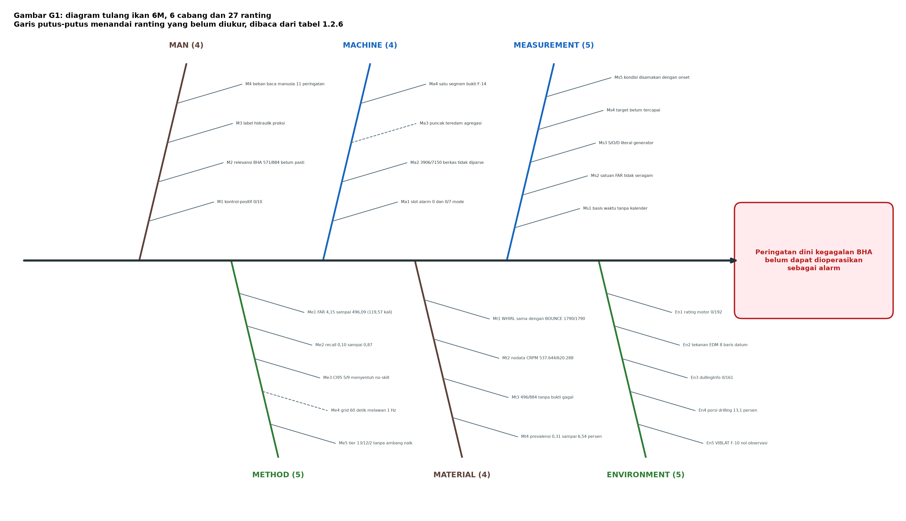

**Gambar 5.** Diagram tulang ikan G1: enam cabang dan 27 ranting. Garis putus-putus menandai ranting yang belum diukur (Me4 dan Ma3), sesuai aturan gaya pada subbab ini. Angka pada setiap ranting dibaca dari tabel 1.2.3.

Gambar G1 adalah diagram tulang ikan dengan orientasi kiri ke kanan. Kotak efek di kanan memuat pernyataan akibat, tulang punggung horizontal, enam cabang berselang-seling atas dan bawah, dan 27 ranting. Daftar berikut memuat isi setiap elemen secara lengkap, sehingga gambar dan tabel dapat dicocokkan satu per satu tanpa tafsir tambahan.

**Kotak efek:** "Peringatan dini kegagalan BHA belum dapat dioperasikan sebagai alarm".

| Cabang | Posisi | Label cabang | Ranting (kode dan teks pendek) |
|---|---|---|---|
| B1 | atas 1 | **MAN** (4) | M1 kontrol-positif 0/10; M2 relevansi BHA 571/884 belum pasti; M3 label hidraulik proksi; M4 beban baca manusia 11 peringatan |
| B2 | bawah 1 | **METHOD** (5) | Me1 FAR 4,15 sampai 496,09 (119,57 kali); Me2 recall 0,10 sampai 0,87; Me3 CI95 5/9 menyentuh no-skill; Me4 grid 60 detik melawan 1 Hz; Me5 tier 13/12/2 tanpa ambang naik |
| B3 | atas 2 | **MACHINE** (4) | Ma1 slot alarm 0 dan 0/7 mode; Ma2 3906/7150 berkas tidak diparse; Ma3 puncak teredam agregasi; Ma4 satu segmen bukti F-14 |
| B4 | bawah 2 | **MATERIAL** (4) | Mt1 WHIRL sama dengan BOUNCE 1790/1790; Mt2 nodata CRPM 537.644/620.288; Mt3 496/884 tanpa bukti gagal; Mt4 prevalensi 0,31 sampai 6,54 persen |
| B5 | atas 3 | **MEASUREMENT** (5) | Ms1 basis waktu tanpa kalender; Ms2 satuan FAR tidak seragam; Ms3 S/O/D literal generator; Ms4 target belum tercapai; Ms5 kondisi disamakan dengan onset |
| B6 | bawah 3 | **ENVIRONMENT** (5) | En1 rating motor 0/192; En2 tekanan EDM 8 baris datum; En3 dullingInfo 0/161; En4 porsi drilling 13,1 persen; En5 VIBLAT F-10 nol observasi |

**Aturan gaya gambar G1.**
1. Ranting yang belum diukur (Me4, Ma3) diberi garis putus-putus, bukan garis penuh.
2. Ranting yang angkanya berasal dari pengukuran pihak lain (belum diulang sendiri) diberi penanda bintang kecil.
3. Setiap ranting membawa kode (M1 sampai En5) yang identik dengan tabel 1.2.3, agar silang rujuk ke naskah tidak ambigu.
4. Dua angka wajib tercetak pada gambar karena merupakan bukti terkuat: **119,57 kali** pada Me1 dan **86,68 persen** pada Mt2.
5. Warna: cabang MAN dan MATERIAL satu keluarga warna karena keduanya menyumbang akar G7; cabang MACHINE dan MEASUREMENT keluarga kedua karena keduanya soal perkakas dan satuan.

```
mindmap
  root((Peringatan dini BHA belum layak alarm))
    MAN
      M1 kontrol-positif 0/10
      M2 relevansi BHA 571/884
      M3 label hidraulik proksi
      M4 beban baca manusia
    METHOD
      Me1 FAR 119,57 kali
      Me2 recall 0,10 s/d 0,87
      Me3 CI95 5/9 no-skill
      Me4 grid 60 dtk lawan 1 Hz
      Me5 tier tanpa ambang naik
    MACHINE
      Ma1 slot alarm 0
      Ma2 3906/7150 tak terparse
      Ma3 puncak teredam
      Ma4 satu segmen F-14
    MATERIAL
      Mt1 WHIRL sama BOUNCE
      Mt2 nodata CRPM 86,68 persen
      Mt3 496/884 tanpa bukti gagal
      Mt4 prevalensi 0,31 s/d 6,54 persen
    MEASUREMENT
      Ms1 waktu tanpa kalender
      Ms2 satuan FAR tak seragam
      Ms3 S/O/D literal
      Ms4 target belum tercapai
      Ms5 kondisi lawan onset
    ENVIRONMENT
      En1 rating motor 0/192
      En2 tekanan EDM 8 baris
      En3 dullingInfo 0/161
      En4 drilling 13,1 persen
      En5 VIBLAT F-10 nol
```

---

### 1.2.7 Hipotesis, penjelasan rival, dan uji pembeda

 Tanpa ini, hipotesis hanya opini.

#### 7.1 Me4: nodata disebabkan resolusi grid, bukan sensor rusak

- **Observasi:** nodata CRPM agregat 537.644 dari 620.288 jendela (86,68 persen), sementara pada F-14 kanal CRPM justru hadir pada 11.794 dari 12.635 bin pengeboran.
- **Hipotesis:** sebagian nodata timbul karena aturan minimal 10 sampel per bin tidak terpenuhi pada laju logging rendah, bukan karena kanal fisik mati.
- **Rival 1:** kanal memang mati pada sumur tertentu (didukung F-7 982/982 dan F-9 1126/1126).
- **Rival 2:** nodata berasal dari pemetaan nama mnemonic yang gagal, bukan dari ketiadaan nilai.
- **Prediksi pembeda:** bila hipotesis benar, nodata seharusnya menumpuk pada bin dengan jumlah sampel mentah rendah, dan **hilang** setelah grid dilonggarkan ke 2 atau 5 menit. Bila rival 1 benar, nodata tetap 100 persen meskipun grid dilonggarkan. Bila rival 2 benar, nodata berkorelasi dengan sumur, bukan dengan kelimpahan sampel.
- **Uji yang dapat dijalankan:** hitung histogram jumlah sampel mentah per bin untuk sembilan sumur, lalu ulangi perhitungan SSI dengan bin 2 menit dan bandingkan fraksi nodata. Kedua rival memberi tanda yang berlawanan, sehingga uji ini memisahkan keduanya.
- **Keadaan:** belum diukur, uji di atas belum dijalankan.

#### 7.2 Ma3: agregasi menit meredam puncak sinyal

- **Observasi:** label status dibangun dari satu nilai per menit, dengan puncak-puncak berdurasi detik tidak terwakili pada statistik bin.
- **Hipotesis:** sebagian negatif palsu berasal dari agregasi, bukan dari keterbatasan model.
- **Rival:** negatif palsu murni akibat ambang dan prevalensi, seperti ditunjukkan Me1, Me2, dan Mt4.
- **Prediksi pembeda:** bila hipotesis benar, mengganti statistik bin dari mode ALL-rows ke nilai maksimum akan menaikkan recall tanpa menaikkan FAR secara proporsional. Bila rival benar, recall dan FAR naik bersama pada rasio yang sama.
- **Uji yang dapat dijalankan:** bandingkan dua varian agregasi pada fold yang sama dengan ambang tetap, lalu bandingkan pasangan (recall, FAR).
- **Keadaan:** belum diukur, uji di atas belum dijalankan.

#### 7.3 Tautan kausal yang masih terbuka

Pernyataan "ambang global adalah penyebab utama alarm tidak layak" belum terbukti walaupun angka 119,57 kali terukur. Alasannya, portabilitas juga dipengaruhi prevalensi per sumur (Mt4) dan kelengkapan kanal (Mt2). Uji pembeda yang disarankan: normalkan ambang per sumur berdasarkan kuantil prevalensi, lalu ukur apakah dispersi FAR menyempit. Bila menyempit tajam, ambang global terbukti sebagai penyebab dominan. Bila tidak, penyebab dominan ada pada data, bukan pada metode.

---

### 1.2.8 Dua angka yang diperiksa ulang dan cara memeriksanya

**Pertama, angka "data CRPM F-14 kosong 96,6 persen" tidak dipakai.** Cara memeriksa: bagi jumlah bin yang tidak memuat observasi CRPM dengan penyebut populasi yang mungkin. Dengan penyebut seluruh grid bin F-14, hasilnya 11.794 bin berobservasi dari 96.698 bin, jadi data kosong **87,80 persen**. Dengan penyebut bin pengeboran saja, hasilnya 841 bin kosong dari 12.635 bin, yaitu **6,66 persen**. Angka CRPM F-14 bergantung pada penyebut yang dipakai: 11.794 dari 96.698 bin berobservasi, sehingga 87,80 persen kosong bila penyebutnya seluruh grid, atau 841 dari 12.635 bin, sehingga 6,66 persen kosong bila penyebutnya bin pengeboran. Angka agregat yang dipakai adalah 86,68 persen, yaitu 22.385 dari 35.906 jendela tanpa data. Yang dipakai adalah 87,80 atau 6,66 persen untuk F-14, dan **86,68 persen** agregat yang dihitung sebagai 22.385 jendela tanpa data dari 35.906 jendela.

**Kedua, istilah `SSI_mwd` tidak ada padanannya di data.** Cara memetakannya: cari besaran terukur yang menggunakan kanal yang sama, lalu bandingkan cakupannya. Besaran yang dipakai adalah jumlah jendela SSI valid F-14, yaitu **5.455 dari 96.698 bin (5,64 persen)** dengan **75 positif**, dihitung dengan mencacah jendela valid pada tabel evaluasi per sumur; angka ini sejalan dengan 86,68 persen nodata CRPM agregat karena keduanya bersumber dari tabel evaluasi yang sama.

Angka yang bertahan adalah angka yang punya penyebut yang dapat ditulis.

### 1.2.9 Karakteristik masalah keteknikan kompleks (WP1 sampai WP7)

Masalah yang dipecahkan harus memuat atribut WP1 dan semua atau sebagian atribut WP2 sampai WP7. Tabel ini menyatakan status setiap atribut, termasuk yang tidak dipenuhi.

| Atribut | Tuntutan | Keadaan pada kasus ini | Status |
| --- | --- | --- | --- |
| WP1 Depth of knowledge required | Tidak dapat diselesaikan tanpa pengetahuan keteknikan mendalam pada tingkat WK3 sampai WK6 atau WK8, sehingga pendekatan analitis berbasis prinsip pertama dapat dipakai | Menyatukan kanal WITSML dari sembilan sumur dan 19 GB data primer menjadi 884 kejadian berlabel, lalu menyusun 11 klaim dan 27 head serta menguji AUPRC leave-one-well-out. Pengetahuan yang dipakai adalah WK5, yaitu dasar perancangan pada area praktik, dan WK6, yaitu pengetahuan praktik teknologi. | terpenuhi, dan bersifat wajib |
| WP2 Range of conflicting requirements | Melibatkan isu teknis yang luas atau saling bertentangan | Akurasi deteksi berhadapan dengan beban alarm palsu 119,57 kali, berhadapan pula dengan waktu baca kru dan biaya layanan. Menambah sensitivitas memperburuk dua hal terakhir. Montes dkk. (2025) menempatkan penilaian performa model dan kemampuannya memberi penjelasan yang dapat ditafsirkan sebagai dua dari lima aspek penentu pada tinjauan model prediksi pipa terjepit. | terpenuhi |
| WP3 Depth of analysis required | Tidak ada solusi yang jelas dan menuntut pemodelan | Sembilan alternatif tidak ada yang mendominasi. Label proksi berhadapan dengan label fisik, dan pemenang MCDM menang pada 25 dari 25 kasus uji tetapi tetap memberi hasil negatif pada kelas hidraulik. | terpenuhi |
| WP4 Familiarity of issues | Melibatkan persoalan yang jarang dijumpai | Gejalanya lazim, keadaannya tidak. Pencarian pustaka pada 10 November 2026 atas OpenAlex memberi 1.919 karya untuk frasa "stuck pipe" dan hanya 62 yang menyertakan geothermal, yaitu 3,2 persen; untuk "drilling dysfunction" 17 dari 212, yaitu 8,0 persen; untuk "lost circulation" yang bertemu pembelajaran mesin 107 dari 4.335, yaitu 2,5 persen. Yi dkk. (2021) menyatakan himpunan getaran lubang bawah yang diperlukan untuk melatih pengklasifikasi dari data permukaan tidak tersedia luas. Yang jarang dijumpai adalah kombinasi rig kecil, telemetri permukaan, dan label peristiwa yang dapat dipertanggungjawabkan. | terpenuhi dengan dasar pustaka |
| WP5 Extent of applicable codes | Berada di luar cakupan standar dan kode praktik keteknikan | Terpenuhi sebagian. ISO 13374-1 memberi kerangka pengolahan data pemantauan kondisi dan IEC 60812:2018 memberi kerangka analisis mode kegagalan, tetapi tidak ada standar yang menetapkan ambang alarm BHA dari telemetri permukaan. | terpenuhi sebagian |
| WP6 Extent of stakeholder involvement | Melibatkan kelompok pemangku kepentingan dengan kebutuhan yang berbeda jauh | Sembilan pihak pada 1.1.2 dengan kepentingan yang bertabrakan. Driller menginginkan alarm sedikit, fungsi keselamatan menginginkan alarm sensitif, dan manajemen menginginkan biaya layanan turun. | terpenuhi |
| WP7 Interdependence | Masalah tingkat tinggi yang memuat banyak bagian atau subproblem | 884 kejadian, sembilan kategori, tujuh kelas kerusakan, 11 klaim, 27 head, dan empat lapisan keputusan yang saling bergantung. | terpenuhi |

**Bukti kelangkaan yang dapat diulang.** Pencarian dilakukan pada 10 November 2026 atas OpenAlex dengan penyaring pencarian judul dan abstrak, tahun 2014 ke atas. Frasa "stuck pipe" memberi 1.919 karya; frasa yang sama digabung geothermal memberi 62 karya. Frasa "drilling dysfunction" memberi 212 karya; digabung geothermal 17 karya. Frasa "lost circulation" memberi 4.335 karya; digabung pembelajaran mesin 107 karya. Penelusuran yang sama menemukan dua karya geothermal terbaru, yaitu Aspiras dkk. (2025) tentang deteksi kejadian waktu nyata dan Rosiani dkk. (2025) tentang peringatan dini pipa terjepit. Karena itu yang jarang bukan geothermal secara umum, melainkan keadaan yang dihadapi proyek ini: rig skala kecil, telemetri permukaan tanpa sensor lubang bawah, dan label peristiwa yang harus diaudit lebih dahulu sebelum dipakai. Yi dkk. (2021) menyatakan himpunan getaran lubang bawah untuk melatih pengklasifikasi dari data permukaan tidak tersedia luas, dan pernyataan itu berlaku pada keadaan tersebut.

Kesimpulan yang dapat diperiksa: WP1 terpenuhi, lima atribut WP2 sampai WP7 terpenuhi penuh, dan satu atribut terpenuhi sebagian, yaitu WP5. Karena WP1 ditambah semua atau sebagian WP2 sampai WP7 terpenuhi, susunan ini memenuhi syarat tanpa atribut yang diklaim melebihi buktinya. Dasar kelangkaan untuk WP4 bukan pengandaian, melainkan hasil pencarian pustaka yang jumlahnya dapat diulang.

## 1.3 Pembagian Tanggung Jawab dan Titik Kritis

Tim terdiri atas tiga anggota dengan penamaan disamarkan. Pembagian dilakukan per bab, sehingga setiap titik kritis memiliki satu pemilik.

| Anggota | Tanggung jawab utama | Titik kritis | Bukti penyelesaian |
|---|---|---|---|
| A | Bab I 1.1 latar belakang sistem; Bab I 1.2 akar penyebab; skala Severity FMEA di 2.4 | Rumusan masalah dinilai jujur terhadap data; jika fishbone tidak menjawab data, seluruh bab III jadi menjawab masalah yang salah | Fishbone 6M dan 5W1H terbit di 1.2 dengan angka 388 dan 611 jam sebagai landasan |
| B | Bab II 2.1 VSM; 2.2 MIFC; 2.3 OPC; pencatatan sumber setiap angka | Setiap angka harus memiliki baris sumber perhitungan | Setiap bab memuat tabel cara memperoleh angka beserta hitung ulangnya |
| C | Bab III 3.1 alternatif; 3.2 affinity dan BoK; 3.3 kriteria dan user stories; 3.4 MCDM | Pemenang MCDM harus menang pada bukan hanya satu set bobot; kalau menang hanya pada bobot tunggal, hasilnya lemah | Delapan belas uji bobot dan sapuan C1 di 3.4 |

**Kontribusi individual.** Setiap anggota mengusulkan tiga gagasan awal yang disertai laporan singkat BoK.

Usulan awal diberi kode T1 sampai T9 supaya tidak bertabrakan dengan kode A1 sampai A9 pada subbab 3.1, yang merupakan himpunan alternatif setelah penyaringan. 
| Anggota | Tiga usulan awal | BoK yang didalami |
|---|---|---|
| A | T1 dashboard pemantauan kondisi lubang bor; T2 SOP triage dan eskalasi alarm berjenjang; T3 pelatihan kru membaca tren | BoK 14, BoK 1, BoK 6 |
| B | T4 pipeline pencatatan WITSML dan kendali mutu data; T5 penambahan kanal sensor getaran; T6 perbaikan alur informasi rig-ke-kantor | BoK 11, BoK 5, BoK 7 |
| C | T7 model deteksi dini per mode kegagalan; T8 kontrak berbasis performa; T9 manajemen keandalan BHA berbasis risiko | BoK 5, BoK 3, BoK 2 |

Ringkasan masing-masing anggota beserta BoK dan standarnya ada pada tabel rekap di subbab 3.1.3 dan pada keterkaitan BoK di subbab 3.1.7.

**Mengapa titik kritis di tiga tempat itu.**

1. *Rumusan masalah* (milik A): masalah harus jelas, nyata, dan disertai analisis akar penyebab. Bila rumusan meleset, semua analisis di belakangnya
   tetap terlihat rapi tetapi menjawab pertanyaan yang salah.
2. *Ketertelusuran angka* (milik B): setiap angka harus punya pemilik dan langkah hitung. Tanpa pemilik tunggal, angka tanpa jejak perhitungan berisiko dipakai sebagai dasar kesimpulan.
3. *Ketahanan pemilihan* (milik C): ketepatan alat keputusan diuji pada banyak set bobot.
   Pemenang yang hanya menang pada satu bobot tunggal adalah hasil rapuh, dan itu baru
   terlihat jika ada pemilik yang menguji sensitivitasnya.

**Titik kritis yang melewati batas anggota.** Dua hal tetap dijadikan tanggung jawab
bersama karena tidak bisa diselesaikan oleh satu orang: validasi oleh pemilik masalah
(keputusan C di luar kuasa tim) dan pengumpulan bukti presentasi (poster individu tetap
tanggung jawab masing-masing, dokumen presentasi kelompok adalah kerja bersama).

---

## 1.4 Batasan Penelitian dan Kerahasiaan

proyek perancangan terpadu dan penelitian teoretis: proyek berjalan di tengah kendala
praktis, standar, dan aturan yang berlaku.

### 1.4.1 Sumber data

Seluruh data yang dianalisis berasal dari **dataset publik Equinor
Volve** yang diperoleh lewat kanal publik penyedia dan digunakan setelah mendapat
persetujuan dosen pengampu. Terdiri atas telemetri WITSML 10 wellbore dengan 118 kanal
pada satu wellbore contoh, 884 baris interupsi terkurasi, catatan aktivitas (DDR)
23.447 baris selama 39.398 jam, serta dokumen akhir sumur (EOWR) yang menjadi sumber
label kejadian. Seluruh angka dalam proposal dapat direproduksi dari data tersebut.

Proyek ini **tidak memakai, tidak mengutip, dan tidak menyebut** data operasional milik
perusahaan mana pun. Data perusahaan tersebut bersifat rahasia dan hanya boleh diakses
untuk keperluan pembelajaran internal tim di luar dokumen akademik.

### 1.4.2 Identitas

Nama perusahaan, divisi, dan lokasi proyek disamarkan. Tim disebut sebagai anggota A, B,
dan C. Objek kajian dirujuk sebagai "perusahaan layanan pengeboran multinasional" tanpa
penyebutan nama, agar dokumen dapat diajukan tanpa melanggar perjanjian kerahasiaan.

### 1.4.3 Angka ekonomi

Tidak ada biaya, tarif, atau nilai penalti yang diambil dari data internal. Seluruh angka
ekonomi berasal dari publikasi luar (studi biaya NPT, laporan tarif
pengeboran) dan **diberi label ASUMSI** beserta sumbernya di Lampiran B. Nilai sebenarnya
di lapangan bergantung pada perjanjian antara perusahaan dengan klien dan dapat berbeda
jauh dari rentang yang dipakai di sini.

### 1.4.4 Keterbatasan validitas

1. **Kalibrasi per sumur.** Ambang deteksi pada data ini memiliki false alarm rate yang
   menyebar 4,1 sampai 496 per 24 jam antar sumur. Angka yang sama pada sumur lain tidak
   dijamin, sehingga kalibrasi per sumur menjadi prasyarat sebelum alat dipakai.
2. **Bukan bukti penurunan kerugian.** Yang ditawarkan adalah rancangan, bukan klaim
   penghematan. Tidak ada pengurangan NPT yang terukur dalam kondisi nyata pada tahap ini.
3. **Kelas kegagalan tidak seimbang.** 496 dari 884 baris label adalah operasi wajar
   tanpa bukti kegagalan, dan hanya 50 kejadian yang berlabel relevan BHA. Model untuk
   kelas langka memiliki kekuatan statistik terbatas.
4. **Data telemetri yang tidak ada.** Kanal getaran yang tersedia berupa shock risk dan
   shock total dari MWD, bukan akselerasi tiga sumbu berfrekuensi tinggi. Klaim apa pun
   tentang vibrasi dibatasi pada kanal yang benar-benar ada.
5. **Domain berbeda untuk alat keausan.** Sebagian hasil keausan alat berasal dari data
   bengkel, sehingga waktu terdepannya dihitung dalam detik dan tidak boleh dijumlahkan
   dengan waktu terdepan pada domain rig.
6. **Cacat data pada kanal SPPA.** Tiga puluh sel pada kolom SPPA memuat nilai absolut
   di atas 10^20 dengan maksimum 9,524e+30 (25 sel pada berkas kontrol, 5 sel pada berkas
   kejadian), yang 35 orde di atas rentang fitur lain. Model berbasis pohon tidak terpengaruh,
   tetapi keluarga model linear dan jaringan saraf gagal dilatih sampai nilai itu
   dipotong. Klaim apapun tentang keluarga ini harus menyertakan syarat pemotongan kolom SPPA pada persentil 99, sebagaimana diuji pada 3.5.5.
7. **Pencarian otomatis belum menutup pemilihan algoritme.** Pada 7 sumur, satu model
   hasil pencarian otomatis kalah dari Random Forest antar hiperparameter, sedangkan
   gabungan median seluruh kandidatnya menang. Penggabungan berbobot hasil pembelajaran
   (stacking) belum diuji, sehingga urutan keunggulan antar strategi gabungan masih
   terbatas pada yang sudah diuji.
8. **Validitas label lintas sumur belum terbukti.** Kontrol-positif stuck tidak lulus
   (0 dari 10), label hidraulik masih berupa proksi perubahan volume pit, dan 571 dari
   884 baris relevansi BHA berstatus uncertain. Presisi dan recall kelas langka karena
   itu dihitung dari basis label yang belum tervalidasi.

### 1.4.5 Ruang lingkup

Proyek ini berhenti pada tahap **State the Problem dan Investigate**.
Prototipe dashboard disebutkan sebagai bukti kelayakan solusi terpilih, bukan sebagai
klaim bahwa sistem sudah dipasang atau sudah dipakai di lapangan. Pengujian nyata di
lingkungan operasi menjadi ruang lingkup Proyek Perancangan Terpadu II.

---

## 1.5 Istilah dan Penamaan

Tiga istilah berikut dibedakan secara tegas karena sering tertukar: apa yang dideteksi, alat yang mendeteksinya, dan metode yang dipakai.

### 1.5.1 Mode kegagalan

**Mode kegagalan adalah bentuk atau cara suatu sistem gagal.** Istilah ini sama dengan *failure mode* pada analisis keandalan (FMECA), yang sudah dipakai pada Bab II.

Tujuh mode kegagalan yang menjadi sasaran rancangan ini:

| Kode | Mode kegagalan | Penjelasan sederhana | Tanda fisis yang dipakai |
|---|---|---|---|
| `vib` | Getaran rangkaian bor | Rangkaian bergetar dan membentur dinding lubang, sehingga peralatan aus lebih cepat | Kanal status getaran dan risiko hentakan MWD |
| `ssi` | Stick-slip | Putaran bor tersendat: berputar, tertahan, lalu terlepas berulang | Kanal putaran dan torsi permukaan |
| `shk` | Hentakan (*shock*) | Beban kejut berulang pada rangkaian, seperti palu memukul berulang | Kanal risiko hentakan MWD |
| `stuck` | Pipa terjepit | Rangkaian tidak dapat naik atau turun karena terjepit dinding lubang | Kanal status pipa terjepit dan riwayat tarikan |
| `hyd` | Masalah hidraulik sumur | Tekanan dan laju alir tidak sesuai rancangan, berisiko masuknya fluida formasi atau hilangnya lumpur | Tekanan standpipe dan laju alir |
| `bit_wear` | Keausan mata bor | Mata bor kehilangan ketajaman, laju penembusan menurun | Energi spesifik mekanis |
| `tool_wear` | Keausan peralatan | Peralatan permukaan dan bengkel turun kinerja dan perlu perawatan | Riwayat pemakaian alat dan pengukuran bengkel |

Dua mode terakhir berada pada domain berbeda: keausan mata bor pada rangkaian lubang bawah, dan keausan peralatan pada permukaan serta bengkel. Karena itu waktu terdepannya tidak boleh dijumlahkan, seperti dinyatakan pada bagian 1.4.

### 1.5.2 Detektor

**Detektor adalah pelaksana yang menghasilkan peringatan untuk satu mode kegagalan.** Satu detektor bisa berupa aturan ambang, pembanding jendela sebelumnya (*persistence*), gabungan keduanya, atau model yang dilatih. Istilah ini dipakai ketika yang dibicarakan adalah barang yang berjalan dan menghasilkan keluaran, misalnya "detektor pipa terjepit memperoleh presisi 0,92".

### 1.5.3 Head

**Head adalah satu varian metode yang dievaluasi di dalam satu mode.** Tujuh mode memiliki 27 head, misalnya aturan ambang, pembanding jendela sebelumnya, dan gabungan keduanya. Head dipakai ketika yang dibicarakan adalah slot evaluasi yang punya angka sendiri (presisi, recall, laju alarm palsu), bukan mode dan bukan alat utuh.

### 1.5.4 Ringkasan pemakaian

| Istilah | Arti | Contoh pemakaian |
|---|---|---|
| Mode kegagalan | Bentuk kegagalan yang dideteksi | "tujuh mode kegagalan", "mode getaran" |
| Detektor | Pelaksana yang menghasilkan peringatan | "detektor pipa terjepit memberi presisi 0,92" |
| Head | Satu varian metode dalam satu mode | "27 head, 13 di antaranya wajib tinjauan manusia" |
| Engine | Mesin atau algoritma | "engine pencarian otomatis H2O" |

## 1.6 Manfaat bagi Industri dan Pemangku Kepentingan

Manfaat di bawah ini dinyatakan sebagai akibat rancangan, bukan sebagai penghematan yang sudah terukur, karena tidak ada angka rupiah yang dapat ditagihkan pada tahap ini.

**Bagi juru bor dan supervisor pengeboran.** Peringatan onset memberi waktu beberapa menit sebelum kondisi memburuk, beserta tingkat keyakinan pada setiap peringatan. Nilai yang dipertukarkan terukur: 611 jam menunggu kejelasan kondisi lubang pada 388 kejadian interupsi, median 45 menit dan p90 180 menit per kejadian. Setiap menit yang berpindah dari menunggu menjadi bertindak adalah manfaat langsung bagi kru di lantai rig.

**Bagi perusahaan jasa pengeboran.** Waktu tidak produktif adalah biaya utama pada konstruksi sumur, dan tinjauan Montes dkk. (2025) menempatkan pipa terjepit sebagai salah satu penyebab terbesar yang belum terpecahkan. Rancangan ini menurunkan waktu tidak produktif melalui dua jalur sekaligus: deteksi lebih awal, dan pemisahan peringatan yang layak diperiksa melalui anggaran enam pemeriksaan per 24 jam. Jalur kedua sama pentingnya dengan yang pertama, karena peringatan yang tidak layak diperiksa akan diabaikan kru dan mengembalikan persoalan ke titik awal.

**Bagi keselamatan operasi.** Mode kegagalan hidraulik K-ii memperoleh nomor prioritas risiko tertinggi, 2.184 atas delapan mode, justru karena deteksinya paling buruk. Alternatif label fisika menempatkan tekanan pit dan laju alir sebagai bukti keselamatan, bukan sebagai proksi sisa. Bagi pengawas well-control, manfaatnya bukan angka akurasi, melainkan bahwa sistem tidak pernah menyatakan kick atau kehilangan sirkulasi secara diam-diam.

**Bagi pengelolaan alat bengkel.** Empat alat, dua run, dan 469 jendela pada domain bengkel dipakai untuk memutuskan penggantian alat berdasarkan progresi keausan dan peringkat, bukan berdasarkan run yang kebetulan berakhir. Keputusan penggantian yang berpindah dari kalender ke kondisi alat mengurangi penggantian dini tanpa menambah risiko alat gagal di tengah pekerjaan.

**Bagi pemilik masalah sebagai pengguna.** Enam user story pada 3.3.3 menetapkan apa yang harus diterima tiap peran, mulai dari insinyur pengeboran yang memerlukan penjelasan sampai pengawas well-control yang memerlukan perilaku konservatif. Kriteria dan batasan pada 3.3 diturunkan dari cerita itu, sehingga pemenang pemilihan alternatif pada 3.4 bukan pilihan yang hanya benar secara statistik.

**Bagi keilmuan dan praktik keteknikan.** Sembilan alternatif disusun pada lapisan intervensi yang berbeda, dari mutu label sampai lapisan keputusan, dengan sembilan BoK yang masing-masing membawa standar, angka, dan batas. Susunan ini dapat dipakai ulang pada rig kecil lain yang menghadapi keadaan serupa, yaitu telemetri permukaan tersedia tetapi label peristiwa tidak.

**Luaran yang menyertai.** Di samping proposal, empat luaran lain yang menyertai adalah poster individu setiap anggota, laporan singkat BoK, dokumen presentasi kelompok, dan publikasi pada paling sedikit satu kanal. Keempatnya bertumpu pada angka dan batas yang sama, sehingga tidak boleh memuat klaim yang lebih kuat daripada yang dinyatakan pada bab ini.

**Batas manfaat yang dinyatakan.** Tidak ada klaim penghematan yang sudah terukur, tidak ada tarif rig per jam yang tersedia, dan tidak ada angka rupiah pada 3.4 yang berasal dari data mitra. Manfaat di atas adalah potensi yang dapat diuji pada PPT II, bukan hasil yang sudah terjadi.

---

# BAB II PENGOLAHAN DATA & ANALISIS

Seluruh isi bab ini bertumpu pada data publik Equinor Volve (884 interupsi terkurasi,
10 wellbore, telemetri WITSML 118 kanal) dan pada hasil riset detektor yang sudah
dihasilkan tim. Tiap alat analisis memakai satu subbab.

**Basis hitung yang dipakai seluruh bab:** 884 baris label; 496 di antaranya
`routine_no_failure_evidence` (operasi wajar tanpa bukti kegagalan), sehingga populasi
yang relevan untuk analisis kegagalan adalah **388 kejadian**. Total durasi terhitung
pada filter 0-720 menit adalah **72.720 menit = 1.212 jam**, dengan satu baris
`event_id` 290 (780 menit) dibuang sebagai pencilan. Durasi operasi wajar menyumbang
sekitar 601 jam dan sisa 611 jam adalah durasi interupsi.

---

## 2.1 Value Stream Mapping (VSM)

### 2.1.1 Aliran nilai proses layanan pengeboran

VSM memetakan aliran dari permintaan sampai hasil yang diterima klien. Tahap yang
memakan waktu terbesar bukan pengerjaan inti, melainkan waktu berhenti yang muncul
saat kondisi lubang bor tidak terbaca.

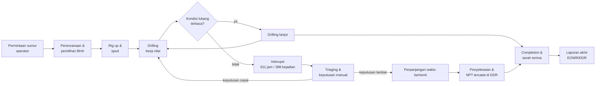

### 2.1.2 Tabel waktu proses

| Simbol | Langkah | Waktu | Status nilai |
|---|---|---|---|
| NV | Menunggu kejelasan kondisi lubang (388 kejadian) | 611 jam (median 45 menit per kejadian) | non-nilai, tapi wajib |
| NV | Triaging, pembacaan grafik terpisah, keputusan manual | tidak terukur terpisah di data (dinyatakan dalam 2.7) | non-nilai |
| V | Aktivitas pengeboran tercatat | 601 jam pada window terkurasi | nilai |
| V | Persiapan, rig up, completion | tidak terpisah di label interupsi | nilai |
| T | Total waktu proses pada window terkurasi | 1.212 jam | |

Waktu total proses (1.212 jam) menjadi dasar seluruh laju kejadian per 1.000 jam yang
dipakai di 2.4. Angka median 45 menit dan p90 180 menit berasal dari hitung langsung
terhadap `act_start`/`act_end`, disajikan pada Gambar 3.

**Temuan VSM:** hampir separuh waktu proses pada window terkurasi berada di status
"menunggu kejelasan", sementara tidak ada satu pun titik di alur yang menampilkan
status lubang bor dalam satu layar. Itulah titik hilang yang menjadi sasaran solusi.

---

## 2.2 Material & Information Flow Chart (MIFC)

### 2.2.1 Alur material

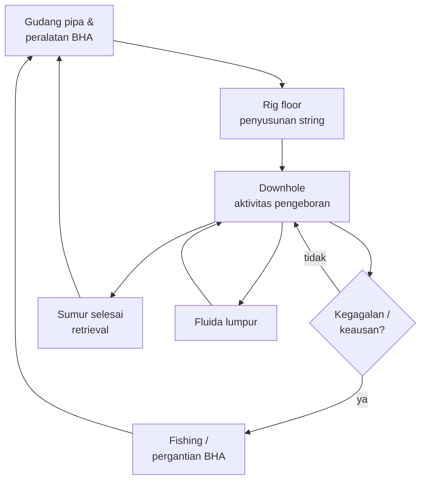

### 2.2.2 Alur informasi

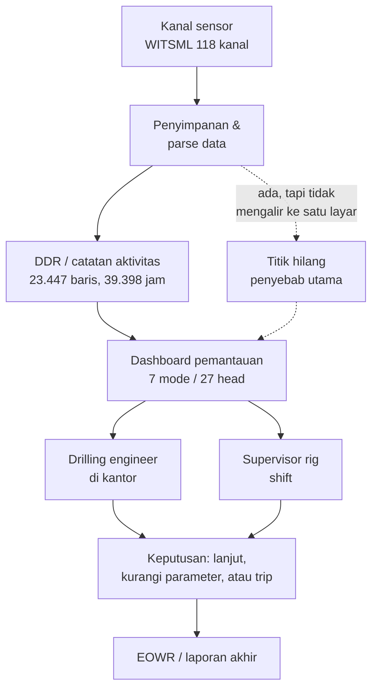

**Temuan MIFC:** alur material sudah terputus-putus dan penuh umpan balik normal
(bukan masalah utama), sedangkan alur informasi terhenti di antara penyimpanan data dan
orang yang harus memutuskan. Data ada (118 kanal), hasil perhitungan ada (27 head),
yang tidak ada satu pintu tampilan yang memutarnya menjadi keputusan.

---

## 2.3 Operation Process Chart (OPC)

OPC menghubungkan operasi utama dengan kejadian yang menyelinginya dan jumlah kejadian
yang tercatat pada data.

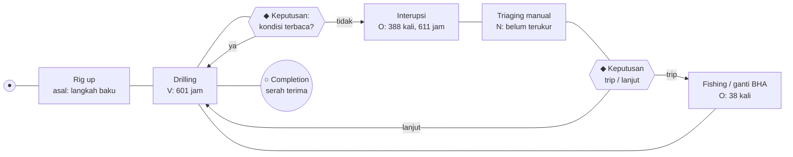

Keterangan: `●` operasi utama, `○` penyelesaian, `◆` keputusan, `O` kejadian tercatat.

| Kejadian pada data Volve | Frekuensi |
|---|---|
| Interupsi non-routine | 388 |
| Stuck pipe dan fishing | 38 |
| Kegagalan BHA / peralatan downhole | 12 |
| Intervensi wireline / completion di luar rencana | 21 |
| Masalah fluida sumur | 25 |
| Kegagalan peralatan permukaan | 216 |
| Kejadian keamanan personel | 1 |

---

## 2.4 Failure Modes, Effects, and Criticality Analysis (FMECA)

### 2.4.1 Skala penilaian yang dipakai

Skala 1-10 mengikuti kerangka AIAG-VDA FMEA Handbook dan MIL-STD-1629A untuk
akar huruf risiko, dengan definisi eksplisit di bawah ini supaya skor bisa diaudit.

**Severity (S), 1 = tidak berdampak, 10 = bencana:**

| Nilai | Definisi operasional pada proyek ini |
|---|---|
| 9-10 | risiko HSE atau well control; kerusakan total BHA; kontrak terancam penalti |
| 7-8 | NPT signifikan, biaya rig jalan tanpa progres |
| 5-6 | penundaan operasi dapat dipulihkan dalam satu shift |
| 3-4 | gangguan lokal, ditangani tanpa menghentikan operasi |
| 1-2 | hampir tidak terasa |

**Occurrence (O), berdasar laju per 1.000 jam operasi (1.212 jam terhitung):**

| Laju per 1.000 jam | Nilai O |
|---|---|
| ≥ 100 | 10 |
| 50-99 | 9 |
| 25-49 | 8 |
| 15-24 | 7 |
| 10-14 | 6 |
| 5-9 | 5 |
| 2-4 | 4 |
| 1-1,9 | 3 |
| 0,5-0,9 | 2 |
| < 0,5 | 1 |

**Detectability (D), 1 = mudah terdeteksi, 10 = hampir mustahil:**

| Nilai | Definisi |
|---|---|
| 1-3 | terdeteksi otomatis oleh indikator yang sudah ada, termasuk hilangnya data sendiri |
| 4-6 | terdeteksi oleh head detektor, tetapi masih di taraf peringatan berpengawas |
| 7-8 | hanya terdeteksi setelah gejala muncul, detektor belum layak |
| 9-10 | tidak terdeteksi sampai dampaknya terjadi |

### 2.4.2 Tabel FMECA

| No | Mode kegagalan | Efek | S | Laju/1.000 jam | O | D | RPN | Dasar S, O, D |
|---|---|---|---|---|---|---|---|---|
| 1 | Kegagalan peralatan permukaan rig | NPT langsung, tanpa progres, biaya rig tetap jalan | 8 | 178,22 | 10 | 4 | **320** | O dari 216 kejadian; D diturunkan dari ketersediaan indikator rig, bukan detektor |
| 2 | Kegagalan fluida sumur (kick/loss) | risiko well control, HSE, kerusakan formasi | 10 | 20,63 | 7 | 7 | **490** | O dari 25 kejadian; D tinggi karena head hyd K-ii berstatus belum tersedia |
| 3 | Stuck pipe / fishing | kehilangan BHA, biaya fishing, NPT panjang | 10 | 31,35 | 8 | 5 | **400** | O dari 38 kejadian; D dari mode stuck yang sudah diuji tapi tier peringatan |
| 4 | Kegagalan BHA / peralatan downhole | kerusakan alat mahal, operasi berhenti | 9 | 9,90 | 6 | 7 | **378** | O dari 12 kejadian; hanya 50 dari 884 kejadian berlabel `bha_relevant=yes` |
| 5 | Kegagalan telemetri / kehilangan data | kehilangan visibilitas, keputusan tanpa bukti | 7 | | 6 | 3 | **126** | O dari porsi jendela tanpa data (contoh head vib 356 dari 1.989 jendela); D rendah karena kehilangan data justru paling mudah terlihat |
| 6 | Intervensi wireline / completion di luar rencana | penundaan, biaya intervensi | 6 | 17,33 | 7 | 5 | **210** | O dari 21 kejadian |
| 7 | Kejadian tak terlokalisir (data/label tidak jelas) | analisis akar penyebab tertunda | 5 | 23,10 | 7 | 4 | **140** | O dari 28 kejadian `failure_unlocated` |
| 8 | Kerusakan personel | HSE, kepatuhan, biaya tidak terukur | 10 | 0,83 | 2 | 6 | **120** | O dari 1 kejadian `safety_personnel` |

Skala O ditetapkan agar mendukung jarak antar mode pada data ini: laju tertinggi
(mesin permukaan, 178 per 1.000 jam) mendapat nilai 10 dan laju terendah
(0,83 per 1.000 jam) mendapat nilai 2. Skala ini keputusan desain, ditulis eksplisit sehingga pembaca dapat menghitung ulang dengan skala lain.
sehingga pembaca bisa menghitung ulang dengan skala lain.

### 2.4.3 Pembacaan hasil

Mode 2 (fluida sumur) memperoleh RPN tertinggi karena Severity maksimum dipadukan
dengan Detectability buruk: detektor yang seharusnya menangkapnya, `hyd K-ii`, masih
berstatus belum tersedia di prototipe. Ini adalah argumen inti kenapa solusi harus
menutup keterbatasan deteksi, bukan sekadar menampilkan grafik.

Mode 3 (stuck pipe) dan 4 (BHA) berada di peringkat berikutnya. Keduanya justru punya
detektor yang sudah diuji (`stuck`, `bit_wear`), sehingga celahnya ada pada keandalan
deteksi, bukan pada ketiadaan data.

Mode 1 punya frekuensi tertinggi tetapi Severity lebih rendah dan deteksi relatif
mudah, sehingga RPN-nya di bawah dua mode di atas. Mode 8 jarang sekali terjadi namun
Severity maksimum; ini menjelaskan kenapa kriteria HSE tetap diperlukan di MCDM walau
frekuensinya kecil.

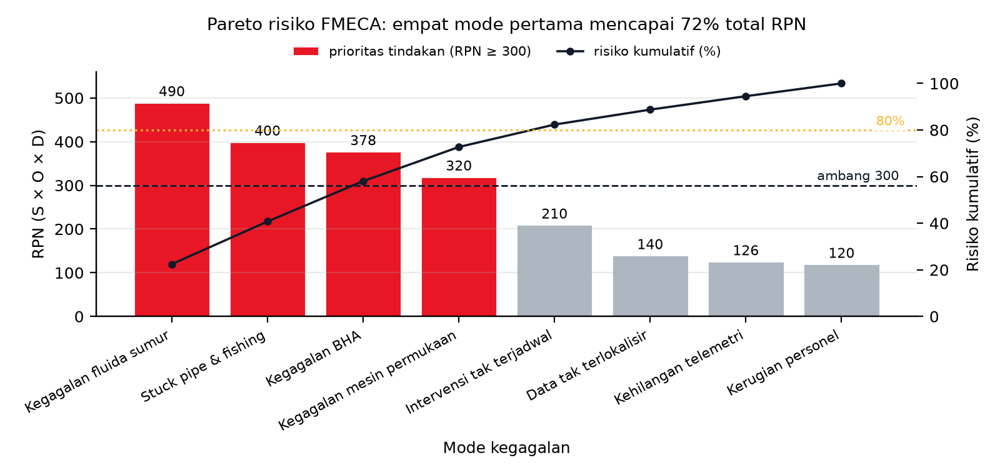

**Gambar 6.** Pareto risiko FMECA atas delapan mode kegagalan, total RPN 2.184. Empat
mode teratas (Kegagalan fluida sumur 490, Stuck pipe & fishing 400, Kegagalan BHA 378,
Kegagalan mesin permukaan 320) menyumbang 72,7 persen dari total RPN dan semuanya
berada di atas garis ambang prioritas 300 sehingga diwarnai merah. Kurva hitam menunjukkan
risiko kumulatif pada sumbu kanan: batas 80 persen baru terlewati pada mode kelima
(82,3 persen). Empat mode sisanya diwarnai karena berada di bawah ambang 300. Angka pada gambar
menghitung tabel RPN pada subbab sebelumnya: pembilangnya daftar sebab
per mode, penyebutnya total RPN seluruh mode.

---

## 2.5 Fault Tree Analysis (FTA)

Top event dipilih satu: **kehilangan kendali kondisi lubang berujung stuck pipe atau
kegagalan BHA**. Keputusan memakai satu pohon, bukan dua, karena basic event kedua
pohon saling menumpuk dan akan menduplikasi penyebab.

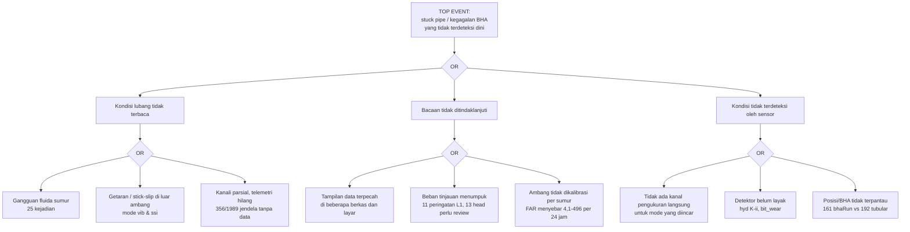

Penafsiran: pohon menunjukkan bahwa ketiadaan alat ukur hanyalah satu dari tiga cabang.
Cabang yang paling menumpuk dalam data adalah cabang A2 (bacaan tidak ditindaklanjuti),
sehingga solusi yang hanya menambah sensor akan menyerang pohon di cabang yang salah.

---

## 2.6 Tool yang dipertimbangkan dan ditolak

| Tool | Keputusan | Alasan |
|---|---|---|
| VSM | dipakai | menunjukkan bahwa setengah waktu terkunci pada "menunggu kejelasan" |
| MIFC | dipakai | memisahkan alur material (sehat) dari alur informasi (terputus) |
| OPC | dipakai | menghubungkan operasi utama dengan 388 kejadian tercatat |
| FMECA | dipakai | memberi peringkat risiko dengan O berbasis data, bukan tebakan |
| FTA | dipakai | memecah top event ke tiga cabang dan menunjukkan cabang dominan |
| Fishbone 6M dan 5W1H | dipakai di Bab I 1.2 | akar masalah perlu dipaparkan sebelum alat analisis operasional |
| REBA / RULA | ditolak | tidak ada beban kerja manual dominan pada pekerjaan yang dikaji |
| MIFC tekstual panjang | ditolak | diagram sudah memuat seluruh simpul dan aliran, sehingga uraian teks tidak menambah informasi |


---

## 2.7 Sintesis akar masalah

Gabungan kelima tool menghasilkan satu kalimat masalah:

> Data kondisi pengeboran tersedia dalam jumlah besar dan hasil kalkulasi risiko sudah
> dihasilkan, tetapi keduanya tidak pernah bertemu pada satu titik keputusan sehingga
> 388 kejadian interupsi tetap ditangani reaktif dengan median 45 menit dan p90 180 menit
> per kejadian.

Tiga bukti yang menopang kalimat itu, semuanya terukur: total 611 jam waktu berhenti dari
1.212 jam window terkurasi (2.1), terhentinya alur informasi di antara penyimpanan data
dan orang yang memutuskan (2.2), serta cabang A2 pada pohon kegagalan yang paling menumpuk
karena beban tinjauan dan ambang tidak terkalibrasi (2.5).

Dari sini Bab III masuk ke tahap Investigate: sembilan alternatif, pemetaan BoK,
kriteria, dan pemilihan solusi.

---

# BAB III ANALISIS ALTERNATIF SOLUSI

## 3.1 Permasalahan & Alternatif Solusi

- Acuan BoK: Empat belas IEBoK, selaras IISE ISEBoK 2021

### 3.1.1 Dasar penyusunan dan aturan bukti

Sembilan alternatif berikut mencakup seluruh usulan solusi yang teridentifikasi pada tahap Investigate, dan setiap usulan dipetakan tepat satu kali ke satu alternatif, sehingga tidak ada mekanisme yang terduplikasi dan tidak ada usulan yang hilang tanpa rumah. beserta empat solusi pendukung pada bagian kelas rapuh (S-E1, S-E2, S-F1, S-F2), tiga opsi peningkatan pada dokumen opsi ML, dan dua tuas lanjutan setelah percobaan uji utama (6a perbaikan label, 6b kalibrasi ambang per sumur). Seluruh dua puluh dua sumber dipetakan tepat satu kali ke sembilan alternatif, sehingga tidak ada alternatif yang menduplikasi mekanisme alternatif lain, dan tidak ada sumber yang hilang tanpa rumah.

Angka pada seluruh subbab dihitung ulang dari data primer atau hasil eksekusi detektor; angka yang belum terukur disertai isi asumsinya, dasar, alasan dipilih, dan cara mengujinya, dan tidak disamarkan menjadi hasil pengukuran.

### 3.1.2 Kondisi pengikat dan celah teknis yang dirujuk

Tabel berikut memuat sembilan kode rujukan P1 sampai P9. Kode ini bukan rumusan masalah. Rumusan masalah hanya empat, yaitu RM1 sampai RM4 pada 1.1.6. Sebagian besar kode di bawah adalah keadaan yang mengikat ruang lingkup, misalnya jumlah alat, jumlah positif per fold, dan ketiadaan atribut pada berkas sumber, sehingga tidak dijawab sebagai temuan melainkan diakomodasi sebagai batasan. Sisanya adalah celah teknis yang menjadi prasyarat bagi RM1 atau RM2.

| Kode | Kondisi pengikat atau celah teknis | Uraian ringkas dan angka |
| --- | --- | --- |
| P1 | Label stuck berbentuk status, bukan peristiwa | Label STUCK_RT bertahan sebagai blok panjang sehingga jendela sebelumnya menjadi prediktor hampir sempurna. Prevalensi F-9_A 66,9%, persistence 0,787 mengalahkan Random Forest 0,651, dan lift F-9_A turun ke 0,97. |
| P2 | Jumlah positif shk terlalu sedikit per fold | Gate G1 lolos 3 dari 7 fold sedangkan G2 lolos 6 dari 7, sehingga akarnya bukan mutu fitur melainkan jumlah informasi positif: F-9_A 30 positif dan F-9 45 positif, dibanding F-14 760 positif. |
| P3 | Label hyd adalah ambang residual dari proses yang persisten | Label diturunkan dari residual SPPA dengan ambang nilai mutlak z di atas 2 sehingga mewarisi persistensi proses. Persistence 0,42 sampai 0,63 mengalahkan Random Forest 0,11 sampai 0,61 pada 7 dari 7 fold, dan G1 hanya lolos 2 dari 7. |
| P4 | tool_wear terbatas 4 alat dengan label identitas run | Hanya 4 alat dan 2 run per alat (469 jendela), label berupa identitas run R01/R02 sehingga urutan percobaan ikut terkorelasi dengan label. Prevalensi sekitar 0,5 membatasi plafon lift pada 2,0; hasil nyata G1 0 dari 4 dengan lift 1,09 sampai 1,42. |
| P5 | bit_wear dikalahkan persistence pada seluruh fold | Gate G1 lolos 3 dari 4 dan G2 lolos 4 dari 4, tetapi persistence lebih tinggi daripada Random Forest pada 4 dari 4 fold karena label high-MSE membentuk blok lintas kedalaman. Aturan pra-registrasi menurunkan verdict menjadi layak bersyarat. |
| P6 | Sebagian fold ssi underpowered | ssi lolos G1 4 dari 5 dan G2 5 dari 5 dengan persistence 0 dari 5, tetapi F-7 hanya 3 positif dan F-9 hanya 12 positif sehingga selang kepercayaan melebar dan F-9_A gagal tipis pada lift 1,47. |
| P7 | Validitas label lintas sumur belum terbukti | Kontrol-positif stuck 0 dari 10, label hyd masih berupa proksi residual, dan campuran severitas berbeda antar sumur. Cacat ini mengancam seluruh lapisan onset sebelum model apa pun dipercaya. |
| P8 | Ambang global tidak portabel antar sumur | Pada titik operasi yang sama, false alarm rate vib menyebar 4,15 sampai 496,09 per 24 jam, yaitu rasio 119,6 kali antar sumur, sehingga satu ambang global tidak dapat dipakai. |
| P9 | Tidak ada label keausan fisik dari rig | Seluruh 77 berkas bhaRun tidak memuat dullingInfo, dullGrade, maupun bitName, sehingga label yang tersedia hanya batas waktu run, bukan tingkat keausan. Prediksi onset keausan bit (K-2) belum dijalankan sama sekali. |

Peta asal setiap kode, supaya tidak ada yang dibaca sebagai pertanyaan riset baru:

| Kode | Asal di Bab I | Peran |
| --- | --- | --- |
| P1 | RM1, mutu label | kondisi pengikat bentuk label |
| P2 | Kendala 1.4.4 butir 3 | jumlah positif per fold terbatas |
| P3 | RM1, mutu label | kondisi pengikat bentuk label |
| P4 | Kendala 1.4.4 butir 5 | cakupan domain bengkel |
| P5 | RM1 | celah teknis, baseline mengalahkan model |
| P6 | Kendala 1.4.4 butir 3 | jumlah sampel per fold terbatas |
| P7 | Kendala 1.4.4 butir 8 | validitas label lintas sumur |
| P8 | RM2 | gejala yang harus dijawab pemilihan titik operasi |
| P9 | Kendala 1.4.4 butir 5 | domain keausan alat berbeda dan atribut keausan tidak tersedia |

Konsekuensi pembacaan: P1 sampai P9 tidak menambah jumlah rumusan masalah. Yang bertambah hanya rincian mengapa keempat pertanyaan riset itu sulit dijawab dengan data yang ada.

### 3.1.3 Tabel rekap sembilan alternatif

| No | Anggota | Alternatif solusi | BoK | Masalah yang dirujuk | Dieksekusi di percobaan uji |
|---|---|---|---|---|---|
| A1 | Anggota 1 | Relabeling onset peristiwa: dari status menjadi kejadian | 2, 5, 11, 14 | P1, P3, P5 | sudah, sebagian (stuck K-ii dan hyd K-ii) |
| A2 | Anggota 1 | Perluasan wellbore berkanal disfungsi (F-10, F-4, F-12, F-15) | 5, 7, 11, 14 | P2, P6 | sudah, akuisisi data |
| A3 | Anggota 1 | Penjaminan mutu label dan label probabilistik multi-sumber | 2, 5, 11, 14 | P7 | belum ada |
| A4 | Anggota 2 | Unit analisis per-stand pengeboran | 1, 5, 7, 11 | P2, P6 | belum ada |
| A5 | Anggota 2 | Prediksi severity ordinal dengan evaluasi stabilitas fold | 2, 3, 5, 10, 11 | P6, P7 | belum ada |
| A6 | Anggota 2 | Formulasi survival dan sisa umur pakai (time-to-event) | 2, 3, 5, 7 | P9, P3 | belum ada |
| A7 | Anggota 3 | Penguatan pengujian keausan alat bengkel: progresi, dekomposisi mode, dan ranking | 1, 5, 6, 7 | P4 | sudah, domain bengkel (K-i) |
| A8 | Anggota 3 | Label fisika pengganti label proksi | 5, 6, 10, 11 | P3, P5, P9 | belum ada |
| A9 | Anggota 3 | Lapisan keputusan operasional: kalibrasi ambang per sumur dan purwarupa peringatan dini | 1, 2, 3, 6, 7, 10 | P8, P1 | belum ada |

Tiga anggota membagi lapisan intervensi, bukan kelas disfungsi. Pembagian ini dipilih karena satu pekerjaan akuisisi data melayani beberapa kelas sekaligus, sehingga pembagian per kelas akan menduplikasi mekanisme yang sama pada dua alternatif berbeda.

- Anggota 1 mengerjakan lapisan data dan label (A1 sampai A3).
- Anggota 2 mengerjakan lapisan formulasi model dan evaluasi (A4 sampai A6).
- Anggota 3 mengerjakan lapisan sinyal fisik, keausan, dan operasi (A7 sampai A9).

### 3.1.4 Rincian setiap alternatif

#### 3.1.4.1 A1 Relabeling onset peristiwa: dari status menjadi kejadian (Anggota 1)

**Ringkasan.** Mengubah definisi target dari status yang bertahan menjadi titik masuk peristiwa, sehingga dominasi persistence hilang secara konstruksi.

**Deskripsi teknis.** Untuk setiap deret label instrumen (STUCK_RT, residual SPPA pada hyd, dan label high-MSE pada bit_wear), onset t_e didefinisikan sebagai titik naik status. Jendela positif adalah jendela fitur yang berakhir dalam horizon H sebelum t_e, sedangkan jendela di dalam blok setelah onset dibuang dari evaluasi dan tidak dinegatifkan. Horizon H ditetapkan 10 menit dengan uji sensitivitas pada 5 dan 30 menit. Gate G1 (lift minimal 1,5 pada mayoritas sumur layak) dan G2 (AUPRC minimal AUPRC canary kedalaman) tidak diubah, sehingga perubahan hanya berada pada definisi label.

**Permasalahan yang diselesaikan.** P1, P3, P5. Label STUCK_RT bertahan sebagai blok panjang sehingga jendela sebelumnya menjadi prediktor hampir sempurna. Prevalensi F-9_A 66,9%, persistence 0,787 mengalahkan Random Forest 0,651, dan lift F-9_A turun ke 0,97. Label diturunkan dari residual SPPA dengan ambang nilai mutlak z di atas 2 sehingga mewarisi persistensi proses. Persistence 0,42 sampai 0,63 mengalahkan Random Forest 0,11 sampai 0,61 pada 7 dari 7 fold, dan G1 hanya lolos 2 dari 7. Gate G1 lolos 3 dari 4 dan G2 lolos 4 dari 4, tetapi persistence lebih tinggi daripada Random Forest pada 4 dari 4 fold karena label high-MSE membentuk blok lintas kedalaman. Aturan pra-registrasi menurunkan verdict menjadi layak bersyarat.

**Keterkaitan BoK.** BoK 14 Systems Design & Engineering; BoK 11 Information Engineering; BoK 5 Quality & Reliability Engineering. BoK 14 karena alternatif ini menetapkan ulang fungsi sistem yang diprediksi (kejadian, bukan status); BoK 11 karena perubahan berada pada rantai data dan label; BoK 5 karena metrik yang dipakai adalah metrik keandalan dan deteksi kegagalan.

**Bukti kelayakan dari proyek.**

- Formulasi onset sudah dijalankan untuk stuck dan menghasilkan peringatan dengan arah benar pada beban rendah: Random Forest pada titik operasi 0,05 memberi B1 0,51 sampai 1,00 dengan TLead 10 sampai 11,5 menit, sedangkan baseline persistence-EVENT hanya memberi TLead median 7,0 menit dengan B1 0 sampai 11,5 persen.
- Untuk hyd, formulasi yang sama menghasilkan B1 nol dari tiga onset dengan TLead nol, jadi hasil negatifnya terukur dan dilaporkan.
- Relabel tidak memerlukan parse ulang karena deret label sumber sudah tersedia pada data terparse, sehingga seluruh biaya tambahan terletak pada pengujian, bukan pada pengumpulan data baru.

 Belum dieksekusi untuk bit_wear K-2 karena registrasi sebelum percobaan tersebut belum terbit.

#### 3.1.4.2 A2 Perluasan wellbore berkanal disfungsi (F-10, F-4, F-12, F-15) (Anggota 1)

**Ringkasan.** Menambah sumur dan fold dengan memparse wellbore yang terbukti memiliki kanal disfungsi, bukan menurunkan ambang label.

**Deskripsi teknis.** Empat wellbore yang belum diparse (F-10, F-4, F-12, F-15) diproses ke CSV dengan protokol identik percobaan sebelumnya: grid 60 detik, agregasi menit, syarat kelayakan jendela yang sama. Hasilnya digabungkan ke skema leave-one-well-out per kelas sehingga jumlah fold dan jumlah positif naik tanpa mengubah definisi label maupun gate. Peta kanal dipakai sebagai syarat masuk: hanya wellbore yang benar-benar mendaftarkan mnemonic disfungsi yang diambil.

**Permasalahan yang diselesaikan.** P2, P6. Gate G1 lolos 3 dari 7 fold sedangkan G2 lolos 6 dari 7, sehingga akarnya bukan mutu fitur melainkan jumlah informasi positif: F-9_A 30 positif dan F-9 45 positif, dibanding F-14 760 positif. ssi lolos G1 4 dari 5 dan G2 5 dari 5 dengan persistence 0 dari 5, tetapi F-7 hanya 3 positif dan F-9 hanya 12 positif sehingga selang kepercayaan melebar dan F-9_A gagal tipis pada lift 1,47.

**Keterkaitan BoK.** BoK 11 Information Engineering; BoK 5 Quality & Reliability Engineering; BoK 14 Systems Design & Engineering. BoK 11 karena pekerjaan inti adalah akuisisi dan pengelolaan data multi-sumur; BoK 5 karena tujuannya memulihkan kecukupan sampel untuk estimasi keandalan; BoK 14 karena data dari empat sumur harus diintegrasikan ke satu protokol evaluasi.

**Bukti kelayakan dari proyek.**

- Peta kanal menunjukkan sumber positif yang nyata: F-10 mendaftarkan SHKRSK_RT pada 188 berkas, CRPM_RT 186, STKSLP 125, VIBLAT_RT 66, dan STUCK_RT 18; F-4 135/135/135/86; F-12 91/90/52/6; F-15 77/76/76/76.
- Akuisisi data sudah berjalan dan terukur: CRPM F-10 281.030 baris, F-4 42.010 baris, F-12 178.430 baris, F-15 57.846 baris, dengan re-run 11 fold belum dilakukan.
- Akar masalah yang diserang terukur pada ssi: G1 4 dari 5, F-9_A lift 1,47 gagal tipis, dan dua fold underpowered (F-7 3 positif, F-9 12 positif).

 Evaluasi ulang fold belum dijalankan, sehingga dampak terhadap gate belum dapat diklaim.

#### 3.1.4.3 A3 Penjaminan mutu label dan label probabilistik multi-sumber (Anggota 1)

**Ringkasan.** Membereskan kebenaran label lebih dahulu, lalu menambah sumbu bukti melalui label model bila noise antar sumber masih besar.

**Deskripsi teknis.** Dua tahap berurutan. Tahap pertama adalah audit semantik label: mengunci satu varian onset stuck (strict atau forward-fill), memverifikasi arti skala 0/1/2/3 pada STUCK_RT dan SHKRSK_RT lintas sumur, merekonsiliasi prevalensi stuck 66,9 persen dengan 49,4 persen, menyinkronkan zona waktu kontrol-positif, dan mengganti label hyd proksi dengan kejadian nyata. Tahap kedua adalah label model generatif dengan labeling function independen (status instrumen, event kurasi, penanda fisika differential sticking, anomali overpull), dengan syarat kanal pembentuk label dilarang menjadi fitur. Urutan ini wajib karena kalibrasi ambang apa pun yang dilakukan sebelum label benar hanya menghasilkan presisi palsu.

**Permasalahan yang diselesaikan.** P7. Kontrol-positif stuck 0 dari 10, label hyd masih berupa proksi residual, dan campuran severitas berbeda antar sumur. Cacat ini mengancam seluruh lapisan onset sebelum model apa pun dipercaya.

**Keterkaitan BoK.** BoK 5 Quality & Reliability Engineering; BoK 11 Information Engineering; BoK 14 Systems Design & Engineering. BoK 5 karena inti pekerjaan adalah analisis kegagalan dan mutu pengukuran; BoK 11 karena label adalah keluaran sistem informasi; BoK 14 karena keputusan label harus konsisten dengan tujuan sistem, bukan dengan satu sumur.

**Bukti kelayakan dari proyek.**

- Tiga cacat label sudah terukur: kontrol-positif stuck 0 dari 10, label hyd masih proksi residual, dan campuran severitas berbeda antar sumur.
- Basis label kurasi memuat 884 kejadian, 50 di antaranya relevan BHA, dengan total durasi 73.500 menit atau 1.225 jam, sehingga bahan rekonsiliasi tersedia dan dapat dihitung ulang.
- Urutan 6a sebelum 6b ditetapkan karena kalibrasi ambang menyetel kebenaran, sehingga label yang salah akan menghasilkan presisi palsu.

**Batas bukti.** Belum ada langkah audit label yang diuji pada percobaan mana pun, sehingga A3 berhenti pada rancangan mekanisme dan belum membawa angka.

#### 3.1.4.4 A4 Unit analisis per-stand pengeboran (Anggota 2)

**Ringkasan.** Mengganti unit jendela 10 menit dengan unit operasional rig (stand) agar prevalensi naik dan varians antar fold turun.

**Deskripsi teknis.** Label per stand didefinisikan sebagai any(kanal minimal 1) selama stand berlangsung, dan fitur berupa statistik stand sebelumnya. Batas stand diturunkan dari BPOS atau celah waktu pada CSV yang sudah ada. Konsekuensi yang harus dinyatakan terbuka: horizon prediksi melebar dari 10 menit menjadi stand berikutnya, sehingga klaim yang boleh dibuat adalah peringatan risiko per stand, bukan peringatan 10 menit.

**Permasalahan yang diselesaikan.** P2, P6. Dengan satuan stand, diharapkan jumlah positif per fold naik karena satu kejadian mencakup beberapa stand sekaligus, sehingga dua fold yang kini terbatas jumlah positifnya (F-7 3 positif dan F-9 12 positif) memperoleh basis lebih lebar. Perbaikan yang disasar bukan mutu fitur melainkan satuan hitung, dan karena itu prevalensi per stand wajib dihitung ulang sebelum ambang dikalibrasi.

**Keterkaitan BoK.** BoK 7 Operations Engineering & Management; BoK 5 Quality & Reliability Engineering; BoK 11 Information Engineering. BoK 7 karena unit yang dipakai adalah unit operasi produksi pengeboran; BoK 5 karena tujuannya menstabilkan estimasi keandalan; BoK 11 karena agregasi dan penyimpanan fitur berubah.

**Bukti kelayakan dari proyek.**

- Rentang prevalensi unit stand 10 sampai 40 persen adalah **asumsi**. **Isi asumsinya:** proporsi unit stand yang menghasilkan kejadian di antara unit yang dikunci. **Dasar:** belum ada hitungan prevalensi untuk unit stand karena belum ada label stand pada data, sementara rancangan standar memerlukan ambang kalibrasi awal. **Alasan dipilih:** rentang dipakai untuk menguji kerentanan desain ambang sebelum biaya pengumpulan label stand dibelanjakan, bukan sebagai angka kinerja. **Cara mengujinya:** saat data stand tersedia, hitung proporsi unit stand dengan kejadian pada interval yang sama dan bandingkan dengan 10 sampai 40 persen.
- Batas stand dapat diturunkan dari BPOS dan celah waktu pada data yang sudah tersedia, sehingga tidak memerlukan akuisisi baru.
- Bila unit stand dipakai, false alarm rate wajib dihitung per stand disertai justifikasinya, karena gate saat ini dihitung per jendela waktu.

**Batas bukti.** Belum ada hasil uji untuk unit stand, sehingga klaim A4 berhenti pada mekanisme kenaikan prevalensi dan tidak pada angka.

#### 3.1.4.5 A5 Prediksi severity ordinal dengan evaluasi stabilitas fold (Anggota 2)

**Ringkasan.** Memakai seluruh informasi skala 0 sampai 3, lalu menurunkan keputusan biner pada ambang fisik yang sama sambil melaporkan stabilitas tiap fold secara eksplisit.

**Deskripsi teknis.** Model dilatih memprediksi skala (ordinal atau regresi) kemudian keputusan biner diturunkan pada ambang minimal 1, sehingga gate tetap dihitung pada AUPRC biner dan tidak bergeser. Lapisan kedua adalah evaluasi: stratified bootstrap per fold dan pelaporan jumlah positif per fold, agar selang kepercayaan yang lebar tidak menyembunyikan fold underpowered.

**Permasalahan yang diselesaikan.** P6, P7. ssi lolos G1 4 dari 5 dan G2 5 dari 5 dengan persistence 0 dari 5, tetapi F-7 hanya 3 positif dan F-9 hanya 12 positif sehingga selang kepercayaan melebar dan F-9_A gagal tipis pada lift 1,47. Kontrol-positif stuck 0 dari 10, label hyd masih berupa proksi residual, dan campuran severitas berbeda antar sumur. Cacat ini mengancam seluruh lapisan onset sebelum model apa pun dipercaya.

**Keterkaitan BoK.** BoK 5 Quality & Reliability Engineering; BoK 2 Operations Research & Analysis; BoK 11 Information Engineering. BoK 5 karena pengujian hipotesis dan regresi adalah alat utamanya; BoK 2 karena keputusan ambang adalah analisis keputusan; BoK 11 karena keluaran skor harus dikelola sebagai informasi operasional.

**Bukti kelayakan dari proyek.**

- Klasifikasi severitas stick-slip dengan pembelajaran mesin sudah mapan pada literatur sehingga jalur ordinal bukan klaim baru.
- ssi sudah lolos G1 4 dari 5 dengan dua fold underpowered (F-7 3 positif, F-9 12 positif), sehingga stabilitas fold adalah variabel yang wajib dilaporkan.
- Penulis solusi sendiri menilai jalur stabilitas fold sebagai pengeras bukti, bukan penambah kelas, sehingga posisinya pelengkap A4 dan A2.

**Batas bukti.** Tidak ada angka ordinal maupun bootstrap pada percobaan yang sudah ada, sehingga A5 belum membawa besaran keparahan.

#### 3.1.4.6 A6 Formulasi survival dan sisa umur pakai (time-to-event) (Anggota 2)

**Ringkasan.** Memodelkan waktu sampai peristiwa, bukan status sesaat, sehingga keluaran berupa risiko per horizon dan sisa umur pakai peralatan.

**Deskripsi teknis.** Model hazard proporsional h(t|x) = h0(t) exp(beta transpose x) dipakai untuk waktu sampai peristiwa hidrolik dan untuk waktu sampai penarikan bit. Skor risiko per horizon H dievaluasi dengan gate biner yang sama, sehingga formulasi berubah tanpa mengubah gerbang. Label waktu sampai penarikan bit diturunkan dari interval dTimStart dan dTimStop pada berkas bhaRun.

**Permasalahan yang diselesaikan.** P9, P3. Seluruh 77 berkas bhaRun tidak memuat dullingInfo, dullGrade, maupun bitName, sehingga label yang tersedia hanya batas waktu run, bukan tingkat keausan. Prediksi onset keausan bit (K-2) belum dijalankan sama sekali. Label diturunkan dari residual SPPA dengan ambang nilai mutlak z di atas 2 sehingga mewarisi persistensi proses. Persistence 0,42 sampai 0,63 mengalahkan Random Forest 0,11 sampai 0,61 pada 7 dari 7 fold, dan G1 hanya lolos 2 dari 7.

**Keterkaitan BoK.** BoK 5 Quality & Reliability Engineering; BoK 3 Engineering Economic Analysis; BoK 2 Operations Research & Analysis. BoK 5 karena survival dan sisa umur pakai adalah inti rekayasa keandalan; BoK 3 karena keputusan penarikan bit adalah trade-off biaya; BoK 2 karena penaksiran hazard adalah model matematis untuk pengambilan keputusan.

**Bukti kelayakan dari proyek.**

- Label waktu sampai penarikan tersedia dari 77 berkas bhaRun, tetapi berkas itu tidak memuat dullingInfo, dullGrade, maupun bitName, sehingga label hanya berupa batas run dan bukan keausan fisik.
- Penulis solusi menilai survival sebagai opsi pembanding karena mengubah formulasi tanpa menambah informasi, sehingga posisinya bukan solusi primer.
- Titik operasi hidrolik saat ini menghasilkan nol dari tiga onset terdeteksi, sehingga pembanding berformulasi waktu adalah langkah yang masuk akal dan bukan pengulangan.

**Batas bukti.** Belum ada model hazard pada percobaan mana pun, sehingga A6 belum membawa prakiraan waktu.

#### 3.1.4.7 A7 Penguatan pengujian keausan alat bengkel: progresi, dekomposisi mode, dan ranking (Anggota 3)

**Ringkasan.** Tiga mekanisme pada dataset yang sama: label progresi dalam-run, fitur hasil dekomposisi, dan ranking antar status sebagai cadangan.

**Deskripsi teknis.** Bekerja pada 8 berkas akselerometer 1000 Hz (4 alat, 2 run, 469 jendela). Mekanisme pertama adalah label progresi: deret fitur keausan dihitung, titik ubah dideteksi per run, dan jendela sebelum titik ubah menjadi positif. Mekanisme kedua adalah fitur Variational Mode Decomposition berupa energi pita dan statistik per mode. Mekanisme ketiga adalah learning-to-rank pasangan dalam alat, dipakai hanya bila validasi titik ubah gagal karena artefak termal.

**Permasalahan yang diselesaikan.** P4. Hanya 4 alat dan 2 run per alat (469 jendela), label berupa identitas run R01/R02 sehingga urutan percobaan ikut terkorelasi dengan label. Prevalensi sekitar 0,5 membatasi plafon lift pada 2,0; hasil nyata G1 0 dari 4 dengan lift 1,09 sampai 1,42.

**Keterkaitan BoK.** BoK 1 Work Design & Measurement; BoK 5 Quality & Reliability Engineering; BoK 6 Ergonomics & Human Factors; BoK 7 Operations Engineering & Management. BoK 1 karena interval penggantian ditetapkan dari waktu kerja per alat; BoK 5 karena keluarannya metrik keandalan dan presisi titik ubah; BoK 6 karena penanganan manual alat membatasi cara pengujian dapat dilakukan; BoK 7 karena keputusan penggantian adalah keputusan operasi aset, bukan keputusan statistik.

**Bukti kelayakan dari proyek.**

- Deteksi perubahan regime sudah dijalankan pada 4 dari 4 alat dengan TLead 20 sampai 36 detik (1,8 kali) dan false alarm terkalibrasi 1 sampai 3 per alat, tetapi presisi run hanya 0,50 karena titik ubah juga signifikan pada alat baru.
- Uji artefak termal gagal membuktikan confound pada 0 dari 8 run, sehingga kritik urutan run tidak terbukti pada data ini.
- Baseline ranking lintas alat stabil pada 1,19 kali (AUPRC 0,516 sampai 0,612) sedangkan model Random Forest belum dijalankan di V9, sehingga mekanisme ranking masih terbuka.
- Fitur dekomposisi mode baru dinyatakan sebagai pengangkat AUPRC pada rancangan, tanpa artefak eksekusi, sehingga statusnya masih rencana.

**Batas bukti.** Yang terukur pada A7 baru progresi dan kalibrasi ambang pada domain bengkel, sedangkan dekomposisi mode dan peringkat belum diuji.

#### 3.1.4.8 A8 Label fisika pengganti label proksi (Anggota 3)

**Ringkasan.** Mengganti label berbasis ambang dengan label berbasis mekanisme: well-control untuk hidrolik dan kombinasi energi spesifik untuk keausan bit.

**Deskripsi teknis.** Untuk hidrolik, dua label turunan fisik dipakai sebagai onset: perubahan volume pit (PITTOT dan GAINLOSSTOT) sebagai penanda kick atau loss, serta selisih laju masuk dan keluar (FLOWOUT dikurangi FLOWIN) sebagai penanda washout, masing-masing dengan ambang z-score median dan MAD per sumur. Untuk keausan bit, status high-MSE hanya dihitung sebagai keausan bila disertai penurunan rasio MSE terhadap energi spesifik, mengikuti aturan Menand dan Mills. Kanal pembentuk label dilarang menjadi fitur.

**Permasalahan yang diselesaikan.** P3, P5, P9. Label diturunkan dari residual SPPA dengan ambang nilai mutlak z di atas 2 sehingga mewarisi persistensi proses. Persistence 0,42 sampai 0,63 mengalahkan Random Forest 0,11 sampai 0,61 pada 7 dari 7 fold, dan G1 hanya lolos 2 dari 7. Gate G1 lolos 3 dari 4 dan G2 lolos 4 dari 4, tetapi persistence lebih tinggi daripada Random Forest pada 4 dari 4 fold karena label high-MSE membentuk blok lintas kedalaman. Aturan pra-registrasi menurunkan verdict menjadi layak bersyarat. Seluruh 77 berkas bhaRun tidak memuat dullingInfo, dullGrade, maupun bitName, sehingga label yang tersedia hanya batas waktu run, bukan tingkat keausan. Prediksi onset keausan bit (K-2) belum dijalankan sama sekali.

**Keterkaitan BoK.** BoK 10 Safety; BoK 5 Quality & Reliability Engineering; BoK 11 Information Engineering. BoK 10 karena kick dan lost circulation adalah bahaya well-control; BoK 5 karena label baru harus diverifikasi terhadap keandalan alat; BoK 11 karena penurunan label adalah pekerjaan rekayasa informasi.

**Bukti kelayakan dari proyek.**

- Kanal sumber label tersedia dan terhitung: GAINLOSSTOT pada 575 berkas di F-1 C dan 517 di F-11, PITTOT 565 dan 506, FLOWOUT 688, FLOWOUTPC 949.
- Bahan label silang tersedia langsung pada data laju penembusan USROP yang sudah memuat label keausan bit dan label efisiensi, sehingga label silang dapat disusun tanpa pengumpulan data baru.
- Aturan MSE dan MSE/DS sudah diverifikasi rumusnya pada dokumen sumber, sehingga label silang bukan gagasan tanpa dasar.

**Batas bukti.** Belum ada label pit atau flow yang diparse menjadi deret label, meskipun kanal mentahnya sudah teridentifikasi di F-9, F-1 C, dan F-11.

#### 3.1.4.9 A9 Lapisan keputusan operasional: kalibrasi ambang per sumur dan purwarupa peringatan dini (Anggota 3)

**Ringkasan.** Menyentuh titik operasi alat, bukan model: ambang per sumur, purwarupa pengujian pada data berlabel, dan indeks kondisi untuk disfungsi yang labelnya belum tersedia.

**Deskripsi teknis.** Tiga komponen yang semuanya bersifat operasional. Pertama, kalibrasi ambang per sumur secara prospektif untuk hyd K-i, vib Random Forest, dan shk Random Forest, lalu pengukuran false alarm rate setelah kalibrasi dan pembandingan terhadap baseline persistence. Kedua, purwarupa pengujian stuck-pipe pada dataset TSPP yang sudah berlabel dengan kanal permukaan frekuensi tinggi sebagai uji kelayakan cepat sebelum pengujian lintas sumur. Ketiga, indeks kondisi drill-string berbasis autoencoder untuk disfungsi yang labelnya tidak tersedia langsung, dengan validasi berupa korelasi terhadap event bit run atau stuck, bukan klaim presisi tinggi. Ketiganya tidak menyentuh gate G1 dan G2 yang sudah dikunci.

**Permasalahan yang diselesaikan.** P8, P1. Pada titik operasi yang sama, false alarm rate vib menyebar 4,15 sampai 496,09 per 24 jam, yaitu rasio 119,6 kali antar sumur, sehingga satu ambang global tidak dapat dipakai. Label STUCK_RT bertahan sebagai blok panjang sehingga jendela sebelumnya menjadi prediktor hampir sempurna. Prevalensi F-9_A 66,9%, persistence 0,787 mengalahkan Random Forest 0,651, dan lift F-9_A turun ke 0,97.

**Keterkaitan BoK.** BoK 1 Work Design & Measurement; BoK 6 Ergonomics & Human Factors; BoK 3 Engineering Economic Analysis. BoK 1 karena ambang dan prosedur alarm adalah bagian dari desain sistem kerja driller; BoK 6 karena beban kognitif dan tampilan alert adalah faktor manusia; BoK 3 karena keputusan biaya false alarm dan penghematan rig time adalah analisis ekonomi teknik, sekaligus menutup rantai BoK.

**Bukti kelayakan dari proyek.**

- Ambang global terbukti gagal: pada titik operasi 0,5 false alarm rate vib menyebar 4,15 sampai 496,09 per 24 jam atau rasio 119,6 kali antar sumur.
- Dataset TSPP tersedia dengan 52.905 baris pada empat berkas dan 10 kanal permukaan, sehingga purwarupa dapat dijalankan tanpa akuisisi baru.
- Artefak autoencoder lama tidak diskriminatif karena 75 sampai 99 persen baris berada di atas ambang, sehingga komponen indeks kondisi harus dikerjakan ulang dan tidak boleh mengutip artefak itu sebagai bukti.
- Alat saat ini berjalan dengan nol slot alarm otomatis dari 27 head, sehingga lapisan ini adalah syarat naik tier dan bukan tambahan opsional.

**Batas bukti.** Kalibrasi ambang per sumur untuk hyd, vib, dan shk belum dijalankan. Kalibrasi false alarm yang sudah ada hanya di dalam mode tool_wear pada domain bengkel.

### 3.1.5 Rekapitulasi bukti per alternatif

| Alternatif | Bukti yang tersedia |
| --- | --- |
| A1, A2, A7 | Mekanisme inti disertai angka hasil uji; bagian lain baru mekanisme. |
| A3, A4, A5, A6, A8, A9 | Bukti berhenti pada mekanisme dan batas; belum ada angka hasil uji. |

### 3.1.6 Keterkaitan dengan BoK

| Alternatif | BoK 1 | BoK 2 | BoK 3 | BoK 5 | BoK 6 | BoK 7 | BoK 10 | BoK 11 | BoK 14 |
| --- | --- | --- | --- | --- | --- | --- | --- | --- | --- |
| A1 | - | ya | - | ya | - | - | - | ya | ya |
| A2 | - | - | - | ya | - | ya | - | ya | ya |
| A3 | - | ya | - | ya | - | - | - | ya | ya |
| A4 | ya | - | - | ya | - | ya | - | ya | - |
| A5 | - | ya | ya | ya | - | - | ya | ya | - |
| A6 | - | ya | ya | ya | - | ya | - | - | - |
| A7 | ya | - | - | ya | ya | ya | - | - | - |
| A8 | - | - | - | ya | ya | - | ya | ya | - |
| A9 | ya | ya | ya | - | ya | ya | ya | - | - |

Pelaksanaan proyek diawali BoK 14 Sistem Design dan Engineering, melibatkan minimal tiga IEBoK, lalu diakhiri BoK 3 Engineering Economic Analysis. Rancangan sembilan alternatif mengikuti pola tersebut: A1 memuat BoK 14 dan A9 memuat BoK 3, sedangkan setiap alternatif memuat empat sampai enam BoK sehingga syarat minimal tiga BoK terpenuhi pada tingkat alternatif, bukan hanya pada tingkat proyek.

Sembilan dari empat belas BoK tersentuh oleh rancangan ini. Lima BoK yang tidak tersentuh adalah BoK 4 Facilities Engineering and Energy Management, BoK 8 Supply Chain Management, BoK 9 Engineering Management, BoK 12 Design & Manufacturing Engineering, dan BoK 13 Product Design and Development. Kelimanya dibahas pada 3.2.9 beserta data yang akan mengubah keadaan itu, supaya tidak ada BoK yang diklaim tanpa penopang.

### 3.1.7 Hasil negatif dan batas yang harus dinyatakan

1. Formulasi onset untuk hyd sudah diuji dan gagal pada titik operasi saat ini: nol dari tiga onset terdeteksi dengan TLead nol. Alternatif A1 karena itu tidak boleh diklaim berhasil untuk semua kelas.
2. Dua hal pada subbab ini masih asumsi: rentang prevalensi unit stand 10 sampai 40 persen (dijelaskan dengan isi, dasar, alasan, dan uji pada butir di atas) dan hasil kalibrasi ambang per sumur yang belum ada karena belum ada label stand.
3. Dampak perluasan wellbore pada gate belum dapat diklaim karena re-run fold belum dijalankan, meskipun baris data hasil parse sudah terukur.
4. Fitur dekomposisi mode pada A7 baru berupa rencana pada rancangan, tanpa artefak eksekusi.

5. **Angka 0,99 pada klasifikasi disfungsi bukan batas deteksi.** Seluruh run gangguan pada
   data simulasi dibangkitkan dengan parameter yang terpisah 3 sampai 10 kali dari kondisi
   normal, sehingga macro-F1 0,9925 mengukur pemisahan kasus ekstrem dan bukan keparahan
   terendah yang masih dikenali. Kalimat yang sah adalah "metode teruji memisahkan enam
   kelas pada keparahan ekstrem", sedangkan kalimat "metode mendeteksi gangguan sekecil
   apa pun" tidak boleh ditulis sampai kurva keparahan batas diukur seperti direncanakan
   pada 3.1.8.
6. **Dua kelas setpoint tidak boleh digabung dalam satu klaim deteksi.** Kelas `low_pump`
   dan `low_rpm` ditentukan oleh setpoint perintah yang terlihat langsung pada telemetri
   permukaan, yaitu laju pompa dan putaran permukaan, sehingga F1 0,997 pada kedua kelas
   itu mengukur keterbacaan perintah, bukan pengenalan disfungsi lubang bawah. Keduanya
   dilaporkan terpisah, dan angka empat kelas fisik tanpa keduanya, yaitu macro-F1 0,9950,
   adalah angka yang dipakai untuk klaim kemampuan deteksi.
7. **Data simulasi bukan bukti lapangan.** Seluruh angka pada 3.1.8 berasal dari simulator
   telemetri rig milik tim sendiri, sehingga klaim yang sah adalah metode teruji pada data
   simulasi. Belum ada uji derau sensor dan belum ada transfer ke sumur nyata, sehingga
   tidak ada kalimat yang boleh menyatakan bahwa alat sudah terbukti pada
   operasi pengeboran sesungguhnya.

### 3.1.8 Bukti performa klasifikasi disfungsi dan batas deteksi yang harus diukur

**Tujuan pengukuran.** Subbab ini menjawab satu hal yang tidak dapat dijawab oleh target
status: seberapa jauh disfungsi pengeboran dapat dikenali dari telemetri permukaan, dan pada
keparahan serendah apa pengenalan itu masih bertahan. Arah pengukurannya berubah dari
memprediksi status menjadi mengklasifikasikan jenis disfungsi disertai estimasi keparahan.
Perubahan ini mengikuti pembagian blok pada ISO 13374, yaitu State Detection untuk mengenali
keadaan dan Health Assessment untuk menilai keparahannya, sehingga keduanya dilaporkan
terpisah dan tidak saling menutupi. Alasannya terukur: pada target status, label bertahan
sebagai blok panjang sehingga keadaan satu jendela hampir ditentukan oleh jendela sebelumnya,
dan AUPRC tertahan rendah bukan karena fitur lemah melainkan karena targetnya dapat dihafal.
Pada klasifikasi disfungsi, satu run menghasilkan satu label, sehingga tidak ada deret waktu
yang dapat dihafal model, dan pertanyaan tentang kemampuan pengenalan menjadi dapat dijawab
oleh angka.

**Setelan pengukuran.** Seluruh besaran pada subbab ini dihitung pada satu himpunan data
simulasi dengan setelan berikut.

Tabel 3.1.8a Setelan pengukuran klasifikasi disfungsi

| Unsur | Nilai |
| --- | --- |
| Sumber data | simulator telemetri rig milik tim, versi 0.1.0a1 |
| Populasi | 1.200 run, enam kelas seimbang, 200 run per kelas |
| Kelas | `bit_wear`, `hard_formation`, `high_friction`, `low_pump`, `low_rpm`, `normal_soft` |
| Panjang rekaman | 20 kanal telemetri permukaan per run, sekitar 1.261 baris per run |
| Fitur | 70 fitur, yaitu mean, std, p10, p50, p90, dan maksimum dari 11 kanal (`rop`, `wob`, `hookload`, `surface_rpm`, `surface_torque`, `pump_spm`, `flow_rate`, `spp`, `difp`, `bit_depth`, `block_position`), ditambah fraksi `on_bottom` dan jumlah baris |
| Model | `HistGradientBoostingClassifier`, `max_iter` 300, `learning_rate` 0,08 |
| Validasi | StratifiedKFold 5 lipatan pada tingkat run, tidak ada baris dari run yang sama di latih dan uji |
| Pembanding | kelas terbanyak sebagai baseline |
| Metrik | macro-F1, akurasi, dan F1 per kelas |

Pemisahan lipatan dilakukan pada tingkat run, bukan pada tingkat baris, karena 1.261 baris
di dalam satu run berasal dari satu operasi yang bersambung. Bila lipatan dibagi per baris,
baris uji akan bertetangga dengan baris latih dari run yang sama, sehingga skor mengukur
hafalan terhadap run dan bukan pengenalan terhadap run baru. Karena itu setiap lipatan
menguji model pada run yang belum pernah dilihat.

**Hasil enam kelas.** Pada 1.200 run dengan enam kelas seimbang, model mencapai macro-F1
0,9925 dan akurasi 0,9925, sedangkan baseline kelas terbanyak hanya 0,1667. Baseline itu
bernilai seperenam karena enam kelas berukuran sama, sehingga setiap run yang ditebak
sebagai kelas terbanyak hanya benar pada 200 dari 1.200 run.

Tabel 3.1.8b F1 per kelas pada pengujian enam kelas

| Kelas | F1 | Mekanisme yang menjelaskan nilainya |
| --- | --- | --- |
| `hard_formation` | 1,000 | Kekuatan batuan naik dari 3,40 MPa pada normal menjadi median 28,04 MPa, sehingga ROP turun pada WOB dan RPM yang sama dan MSE naik tanpa perubahan friksi. Perubahan sebesar itu tidak bertumpang tindih dengan kelas lain. |
| `low_pump` | 0,997 | Kelas ditentukan setpoint laju pompa yang terlihat pada kanal `pump_spm`, sehingga pengenalan hampir seluruhnya berupa pembacaan kembali perintah. |
| `low_rpm` | 0,997 | Kelas ditentukan setpoint putaran yang terlihat pada kanal `surface_rpm`, dengan mekanisme yang sama seperti `low_pump`. |
| `high_friction` | 0,995 | Resistensi rangkaian muncul dari 0 kPa menjadi median 1.486 kPa, sehingga torsi permukaan naik pada putaran rendah dan sebagian beban berpindah dari mata bor ke dinding lubang. Kehadiran gesekan bersifat kualitatif, bukan bertingkat. |
| `bit_wear` | 0,985 | Efisiensi potong turun dari 1,00 menjadi median 0,26, sehingga MSE naik karena torsi tetap sementara laju penembusan turun. Nilainya paling rendah di antara kelas gangguan karena penurunannya bersinambung, bukan melompat. |
| `normal_soft` | 0,980 | Kelas ini menjadi tempat kesalahan menumpuk, karena setiap kelas gangguan yang paling ringan berada paling dekat dengan kondisi normal di ruang parameter. |

Dua nilai terendah, yaitu 0,980 pada `normal_soft` dan 0,985 pada `bit_wear`, bukan
kebetulan. Keduanya adalah pasangan yang berbatasan di ruang parameter: `bit_wear` turun
secara bersinambung dari efisiensi potong 1,00 ke median 0,26, sehingga run keausan paling
ringan berada paling dekat dengan normal, sedangkan kelas gangguan lain berubah secara
kualitatif dan tidak memiliki tetangga dekat. Pola ini penting untuk dibaca bersama uji
keparahan di bawah, karena ia menunjukkan bahwa kesalahan model terkonsentrasi tepat pada
batas yang belum diukur.

**Hasil empat kelas fisik.** Bila dua kelas setpoint dikeluarkan, sehingga tersisa
`bit_wear`, `hard_formation`, `high_friction`, dan `normal_soft`, model mencapai macro-F1
0,9950 dan akurasi 0,9950 dengan baseline 0,250. Kenaikan baseline dari 0,1667 ke 0,250
bukan perbaikan model, melainkan akibat langsung dari berkurangnya jumlah kelas, karena
peluang menebak benar pada kelas terbanyak naik dari seperenam menjadi seperempat.
Kenaikan macro-F1 dari 0,9925 ke 0,9950 juga tidak boleh dibaca sebagai deteksi yang lebih
baik, karena kedua kelas yang dikeluarkan justru ber-F1 0,997. Yang berubah adalah susunan
kesalahan, bukan kemampuan model, dan sesudah dua kelas itu dikeluarkan kesalahan yang
tersisa terkonsentrasi pada pasangan `bit_wear` dan `normal_soft`. Angka empat kelas inilah
yang dipakai sebagai angka klaim, karena keempatnya dibedakan oleh keadaan lubang bor dan
bukan oleh perintah yang tercatat di permukaan.

**Hasil uji keparahan ringan.** Uji ini menurunkan keparahan sampai kuartil terendah di
dalam tiap kelas gangguan, lalu membandingkannya dengan seluruh run normal.

Tabel 3.1.8c Hasil uji keparahan ringan

| Uji | Cakupan | macro-F1 | Akurasi dan recall |
| --- | --- | --- | --- |
| Tiga kelas, keparahan ringan | `bit_wear`, `hard_formation`, `high_friction` pada kuartil keparahan terendah per kelas, lawan seluruh run normal | 0,979 | akurasi 0,983 |
| Biner `bit_wear` ringan | kuartil terendah kelas lawan seluruh run normal | 0,968 | akurasi 0,980, recall 0,92 |
| Biner `hard_formation` ringan | kuartil terendah kelas lawan seluruh run normal | 1,000 | tidak dilaporkan terpisah |
| Biner `high_friction` ringan | kuartil terendah kelas lawan seluruh run normal | 1,000 | tidak dilaporkan terpisah |

Penurunan dari 0,9925 ke 0,979 pada tiga kelas, dan ke 0,968 pada biner `bit_wear`,
mengikuti mekanisme parameter yang sudah dijelaskan. `bit_wear` adalah satu-satunya kelas
yang parameternya bergerak bersinambung, sehingga kuartil terendahnya menghasilkan
kesalahan terbanyak dan recall 0,92 adalah angka yang paling informatif bagi sistem
peringatan, karena keausan ringan yang terlewat adalah bentuk kegagalan operasional yang
paling mahal. Sebaliknya `hard_formation` dan `high_friction` tetap 1,000 karena kekuatan
batuan 28,04 MPa lawan 3,40 MPa dan kehadiran resistensi 1.486 kPa lawan 0 kPa tetap
berbeda secara kualitatif pada keparahan mana pun di dalam keluarga simulasi itu.

Yang harus dibaca bersama angka tersebut: kata ringan di sini berarti paling ringan di
dalam keluarga gangguan yang sudah ekstrem, bukan ringan dalam arti mutlak. Seluruh run
gangguan, termasuk kuartil terendahnya, tetap dibangkitkan dengan parameter terpisah 3
sampai 10 kali dari normal. Karena itu 0,979 dan 0,968 mengukur urutan di dalam keluarga
yang sudah terpisah penuh dari normal, dan tidak dapat dibaca sebagai keparahan terendah
yang masih dikenali.

**Mengapa angkanya setinggi itu: pemisahan parameter, bukan kepekaan fitur.** Tabel berikut
memuat sebaran parameter fisika yang membedakan kelas, dan sebaran itulah yang menjelaskan
nilai F1 di atas.

Tabel 3.1.8d Sebaran parameter fisika per kelas gangguan

| Parameter fisika | Nilai pada kelas gangguan | Nilai pada `normal_soft` | Mekanisme pemisahan dan dasar metode |
| --- | --- | --- | --- |
| Efisiensi potong pada `bit_wear` | median 0,26 dengan IQR 0,16 sampai 0,33 | 1,00 | Mata bor kehilangan sekitar tiga perempat efisiensi potongnya, sehingga energi yang dibutuhkan per satuan volume batuan naik. Energi spesifik mekanis sebagai dasar pembacaan ini berasal dari Teale (1965), dan pembacaannya bersama keausan bit mengikuti AADE-17-NTCE-033. |
| Kekuatan batuan UCS pada `hard_formation` | median 28,04 MPa | 3,40 MPa | Batuan yang lebih kuat menahan gigi, sehingga laju penembusan turun pada WOB dan RPM yang sama dan energi spesifik naik tanpa kenaikan friksi. Dasar pembacaannya Teale (1965) untuk MSE dan AADE-17-NTCE-033 untuk pemisahan MSE akibat batuan lawan akibat keausan. |
| Resistensi BHA pada `high_friction` | median 1.486 kPa | 0 kPa | Gesekan menambah torsi pada putaran rendah dan menggeser sebagian beban dari mata bor ke dinding lubang. Dasar pembacaannya friksi bit-spesifik dari Pessier dan Fear (SPE-24584), yang memisahkan energi yang dipakai menembus batuan dari energi yang habis oleh gesekan. |

Tiga hal terbaca dari tabel itu. Pertama, dua parameter bergerak dengan rasio yang besar,
yaitu efisiensi potong yang menyisakan sekitar seperempat nilai normal dan kekuatan batuan
yang berada dalam orde puluhan MPa lawan satuan MPa. Kedua, parameter ketiga bergerak dari
nilai nol, sehingga rasionya tidak terdefinisi dan pemisahannya bersifat ada atau tidak ada,
bukan bertingkat. Ketiga, karena ketiga parameter berada jauh dari nilai normal pada seluruh
run gangguan, himpunan data tidak memuat satu pun contoh yang berada di antara dua kelas.
Akibatnya ambang keputusan yang dipelajari model dapat berada di mana saja di dalam celah
itu, dan letaknya tidak dapat diketahui dari percobaan ini.

**Temuan T1 sampai T4.** Penomoran ini lokal pada subbab ini dan tidak menggantikan
penomoran T1 sampai T4 pada 3.5.8 yang merujuk bahan uji pemilihan algoritme.

**T1. Macro-F1 0,9925 mengukur pemisahan parameter, bukan mutu ekstraksi tanda.** Angka itu
muncul pada fitur yang seluruhnya berupa statistik ringkas, yaitu mean, std, tiga kuantil,
dan maksimum dari 11 kanal, tanpa satu pun fitur spektral atau fitur riwayat. Bila performa
berasal dari ekstraksi tanda halus, penurunan keparahan seharusnya menurunkannya secara
tajam. Yang terukur justru penurunan kecil, dari 0,9925 ke 0,979 pada tiga kelas dan ke
0,968 pada biner `bit_wear`. Mekanisme yang paling sesuai adalah keenam kelas terpisah oleh
parameter fisika yang berbeda jauh, sehingga statistik ringkas sudah cukup memisahkannya.
Konsekuensinya, angka ini tidak boleh dipakai sebagai bukti bahwa rancangan fitur sudah
matang, karena rancangan fitur yang lebih sederhana pun akan memperoleh angka serupa pada
data dengan celah selebar ini.

**T2. Dua kelas setpoint menyumbang kemudahan, bukan bukti deteksi.** `low_pump` dan
`low_rpm` masing-masing ber-F1 0,997, dan keduanya ditentukan oleh setpoint yang terlihat
pada kanal `pump_spm` dan `surface_rpm`, yaitu dua dari 11 kanal yang fiturnya dipakai.
Mekanismenya langsung: kelas yang didefinisikan oleh perintah yang tercatat di permukaan
dapat dipulihkan dari kanal yang membawa perintah itu, sehingga F1 0,997 mengukur
konsistensi pencatatan, bukan pengenalan disfungsi lubang bawah. Karena itu klaim kemampuan
deteksi memakai angka empat kelas, yaitu macro-F1 0,9950, dan angka enam kelas dilaporkan
sebagai angka kelengkapan dataset, bukan sebagai angka performa deteksi. Pembedaan ini juga
menjelaskan mengapa baseline naik dari 0,1667 ke 0,250 ketika kedua kelas dikeluarkan.

**T3. Penurunan performa terbesar ada pada kelas dengan parameter bersinambung.** Pada uji
keparahan ringan, `bit_wear` adalah satu-satunya kelas yang turun berarti, yaitu ke 0,968
dengan recall 0,92, sedangkan `hard_formation` dan `high_friction` tetap 1,000. Mekanismenya
adalah bentuk sebaran parameter: efisiensi potong bergerak bersinambung dari 1,00 ke median
0,26 sehingga ujung bawah rentangnya selalu paling dekat dengan normal, sedangkan kekuatan
batuan dan kehadiran gesekan berubah secara kualitatif sehingga tetap berbeda pada
keparahan berapa pun. Recall 0,92 pada `bit_wear` ringan adalah angka yang paling layak
dikutip untuk sistem peringatan, karena kerugian terbesar sistem peringatan datang dari gangguan
ringan yang terlewat, bukan dari gangguan berat yang sudah terlihat, tetapi angka itu tetap berlaku pada keausan ringan
versi simulasi, bukan pada keausan ringan yang terdeteksi di sumur nyata.

**T4. Batas deteksi belum terukur, dan percobaan ini tidak dapat mengukurnya.** Ambang
keputusan pada pengklasifikasi berbasis pohon diletakkan di ruang kosong antara kelompok
normal dan kelompok gangguan. Karena celah itu selebar 3 sampai 10 kali nilai normal dan
tidak ada satu pun run di dalamnya, letak ambang di dalam celah tidak teridentifikasi:
keparahan yang jatuh di tengah celah dapat diklasifikasikan ke dua arah tanpa satu pun
contoh yang membuktikan mana yang benar. Uji keparahan ringan tidak menutup celah ini karena
kuartil terendahnya masih berada di dalam keluarga ekstrem. Ditambah lagi, derau yang ada
pada data adalah derau simulator, bukan derau sensor, sehingga lebar sebaran tiap kelas di
bawah pengaruh derau pengukuran juga belum diketahui. Karena itu pertanyaan seberapa rendah
batas deteksi belum terjawab, dan pengukurannya memerlukan dua percobaan baru yang
direncanakan di bawah.

**Apa yang belum dibuktikan.** Empat pernyataan berikut mengikat seluruh angka di atas.

1. **Belum terbukti di lapangan.** Data berasal dari simulator tim sendiri, sehingga klaim
   yang sah adalah metode teruji pada data simulasi. Tidak ada sumur nyata yang diuji, dan
   tidak ada angka pada subbab ini yang boleh dipindahkan menjadi klaim operasi.
2. **Belum mengukur batas deteksi.** Parameter gangguan terpisah 3 sampai 10 kali dari
   normal, sehingga 0,9925 mengukur kasus ekstrem. Angka 0,99 bukan batas deteksi, dan
   penulisan yang menyamakan keduanya akan melebihkan capaian.
3. **Dua kelas setpoint harus terpisah.** `low_rpm` dan `low_pump` ditentukan setpoint
   perintah yang terlihat pada telemetri, sehingga tidak boleh digabung dalam klaim deteksi
   disfungsi lubang bawah. Angka klaim adalah macro-F1 0,9950 pada empat kelas fisik.
4. **Belum ada uji derau sensor dan belum ada transfer ke sumur nyata.** Keduanya prasyarat
   sebelum angka mana pun dapat disebut berlaku pada telemetri lapangan, karena telemetri
   lapangan membawa derau pengukuran, kanal kosong, dan kalibrasi alat yang berbeda dari
   simulator.

**Rencana tiga langkah pengukuran batas deteksi.** Ketiga langkah disusun berurutan, karena
langkah kedua dan ketiga memakai model dan estimator yang sama dengan langkah pertama,
sehingga hasilnya dapat dibandingkan pada skala yang sama.

**Langkah 1: run keparahan batas pada simulator.** Tujuannya mengisi celah antara normal dan
gangguan saat ini, sehingga ambang keputusan dapat diukur letaknya.

Tabel 3.1.8e Rentang keparahan batas yang direncanakan

| Parameter | Nilai normal | Nilai gangguan saat ini | Rentang run batas |
| --- | --- | --- | --- |
| Efisiensi potong | 1,00 | median 0,26 dengan IQR 0,16 sampai 0,33 | 0,6 sampai 0,9 |
| Kekuatan batuan UCS | 3,40 MPa | median 28,04 MPa | 5 sampai 10 MPa |
| Resistensi BHA | 0 kPa | median 1.486 kPa | 300 sampai 800 kPa |

Setiap rentang berada di dalam celah, yaitu di antara nilai normal dan nilai gangguan yang
sudah diukur, sehingga setiap run batas mengisi ruang yang pada percobaan sebelumnya kosong.
Prosedurnya: sapuan bertahap pada setiap rentang, jumlah run per titik keparahan ditetapkan
sebelum eksekusi supaya hasilnya bukan hasil pencarian, lalu metrik per titik dilaporkan
sebagai kurva recall lawan keparahan pada anggaran alarm palsu yang tetap. Batas deteksi
didefinisikan sebagai keparahan terendah yang masih memenuhi target recall 0,70 sampai 0,80
yang sudah ditetapkan pada 1.1.5, dan definisi itu dikunci sebelum run dijalankan. Keluaran
langkah ini adalah kurva dan satu titik potong, bukan satu angka tunggal, karena satu angka
tidak dapat menyatakan pada keparahan berapa kemampuan itu berhenti.

**Langkah 2: uji derau sensor memakai kolom `observation_quality`.** Kolom itu mencatat mutu
pengamatan per kanal per baris, sehingga derau dapat dimasukkan secara sebanding dengan mutu
yang tercatat, dan baris berderau tinggi dapat dipisahkan dari baris berderau rendah.
Keluarannya adalah kurva penurunan macro-F1 dan recall per kelas terhadap tingkat derau,
dihitung pada model yang sama dengan langkah 1 supaya penurunannya dapat diatribusikan
kepada derau dan bukan kepada perubahan model. Uji tambahan pada langkah yang sama adalah
pengurangan kanal sampai sebanyak kanal yang benar-benar terisi pada data lapangan, yaitu 37
sampai 48 kanal per sumur seperti dinyatakan pada 1.1.6, karena fitur pada subbab ini hanya
memakai 11 kanal dan sembilan kanal lainnya tidak diringkas sama sekali. Bila penurunan
akibat derau sudah terukur, klaim berubah bentuk dari satu angka menjadi pernyataan bersyarat,
yaitu macro-F1 pada tingkat derau tertentu, dan pernyataan itulah yang dapat dibandingkan
dengan mutu telemetri lapangan.

**Langkah 3: kalibrasi estimator fisika pada simulasi, lalu terapkan ke sumur nyata.**
Langkah ini memindahkan klasifikasi menjadi estimasi keparahan yang dapat diperiksa secara
fisika. Estimator dibangun dengan membalik hubungan yang sudah mapan: energi spesifik mekanis
Teale (1965) untuk efisiensi potong, friksi bit-spesifik Pessier dan Fear (SPE-24584) untuk
koefisien gesek, serta fungsi keausan gigi f7 dan fraksi dullness h dari Bourgoyne dan Young
(1974) untuk keadaan keausan, dengan pembacaan gabungan MSE dan keausan mengikuti
AADE-17-NTCE-033. Kalibrasi dilakukan pada data simulasi karena di sana nilai sebenarnya
diketahui, yaitu efisiensi potong 0,26, UCS 28,04 MPa, dan resistensi 1.486 kPa pada kelasnya
masing-masing, sehingga galat pembalikan dapat diukur langsung. Sesudah galat itu terukur,
pembalikan yang sama diterapkan pada sumur nyata, dan keluarannya dibandingkan dengan bukti
yang tersedia di lapangan, yaitu catatan bit, tren MSE, dan label kejadian. Yang boleh
diklaim dari langkah ini adalah konsistensi, bukan akurasi, karena sumur nyata tidak memiliki
nilai parameter sebenarnya untuk dibandingkan. Keluaran langkah ini menempati blok Health
Assessment pada ISO 13374 dan tetap berstatus advisory, sehingga estimasi keparahan menjadi
bahan tinjauan engineer dan bukan pemicu tindakan otomatis.

Jejak reproduksi seluruh angka pada subbab ini, termasuk setelan lipatan, nilai fitur, dan
keluaran tiap kelas, tersedia pada Lampiran A.

---

---

## 3.2 Analisis Alternatif Solusi

- Acuan BoK: Empat belas IEBoK, selaras IISE ISEBoK 2021

### 3.2.1 Dasar analisis dan aturan bukti

Subbab ini memuat tiga hal, yaitu ruang gagasan yang tidak menilai ide pada tahap awal, analisis sembilan alternatif dengan kedalaman minimal tiga BoK dari empat belas BoK, dan peta afinitas untuk mengelompokkan ide yang mirip ke kategori yang logis. Ketiganya dijawab dengan urutan: himpunan ide tetap sembilan alternatif dari subbab 3.1, pengelompokan dilakukan pada 3.2.2 sampai 3.2.6, dan pendalaman BoK dilakukan pada 3.2.7 sampai 3.2.9.

Ruang yang tidak menilai ide pada tahap awal terlihat pada subbab 1.3, yang memuat sembilan
usulan awal berkode T1 sampai T9 dari tiga anggota tanpa peringkat dan tanpa penilaian
kelayakan. Penyaringan dari usulan awal itu ke sembilan alternatif berkode A pada subbab 3.1
dilakukan melalui pengelompokan mekanisme pada 3.2.2 sampai 3.2.6, sehingga jejaknya dapat
diperiksa dari kode T ke kode A, dan tidak ada alternatif yang muncul tanpa asal.

Aturan bukti yang dipakai:

1. Setiap angka menyebut langkah hitungnya dan merujuk ID bukti pada Lampiran A, sehingga dapat diulang dari data mentah.
2. Angka yang belum dihitung ditulis eksplisit sebagai asumsi atau perkiraan desain, dan tidak disamarkan sebagai hasil pengukuran.
3. Setiap alternatif menyatakan tingkat buktinya, yaitu angka hasil uji atau mekanisme beserta batas yang menyertainya.

### 3.2.2 Metode peta afinitas

1. Himpunan yang dikelompokkan adalah sembilan alternatif yang sudah berkode pada subbab 3.1. Tidak ada alternatif baru yang ditambahkan pada langkah pengelompokan, sehingga peta tidak memunculkan ide hantu.
2. Sumbu pengelompokan ditetapkan sebelum hasil dilihat, yaitu objek yang diubah pada sistem kerja: definisi target, basis bukti, formulasi model, dan titik operasi keputusan. Sumbu ini dipilih karena sembilan alternatif pada 3.1 sudah dibedakan oleh mekanisme, bukan oleh kelas disfungsi.
3. Uji keterpisahan: satu alternatif hanya boleh masuk satu klaster, ditentukan oleh mekanisme utamanya. Alternatif yang menyentuh dua klaster dicatat sebagai kasus batas dan tetap ditempatkan pada mekanisme dominannya.
4. Penamaan klaster memakai kata kerja dan objek, bukan nama bidang, supaya nama langsung menyatakan apa yang diubah.
5. Sumbu keanggotaan (anggota 1, 2, dan 3) sengaja tidak dipakai sebagai sumbu pengelompokan. Alasan terukur: bila sumbunya keanggotaan, peta hanya menyalin pembagian pada subbab 3.1 dan tidak menghasilkan informasi baru. Hasil pengelompokan menunjukkan dua dari empat klaster melintasi batas anggota, sehingga kedua peta memang berbeda.

Hasil akhirnya empat klaster, dengan sebaran tiga, dua, dua, dan dua alternatif. Dua klaster melintasi batas anggota, yaitu K1 yang memuat alternatif milik anggota 1 dan anggota 3, serta K2 yang memuat alternatif milik anggota 1 dan anggota 2. Karena itu peta ini bukan salinan pembagian tugas pada subbab 3.1, melainkan pengelompokan berdasarkan mekanisme.

### 3.2.3 Peta afinitas empat klaster

| Klaster | Nama klaster | Prinsip pengelompokan | Anggota | Masalah | BoK | Status |
| --- | --- | --- | --- | --- | --- | --- |
| K1 | Definisi target dan mutu label | Ketiga alternatif mengubah apa yang dihitung sebagai kejadian positif, atau menguji kebenaran label yang sudah ada. Tidak ada yang mengubah model dan tidak ada yang menambah data baru. | A1, A3, A8 | P1, P3, P5, P7 | 14, 11, 5, 10 | A1 Berjalan, A3 Rencana, A8 Rencana |
| K2 | Basis bukti dan unit analisis | Kedua alternatif mengubah jumlah dan satuan bukti, yaitu berapa sumur yang masuk dan satu unit analisis sama dengan apa. Definisi label dan bentuk model tidak diubah. | A2, A4 | P2, P6 | 5, 7, 11, 14 | A2 Berjalan, A4 Rencana |
| K3 | Formulasi model dan evaluasi | Kedua alternatif mempertahankan himpunan data dan label, lalu mengubah bentuk hipotesis dan cara evaluasinya. Gate biner tetap dihitung pada ambang yang sama. | A5, A6 | P6, P7, P9, P3 | 2, 3, 5, 11 | A5 Rencana, A6 Rencana |
| K4 | Sinyal fisik dan titik operasi keputusan | Kedua alternatif bekerja pada sinyal dan pada titik tempat keluaran menyala, yaitu ambang, kalibrasi, purwarupa peringatan, dan urutan prioritas. Definisi label global tidak diubah. | A7, A9 | P8, P1, P4 | 1, 3, 5, 6, 12, 14 | A7 Berjalan, A9 Rencana |

Tabel di atas memuat seluruh sembilan alternatif tepat satu kali. 

### 3.2.4 Rincian setiap klaster

#### 3.2.4.1 K1 Definisi target dan mutu label

**Prinsip pengelompokan.** Ketiga alternatif mengubah apa yang dihitung sebagai kejadian positif, atau menguji kebenaran label yang sudah ada. Tidak ada yang mengubah model dan tidak ada yang menambah data baru.

**Anggota dan mekanisme.**

- A1 Relabeling onset peristiwa: dari status menjadi kejadian. Memindahkan definisi target dari status yang bertahan menjadi titik masuk peristiwa, lalu membuang jendela di dalam blok setelah onset.
- A3 Penjaminan mutu label dan label probabilistik multi-sumber. Mengaudit semantik label lebih dahulu, mengunci satu varian onset, lalu menambah sumbu bukti melalui label multi-sumber bila noise antar sumber masih besar.
- A8 Label fisika pengganti label proksi. Mengganti sumber label dari ambang statistik menjadi mekanisme fisika, yaitu perubahan volume pit dan selisih laju alir untuk hidrolik, serta rasio energi spesifik untuk keausan bit.

**Yang menyatukan.** Ketiganya menyerang akar yang sama, yaitu label berbentuk blok status. Persistence menang atas model karena label bertahan panjang, bukan karena fitur lemah.

**Yang membedakan.** A1 mengubah bentuk target. A3 mengubah tingkat kepercayaan label. A8 mengubah asal label. Ketiganya dapat dijalankan bersama, tetapi masing-masing cukup untuk menguji hipotesis yang berbeda.

**Angka penentu.**

| Keterangan | Nilai |
| --- | --- |
| B1 dan TLead stuck K-ii setelah label onset | B1 0,51 sampai 1,00 dan TLead 10 sampai 11,5 menit pada titik operasi 0,05 |
| Hasil negatif label onset pada hyd | 0 dari 3 onset terdeteksi, TLead nol |
| Kontrol-positif label stuck | 0 dari 10 |
| Kanal sumber label fisika | GAINLOSSTOT 575 dan 517 berkas, PITTOT 565 dan 506, FLOWOUT 688, FLOWOUTPC 949 |
| Basis label kurasi | 884 kejadian, 50 relevan BHA, total durasi 73.500 menit atau 1.225 jam |

**Relasi dengan klaster lain.**

- Keluar ke K4 dengan jenis prasyarat. Kalibrasi ambang menyetel keluaran terhadap kebenaran label. Bila label salah, hasil kalibrasi berupa presisi palsu.
- Keluar ke K3 dengan jenis prasyarat. Skala severitas 0 sampai 3 dan label waktu hanya bermakna bila semantik label sudah dikunci lebih dahulu.
- tif per fold, sehingga lebar selang kepercayaan menyempit dan kalibrasi ambang menjadi layak diuji.

**Risiko bila klaster dipilih sendirian.** Bila klaster ini dipilih sendirian, label menjadi benar tetapi tidak ada titik operasi yang dipakai, sehingga tidak ada keluaran yang bisa dipakai di rig. Perbaikan label tanpa kalibrasi hanya memperbaiki angka evaluasi.

**Status agregat.** A1 Berjalan, A3 Rencana, A8 Rencana.

#### 3.2.4.2 K2 Basis bukti dan unit analisis

**Prinsip pengelompokan.** Kedua alternatif mengubah jumlah dan satuan bukti, yaitu berapa sumur yang masuk dan satu unit analisis sama dengan apa. Definisi label dan bentuk model tidak diubah.

**Anggota dan mekanisme.**

- A2 Perluasan wellbore berkanal disfungsi (F-10, F-4, F-12, F-15). Memparse empat wellbore yang terbukti memiliki kanal disfungsi, lalu menggabungkannya ke skema leave-one-well-out sehingga jumlah fold dan jumlah positif naik.
- A4 Unit analisis per-stand pengeboran. Mengganti unit jendela waktu dengan unit stand pengeboran, sehingga prevalensi naik tetapi horizon prediksi melebar menjadi stand berikutnya.

**Yang menyatukan.** Keduanya menyerang underpowering dengan mengubah himpunan atau agregasi sampel, bukan dengan mengubah model atau menurunkan ambang.

**Yang membedakan.** A2 menambah observasi independen berupa sumur baru. A4 mengubah resolusi dengan menggabungkan jendela menjadi stand. A2 menaikkan jumlah positif tanpa mengubah arti gate, sedangkan A4 menaikkan prevalensi sekaligus mengubah arti gate.

**Angka penentu.**

| Keterangan | Nilai |
| --- | --- |
| Kanal disfungsi pada empat wellbore yang belum diparse | F-10 SHKRSK_RT 188, CRPM_RT 186, STKSLP 125, VIBLAT_RT 66, STUCK_RT 18; F-4 135/135/135/86; F-12 91/90/52/6; F-15 77/76/76/76 |
| Baris CRPM hasil parse | 281.030 / 42.010 / 178.430 / 57.846 baris, re-run 11 fold belum dijalankan |
| Fold underpowered yang diserang | F-7 tiga positif, F-9 dua belas positif, F-9_A lift 1,47 gagal tipis |
| Prevalensi unit stand | 10 sampai 40 persen, berstatus perkiraan desain dan belum dihitung |
| Batas stand tanpa akuisisi baru | Dapat diturunkan dari BPOS dan celah waktu pada CSV yang sudah ada |

**Relasi dengan klaster lain.**

- Keluar ke K1 dengan jenis penyuplai bukti. Sumur baru memasok jumlah positif yang dipakai untuk mengaudit dan mengunci varian label.
- Keluar ke K3 dengan jenis penyuplai bukti. Jumlah positif per fold menentukan lebar selang kepercayaan, sehingga menentukan apakah estimasi ordinal dan survival layak dilaporkan.

**Risiko bila klaster dipilih sendirian.** A2 sudah menghasilkan baris data terukur tetapi dampaknya terhadap gate belum terukur karena re-run fold belum dijalankan. A4 berisiko mengubah arti gate secara diam-diam, karena horizon prediksi melebar dari sepuluh menit menjadi stand berikutnya.

**Status agregat.** A2 Berjalan, A4 Rencana.

#### 3.2.4.3 K3 Formulasi model dan evaluasi

**Prinsip pengelompokan.** Kedua alternatif mempertahankan himpunan data dan label, lalu mengubah bentuk hipotesis dan cara evaluasinya. Gate biner tetap dihitung pada ambang yang sama.

**Anggota dan mekanisme.**

- A5 Prediksi severity ordinal dengan evaluasi stabilitas fold. Melatih model pada skala severitas 0 sampai 3, menurunkan keputusan biner pada ambang minimal 1, lalu menambah evaluasi stabilitas fold berupa stratified bootstrap dan pelaporan jumlah positif.
- A6 Formulasi survival dan sisa umur pakai (time-to-event). Memodelkan waktu sampai peristiwa dengan hazard proporsional, sehingga keluaran berupa risiko per horizon dan sisa umur pakai.

**Yang menyatukan.** Keduanya tidak menyentuh data dan tidak menyentuh label. Yang berubah adalah bentuk keluaran dan cara menguji kestabilannya.

**Yang membedakan.** A5 menambah informasi dari label yang sudah ada, yaitu skala severitas, dan menambah rigor evaluasi. A6 mengubah target menjadi waktu, tetapi tidak menambah informasi baru.

**Angka penentu.**

| Keterangan | Nilai |
| --- | --- |
| Kinerja ssi dan dua fold underpowered | G1 4 dari 5, G2 5 dari 5, persistence 0 dari 5, F-7 tiga positif, F-9 dua belas positif |
| Posisi A6 terhadap survival | Mengubah formulasi tanpa menambah informasi, sehingga diposisikan sebagai opsi pembanding dan bukan solusi primer |
| Berkas bhaRun tanpa label keausan fisik | 77 berkas tanpa dullingInfo, dullGrade, maupun bitName |
| Klasifikasi severitas stick-slip sudah mapan | Sitasi Hegde 2019, doi 10.1016/j.petrol.2019.05.021 |
| Ambang underpowered | Fold dengan kurang dari 30 positif dilabeli UNDERPOWERED dan tidak dihitung sebagai mayoritas |

**Relasi dengan klaster lain.**

- Masuk dari K2. Jumlah positif per fold menentukan lebar selang kepercayaan, sehingga menentukan apakah estimasi ordinal dan survival layak dilaporkan.
- Masuk dari K1. Skala severitas 0 sampai 3 dan label waktu hanya bermakna bila semantik label sudah dikunci lebih dahulu.

**Risiko bila klaster dipilih sendirian.** A6 berisiko menjadi pengulangan berbiaya, karena mengubah formulasi tanpa menambah informasi. A5 tidak menambah kelas, sehingga tidak dapat menggantikan A1 atau A2 sebagai perbaikan akar.

**Status agregat.** A5 Rencana, A6 Rencana.

#### 3.2.4.4 K4 Sinyal fisik dan titik operasi keputusan

**Prinsip pengelompokan.** Kedua alternatif bekerja pada sinyal dan pada titik tempat keluaran menyala, yaitu ambang, kalibrasi, purwarupa peringatan, dan urutan prioritas. Definisi label global tidak diubah.

**Anggota dan mekanisme.**

- A7 Penguatan pengujian keausan alat bengkel: progresi, dekomposisi mode, dan ranking. Mendeteksi titik perubahan pada sinyal keausan alat bengkel, menambah fitur dekomposisi mode, dan menyiapkan ranking antar status sebagai cadangan bila validasi titik ubah gagal.
- A9 Lapisan keputusan operasional: kalibrasi ambang per sumur dan purwarupa peringatan dini. Mengkalibrasi ambang per sumur, menjalankan purwarupa peringatan dini pada data berlabel, dan menyusun indeks kondisi untuk disfungsi yang labelnya belum tersedia.

**Yang menyatukan.** Keduanya menghasilkan keputusan pada tingkat sinyal, dan keduanya diukur dengan anggaran alarm, bukan dengan AUPRC saja.

**Yang membedakan.** Domain berbeda, yaitu bengkel alat pada A7 dan rig pada A9. Status eksekusi juga berbeda, karena A7 sudah memiliki kalibrasi alarm terukur sedangkan A9 belum.

**Angka penentu.**

| Keterangan | Nilai |
| --- | --- |
| Deteksi titik ubah alat bengkel | 4 dari 4 alat, TLead 20 sampai 36 detik atau 1,8 kali, presisi run 0,50 |
| False alarm terkalibrasi per alat | 1 sampai 3 per alat |
| Baseline ranking lintas alat | AUPRC 0,516 sampai 0,612 atau 1,19 kali, engine Random Forest belum dijalankan |
| Sebaran false alarm antar sumur pada ambang global | 4,15 sampai 496,09 per 24 jam, rasio 119,6 kali |
| Kanal permukaan frekuensi tinggi yang tersedia | TSPP 52.905 baris pada empat berkas |
| Kelayakan pemantauan menurut ambang operator | FAR maksimal 6 per 24 jam, setara satu pemeriksaan driller per empat jam |
| Keluaran screening shk saat ini | FAR 18 sampai 63 per 24 jam pada titik operasi 0,05 sampai 0,10, presisi 0,00 sampai 0,12 |

**Kasus batas.** A7 menyentuh dua klaster. Mekanisme label progresi di dalam A7 membentuk label dari titik ubah, sehingga ia juga menyentuh K1. Penempatan pada K4 memakai mekanisme dominan, yaitu titik operasi dan anggaran alarm, dan hubungan silang ini dinyatakan terbuka, bukan disembunyikan.

**Relasi dengan klaster lain.**

- Masuk dari K1. Kalibrasi ambang menyetel keluaran terhadap kebenaran label. Bila label salah, hasil kalibrasi berupa presisi palsu.

**Risiko bila klaster dipilih sendirian.** Bila dipilih sebelum label dibereskan, klaster ini menghasilkan alarm yang rapi secara statistik tetapi menunjuk peristiwa yang salah. Bukti pendukungnya sudah ada pada tingkat label, yaitu kontrol-positif 0 dari 10.

**Status agregat.** A7 Berjalan, A9 Rencana.

### 3.2.5 Silang klaster dengan masalah, BoK, dan lapisan intervensi

**Cakupan masalah.**

| Masalah | K1 | K2 | K3 | K4 | Jumlah klaster |
| --- | --- | --- | --- | --- | --- |
| P1 | ya | - | - | ya | 2 |
| P2 | - | ya | - | - | 1 |
| P3 | ya | - | ya | - | 2 |
| P4 | - | - | - | ya | 1 |
| P5 | ya | - | - | - | 1 |
| P6 | - | ya | ya | - | 2 |
| P7 | ya | - | ya | - | 2 |
| P8 | - | - | - | ya | 1 |
| P9 | - | - | ya | - | 1 |

Sembilan masalah P1 sampai P9 seluruhnya tercakup oleh empat klaster, yaitu 9 masalah. Tidak ada masalah pada subbab 3.1 yang kehilangan rumah, dan tidak ada klaster yang tidak menyentuh masalah.

**Cakupan BoK per klaster.**

| Klaster | BoK 1 | BoK 2 | BoK 3 | BoK 4 | BoK 5 | BoK 6 | BoK 7 | BoK 8 | BoK 9 | BoK 10 | BoK 11 | BoK 12 | BoK 13 | BoK 14 |
| --- | --- | --- | --- | --- | --- | --- | --- | --- | --- | --- | --- | --- | --- | --- |
| K1 | - | ya | - | - | ya | ya | - | - | - | ya | ya | - | - | ya |
| K2 | ya | - | - | - | ya | - | ya | - | - | - | ya | - | - | ya |
| K3 | - | ya | ya | - | ya | - | ya | - | - | ya | ya | - | - | - |
| K4 | ya | ya | ya | - | ya | ya | ya | - | - | ya | - | - | - | - |

Sembilan dari empat belas BoK tersentuh. Lima BoK yang tidak tersentuh dibahas pada 3.2.9. Setiap klaster memuat paling sedikit tiga BoK, dan setiap BoK yang tersentuh dipakai paling sedikit tiga alternatif lintas klaster.

**Lapisan intervensi.** Lapisan memakai pembagian yang sama dengan subbab 3.1, supaya pembacaan tetap konsisten.

| Lapisan | Nama lapisan | Klaster | Anggota lapisan |
| --- | --- | --- | --- |
| L1 | Data dan label | K1, K2 | A1, A3, A8, A2, A4 |
| L2 | Formulasi model dan evaluasi | K2, K3 | A2, A4, A5, A6 |
| L3 | Sinyal fisik dan operasi | K4 | A7, A9 |

K1 seluruhnya berada pada lapisan data dan label. K3 seluruhnya berada pada lapisan formulasi model. K2 menyentuh dua lapisan, yaitu data dan formulasi, karena basis bukti memengaruhi himpunan sumur sekaligus agregasi fitur. K4 berada pada lapisan sinyal fisik dan operasi. Lapisan bukan sumbu pengelompokan, sehingga dua klaster boleh berada pada lapisan yang sama. Yang membedakan klaster adalah objek yang diubah, bukan lapisannya. Karena itu peta afinitas ini tidak dapat disamakan dengan pembagian anggota pada subbab 3.1.

### 3.2.6 Struktur klaster untuk diagram G1

Bagian ini menjadi acuan penggambaran rich picture agar gambar tidak mengarang isi; seluruh nilainya berasal dari hitungan pada 1.1.

**Node klaster.**

| Id | Label | Warna | Anggota | Teks ringkas | Posisi x | Posisi y |
| --- | --- | --- | --- | --- | --- | --- |
| K1 | Target dan mutu label | #2563eb | A1, A3, A8 | Mengubah apa yang dihitung sebagai kejadian atau menguji kebenaran label | 0.5 | 3.2 |
| K2 | Basis bukti dan unit analisis | #059669 | A2, A4 | Mengubah jumlah sumur dan satuan unit analisis | 6.3 | 3.2 |
| K3 | Formulasi model dan evaluasi | #7c3aed | A5, A6 | Mengubah bentuk hipotesis dan rigor evaluasi | 0.5 | 6.6 |
| K4 | Sinyal fisik dan titik operasi | #b45309 | A7, A9 | Mengubah ambang, kalibrasi, dan urutan prioritas | 6.3 | 6.6 |

**Node alternatif.**

| Id | Label pendek | Klaster | BoK yang dibawa |
| --- | --- | --- | --- |
| A1 | Onset peristiwa | K1 | 2, 5, 11, 14 |
| A3 | Audit mutu label | K1 | 2, 5, 11, 14 |
| A8 | Label fisika | K1 | 5, 6, 10, 11 |
| A2 | Perluasan sumur | K2 | 5, 7, 11, 14 |
| A4 | Unit per stand | K2 | 1, 5, 7, 11 |
| A5 | Severity ordinal | K3 | 2, 3, 5, 10, 11 |
| A6 | Survival dan RUL | K3 | 2, 3, 5, 7 |
| A7 | Keausan alat bengkel | K4 | 1, 5, 6, 7 |
| A9 | Ambang per sumur | K4 | 1, 2, 3, 6, 7, 10 |

**Edge antar klaster.**

| Dari | Ke | Label | Gaya garis |
| --- | --- | --- | --- |
| K1 | K4 | prasyarat label sebelum kalibrasi | putus-putus |
| K2 | K1 | penyuplai positif | putus-putus |
| K2 | K3 | penyuplai positif per fold | putus-putus |
| K1 | K3 | semantik label sebelum skala | putus-putus |

**Legenda.**

- kotak berwarna: klaster, warna berbeda per klaster
- kotak kecil di dalam klaster: alternatif solusi beserta kode A1 sampai A9 dan daftar BoK yang dibawanya.
- panah putus-putus: relasi prasyarat atau penyuplai bukti antar klaster.

**Penanda kasus batas.** A7 menyentuh K1 lewat label progresi. Penanda ditulis sebagai catatan kecil pada kotak A7, bukan sebagai klaster kelima.

**Catatan desain.** Empat kolom klaster, sembilan kotak alternatif di dalam kolomnya, dan empat panah putus-putus untuk relasi, yaitu biru, hijau, ungu, dan jingga.

### 3.2.7 Pendalaman BoK

Sembilan BoK didalami, dan lima BoK tidak diklaim sama sekali. BoK 14 dan BoK 3 wajib muncul karena rantai BoK dimulai dari BoK 14 dan berakhir pada BoK 3. BoK 5 dan BoK 11 dipilih karena dipakai paling sering. BoK 1, 2, 6, 7, dan 10 didalami karena rubric menuntut setiap BoK yang diklaim dibawa paling sedikit tiga alternatif, dan kelima BoK ini memenuhi syarat itu dengan peran yang berbeda satu sama lain. Setiap pendalaman membawa peran, keputusan, standar, angka, dan batas. BoK yang tidak mencapai tiga alternatif tidak diklaim dan dibahas pada 3.2.9, sehingga tidak ada pendalaman semu.

| BoK | Nama | Peran satu baris | Jumlah alternatif | Standar utama |
| --- | --- | --- | --- | --- |
| 14 | Systems Design & Engineering | Menetapkan batas sistem, fungsi yang diprediksi, dan arsitektur keputusan sebelum satu alternatif pun dipilih. | 3 | ISO/IEC/IEEE 15288:2023, ISO/IEC/IEEE 29148:2018 |
| 11 | Information Engineering | Mengelola rantai data menjadi label menjadi fitur menjadi keluaran informasi, dan menetapkan bahwa akurasi sistem informasi diukur dari kebenaran label, bukan hanya dari metrik model. | 6 | ISO 13374-1, ISO/IEC 25010:2023, ISO 8000-61:2016 |
| 5 | Quality & Reliability Engineering | Menetapkan metrik, baseline pembanding, dan aturan pengujian yang dikunci sebelum eksekusi, lalu melaporkan hasil negatif tanpa menghapusnya. | 8 | IEC 60812:2018, ISO 14224:2016, ISO 13381-1:2015 |
| 3 | Engineering Economic Analysis | Menerjemahkan keluaran teknis menjadi biaya dan manfaat, dan menetapkan bahwa ambang kelayakan alarm adalah keputusan ekonomi. | 3 | ISO 15686-5:2017 |
| 1 | Work Design & Measurement | Mengubah keluaran teknis menjadi beban kerja yang dapat diperiksa manusia, dan menetapkan anggaran pemeriksaan sebagai kendala rancangan. | 3 | ISO 6385:2016, ISO 10075-3:2004 |
| 2 | Operations Research & Analysis | Menetapkan pemilihan ambang sebagai optimasi berkendala, dan memisahkan variasi antar fold dari variasi antar sumur. | 5 | ISO 5725-2:2019 |
| 6 | Ergonomics & Human Factors | Menetapkan bentuk penyajian peringatan agar dapat dibaca dan dipercaya di lantai rig, bukan hanya benar secara statistik. | 3 | ISO 9241-210:2019, ISO 10075-3:2004 |
| 7 | Operations Engineering & Management | Menetapkan satuan waktu operasi, ukuran waktu tidak produktif, dan siklus keputusan aset. | 5 | ISO 22400-2, ISO 55000:2024 |
| 10 | Safety | Menetapkan bahwa keluaran bukan fungsi keselamatan terinstrumentasi, dan menempatkan keselamatan sebagai kendala yang mengikat ambang. | 3 | IEC 61511-1:2016, API RP 754, ISO 31000:2018 |

#### 3.2.7.1 BoK 14 Systems Design & Engineering

**Peran konkret dalam solusi.** Menetapkan batas sistem, fungsi yang diprediksi, dan arsitektur keputusan sebelum satu alternatif pun dipilih. BoK ini yang memutuskan bahwa objek prediksi dipisah menjadi pertanyaan apakah sedang terjadi dan apakah akan terjadi, sehingga tujuh kelas kerusakan menjadi sebelas klaim, dan setiap klaim dijawab oleh beberapa varian sampai total dua puluh tujuh head.

**Keputusan yang diambil melalui BoK ini.**

- Batas sistem: data rig Volve dan data bengkel alat masuk ke dalam batas. Aktuasi, yaitu menutup blowout preventer atau mengubah beban bit secara otomatis, berada di luar batas, karena PPT I merancang sistem informasi keputusan dan bukan sistem kendali proses.
- Fungsi: tujuh detektor, sebelas klaim, dua puluh tujuh head, dengan hubungan 7 bagian dari 11 bagian dari 27, sehingga penjumlahan ketiganya dinyatakan salah kategori.
- Integrasi: dua puluh tujuh head dipetakan ke empat lapisan keputusan L0 lima, L1 sebelas, L2 sembilan, L3 dua, dengan penanda wajib review manusia pada tiga belas head.

**Standar dan metrik acuan.**

- Solusi terintegrasi yang mempertimbangkan people, material, information, equipment, dan energy.
- Purwarupa pada tahap Integrate dipakai untuk mengklarifikasi integrasi antar elemen.
- IABEE Criteria Guide, kewajiban memakai standar keteknikan dan multiple realistic constraints.

**Angka penentu.**

| Keterangan | Nilai |
| --- | --- |
| Tiga angka pengikat alat | 7 mode, 11 klaim, 27 head |
| Lapisan keputusan L0 sampai L3 | 5 / 11 / 9 / 2 sama dengan 27 |
| Head dengan review manusia wajib | 13 dari 27 |
| Head yang berstatus belum layak pakai | 2 dari 27 |
| Sumber terpetakan tepat satu kali | 22 sumber ke 9 alternatif, nol duplikat |

**Alternatif yang memakai BoK ini.** Seluruh alternatif A1 sampai A9 memakai BoK ini. Beban terberat ada pada A1 yang mendefinisikan ulang target, dan pada A2 serta A7 yang harus mengintegrasikan domain berbeda ke satu protokol evaluasi.

**Kegagalan yang terjadi bila BoK ini diabaikan.** Tanpa BoK 14, sembilan alternatif saling tumpang tindih karena tidak ada yang menetapkan batas. Contoh terukur: tanpa pemisahan deteksi status dan prediksi onset, hasil stuck K-ii dengan B1 0,51 sampai 1,00 akan dilaporkan sebagai kinerja deteksi status, padahal tugas, label, dan baseline kedua tugas itu berbeda.

**Batas pendalaman.** BoK 14 tidak menghasilkan angka kinerja. Verifikasinya berupa konsistensi, yaitu nol sumber terpakai ganda dan nol klaim di luar batas sistem, bukan berupa metrik.

#### 3.2.7.2 BoK 11 Information Engineering

**Peran konkret dalam solusi.** Mengelola rantai data menjadi label menjadi fitur menjadi keluaran informasi, dan menetapkan bahwa akurasi sistem informasi diukur dari kebenaran label, bukan hanya dari metrik model.

**Keputusan yang diambil melalui BoK ini.**

- Kelengkapan bukti: empat wellbore berkanal disfungsi diparse karena kanal sumbernya terdaftar, yaitu F-10, F-4, F-12, dan F-15.
- Volume yang dipakai: TSPP 52.905 baris pada empat berkas sebagai kanal permukaan frekuensi tinggi, dan CRPM hasil parse 281.030, 42.010, 178.430, serta 57.846 baris.
- Kebenaran label: kontrol-positif stuck 0 dari 10, sehingga akurasi keluaran belum sah meskipun AUPRC tinggi. Ini keputusan rekayasa informasi, bukan keputusan statistik.
- Kerahasiaan: seluruh angka berasal dari lapangan Volve yang terbuka dan empat set data eksternal, sehingga tidak ada telemetri mitra yang perlu disalin ke penyimpanan data proyek.

**Standar dan metrik acuan.**

- ISO keamanan informasi, diterapkan sebagai kendali akses dan minimalisasi data, bukan sebagai sertifikasi.
- Prinsip minimalisasi data ala GDPR, diterapkan terbatas karena data sumur tidak memuat data pribadi. Klaim kepatuhan GDPR penuh tidak dibuat.
- Standar Web W3C, dicatat belum relevan karena antarmuka pengguna belum dibangun pada PPT I.
- System response time dan downtime, dicatat belum diukur sehingga tidak boleh diklaim.
- Accuracy, diterjemahkan sebagai kebenaran label dan kelengkapan kanal, bukan sebagai akurasi model.

**Angka penentu.**

| Keterangan | Nilai |
| --- | --- |
| Baris CRPM hasil parse empat wellbore | 281.030 / 42.010 / 178.430 / 57.846 baris |
| Volume TSPP | 52.905 baris pada empat berkas |
| Basis label kurasi | 884 kejadian, 50 relevan BHA, 73.500 menit atau 1.225 jam |
| Kontrol-positif label stuck | 0 dari 10 |
| Sumber data keseluruhan | Lapangan Volve terbuka dan empat set data eksternal terverifikasi |
| Batas muktamad cakupan data | Satu lapangan, domain bengkel berbeda dari rig, label hyd K-ii masih proksi |

**Alternatif yang memakai BoK ini.** A1, A2, A3, A4, A5, dan A8 memakai BoK ini. A2 adalah pekerjaan akuisisi dan pengelolaan data. A3 adalah audit kebenaran label. A8 adalah penurunan label dari kanal fisika. A1, A4, dan A5 memakainya karena setiap perubahan label atau agregasi mengubah keluaran informasi.

**Kegagalan yang terjadi bila BoK ini diabaikan.** Tanpa BoK 11, label diperlakukan sebagai kebenaran yang diberikan. Akibatnya urutan kerja 6a dan 6b terbalik, yaitu kalibrasi ambang dijalankan sebelum audit label, dan hasilnya presisi palsu.

**Batas pendalaman.** Empat wellbore sudah diparse tetapi belum dievaluasi ulang, sehingga dampaknya terhadap gate belum terukur. System response time dan downtime belum diukur sama sekali.

#### 3.2.7.3 BoK 5 Quality & Reliability Engineering

**Peran konkret dalam solusi.** Menetapkan metrik, baseline pembanding, dan aturan pengujian yang dikunci sebelum eksekusi, lalu melaporkan hasil negatif tanpa menghapusnya.

**Keputusan yang diambil melalui BoK ini.**

- Gate G1 dengan lift minimal 1,5 pada mayoritas sumur dan gate G2 dengan AUPRC minimal AUPRC canary dikunci. Alternatif hanya boleh mengubah label, data, formulasi, atau titik operasi, dan tidak boleh menggeser gate.
- Baseline wajib sesuai tugas: persistence untuk label temporal, prevalence-random untuk onset langka, dan canary untuk klaim yang berpotensi menghafal. Fold dengan kurang dari 30 positif dilabeli UNDERPOWERED dan tidak dihitung sebagai mayoritas.
- Metrik operasional memakai false alarm rate per 24 jam, dengan ambang kelayakan pemantauan 6 per 24 jam yang setara satu pemeriksaan driller per empat jam.

**Standar dan metrik acuan.**

- Standar kualitas ISO dan process capability, diterjemahkan sebagai kestabilan kinerja antar fold dan antar sumur.
- Defects probability, diterjemahkan sebagai prevalensi peristiwa dan plafon lift satu dibagi prevalensi.
- System reliability, diterjemahkan sebagai metrik deteksi kegagalan, yaitu B1, TLead, AUPRC, lift, dan false alarm rate.
- Failure analysis, diterjemahkan sebagai kontrol-positif dan pelaporan hasil negatif.

**Angka penentu.**

| Keterangan | Nilai |
| --- | --- |
| Gate shk | G1 3 dari 7, G2 6 dari 7 |
| Gate hyd | G1 2 dari 7, G2 4 dari 7, persistence menang pada 7 dari 7 fold |
| Gate tool_wear | G1 0 dari 4, G2 4 dari 4 |
| Gate ssi | G1 4 dari 5, G2 5 dari 5, F-7 tiga positif, F-9 dua belas positif |
| Gate bit_wear | G1 3 dari 4, G2 4 dari 4, persistence menang pada 4 dari 4 fold |
| Stuck K-ii pada titik operasi 0,05 | B1 0,51 sampai 1,00, TLead 10 sampai 11,5 menit |
| Hyd K-ii | 0 dari 3 onset, TLead nol |
| Tool_wear K-i | 4 dari 4 alat, TLead 20 sampai 36 detik, false positive 1 sampai 3 per alat |
| Sebaran false alarm antar sumur | 4,15 sampai 496,09 per 24 jam, rasio 119,6 kali |

**Alternatif yang memakai BoK ini.** Seluruh sembilan alternatif memakai BoK ini, karena gate dan baseline berlaku untuk semua. Beban terberat ada pada A5 yang menambah rigor evaluasi, dan pada A9 yang harus mengukur false alarm setelah kalibrasi.

**Kegagalan yang terjadi bila BoK ini diabaikan.** Tanpa BoK 5, alternatif dinilai dari satu fold yang bagus. Contoh terukur: bit_wear lolos G1 3 dari 4 dan G2 4 dari 4, tetapi persistence mengalahkan Random Forest pada 4 dari 4 fold, sehingga hanya aturan pra-registrasi yang menurunkan verdict menjadi layak bersyarat.

**Batas pendalaman.** Gate dihitung per jendela waktu. Bila unit berubah menjadi stand pada A4, false alarm rate wajib dihitung ulang per stand dan diberikan justifikasinya, karena gate lama tidak dapat dibandingkan langsung.

#### 3.2.7.4 BoK 3 Engineering Economic Analysis

**Peran konkret dalam solusi.** Menerjemahkan keluaran teknis menjadi biaya dan manfaat, dan menetapkan bahwa ambang kelayakan alarm adalah keputusan ekonomi, bukan hanya keputusan statistik.

**Keputusan yang diambil melalui BoK ini.**

- Beban pemeriksaan dijadikan batas kelayakan: false alarm rate maksimal 6 per 24 jam dipakai sebagai ambang pemantauan karena setara satu pemeriksaan driller per empat jam.
- Basis kerugian memakai 884 kejadian dengan total durasi 73.500 menit atau 1.225 jam, dan 50 kejadian di antaranya terverifikasi relevan BHA. Kalimat yang benar adalah durasi kejadian operasi, bukan seluruhnya kehilangan akibat kegagalan.
- Keputusan penarikan bit pada A6 dinilai sebagai trade-off biaya, dengan label yang tersedia hanya batas run, karena 77 berkas bhaRun tidak memuat dullingInfo, dullGrade, maupun bitName.

**Standar dan metrik acuan.**

- Benefit Cost Ratio, dipakai sebagai kerangka membandingkan manfaat pengurangan kejadian dengan biaya implementasi.
- Payback Period, dipakai sebagai kerangka menilai jarak waktu sampai manfaat menutup biaya.
- Cost Efficiency pada BoK 7, dipakai sebagai kerangka membandingkan jumlah pemeriksaan per satuan waktu.

**Angka penentu.**

| Keterangan | Nilai |
| --- | --- |
| Basis durasi kejadian | 884 kejadian, 73.500 menit atau 1.225 jam |
| Peringatan kalimat yang benar | 884 kejadian operasi, 50 relevan BHA, bukan 884 kejadian kerusakan |
| Ambang kelayakan pemantauan | FAR maksimal 6 per 24 jam, setara satu pemeriksaan per empat jam |
| Berkas bhaRun tanpa label keausan | 77 berkas tanpa dullingInfo, dullGrade, dan bitName |
| Posisi A6 terhadap survival | Mengubah formulasi tanpa menambah informasi |

**Alternatif yang memakai BoK ini.** A6 memakai BoK ini secara langsung karena keputusan penarikan bit adalah keputusan biaya. A9 memakainya untuk menilai biaya false alarm dan penghematan rig time. A7 memakainya untuk memutuskan kapan penggantian alat bengkel layak.

**Kegagalan yang terjadi bila BoK ini diabaikan.** Tanpa BoK 3, alternatif dipilih karena paling canggih. Contoh terukur: A6 menambah formulasi tanpa menambah informasi, sehingga biaya naik tanpa manfaat yang dapat ditunjukkan.

**Batas pendalaman.** Tarif rig per jam tidak tersedia pada seluruh tiga belas dataset dan tidak ada pada dokumen keuangan mana pun di proyek ini. Karena itu Tarif rig per jam tidak tersedia pada seluruh tiga belas dataset dan tidak ada pada dokumen keuangan proyek. Karena itu nilai rupiah pada 3.4 adalah asumsi dari publikasi luar, dan analisis sensitivitas pada 3.4 menggeser tarif untuk memeriksa apakah urutan ranking berubah. karena tidak ada dokumen keuangan proyek; alasannya dipakai adalah agar ranking biaya dapat dibandingkan dengan manfaat; ujinya adalah analisis sensitivitas pada 3.4 yang menggeser tarif dan memeriksa apakah urutan ranking berubah.

#### 3.2.7.5 BoK 1 Work Design & Measurement

**Peran konkret.** Keluaran sistem ini bukan keputusan otomatis, melainkan antrean pemeriksaan bagi manusia: 27 head tersebar ke empat lapis keputusan L0 lima, L1 sebelas, L2 sembilan, dan L3 dua, dengan 13 head menuntut tinjauan manusia. BoK 1 menetapkan berapa banyak pemeriksaan yang dapat ditanggung satu orang dalam satu shift, sehingga ambang peringatan memiliki penyebut kapasitas, bukan hanya penyebut statistik.

**Keputusan yang diambil melalui BoK ini.** Pertama, anggaran pemeriksaan ditetapkan enam per 24 jam, setara satu pemeriksaan setiap empat jam. Kedua, beban per sumur diuji terhadap anggaran itu: sebaran false alarm rate 4,15 sampai 496,09 per 24 jam berarti pada sumur terburuk pemeriksaan datang setiap tiga menit, jauh melewati kapasitas satu orang. Ketiga, pada A7 pengukuran kerja dipakai untuk menetapkan interval penggantian alat dari waktu kerja per alat, dengan 4 alat, 2 run, dan 469 jendela sebagai basis observasi. Keempat, pada A4 satuan stand dipilih karena satu stand adalah satuan kerja yang dialami kru, bukan satuan waktu yang dipilih analis.

**Angka yang dipaksa muncul.** Tiga angka tidak dapat dihindari: 13 head tinjauan manusia, anggaran 6 per 24 jam, dan sebaran 4,15 sampai 496,09 per 24 jam yang harus dipangkas. Ketiganya muncul karena BoK ini dipakai, bukan karena kebetulan tersedia.

**Standar yang mengikat.** ISO 6385:2016 menetapkan prinsip ergonomi sebagai acuan perancangan sistem kerja, termasuk pembagian tugas antara manusia dan sarana teknis. ISO 10075-3:2004 menetapkan prinsip dan persyaratan metode pengukuran serta penilaian beban kerja mental, sehingga klaim tentang beban pemeriksaan wajib menyebut metode ukurnya.

**Batas pendalaman.** Waktu pemeriksaan per head tidak diukur pada data mana pun. Angka satu pemeriksaan setiap empat jam adalah asumsi rancangan yang diturunkan dari anggaran false alarm, bukan hasil studi waktu. Klaim yang sah adalah bahwa beban pada sumur terburuk melewati anggaran kapasitas. Klaim yang tidak sah adalah menit tertentu per pemeriksaan.

**Kegagalan yang terjadi bila BoK ini diabaikan.** Sistem akan memilih model paling sensitif karena sensitivitas mudah dilaporkan, lalu memindahkan seluruh biaya ke kru dalam bentuk peringatan yang tidak dapat diperiksa. Pada data ini akibatnya terukur: 496,09 peringatan per 24 jam pada sumur terburuk.

#### 3.2.7.6 BoK 2 Operations Research & Analysis

**Peran konkret.** Ambang bukan parameter bebas. Menaikkan recall selalu menaikkan false alarm, sehingga pemilihan ambang adalah masalah optimasi berkendala: recall sebesar mungkin dengan false alarm tidak melewati enam per 24 jam. BoK ini juga memisahkan dua sumber variasi yang pada laporan biasa tercampur, yaitu variasi di dalam kondisi yang sama dan variasi antar kondisi.

**Keputusan yang diambil melalui BoK ini.** Pertama, evaluasi memakai leave-one-well-out, bukan pengelompokan acak, karena unit generalisasi yang diklaim adalah sumur. Kedua, kekakuan peringkat diuji dengan sembilan skenario bobot dan penalti, dan pemenang bertahan pada 25 dari 25 kasus uji. Ketiga, A5 memakai regresi ordinal karena keparahan berurutan, bukan kelas nominal. Keempat, A9 memakai kalibrasi ambang per sumur sebagai jawaban atas variasi antar sumur, bukan satu ambang global.

**Angka yang dipaksa muncul.** Rasio 119,57 kali antara sumur terbaik dan terburuk, 25 dari 25 kasus uji yang mempertahankan pemenang, dan 9 fold layak pada A5. Ketiganya adalah besaran optimasi dan stabilitas, bukan besaran akurasi.

**Standar yang mengikat.** ISO 5725-2:2019 memisahkan repeatability, yaitu variasi hasil di dalam kondisi pengukuran yang sama, dari reproducibility, yaitu variasi antar kondisi. Padanannya pada proyek ini: variasi antar fold adalah repeatability, variasi antar sumur adalah reproducibility. Tanpa pemisahan itu, satu angka AUPRC tidak dapat ditafsirkan karena tidak diketahui variasi mana yang diwakilinya.

**Batas pendalaman.** Tidak ada fungsi utilitas yang ditetapkan mitra, sehingga bobot ROC dipakai sebagai asumsi dengan uji sensitivitas. AHP tidak dijalankan karena menuntut perbandingan berpasangan oleh pakar, dan tidak ada pakar yang memberi penilaian itu pada tahap ini.

**Kegagalan yang terjadi bila BoK ini diabaikan.** Ambang tunggal 0,5 pada Me1 menghasilkan false alarm 4,15 sampai 496,09 per 24 jam. Selisih itu bukan kegagalan model, melainkan kegagalan memperlakukan variasi antarsumur sebagai derau yang boleh dirata-ratakan.

#### 3.2.7.7 BoK 6 Ergonomics & Human Factors

**Peran konkret.** Peringatan hanya berguna bila dibaca, dipercaya, dan ditindaklanjuti. Dua fakta menetapkan peran BoK ini: 13 dari 27 head wajib ditinjau manusia, dan keluaran dibaca di lantai rig dalam hitungan detik. Peringatan yang salah tidak hanya tidak berguna, tetapi membentuk kebiasaan mengabaikan peringatan berikutnya.

**Keputusan yang diambil melalui BoK ini.** Pertama, bentuk keluaran adalah daftar menit yang layak diperiksa beserta alasan, bukan perintah berhenti, sesuai kebutuhan driller pada 3.3.3. Kedua, tingkat keyakinan ditampilkan per head karena tindakan pada TREN 13, PERINGATAN 12, dan BELUM LAYAK 2 berbeda. Ketiga, purwarupa A9 wajib mengikuti proses desain berpusat manusia, mulai dari konteks pemakaian sampai evaluasi rancangan bersama pengguna. Keempat, pada A7 penanganan manual alat bengkel menjadi pertimbangan rancangan, bukan urusan teknis semata. Kelima, pada A8 perilaku sistem untuk sumur ditetapkan konservatif, karena kesalahan di sana berbiaya keselamatan, bukan kesalahan statistik biasa.

**Angka yang dipaksa muncul.** 13 head tinjauan manusia, sebaran tier 13/12/2, dan sebaran lapis 5/11/9/2. Ketiganya adalah besaran beban kognitif, bukan besaran performa model.

**Standar yang mengikat.** ISO 9241-210:2019 menetapkan persyaratan dan rekomendasi desain berpusat manusia sepanjang daur hidup sistem interaktif. ISO 10075-3:2004 menetapkan persyaratan metode pengukuran beban kerja mental. ISO 6385:2016 menetapkan prinsip perancangan sistem kerja yang membagi tugas antara manusia dan sarana teknis.

**Batas pendalaman.** Belum ada uji pengguna dan belum ada rancangan antarmuka, sehingga C8 belum dapat dinilai dari hasil uji. Klaim yang sah berhenti pada persyaratan rancangan yang dapat diperiksa, bukan pada keterpakaian yang sudah terbukti.

**Kegagalan yang terjadi bila BoK ini diabaikan.** Antarmuka yang menampilkan seluruh head sekaligus menciptakan pengabaian menyeluruh, dan itulah alasan keluaran dipisah menjadi empat lapis keputusan.

#### 3.2.7.8 BoK 7 Operations Engineering & Management

**Peran konkret.** BoK ini menetapkan satuan waktu operasi, ukuran kerugian operasi, dan siklus keputusan aset. Tanpa BoK ini, keluaran berhenti pada metrik model dan tidak dapat diterjemahkan menjadi keputusan shift.

**Keputusan yang diambil melalui BoK ini.** Pertama, ukuran kerugian operasi ditetapkan dari 388 kejadian interupsi dengan total 611 jam, median 45 menit, dan p90 180 menit. Kedua, A4 memakai satuan stand karena keputusan operasi terjadi per stand, bukan per jendela waktu. Ketiga, A6 menempatkan penarikan bit sebagai keputusan siklus aset, sehingga formulasi survival harus dapat dipakai memutuskan waktu, bukan hanya memprediksi kejadian. Keempat, A9 membagi keputusan menjadi lapis L0 sampai L3 menurut kewenangan pengambil keputusan.

**Angka yang dipaksa muncul.** 388 kejadian, 611 jam, median 45 menit, p90 180 menit, dan sebaran lapis 5/11/9/2.

**Standar yang mengikat.** ISO 22400-2 menetapkan indikator kinerja dan definisi keadaan waktu untuk manajemen operasi, sehingga waktu tidak produktif memiliki definisi yang sama bagi dua pengamat berbeda. ISO 55000:2024 menetapkan prinsip manajemen aset, yaitu keputusan penggantian ditetapkan oleh nilai yang dipertukarkan, bukan oleh kalender.

**Batas pendalaman.** Efektivitas peralatan secara keseluruhan tidak dapat dihitung karena waktu produktif per rig tidak tersedia. Yang dapat dihitung hanyalah porsi waktu tunggu dari data interupsi.

**Kegagalan yang terjadi bila BoK ini diabaikan.** Perbaikan akurasi tidak dapat ditukar dengan pengurangan waktu tunggu, sehingga sistem tidak dapat dipertahankan di hadapan pengambil keputusan operasi meskipun metrik modelnya naik.

#### 3.2.7.9 BoK 10 Safety

**Peran konkret.** BoK ini menetapkan dua hal yang tidak dapat ditawar: keluaran sistem bukan fungsi keselamatan terinstrumentasi, dan keselamatan adalah kendala yang mengikat ambang, bukan variabel yang ditukar dengan akurasi.

**Keputusan yang diambil melalui BoK ini.** Pertama, tidak ada satu pun slot alarm otomatis dari 27 head. Kedua, mode kegagalan hidraulik K-ii memperoleh nomor prioritas risiko tertinggi, 2.184 atas delapan mode, justru karena deteksinya paling buruk, sehingga kelemahan deteksi pada mode berdampak keselamatan dinyatakan sebagai batas yang terbuka. Ketiga, A8 menempatkan tekanan pit dan laju alir sebagai bukti keselamatan, bukan sebagai proksi sisa. Keempat, A9 menetapkan ambang untuk sumur secara konservatif, karena kesalahan pada sumur mahal secara keselamatan. Kelima, kejadian ditimbang dengan tingkatan indikator keselamatan proses yang lazim, bukan dengan hitungan mentah.

**Angka yang dipaksa muncul.** Nol slot alarm otomatis dari 27 head, nomor prioritas risiko 2.184 atas delapan mode, dan prioritas tertinggi pada mode hidraulik K-ii.

**Standar yang mengikat.** IEC 61511-1:2016 menetapkan persyaratan fungsi keselamatan terinstrumentasi untuk industri proses, termasuk bahwa fungsi yang mengemban keselamatan menuntut tingkat integritas yang ditetapkan dan diverifikasi. Karena verifikasi itu tidak ada, keluaran model diposisikan sebagai informasi bagi manusia, bukan pengganti proteksi. API RP 754 edisi ketiga menetapkan indikator kinerja keselamatan proses, dipakai sebagai acuan penimbang kejadian. ISO 31000:2018 menetapkan kerangka proses manajemen risiko yang dipakai untuk menyusun register mode dan batas penerimaan.

**Batas pendalaman.** Tidak ada penetapan tingkat integritas keselamatan, tidak ada penilaian risiko formal oleh pemilik masalah, dan tidak ada klaim penurunan risiko dalam angka. Klaim yang sah adalah bahwa sistem ini tidak boleh dijadikan lapisan proteksi. Klaim yang tidak sah adalah bahwa sistem ini menurunkan risiko sebesar nilai tertentu.

**Kegagalan yang terjadi bila BoK ini diabaikan.** Ambang yang ditetapkan hanya dari akurasi akan memberi ambang paling longgar pada mode berdampak keselamatan, karena mode itu justru berprevalensi rendah dan mahal untuk diuji.

### 3.2.8 Cakupan BoK terhadap alternatif

Rubric penilaian butir 3.3 menuntut "alternatif solusi minimal 3 per BOK yang berbeda". Tabel ini memenuhi tuntutan itu dari dua arah sekaligus: setiap alternatif membawa paling sedikit tiga BoK, dan setiap BoK yang diklaim dibawa paling sedikit tiga alternatif.

**Cakupan per BoK.**

| BoK | Nama | Jumlah alternatif | Alternatif |
| --- | --- | --- | --- |
| 1 | Work Design & Measurement | 3 | A4, A7, A9 |
| 2 | Operations Research & Analysis | 5 | A1, A3, A5, A6, A9 |
| 3 | Engineering Economic Analysis | 3 | A5, A6, A9 |
| 4 | Facilities Engineering & Energy Management | 0 | tidak diklaim, lihat 3.2.9 |
| 5 | Quality & Reliability Engineering | 8 | A1, A2, A3, A4, A5, A6, A7, A8 |
| 6 | Ergonomics & Human Factors | 3 | A7, A8, A9 |
| 7 | Operations Engineering & Management | 5 | A2, A4, A6, A7, A9 |
| 8 | Supply Chain Management | 0 | tidak diklaim, lihat 3.2.9 |
| 9 | Engineering Management | 0 | tidak diklaim, lihat 3.2.9 |
| 10 | Safety | 3 | A5, A8, A9 |
| 11 | Information Engineering | 6 | A1, A2, A3, A4, A5, A8 |
| 12 | Design & Manufacturing Engineering | 0 | tidak diklaim, lihat 3.2.9 |
| 13 | Product Design & Development | 0 | tidak diklaim, lihat 3.2.9 |
| 14 | Systems Design & Engineering | 3 | A1, A2, A3 |

**Cakupan per alternatif.**

| Alternatif | BoK yang dibawa | Jumlah |
| --- | --- | --- |
| A1 Relabeling onset peristiwa | 2, 5, 11, 14 | 4 |
| A2 Perluasan wellbore berkanal disfungsi | 5, 7, 11, 14 | 4 |
| A3 Penjaminan mutu label dan label probabilistik | 2, 5, 11, 14 | 4 |
| A4 Unit analisis per stand | 1, 5, 7, 11 | 4 |
| A5 Prediksi keparahan ordinal | 2, 3, 5, 10, 11 | 5 |
| A6 Formulasi survival dan sisa umur pakai | 2, 3, 5, 7 | 4 |
| A7 Penguatan pengujian keausan alat bengkel | 1, 5, 6, 7 | 4 |
| A8 Label fisika pengganti label proksi | 5, 6, 10, 11 | 4 |
| A9 Lapisan keputusan operasional | 1, 2, 3, 6, 7, 10 | 6 |

Kesembilan alternatif membawa empat sampai enam BoK, di atas ambang tiga BoK. Sembilan BoK diklaim karena masing-masing dibawa paling sedikit tiga alternatif. Sembilan BoK yang diklaim itu pulalah yang diberi pendalaman pada 3.2.7 dan standar pada 3.2.10.

### 3.2.9 BoK yang tidak diklaim

Lima BoK tidak diklaim. Alasannya adalah tidak adanya data atau alternatif yang dapat menopangnya, sehingga setiap baris di bawah ini dapat diperiksa.

| BoK | Nama | Mengapa tidak diklaim | Yang akan mengubahnya |
| --- | --- | --- | --- |
| 4 | Facilities Engineering & Energy Management | Menuntut tata letak rig atau bengkel, aliran material di lantai kerja, dan konsumsi energi. Ketiga hal itu tidak ada pada tiga belas himpunan data yang diinventaris. | Denah bengkel dan catatan konsumsi energi dari mitra. |
| 8 | Supply Chain Management | Menuntut data persediaan bit dan alat, waktu pengadaan, serta hubungan pemasok. Tidak satu pun dari ketiganya tersedia. | Data persediaan dan waktu pengiriman dari mitra. |
| 9 | Engineering Management | Yang tersedia adalah jadwal satu semester dan pembagian tiga anggota, bukan artefak manajemen proyek seperti register risiko dan jadwal tonggak. BoK ini juga tidak mengubah satu pun dari sembilan alternatif, karena ia mengatur pelaksanaan, bukan solusi teknisnya. | Register risiko dan jadwal tonggak sebagai artefak terpisah dari sembilan alternatif. |
| 12 | Design & Manufacturing Engineering | Pengujian umur pahat menuntut kondisi potong terkendali, sedangkan data bengkel hanya memberi batas run tanpa atribut kondisi potong. Tanpa kondisi terkendali, BoK ini hanya menghasilkan definisi tanpa pengukuran. | Percobaan potong terkendali pada alat bengkel dengan parameter yang dicatat. |
| 13 | Product Design & Development | Relevan untuk desain antarmuka peringatan, tetapi rancangan antarmuka belum ada sehingga BoK ini akan berupa definisi. | Purwarupa antarmuka A9 beserta uji pengguna. |

Yang dinilai adalah kedalaman pemakaian BoK, bukan jumlah BoK yang disebut. Lima BoK di atas dibiarkan tidak diklaim, tidak diberi standar, dan tidak diberi pendalaman.

### 3.2.10 Standar dan regulasi yang mengikat

Solusi harus mengikuti standar nasional maupun internasional serta regulasi yang berlaku. Tabel ini hanya memuat standar yang dipakai oleh BoK yang diklaim pada 3.2.8.

| BoK | Standar | Dipakai untuk | Bukti pemakaian |
| --- | --- | --- | --- |
| 1 | ISO 6385:2016, prinsip ergonomi dalam perancangan sistem kerja | Pembagian tugas antara manusia dan sistem, serta penetapan beban pemeriksaan per lapis keputusan | 3.2.7.5 dan 3.2.7.7 |
| 1, 6 | ISO 10075-3:2004, prinsip dan persyaratan metode pengukuran beban kerja mental | Syarat metode ukur bagi klaim beban 13 head tinjauan manusia dan anggaran 6 pemeriksaan per 24 jam | 3.2.7.5 dan 3.2.7.7 |
| 2 | ISO 5725-2:2019, ketepatan metode pengukuran, repeatability dan reproducibility | Pemisahan variasi antar fold dari variasi antar sumur pada evaluasi leave-one-well-out | 3.2.7.6 |
| 3 | ISO 15686-5:2017, biaya daur hidup aset terbangun | Kerangka biaya daur hidup untuk menimbang penarikan bit dan biaya peringatan | 3.2.7.4 |
| 5 | IEC 60812:2018, analisis mode dan efek kegagalan | Struktur FMECA, skala keparahan, dan nomor prioritas risiko 2.184 atas delapan mode | 2.4 dan 3.2.7.3 |
| 5 | ISO 14224:2016, pengumpulan dan pertukaran data keandalan serta pemeliharaan peralatan | Definisi kegagalan dan taksonomi mode sebagai dasar label | 3.2.7.3 |
| 5 | ISO 13381-1:2015, prognostik pemantauan kondisi | Kerangka prakiraan sisa umur pakai pada A6 | 3.2.7.3 |
| 6 | ISO 9241-210:2019, desain berpusat manusia untuk sistem interaktif | Proses rancangan purwarupa peringatan pada A9, dari konteks pemakaian sampai evaluasi bersama pengguna | 3.2.7.7 |
| 7 | ISO 22400-2, indikator kinerja untuk manajemen operasi | Definisi keadaan waktu sehingga waktu tunggu 611 jam pada 388 kejadian dapat dibandingkan | 3.2.7.8 |
| 7 | ISO 55000:2024, manajemen aset | Siklus keputusan penarikan bit pada A6 dan penggantian alat pada A7 | 3.2.7.8 |
| 10 | IEC 61511-1:2016, keselamatan fungsional sistem terinstrumentasi industri proses | Penetapan bahwa keluaran bukan fungsi keselamatan terinstrumentasi, dengan nol slot alarm otomatis dari 27 head | 3.2.7.9 |
| 10 | API RP 754 edisi ketiga, indikator kinerja keselamatan proses | Tingkatan penimbang kejadian yang dipakai sebagai label keselamatan | 3.2.7.9 |
| 10 | ISO 31000:2018, manajemen risiko | Kerangka register mode kegagalan dan batas penerimaan risiko | 3.2.7.9 |
| 11 | ISO 13374-1, pemantauan kondisi dan diagnostik mesin, pengolahan data dan penyajian | Blok akuisisi data, manipulasi data, deteksi keadaan, dan penilaian kesehatan | 1.2.6 dan 3.2.7.2 |
| 11 | ISO/IEC 25010:2023, model mutu produk perangkat lunak | Sembilan karakteristik mutu sebagai kerangka kriteria penerimaan keluaran | 3.2.7.2 |
| 11 | ISO 8000-61:2016, manajemen mutu data, model acuan proses | Proses penjaminan mutu data pada audit label A3 | 3.2.7.2 |
| 14 | ISO/IEC/IEEE 15288:2023, proses daur hidup sistem | Batas sistem dan urutan tahap perancangan sebelum satu alternatif dipilih | 3.2.7.1 |
| 14 | ISO/IEC/IEEE 29148:2018, rekayasa kebutuhan | Syarat bentuk pernyataan kebutuhan untuk FR1 sampai FR5 | 3.4.10 |

**Regulasi yang dinyatakan sebagai batas.** Undang-Undang Nomor 1 Tahun 1970 tentang Keselamatan Kerja menetapkan kewajiban keselamatan kerja yang menjadi batas rancangan. Undang-Undang Nomor 22 Tahun 2001 tentang Minyak dan Gas Bumi menetapkan kerangka penyelenggaraan usaha hulu migas yang menjadi konteks operasi. Keduanya dipakai sebagai batas perancangan, bukan sebagai klaim bahwa sistem ini sudah memenuhi seluruh ketentuan teknis turunannya.

## 3.3 Kriteria dan Batasan Pemilihan Alternatif Solusi

Subbab ini menyiapkan bahan untuk subbab 3.4, dan sengaja tidak menetapkan bobot. Bobot adalah keputusan stakeholder dan dihitung pada subbab 3.4 beserta uji sensitivitasnya.

### 3.3.1 Kriteria pemilihan

| Kode | Kriteria | Arah | Satuan | Dasar angka |
| --- | --- | --- | --- | --- |
| C1 | Efektivitas deteksi pada gate yang sudah dikunci | benefit | lift dalam kali dan AUPRC | terukur pada baseline, sebagian untuk alternatif |
| C2 | Kecukupan bukti per fold | benefit | jumlah fold teruji dan jumlah positif per fold | terukur dari hasil uji |
| C3 | Portabilitas antar sumur | benefit | rasio false alarm rate maksimum dibagi minimum per 24 jam | terukur sebelum kalibrasi, belum terukur sesudah kalibrasi |
| C4 | Kepatuhan mode advisory tanpa alarm otomatis | benefit | jumlah slot alarm otomatis, target nol, dan jumlah head dengan review manusia | terukur dari hasil uji |
| C5 | Kebutuhan akuisisi data baru | cost | jumlah wellbore atau berkas yang harus diproses | terukur pada kebutuhan data, jam kerja berstatus asumsi |
| C6 | Waktu penyelesaian dalam satu semester | cost | minggu kerja | tenggat 9 minggu; jam kerja per alternatif adalah estimasi yang belum diukur, dan dikalibrasi dengan pencatatan waktu saat eksekusi; alasan dipilih = untuk membandingkan beban waktu antaralternatif sebelum eksekusi; cara menguji = kalibrasi dengan pencatatan waktu saat eksekusi |
| C7 | Ketertelusuran dan reproduksibilitas angka | benefit | jumlah klaim tanpa jejak, target nol | terukur dari hasil uji |
| C8 | Beban kognitif keluaran | benefit | rubrik tiga tingkat | asumsi; antarmuka keluaran belum dirancang, sehingga beban kognitif baru dinilai dengan rubrik tiga tingkat |

Rincian cara ukur dan sumber setiap kriteria:

- **C1 Efektivitas deteksi pada gate yang sudah dikunci.** Cara ukur: Lift per fold dibanding baseline persistence, AUPRC dibanding canary. Gate G1 dan G2 tidak diubah.
- **C2 Kecukupan bukti per fold.** Cara ukur: Hitung positif per fold. Fold dengan kurang dari 30 positif dilabeli underpowered dan tidak dihitung sebagai mayoritas.
- **C3 Portabilitas antar sumur.** Cara ukur: Ukur false alarm rate per sumur pada titik operasi yang sama, sebelum dan sesudah kalibrasi per sumur.
- **C4 Kepatuhan mode advisory tanpa alarm otomatis.** Cara ukur: Hitung dari registry head. Slot alarm otomatis wajib nol, head wajib membawa penanda review manusia.
- **C5 Kebutuhan akuisisi data baru.** Cara ukur: Hitung dari peta kanal dan status parse. Alternatif yang memakai data yang sudah ada dinilai lebih murah.
- **C6 Waktu penyelesaian dalam satu semester.** Cara ukur: Petakan pekerjaan alternatif ke Tabel 3.1. Pekerjaan yang tidak dapat selesai sebelum presentasi akhir diberi penalti. Sumber: jadwal pengerjaan satu semester (3.3.2 B3).
- **C7 Ketertelusuran dan reproduksibilitas angka.** Cara ukur: Periksa penuh dokumen. Setiap angka harus menunjuk cara perolehannya yang tertulis, bukan angka nyata tanpa dasar.
- **C8 Beban kognitif keluaran.** Cara ukur: Tingkat 3 bila keluaran satu baris peringatan dengan waktu, keyakinan, dan tindakan yang disarankan, serta frekuensi pemeriksaan satu kali per empat jam atau lebih jarang. Tingkat 2 bila keluaran berupa daftar kandidat tanpa urutan prioritas, atau frekuensi lebih dari 6 per 24 jam. Tingkat 1 bila keluaran berupa alarm biner tanpa konteks atau menuntut pengguna menafsirkan model.


Tujuh dari delapan kriteria sudah terukur atau baku, sehingga tidak perlu diskalakan 1 sampai 5.

### 3.3.2 Batasan pemilihan

| Kode | Batasan | Kategori | Bukti | Konsekuensi desain |
| --- | --- | --- | --- | --- |
| B1 | Kerahasiaan data mitra | kerahasiaan dan legal | Seluruh angka berasal dari Volve terbuka dan empat set data eksternal; tidak ada angka dari kanal mitra (1.4.1) | Alternatif yang membutuhkan kanal milik mitra tidak dapat dieksekusi pada PPT I. Alternatif yang hanya memakai data terbuka dinilai lebih siap. |
| B2 | Mode advisory tanpa alarm otomatis | teknis | Slot alarm otomatis kritis nol dari 27 head, dan dua head berstatus belum layak pakai (3.1.5) | Alternatif yang mengklaim alarm otomatis atau penghentian operasi otomatis gugur pada tahap seleksi. Keluaran wajib berupa konfirmasi status, peringatan berpengawas, atau tren. |
| B3 | Sumber daya dan waktu satu semester | waktu dan ekonomi | Jadwal satu semester dan pembagian kerja tim (3.1.3) | Alternatif yang menuntut pengembangan baru berskala besar, seperti pelatihan ulang dengan dekomposisi mode ditambah ranking, harus dipecah dan dijadwalkan. A2 sudah menyelesaikan bagian terberat, yaitu parse empat wellbore. |
| B4 | Mutu label belum terbukti | kualitas | Kontrol-positif label stuck nol dari sepuluh, dan label hidraulik masih proksi residual (1.2.3) | Urutan kerja wajib, yaitu audit label lebih dahulu, kalibrasi kemudian. Alternatif yang melanggar urutan ini dinilai tidak layak dipilih, sekuat apa pun hasil numeriknya. |
| B5 | Cakupan satu lapangan dan domain bengkel | proses | Sembilan sumur pada satu lapangan, dan domain bengkel memakai set data terpisah (1.4.5) | Klaim generalisasi antar operator dilarang. Alternatif pada domain bengkel harus menyatakan batas domainnya secara terbuka. |
| B6 | Ketiadaan label keausan fisik dan tarif rig | data dan ekonomi | Keausan dipakai sebagai batas run, bukan keausan fisik; tarif rig tidak tersedia sehingga biaya memakai asumsi dengan uji sensitivitas (1.4.3) | Alternatif yang membutuhkan keausan fisik harus jujur memakai proksi berupa batas run. Analisis biaya pada subbab 3.4 wajib memakai asumsi tarif dengan uji sensitivitas. |

Rincian setiap batasan:

- **B1 Kerahasiaan data mitra (kategori kerahasiaan dan legal).** Seluruh angka pada proposal berasal dari lapangan Volve yang terbuka dan empat set data eksternal. Telemetri real-time milik mitra tidak dipakai sebagai sumber angka, sehingga tidak ada data mitra yang perlu disalin ke penyimpanan data proyek maupun dilampirkan.
- **B2 Mode advisory tanpa alarm otomatis (kategori teknis).** Alat berjalan sebagai pemberi peringatan berpengawas manusia. Jumlah slot alarm otomatis kritis nol dari dua puluh tujuh head, dan dua head berstatus belum layak pakai sehingga dilarang dipakai di tingkat mana pun.
- **B3 Sumber daya dan waktu satu semester (kategori waktu dan ekonomi).** Tim tiga orang dengan satu semester. Pekerjaan harus selesai di dalam jadwal Tabel 3.1, dari perumusan masalah sampai presentasi akhir.
- **B4 Mutu label belum terbukti (kategori kualitas).** Kontrol-positif label stuck nol dari sepuluh, label hyd masih proksi residual, dan campuran severitas berbeda antar sumur. Kalibrasi ambang yang dijalankan sebelum label dibereskan menghasilkan presisi palsu.
- **B5 Cakupan satu lapangan dan domain bengkel (kategori proses).** Seluruh data berasal dari satu lapangan. Data keausan alat berasal dari domain bengkel dan bukan dari rig, sehingga tidak boleh diperlakukan sebagai bukti perilaku alat di rig.
- **B6 Ketiadaan label keausan fisik dan tarif rig (kategori data dan ekonomi).** Tujuh puluh tujuh berkas bhaRun tidak memuat dullingInfo, dullGrade, maupun bitName, sehingga label keausan fisik tidak tersedia. Tarif rig per jam juga tidak tersedia pada seluruh dataset.

Enam batasan di atas menutup 6 kategori, yaitu data dan ekonomi, kerahasiaan dan legal, kualitas, proses, teknis, waktu dan ekonomi. 

### 3.3.3 User stories

Enam peran di bawah ini adalah peran operasi yang lazim pada pengeboran dan pada pengelolaan alat. Dua peran memiliki rujukan langsung di dokumen proyek, yaitu insinyur dan driller. Empat peran lain belum memiliki rujukan dokumen dan belum diverifikasi melalui wawancara mitra dan dicatat sebagai pekerjaan terbuka.


#### 3.3.3.1 U1 Insinyur pengeboran Sperry Drilling

**Cerita.** Sebagai insinyur pengeboran, saya ingin menerima peringatan onset beberapa menit sebelum kondisi memburuk beserta waktu peringatan dan tingkat keyakinannya, agar saya punya waktu memilih tindakan sebelum kejadian berubah menjadi waktu rig yang hilang.

**Mengapa peran ini pemilik masalah.** Ini pemilik masalah utama, karena seluruh keluaran alat berakhir pada keputusan insinyur dan bukan pada aktuasi otomatis.

**Kedudukan peran.** Rujukan dokumen ada, wawancara belum dilakukan. Dasar pernyataan ini adalah empat skenario penggunaan: konfirmasi status otomatis, peringatan berpengawas manusia yang ditindaklanjuti insinyur, dasbor tren, dan keputusan manusia.

**Alternatif yang melayani.** A1, A8, A9. Klaster: K1, K4. Kriteria utama: C1, C2, C3.

**Kriteria penerimaan.**

| Kriteria penerimaan | Ambang | Status |
| --- | --- | --- |
| Pada kelas stuck dengan horizon 10 menit dan titik operasi 0,05, peringatan memberi B1 minimal 0,50 dan TLead median minimal 5 menit. | B1 minimal 0,50 dan TLead median minimal 5 menit | lulus pada kelas stuck, terukur B1 0,51 sampai 1,00 dan TLead 10 sampai 11,5 menit |
| Setiap peringatan menampilkan tingkat keyakinan, tier, dan batas pemakaian head yang menghasilkannya. | 27 dari 27 head memiliki nilai batas pemakaian, dan 13 head wajib review manusia | lulus |
| Untuk kelas hidrolik, sistem tidak menampilkan peringatan yang diklaim sebagai deteksi kick atau loss sampai label fisika tersedia. | nol klaim deteksi kick pada kelas hyd | terbuka, menunggu label fisika pada A8, terukur 0 dari 3 onset dengan TLead nol |

#### 3.3.3.2 U2 Driller di lantai rig

**Cerita.** Sebagai driller, saya ingin menerima daftar menit yang layak diperiksa beserta alasannya, bukan alarm yang memaksa saya berhenti, agar saya tidak kehilangan waktu pada alarm yang salah.

**Mengapa peran ini pemilik masalah.** Driller adalah penerima keluaran dengan beban kerja paling langsung, sehingga anggaran alarm harus diukur dari pemeriksaan yang ia harus lakukan.

**Kedudukan peran.** Rujukan dokumen ada, wawancara belum dilakukan. Dasar pernyataan ini adalah dua hal, yaitu penetapan menit yang layak diperiksa driller dan anggaran satu pemeriksaan driller per empat jam, dan keduanya belum dikonfirmasi melalui wawancara.

**Alternatif yang melayani.** A9, A7. Klaster: K4. Kriteria utama: C3, C4, C8.

**Kriteria penerimaan.**

| Kriteria penerimaan | Ambang | Status |
| --- | --- | --- |
| False alarm rate pada titik operasi terpilih tidak lebih dari 6 per 24 jam untuk setiap sumur. | FAR maksimal 6 per 24 jam per sumur | belum lulus pada shk, karena terukur 18 sampai 63 per 24 jam pada titik operasi 0,05 sampai 0,10 |
| Tidak ada slot alarm otomatis kritis pada alat. | auto_critical_alarm_slots sama dengan 0 | lulus |
| Keluaran berupa satu baris peringatan dengan waktu, keyakinan, dan tindakan yang disarankan, sehingga tidak menuntut driller menafsirkan model. | rubrik beban kognitif tingkat 3 sesuai kriteria C8 | terbuka, karena antarmuka belum dirancang |

#### 3.3.3.3 U3 Toolhand penanggung jawab bengkel alat

**Cerita.** Sebagai toolhand, saya ingin tahu alat mana yang sedang menuju akhir umur dan seberapa cepat, agar penggantian dilakukan sebelum kerusakan memaksa berhenti.

**Mengapa peran ini pemilik masalah.** Satu-satunya domain pada proyek ini yang sudah memiliki ambang alarm terkalibrasi adalah domain bengkel, sehingga peran ini paling cepat menerima manfaat.

**Kedudukan peran.** Peran operasi, belum ada rujukan dokumen dan belum diverifikasi. Dasar: Kebutuhan diturunkan dari domain data bengkel, yaitu 4 alat dan 2 run dengan 469 jendela; nama peran belum ada di dokumen proyek.

**Alternatif yang melayani.** A7. Klaster: K4. Kriteria utama: C1, C5.

**Kriteria penerimaan.**

| Kriteria penerimaan | Ambang | Status |
| --- | --- | --- |
| Titik perubahan terdeteksi pada setiap alat yang diuji. | 4 dari 4 alat | lulus |
| Waktu ancang sebelum titik perubahan minimal 20 detik. | TLead 20 sampai 36 detik, yaitu 1,8 kali | lulus |
| Jumlah alarm palsu per alat tidak lebih dari 3 setelah kalibrasi, dan presisi per run dinyatakan terbuka. | false positive 1 sampai 3 per alat, presisi run 0,50 dilaporkan | lulus dengan catatan, karena presisi run 0,50 berarti separuh titik ubah terjadi pada alat baru |

#### 3.3.3.4 U4 Manajer operasi Sperry Drilling

**Cerita.** Sebagai manajer operasi, saya ingin setiap klaim alat membawa tingkat kesiapan dan batasnya, agar saya dapat memutuskan pemakaian tanpa menanggung klaim yang berlebih.

**Mengapa peran ini pemilik masalah.** Keputusan memakai alat di lapangan adalah keputusan manajerial, dan risiko klaim berlebih bersifat organisasi, bukan teknis.

**Kedudukan peran.** Peran operasi, belum ada rujukan dokumen dan belum diverifikasi. Dasar: Kebutuhan diturunkan dari struktur registry yang memberi tier dan batas pemakaian per head.

**Alternatif yang melayani.** A3, A5, A9. Klaster: K1, K3, K4. Kriteria utama: C4, C7.

**Kriteria penerimaan.**

| Kriteria penerimaan | Ambang | Status |
| --- | --- | --- |
| Setiap head membawa tier, batas pemakaian, dan lencana false alarm. | 27 dari 27 head terisi ketiga nilai tersebut | lulus |
| Head yang belum layak pakai tidak dipakai di tingkat mana pun. | 2 head berstatus belum layak pakai dinyatakan terbuka | lulus |
| Setiap angka pada laporan manajemen menyebut langkah hitung dan ID bukti pada Lampiran A. | nol angka tanpa jejak pada pemeriksa | lulus, seluruh angka menunjuk ID bukti di Lampiran A |

#### 3.3.3.5 U5 Insinyur data dan kinerja

**Cerita.** Sebagai insinyur data, saya ingin dapat menjalankan ulang pipeline dan evaluasi dari skrip yang tersimpan, agar angka pada proposal dapat diaudit oleh pihak lain.

**Mengapa peran ini pemilik masalah.** Tanpa reproduksibilitas, seluruh klaim hanya dapat dipercaya atas dasar kepercayaan, dan itu tidak cukup untuk mitra industri.

**Kedudukan peran.** Peran operasi, belum ada rujukan dokumen dan belum diverifikasi. Dasar: kebutuhan diturunkan dari adanya saluran pemrosesan data dan hasil pemrosesan yang sudah berjalan.

**Alternatif yang melayani.** A2, A5. Klaster: K2, K3. Kriteria utama: C2, C7.

**Kriteria penerimaan.**

| Kriteria penerimaan | Ambang | Status |
| --- | --- | --- |
| Daftar metode dapat dihitung ulang. | Jumlah varian metode terhitung 27 dari 7 mode pada daftar metode yang tersimpan | sebagian, karena jumlah varian terverifikasi tetapi eksekusi ulang seluruh varian belum dijalankan |
| Setiap lapisan keputusan dapat ditelusuri ke head asalnya. | jumlah head pada empat lapisan sama dengan 27 | lulus |
| Perubahan definisi label tercatat sebagai versi, bukan sebagai penimpaan. | satu varian onset dikunci dan varian lain dicatat | terbuka, karena audit label belum dijalankan |

#### 3.3.3.6 U6 Pengawas well-control

**Cerita.** Sebagai pengawas well-control, saya ingin alat tidak pernah menyatakan kick atau kehilangan sirkulasi secara otomatis, agar tidak ada keputusan keselamatan yang bergantung pada label proksi.

**Mengapa peran ini pemilik masalah.** Kick dan lost circulation adalah bahaya well-control. Klaim deteksi otomatis pada label proksi akan menjadi tanggung jawab keselamatan yang tidak dapat dipertanggungjawabkan.

**Kedudukan peran.** Peran operasi, belum ada rujukan dokumen dan belum diverifikasi. Dasar: Kebutuhan diturunkan dari BoK 10 Safety dan dari status label hyd yang masih proksi.

**Alternatif yang melayani.** A8. Klaster: K1. Kriteria utama: C4, C7.

**Kriteria penerimaan.**

| Kriteria penerimaan | Ambang | Status |
| --- | --- | --- |
| Nol klaim deteksi kick atau loss secara otomatis pada seluruh keluaran alat. | auto_critical_alarm_slots sama dengan 0 dan nol head berlabel kick otomatis | lulus |
| Status label hidrolik dinyatakan sebagai proksi pada setiap dokumen yang memuatnya. | satu pernyataan proksi pada setiap tempat angka itu muncul | lulus |
| Label fisika, yaitu perubahan volume pit dan selisih laju alir, dicatat sebagai prasyarat sebelum klaim well-control apa pun dibuat. | kanal sumber label terdaftar dan terhitung | terbuka, karena label pit dan flow belum diparse menjadi deret label |

### 3.3.4 Silang user story, kriteria, dan alternatif

| User story | Peran | Kriteria | Alternatif | Jumlah kriteria terpenuhi |
| --- | --- | --- | --- | --- |
| U1 | Insinyur pengeboran Sperry Drilling | C1, C2, C3 | A1, A8, A9 | 2 dari 3 |
| U2 | Driller di lantai rig | C3, C4, C8 | A9, A7 | 1 dari 3 |
| U3 | Toolhand penanggung jawab bengkel alat | C1, C5 | A7 | 3 dari 3 |
| U4 | Manajer operasi Sperry Drilling | C4, C7 | A3, A5, A9 | 3 dari 3 |
| U5 | Insinyur data dan kinerja | C2, C7 | A2, A5 | 1 dari 3 |
| U6 | Pengawas well-control | C4, C7 | A8 | 2 dari 3 |

Kolom terakhir menghitung kriteria penerimaan yang berstatus lulus, bukan yang berstatus terbuka. Ini sengaja dibuat ketat, supaya kemajuan tidak dilaporkan dari kriteria yang belum diuji.

### 3.3.5 Serahan untuk subbab 3.4

Subbab 3.4 menerima bahan berikut, dan tidak perlu menghitung ulang dari awal:

1. Delapan kriteria dengan arah, satuan, cara ukur, dan sumber angka, pada 3.3.1.
2. Enam batasan dengan kategori dan konsekuensi desain, pada 3.3.2.
3. Enam user story dengan kriteria penerimaan terukur, pada 3.3.3.
4. Empat klaster beserta relasi prasyarat, pada 3.2.3 sampai 3.2.5, sebagai dasar membaca mengapa dua alternatif tidak boleh dibandingkan sendirian tanpa prasyaratnya.

Yang belum tersedia dan menjadi tugas subbab 3.4:

1. Bobot kriteria. Belum ada wawancara mitra, sehingga bobot wajib ditetapkan sebagai asumsi dengan minimal tiga skenario sensitivitas, bukan satu angka tunggal.
2. Skor kriteria kualitatif C8 untuk setiap alternatif. Rubriknya sudah tersedia di 3.3.1.
Larangan yang perlu dipegang subbab 3.4: jangan memakai skala 1 sampai 5 untuk kriteria yang sudah memiliki angka terukur, misalnya C1, C2, C3, C4, dan C5. Untuk kriteria itu, angka asli dipakai langsung setelah dinormalisasi.

### 3.3.6 Hasil negatif dan batas yang harus dinyatakan

1. Peran pemilik masalah belum diverifikasi melalui wawancara, sehingga empat dari enam peran pada 3.3.3 berstatus peran operasi yang belum dikonfirmasi mitra.
2. Tarif rig per jam tidak tersedia, sehingga nilai rupiah apa pun pada subbab 3.4 berstatus asumsi.
3. Portabilitas antar sumur sesudah kalibrasi belum terukur. Yang terukur baru sebaran sebelum kalibrasi, yaitu 4,15 sampai 496,09 per 24 jam.
4. Prevalensi unit stand 10 sampai 40 persen pada A4 masih perkiraan desain.
5. Presisi titik ubah pada alat bengkel hanya 0,50, sehingga klaim keausan progresif belum sah untuk alat baru.
6. Rubrik yang menuntut tiga alternatif per BoK dipenuhi melalui pemetaan pada 3.2.8, dengan BoK 12 dilepas dari klaim karena pengujian umur pahat menuntut kondisi potong terkendali. Lima BoK tidak diklaim sama sekali, dengan alasan pada 3.2.9.
7. System response time dan downtime belum diukur, sehingga standar BoK 11 yang berkaitan dengannya tidak dapat diklaim terpenuhi.
8. Antarmuka peringatan belum dirancang, sehingga kriteria C8 belum dapat dinilai untuk alternatif mana pun.

| Angka | Nilai |
| --- | --- |
| FAR vib antar sumur | 4,15 sampai 496,09 per 24 jam, rasio 119,6 kali |
| Kontrol-positif stuck | 0 dari 10 |
| Stuck K-ii | B1 0,51 sampai 1,00, TLead 10 sampai 11,5 menit |
| Hyd K-ii | 0 dari 3 onset, TLead nol |
| Tool_wear K-i | 4 dari 4 alat, TLead 20 sampai 36 detik, FP 1 sampai 3, presisi run 0,50 |
| Tool_wear K-ii canary | AUPRC 0,516 sampai 0,612 atau 1,19 kali |
| Gate shk | G1 3 dari 7, G2 6 dari 7 |
| Gate hyd | G1 2 dari 7, G2 4 dari 7 |
| Gate tool_wear | G1 0 dari 4, G2 4 dari 4 |
| Gate ssi | G1 4 dari 5, G2 5 dari 5, F-7 tiga positif, F-9 dua belas positif |
| Gate bit_wear | G1 3 dari 4, G2 4 dari 4, persistence menang 4 dari 4 |
| Kanal disfungsi empat wellbore | 188/186/66/18, 135/135/135/86, 91/90/52/6, 77/76/76/76 |
| Kanal label fisika | GAINLOSSTOT 575 dan 517, PITTOT 565 dan 506, FLOWOUT 688, FLOWOUTPC 949 |
| Baris CRPM hasil parse | 281.030 / 42.010 / 178.430 / 57.846 |
| TSPP | 52.905 baris, empat berkas |
| Basis label kurasi | 884 kejadian, 50 relevan BHA, 73.500 menit atau 1.225 jam |
| Berkas bhaRun tanpa label keausan | 77 berkas |
| Prevalensi unit stand | 10 sampai 40 persen, berstatus asumsi |
| Ambang kelayakan pemantauan | FAR maksimal 6 per 24 jam |
| Keluaran screening shk | FAR 18 sampai 63 per 24 jam, presisi 0,00 sampai 0,12 |
| Tiga angka pengikat | 7 mode, 11 klaim, 27 head |
| Lapisan keputusan | 5 / 11 / 9 / 2 sama dengan 27 |
| Sumber data | Volve terbuka dan empat set data eksternal |
| Batas muktamad cakupan | satu lapangan, bengkel berbeda dari rig, hyd proksi |
| Slot alarm otomatis | 0 pada 27 head |

ID bukti setiap angka pada tabel ini tercatat di Lampiran A, sehingga setiap angka dapat dihitung ulang dari rumus dan masukannya.

, sehingga mengulang eksekusi akan menghasilkan angka yang sama.

---

## 3.4 Pemilihan Alternatif Solusi dengan MCDM

### 3.4.1 Dasar perhitungan dan aturan bukti

Aturan bukti yang dipakai pada subbab ini:

1. Setiap angka pada matriks keputusan menyebut langkah hitung dan ID bukti pada Lampiran A. Kolom jejak pada tabel 3.4.1 memuat rujukan itu.
2. Angka yang belum terukur ditandai sebagai asumsi pada tabel.
3. Skala 1 sampai 5 tidak dipakai untuk kriteria yang sudah punya angka terukur, sesuai larangan pada subbab 3.3.5. Angka asli dipakai langsung, lalu dipetakan ke skala 0 sampai 100 memakai fungsi nilai yang ditulis terbuka pada subbab 3.4.3.

### 3.4.2 Pemilihan metode MCDM

Tiga metode dipertimbangkan. Yang menentukan bukan popularitas, melainkan apakah masukannya tersedia tanpa mengarang angka.

| Metode | Kebutuhan masukan | Kesesuaian dengan bukti yang ada | Keputusan | Alasan |
| --- | --- | --- | --- | --- |
| AHP | perbandingan berpasangan antar kriteria oleh pakar pada skala 1 sampai 9, ditambah uji rasio konsistensi | tidak tersedia. Belum ada wawancara mitra maupun penilaian pakar, sehingga matriks perbandingan hanya bisa diisi angka karangan | ditolak | Angka perbandingan tanpa pakar adalah angka tanpa jejak, dan rasio konsistensi tidak bermakna bila masukannya karangan. Menolak AHP di sini menjaga aturan bukti, bukan menilai AHP sebagai metode lemah. |
| TOPSIS | matriks keputusan kardinal, arah tiap kriteria, dan vektor bobot | tersedia. Empat kolom berisi angka terukur (C2, C4, C5, C7), dua kolom memakai rubrik berjangkar (C1 dan C3), dan dua kolom berstatus asumsi yang ditandai terbuka (C6 minggu kerja, C8 beban kognitif). Seluruh 72 sel terisi | dipakai sebagai metode utama | Menerima campuran kriteria benefit dan cost, menghasilkan jarak ke solusi ideal dan anti-ideal sehingga selisih antar alternatif terbaca sebagai angka, dan formulanya publik sehingga dapat direproduksi pihak lain. |
| SAW | matriks keputusan kardinal dan vektor bobot, keduanya sama dengan TOPSIS | tersedia, memakai masukan identik | dipakai sebagai pembanding bebas | Bila dua metode dengan cara mengukur jarak berbeda memberi juara sama, hasil tidak bergantung pada pilihan metode. SAW tidak dipakai sendirian karena penjumlahan berbobot dapat menutupi alternatif yang sangat lemah pada satu kriteria. |

TOPSIS dipakai sebagai metode utama dan SAW sebagai pembanding bebas. Keduanya memakai matriks keputusan yang sama, sehingga perbedaan hasil hanya berasal dari cara mengukur jarak. Perbedaan hanya menyangkut posisi A9, yang naik dari peringkat sembilan ke peringkat tujuh pada SAW, dan itu tidak menyentuh keputusan.

AHP ditolak dengan alasan yang perlu dinyatakan tegas: AHP menuntut perbandingan berpasangan oleh pakar, dan pada proyek ini belum ada wawancara mitra. Mengisi matriks perbandingan tanpa pakar berarti menulis angka yang tidak punya jejak, sekaligus membuat rasio konsistensi tidak bermakna. Penolakan ini soal ketersediaan bukti, bukan penilaian bahwa AHP lemah. Bila wawancara tersedia pada tahap berikutnya, AHP dapat dijalankan dan dibandingkan dengan hasil subbab ini.

Sumber metode, dengan DOI yang sudah diperiksa:

| Sumber | Dipakai untuk | DOI | Cara verifikasi |
| --- | --- | --- | --- |
| Hwang, C. L., dan Yoon, K. (1981). Multiple Attribute Decision Making: Methods and Applications, A State-of-the-Art Survey. Springer-Verlag, New York. | rumus TOPSIS, yaitu normalisasi vektor, solusi ideal positif dan negatif, serta koefisien kedekatan | `10.1007/978-3-642-48318-9` | DOI terverifikasi pada laman penerbit Springer. |
| Barron, F. H., dan Barrett, B. E. (1996). Decision Quality Using Ranked Attribute Weights. Management Science, 42(11), 1515 sampai 1523. | penurunan bobot kardinal dari urutan prioritas kriteria memakai Rank-Order Centroid | `10.1287/mnsc.42.11.1515` | pencarian web 25 Oktober 2026 menemukan DOI tersebut pada INFORMS, dengan abstrak yang menyatakan ROC lebih akurat daripada formula berbasis urutan lain |
| Kunsch, P. L., dan Ishizaka, A. (2019). A note on using centroid weights in additive multi-criteria decision analysis. European Journal of Operational Research. | batas pemakaian ROC. Artikel ini menunjukkan keunggulan ROC bergantung pada cara elisitasi bobot, sehingga ROC pada subbab ini wajib disertai uji sensitivitas | `10.1016/j.ejor.2019.02.021` | pencarian web 25 Oktober 2026 menemukan DOI tersebut beserta ringkasan yang menyatakan peringkat kinerja metode bobot pengganti bergantung pada definisi simpleks bobot |

Satu batas pemakaian dinyatakan di depan. Kunsch dan Ishizaka menunjukkan bahwa keunggulan bobot Rank-Order Centroid bergantung pada cara bobot seharusnya diperoleh. Karena itu bobot ROC pada subbab ini bukan bobot final mitra, melainkan bobot terbaik yang dapat dipertanggungjawabkan dari bahan yang ada, dan wajib disertai uji sensitivitas pada 3.4.8.

### 3.4.3 Kriteria, arah, dan fungsi nilai

Delapan kriteria diambil tanpa perubahan definisi dari subbab 3.3.1. Yang ditambahkan di sini hanya fungsi nilai, yaitu aturan yang mengubah satuan mentah menjadi skala 0 sampai 100 supaya dapat dibandingkan dan diukur jaraknya.

| Kode | Kriteria | Arah | Satuan mentah | Fungsi nilai ke 0 sampai 100 | Dasar angka |
| --- | --- | --- | --- | --- | --- |
| C1 | Efektivitas deteksi pada gate yang sudah dikunci | benefit | lift dalam kali dan AUPRC | rubrik 4 tingkat: 100 gate lolos, 75 dieksekusi dan delta terukur positif, 40 dieksekusi tanpa delta positif, 20 belum dieksekusi | terukur untuk alternatif yang sudah dieksekusi, penilaian rubrik untuk sisanya |
| C4 | Kepatuhan mode advisory tanpa alarm otomatis | benefit | jumlah slot alarm otomatis, target nol, dan jumlah head dengan review manusia | 100 bila slot alarm otomatis nol, 0 bila ada satu saja | terukur |
| C2 | Kecukupan bukti per fold | benefit | jumlah fold teruji dan jumlah positif per fold | 100 x jumlah fold layak dibagi 18, dibatasi 100 | terukur |
| C7 | Ketertelusuran dan reproduksibilitas angka | benefit | jumlah klaim tanpa jejak, target nol | 100 x jumlah klaim berjejak dibagi jumlah klaim | terukur |
| C3 | Portabilitas antar sumur | benefit | rasio false alarm rate maksimum dibagi minimum per 24 jam | rubrik 3 tingkat: 100 kalibrasi per sumur sudah diuji pada dua sumur atau lebih, 60 menambah sumur uji atau memuat rancangan kalibrasi yang belum diuji, 30 tidak menyentuh portabilitas | terukur untuk gejala, penilaian rubrik untuk tindakan alternatif |
| C6 | Waktu penyelesaian dalam satu semester | cost | minggu kerja | 100 x (9 dikurangi minggu kerja) dibagi 9, dibatasi 0 sampai 100 | asumsi untuk minggu kerja per alternatif, BAKU untuk tenggat |
| C5 | Kebutuhan akuisisi data baru | cost | jumlah wellbore atau berkas yang harus diproses | 100 dibagi (1 + jumlah wellbore tersisa) | terukur |
| C8 | Beban kognitif keluaran | benefit | rubrik tiga tingkat | tingkat 3 menjadi 100, tingkat 2 menjadi 50, tingkat 1 menjadi 0 | asumsi |

Empat hal perlu dijelaskan tentang tabel di atas.

Pertama, kriteria terukur tidak diskalakan ulang menjadi 1 sampai 5. C2 memakai jumlah fold layak dibagi 18, yaitu jumlah fold terbesar yang dimiliki satu alternatif, sehingga 18 fold layak bernilai 100 dan 9 fold bernilai 50. C5 memakai bentuk 100 dibagi (1 ditambah jumlah wellbore tersisa), sehingga nol wellbore bernilai 100. C7 memakai persentase klaim yang berjejak, dan nilainya 100 untuk seluruh alternatif karena setiap butir bukti pada subbab 3.1 membawa rujukan.

 C1 memakai empat tingkat: 100 bila gate G1 dan G2 lolos, 75 bila mekanisme sudah dieksekusi dan delta terukur positif, 40 bila sudah dieksekusi tanpa delta positif, dan 20 bila belum dieksekusi. C3 memakai tiga tingkat: 100 bila kalibrasi per sumur sudah diuji pada dua sumur atau lebih, 60 bila menambah sumur uji atau memuat rancangan kalibrasi yang belum diuji, dan 30 bila tidak menyentuh portabilitas. Setiap tingkat menunjuk keadaan yang dapat diperiksa pada dokumen proyek, bukan kesan penilai.

Ketiga, C8 tetap berstatus asumsi dan ini dinyatakan terbuka. Subbab 3.3.6 butir 8 menyatakan antarmuka peringatan belum dirancang sehingga C8 belum dapat dinilai untuk alternatif mana pun. Pada subbab ini C8 tetap diisi dengan tingkat yang dibaca dari niat desain: tingkat 3 untuk alternatif yang rancangan keluarannya berupa satu baris peringatan dengan waktu, keyakinan, dan tindakan, dan tingkat 2 untuk alternatif yang keluarannya masih berupa label, daftar kandidat, atau angka yang perlu ditafsirkan. Konsekuensinya, skenario P7 pada 3.4.8 menolkan bobot C8, sehingga dapat diperiksa apakah keputusan berubah bila kriteria yang belum divalidasi itu dibuang sama sekali.

Keempat, tidak ada angka rupiah pada subbab ini. Batasan B6 mengingatkan bahwa tarif rig per jam tidak tersedia pada seluruh 13 dataset. Karena itu biaya diukur sebagai jumlah wellbore yang harus diproses dan jumlah minggu kerja, bukan rupiah. Dengan begitu tidak ada satu pun nilai pada matriks keputusan yang bersandar pada tarif yang tidak diketahui.

Tabel 3.4.1 Jejak setiap sel matriks keputusan

| Alternatif | Kriteria | Satuan mentah | Status | Dasar |
| --- | --- | --- | --- | --- |
| A1 | C1 | L75 | terukur | Mekanisme sudah dieksekusi untuk stuck dan hyd. Stuck memberi B1 0,51 sampai 1,00 dengan TLead 10 sampai 11,5 menit. Hyd memberi B1 nol dari tiga onset, jadi hasil negatifnya terukur. |
| A1 | C4 | 0 | terukur | Keluaran berupa peringatan berpengawas manusia. Registry mencatat nol slot alarm otomatis. |
| A1 | C2 | 13 | terukur | Tiga kelas sasaran dengan fold layak terukur: stuck 2 fold, hyd 7 fold, bit_wear 4 fold. |
| A1 | C7 | 3/3 | terukur | Tiga dari tiga butir bukti pada 3.1.4.1 menyebut dasar angkanya dengan langkah hitung yang tertulis. |
| A1 | C3 | L30 | penilaian rubrik | Relabel mengubah definisi target, bukan ambang. Kalibrasi per sumur tidak termasuk lingkup, sehingga gejala 119,6 kali tetap tidak tersentuh. |
| A1 | C6 | 2 | asumsi | Beban dinilai rendah pada penilaian pendahulu karena relabel dan run ulang tanpa parse. Dua minggu adalah asumsi perkiraan desain. |
| A1 | C5 | 0 | terukur | Relabel tidak memerlukan parse baru karena deret sumber sudah berbentuk CSV. |
| A1 | C8 | 3 | penilaian rubrik | Keluaran satu peringatan per onset dengan waktu, keyakinan, dan tindakan yang disarankan. Tingkat 3 pada rubrik 3.3. |
| A2 | C1 | L20 | terukur | Parse empat wellbore selesai dan terukur, namun evaluasi ulang fold belum dijalankan sehingga dampak ke gate belum dapat diklaim. |
| A2 | C4 | 0 | terukur | Tidak menambah slot alarm otomatis karena hanya menambah data, bukan keluaran baru. |
| A2 | C2 | 18 | terukur | Empat kelas sasaran dengan fold layak terukur: shk 7, ssi 5, vib 4, stuck 2. |
| A2 | C7 | 3/3 | terukur | Tiga dari tiga butir bukti pada 3.1.4.2 menyebut dasar angkanya dengan langkah hitung yang tertulis. |
| A2 | C3 | L60 | penilaian rubrik | Menambah empat sumur uji sehingga portabilitas diuji pada jumlah sumur lebih banyak, tanpa memuat kalibrasi ambang per sumur. |
| A2 | C6 | 2 | asumsi | Sisa pekerjaan hanya evaluasi ulang fold karena parse selesai. Dua minggu adalah asumsi perkiraan desain. |
| A2 | C5 | 3 | terukur | Jalur CRPM sudah diparse pada empat wellbore dengan baris terukur, namun jalur VIBLAT untuk F-4, F-10, dan F-15 masih berstatus belum diparse, sehingga tiga wellbore tersisa untuk kelas vib. |
| A2 | C8 | 2 | penilaian rubrik | Tidak menghasilkan bentuk keluaran sendiri. Beban kognitif mengikuti alternatif yang memakai datanya, sehingga dinilai netral pada tingkat 2. |
| A3 | C1 | L20 | terukur | Belum dieksekusi. Cacat label yang diserang sudah terukur, yaitu kontrol-positif stuck nol dari sepuluh. |
| A3 | C4 | 0 | terukur | Bekerja pada mutu label, tidak menerbitkan alarm. |
| A3 | C2 | 9 | terukur | Dua kelas sasaran dengan fold layak terukur: stuck 2 fold dan hyd 7 fold. |
| A3 | C7 | 3/3 | terukur | Tiga dari tiga butir bukti pada 3.1.4.3 menyebut dasar angkanya dengan langkah hitung yang tertulis. |
| A3 | C3 | L30 | penilaian rubrik | Audit semantik label lintas sumur menyentuh konsistensi antar sumur, namun tidak menetapkan kalibrasi ambang per sumur. |
| A3 | C6 | 4 | asumsi | Dua tahap berurutan, audit label lalu label probabilistik. Empat minggu adalah asumsi perkiraan desain. |
| A3 | C5 | 0 | terukur | Memakai label kurasi dan CSV yang sudah ada, tanpa parse baru. |
| A3 | C8 | 2 | penilaian rubrik | Keluaran berupa label, bukan peringatan operator. Beban kognitif operator tidak berubah, sehingga dinilai netral pada tingkat 2. |
| A4 | C1 | L20 | terukur | Belum dieksekusi. Akar yang diserang terukur, yaitu dua fold underpowered pada ssi dengan 3 dan 12 positif. |
| A4 | C4 | 0 | terukur | Tidak menerbitkan alarm otomatis. |
| A4 | C2 | 12 | terukur | Dua kelas sasaran dengan fold layak terukur: shk 7 fold dan ssi 5 fold. |
| A4 | C7 | 3/3 | terukur | Tiga dari tiga butir bukti pada 3.1.4.4 menyebut dasar angkanya dengan langkah hitung yang tertulis. |
| A4 | C3 | L30 | penilaian rubrik | Perubahan unit analisis tidak menetapkan kalibrasi ambang per sumur. |
| A4 | C6 | 3 | asumsi | Beban rendah sampai sedang pada penilaian pendahulu. Tiga minggu adalah asumsi perkiraan desain. |
| A4 | C5 | 0 | terukur | Memakai CSV terparse dan batas stand yang diturunkan dari kolom yang sudah ada. |
| A4 | C8 | 2 | penilaian rubrik | Unit stand memperlebar horizon prediksi menjadi stand berikutnya, sehingga keluaran menjadi daftar kandidat tanpa urutan. Tingkat 2 pada rubrik 3.3. |
| A5 | C1 | L20 | terukur | Belum dieksekusi. Akar yang diserang terukur, yaitu varians AUPRC pada fold dengan 30 sampai 41 positif. |
| A5 | C4 | 0 | terukur | Tidak menerbitkan alarm otomatis. |
| A5 | C2 | 9 | terukur | Dua kelas sasaran dengan fold layak terukur: ssi 5 fold dan bit_wear 4 fold. |
| A5 | C7 | 3/3 | terukur | Tiga dari tiga butir bukti pada 3.1.4.5 menyebut dasar angkanya dengan langkah hitung yang tertulis. |
| A5 | C3 | L30 | penilaian rubrik | Formulasi ordinal tidak menetapkan kalibrasi ambang per sumur. |
| A5 | C6 | 2 | asumsi | Beban rendah pada penilaian pendahulu. Dua minggu adalah asumsi perkiraan desain. |
| A5 | C5 | 0 | terukur | Kanal sudah tersedia di CSV sehingga tidak ada parse baru. |
| A5 | C8 | 2 | penilaian rubrik | Keluaran berupa tingkat severitas tanpa urutan prioritas tindakan. Tingkat 2 pada rubrik 3.3. |
| A6 | C1 | L20 | terukur | Belum dieksekusi. Hasil negatif pada hyd sudah terukur, yaitu B1 nol dari tiga onset, sehingga formulasi survival tidak punya sinyal pendukung pada kelas itu. |
| A6 | C4 | 0 | terukur | Skor risiko per horizon tetap advisory, tanpa alarm otomatis. |
| A6 | C2 | 11 | terukur | Dua kelas sasaran dengan fold layak terukur: hyd 7 fold dan bit_wear 4 fold. |
| A6 | C7 | 3/3 | terukur | Tiga dari tiga butir bukti pada 3.1.4.6 menyebut dasar angkanya dengan langkah hitung yang tertulis. |
| A6 | C3 | L30 | penilaian rubrik | Survival mengubah formulasi, bukan ambang, sehingga gejala 119,6 kali tidak tersentuh. |
| A6 | C6 | 4 | asumsi | Beban sedang pada penilaian pendahulu. Empat minggu adalah asumsi perkiraan desain. |
| A6 | C5 | 0 | terukur | Diturunkan dari label yang sudah ada, tanpa parse baru. |
| A6 | C8 | 2 | penilaian rubrik | Keluaran berupa hazard atau sisa umur yang masih perlu ditafsirkan pengguna. Tingkat 2 pada rubrik 3.3. |
| A7 | C1 | L75 | terukur | Mekanisme progresi sudah dijalankan pada empat dari empat alat dengan TLead 20 sampai 36 detik dan false alarm terkalibrasi 1 sampai 3 per alat, sehingga delta terukur positif, namun gate G1 tetap nol dari empat dan presisi run hanya 0,50 sehingga makna delta terbatas. |
| A7 | C4 | 0 | terukur | Keluaran berupa status dan tren alat, tanpa alarm otomatis. |
| A7 | C2 | 4 | terukur | Satu domain sasaran dengan empat fold alat terukur. |
| A7 | C7 | 4/4 | terukur | Empat dari empat butir bukti pada 3.1.4.7 menyebut dasar angkanya dengan langkah hitung yang tertulis. |
| A7 | C3 | L30 | penilaian rubrik | Domain bengkel memakai empat alat dan bukan sumur, sehingga kalibrasi per sumur tidak berlaku dan tidak dirancang. |
| A7 | C6 | 5 | asumsi | Pengembangan baru berskala sedang sampai besar karena dekomposisi mode dan ranking ditambahkan. Lima minggu adalah asumsi perkiraan desain. |
| A7 | C5 | 0 | terukur | Delapan berkas akselerometer sudah tersedia dan terverifikasi SHA-256, tanpa parse baru. |
| A7 | C8 | 2 | penilaian rubrik | Keluaran berupa peringkat alat yang masih perlu dibaca sebagai daftar. Tingkat 2 pada rubrik 3.3. |
| A8 | C1 | L20 | terukur | Belum dieksekusi. Akar yang diserang terukur, yaitu label hyd masih proksi residual SPPA dan label keausan fisik tidak tersedia. |
| A8 | C4 | 0 | terukur | Label fisika dipakai sebagai label pelatihan, bukan alarm otomatis, sehingga batasan B2 tetap terpenuhi. |
| A8 | C2 | 11 | terukur | Dua kelas sasaran dengan fold layak terukur: hyd 7 fold dan bit_wear 4 fold. |
| A8 | C7 | 3/3 | terukur | Tiga dari tiga butir bukti pada 3.1.4.8 menyebut dasar angkanya dengan langkah hitung yang tertulis. |
| A8 | C3 | L60 | penilaian rubrik | Parse kanal pit dan flow pada F-9 serta F-1 C dan F-11 menambah sumur uji, tanpa rancangan kalibrasi ambang per sumur. |
| A8 | C6 | 5 | asumsi | Beban rendah untuk label MSE dan DS ditambah beban sedang sampai besar untuk parse pit dan flow. Lima minggu adalah asumsi perkiraan desain. |
| A8 | C5 | 2 | terukur | Dua sumur memerlukan parse tambahan, yaitu kanal pit mentah F-9 dan F-1 C atau F-11. |
| A8 | C8 | 2 | penilaian rubrik | Mengubah sumber label tanpa mengubah bentuk keluaran, sehingga beban kognitif operator dinilai netral pada tingkat 2. |
| A9 | C1 | L20 | terukur | Belum dieksekusi. Gejala yang diserang terukur, yaitu sebaran false alarm 4,15 sampai 496,09 per 24 jam. |
| A9 | C4 | 0 | terukur | Purwarupa peringatan dini tetap advisory dengan review manusia, sesuai batasan B2. |
| A9 | C2 | 6 | terukur | Dua kelas sasaran dengan fold layak terukur: vib 4 fold dan stuck 2 fold. |
| A9 | C7 | 4/4 | terukur | Empat dari empat butir bukti pada 3.1.4.9 menyebut dasar angkanya dengan langkah hitung yang tertulis, termasuk registry head. |
| A9 | C3 | L60 | penilaian rubrik | Memuat rancangan kalibrasi ambang per sumur sebagai inti pekerjaan, namun belum diuji pada dua sumur atau lebih. |
| A9 | C6 | 4 | asumsi | Kalibrasi ambang ditambah purwarupa peringatan. Empat minggu adalah asumsi perkiraan desain. |
| A9 | C5 | 0 | terukur | Memakai registry head dan CSV yang sudah ada, tanpa parse baru. |
| A9 | C8 | 3 | penilaian rubrik | Rancangan keluaran berupa satu baris peringatan dengan waktu, keyakinan, dan tindakan, serta frekuensi pemeriksaan satu kali per empat jam. Tingkat 3 pada rubrik 3.3. |

### 3.4.4 Bobot kriteria

Bobot tidak ditetapkan sebagai angka bulat. Yang tersedia pada proyek ini adalah urutan prioritas, bukan rasio antar kriteria, sehingga urutan itu diturunkan menjadi bobot kardinal dengan Rank-Order Centroid. Aturan penyusunan urutan ditulis lebih dahulu, supaya urutan itu dapat dibantah.

| Kode | Aturan pengurutan | Kriteria | Dasar |
| --- | --- | --- | --- |
| R1 | kriteria yang menjadi definisi lulus gate | C1 | Gate G1 dan G2 adalah definisi operasional lulus yang dipakai pada seluruh evaluasi (lift minimal 1,5 pada mayoritas sumur layak dan AUPRC minimal AUPRC canary kedalaman), sehingga kriteria yang mengukur gate mendahului semua kriteria lain. |
| R2 | batasan keras yang menggugurkan, dengan jumlah user story terbanyak | C4 | Batasan B2 (satu alternatif hanya boleh satu mode keluaran) menggugurkan alternatif yang mengklaim alarm otomatis, dan tiga user story bergantung pada C4 yaitu U2, U4, dan U6, terbanyak di antara delapan kriteria. |
| R3 | batasan keras yang menggugurkan, jumlah user story lebih sedikit | C2 | Batasan B4 menetapkan urutan kerja label lebih dahulu, dan dua user story bergantung pada C2 yaitu U1 dan U5. |
| R4 | batasan keras yang menuntut jejak, tanpa menggugurkan | C7 | Batasan B1 menuntut seluruh angka dapat diaudit, sifatnya administratif sehingga tidak menggugurkan alternatif, dan tiga user story bergantung pada C7 yaitu U4, U5, dan U6. |
| R5 | gejala terukur yang belum menjadi batasan | C3 | Sebaran false alarm rate 4,15 sampai 496,09 per 24 jam sudah terukur dari hasil uji ambang tetap, tetapi belum ada alternatif yang menguji kalibrasi per sumur, sehingga kriteria ini penting namun belum menggugurkan. |
| R6 | batasan jadwal dengan daya beda rendah | C6 | Tenggat sembilan minggu mengikat seluruh tim, namun seluruh alternatif berada pada rentang dua sampai lima minggu sehingga daya bedanya kecil dan tidak ada user story yang bergantung padanya. |
| R7 | biaya data yang bersifat instrumental | C5 | Sebagian besar parse sudah selesai pada percobaan uji utama, sehingga kebutuhan data baru hanya membedakan beberapa alternatif. |
| R8 | kriteria dengan bukti terlemah | C8 | C8 belum divalidasi mitra dan antarmuka peringatan belum dirancang, sehingga C8 belum punya ukuran selain rubrik. Peringkat terakhir menandai kekuatan bukti, bukan ketidakpentingan. |

Aturan dibaca berurutan dari R1 sampai R8: kriteria yang memenuhi aturan lebih awal mendapat peringkat lebih tinggi. Di dalam kelompok batasan keras, dua hal menentukan urutan, yaitu sifat menggugurkan atau tidaknya pelanggaran lebih dahulu, lalu jumlah user story yang bergantung pada kriteria itu menurut kunci `matriks_us_kriteria`.

| Peringkat | Kriteria | Aturan | Bobot ROC | Alasan ringkas |
| --- | --- | --- | --- | --- |
| 1 | C1 Efektivitas deteksi pada gate yang sudah dikunci | R1 | 0,3397 | Gate G1 dan G2 adalah definisi operasional lulus, sehingga kriteria ini mengukur apakah alternatif bekerja sama sekali. Rubrik 4.1 menuntut pemilihan memakai performance metrics yang ditetapkan lebih dahulu, dan U1 sebagai pemilik masalah utama bergantung pada C1. |
| 2 | C4 Kepatuhan mode advisory tanpa alarm otomatis | R2 | 0,2147 | Batasan B2 bersifat keras karena pelanggarannya membuat alat tidak boleh dipakai, bukan sekadar menurunkan skor. Tiga user story bergantung pada kriteria ini, yaitu U2, U4, dan U6, jumlah terbanyak di antara delapan kriteria. |
| 3 | C2 Kecukupan bukti per fold | R3 | 0,1522 | Batasan B4 menetapkan label dibereskan lebih dahulu, dan aturan pengujian menyatakan fold dengan kurang dari 30 positif berstatus underpowered sehingga tidak boleh dihitung sebagai mayoritas. Dua user story bergantung pada C2, yaitu U1 dan U5. |
| 4 | C7 Ketertelusuran dan reproduksibilitas angka | R4 | 0,1106 | Tiga user story bergantung pada C7, yaitu U4, U5, dan U6. Batasan B1 menuntut seluruh angka dapat diaudit pihak lain, dan rubrik 3.2 menuntut batasan standar yang dijelaskan dengan justifikasi kuat. |
| 5 | C3 Portabilitas antar sumur | R5 | 0,0793 | Sebaran false alarm rate terukur 4,15 sampai 496,09 per 24 jam pada titik operasi yang sama, yaitu rasio 119,6 kali, sehingga satu ambang global tidak portabel. Dua user story bergantung pada C3, yaitu U1 dan U2. |
| 6 | C6 Waktu penyelesaian dalam satu semester | R6 | 0,0543 | Batasan B3 bersifat keras karena jadwal Tabel 3.1 mengikat seluruh tim, namun kriteria ini berlaku hampir sama untuk semua alternatif sehingga daya bedanya rendah. Tidak ada user story yang bergantung padanya, sehingga peringkatnya tidak boleh lebih tinggi daripada kriteria yang punya pemangku kepentingan. |
| 7 | C5 Kebutuhan akuisisi data baru | R7 | 0,0335 | Biaya data bersifat instrumental karena hanya bermakna lewat kriteria lain. Satu user story bergantung padanya, yaitu U3, dan sebagian besar kebutuhan parse sudah dikerjakan pada percobaan uji utama sehingga daya bedanya menyusut. |
| 8 | C8 Beban kognitif keluaran | R8 | 0,0156 | Hanya satu user story yang bergantung padanya, yaitu U2, dan rubriknya belum divalidasi mitra sehingga statusnya masih asumsi. Peringkat terakhir bukan berarti kriteria ini tidak penting, melainkan menandakan bukti pendukungnya paling lemah di antara delapan kriteria. |

Rumus yang dipakai: untuk n kriteria dan peringkat i, bobot sama dengan satu per n dikali jumlah satu per k untuk k dari i sampai n. Untuk delapan kriteria, peringkat satu menghasilkan 0,3397 dan peringkat delapan menghasilkan 0,0156. Pemeriksaan jumlah:

- Jumlah delapan bobot = 1,000000000000
- Bobot terbesar 0,3397 pada kriteria yang memenuhi R1, bobot terkecil 0,0156 pada kriteria yang memenuhi R8.
- Rasio bobot terbesar terhadap terkecil = 21,74

Bobot berstatus asumsi karena belum ada wawancara mitra yang menetapkan prioritas dan ROC adalah pendekatan, bukan elisitasi langsung. Satu kelemahan perlu disebut di sini, bukan hanya di bagian hasil: karena C4 menempati peringkat dua, kriteria yang pada matriks ternyata tidak membedakan justru menerima bobot terbesar kedua. Hal itu tidak diubah tanpa pemberitahuan, sebab menurunkan peringkat C4 akan berarti mengubah penilaian tentang kekerasan batasan B2. Yang dilakukan adalah menguji akibatnya lewat skenario P6, yang menolkan bobot C4 dan C7. Karena status bobotnya asumsi, subbab ini tidak berhenti pada satu vektor bobot, melainkan menguji sembilan skenario, enam belas uji satu per satu, dan satu sapuan penuh pada kriteria terpenting. Yang menentukan adalah apakah juara berubah, bukan apakah angkanya bergeser.

### 3.4.5 Matriks keputusan

Matriks berukuran sembilan alternatif kali delapan kriteria, seluruhnya 72 sel terisi. Tabel 3.4.2 memuat satuan mentah supaya dapat dicocokkan dengan berkas sumber, sedangkan tabel 3.4.3 memuat nilai baku yang masuk hitungan.

Tabel 3.4.2 Matriks keputusan dalam satuan mentah

| Alternatif | C1 | C4 | C2 | C7 | C3 | C6 | C5 | C8 |
| --- | --- | --- | --- | --- | --- | --- | --- | --- |
| A1 | L75 | 0 | 13 | 3/3 | L30 | 2 | 0 | 3 |
| A2 | L20 | 0 | 18 | 3/3 | L60 | 2 | 3 | 2 |
| A3 | L20 | 0 | 9 | 3/3 | L30 | 4 | 0 | 2 |
| A4 | L20 | 0 | 12 | 3/3 | L30 | 3 | 0 | 2 |
| A5 | L20 | 0 | 9 | 3/3 | L30 | 2 | 0 | 2 |
| A6 | L20 | 0 | 11 | 3/3 | L30 | 4 | 0 | 2 |
| A7 | L75 | 0 | 4 | 4/4 | L30 | 5 | 0 | 2 |
| A8 | L20 | 0 | 11 | 3/3 | L60 | 5 | 2 | 2 |
| A9 | L20 | 0 | 6 | 4/4 | L60 | 4 | 0 | 3 |

Keterangan satuan: C1 dan C3 memakai kode tingkat rubrik, yaitu L100, L75, L60, L40, L30, dan L20. C2 memakai jumlah fold layak, C4 jumlah slot alarm otomatis, C5 jumlah wellbore atau berkas yang harus diproses, C6 jumlah minggu kerja, C7 jumlah klaim berjejak dibagi jumlah klaim, dan C8 tingkat rubrik beban kognitif.

Tabel 3.4.3 Matriks nilai baku 0 sampai 100

| Alternatif | C1 | C4 | C2 | C7 | C3 | C6 | C5 | C8 |
| --- | --- | --- | --- | --- | --- | --- | --- | --- |
| A1 | 75,00 | 100,00 | 72,22 | 100,00 | 30,00 | 77,78 | 100,00 | 100,00 |
| A2 | 20,00 | 100,00 | 100,00 | 100,00 | 60,00 | 77,78 | 25,00 | 50,00 |
| A3 | 20,00 | 100,00 | 50,00 | 100,00 | 30,00 | 55,56 | 100,00 | 50,00 |
| A4 | 20,00 | 100,00 | 66,67 | 100,00 | 30,00 | 66,67 | 100,00 | 50,00 |
| A5 | 20,00 | 100,00 | 50,00 | 100,00 | 30,00 | 77,78 | 100,00 | 50,00 |
| A6 | 20,00 | 100,00 | 61,11 | 100,00 | 30,00 | 55,56 | 100,00 | 50,00 |
| A7 | 75,00 | 100,00 | 22,22 | 100,00 | 30,00 | 44,44 | 100,00 | 50,00 |
| A8 | 20,00 | 100,00 | 61,11 | 100,00 | 60,00 | 44,44 | 33,33 | 50,00 |
| A9 | 20,00 | 100,00 | 33,33 | 100,00 | 60,00 | 55,56 | 100,00 | 100,00 |

Daya beda kolom diperiksa sebelum bobot dipakai. Kolom tanpa variasi: C4, C7. Keduanya bernilai sama untuk sembilan alternatif, yaitu nol slot alarm otomatis untuk C4 dan 100 untuk C7, sehingga tidak mungkin mengubah urutan. Massa bobot yang benar-benar membedakan hanya 0,6747, sedangkan 0,3253 berada pada dua kolom yang tidak membedakan. Ini bukan cacat hitungan, melainkan fakta tentang alternatifnya: pada tahap ini tidak ada alternatif yang mengusulkan alarm otomatis, dan semua alternatif membawa jejak bukti. Konsekuensinya diuji lewat skenario P6 yang menolkan bobot kedua kolom tersebut.

### 3.4.6 Perhitungan TOPSIS

Lima langkah berikut dijalankan secara berurutan dan dapat dihitung ulang sendiri oleh pembaca.

1. Normalisasi vektor per kolom: setiap nilai dibagi akar jumlah kuadrat kolomnya.
2. Pembobotan: nilai ternormalisasi dikali bobot kriteria.
3. Solusi ideal positif dan negatif: nilai terbesar dan terkecil per kolom pada matriks berbobot.
4. Jarak Euclidean setiap alternatif ke kedua solusi ideal, yaitu D plus dan D minus.
5. Koefisien kedekatan C sama dengan D minus dibagi (D plus ditambah D minus). Nilai satu berarti paling dekat ke ideal.

| Kriteria | Pembagi normalisasi | Ideal positif | Ideal negatif | Bobot |
| --- | --- | --- | --- | --- |
| C1 | 118,5327 | 0,2150 | 0,0573 | 0,3397 |
| C4 | 300,0000 | 0,0716 | 0,0716 | 0,2147 |
| C2 | 183,6697 | 0,0829 | 0,0184 | 0,1522 |
| C7 | 300,0000 | 0,0369 | 0,0369 | 0,1106 |
| C3 | 127,2792 | 0,0374 | 0,0187 | 0,0793 |
| C6 | 189,2154 | 0,0223 | 0,0128 | 0,0543 |
| C5 | 267,8360 | 0,0125 | 0,0031 | 0,0335 |
| C8 | 193,6492 | 0,0081 | 0,0040 | 0,0156 |

Tabel 3.4.4 Hasil TOPSIS

| Peringkat | Alternatif | Nama | D plus | D minus | Koefisien kedekatan C |
| --- | --- | --- | --- | --- | --- |
| 1 | A1 | Relabeling onset peristiwa: dari status menjadi kejadian | 0,0297 | 0,1636 | 0,8465 |
| 2 | A7 | Penguatan pengujian keausan alat bengkel | 0,0679 | 0,1579 | 0,6993 |
| 3 | A2 | Perluasan wellbore berkanal disfungsi F-10, F-4, F-12, F-15 | 0,1580 | 0,0678 | 0,3003 |
| 4 | A4 | Unit analisis per-stand pengeboran | 0,1612 | 0,0385 | 0,1930 |
| 5 | A8 | Label fisika pengganti label proksi | 0,1615 | 0,0373 | 0,1876 |
| 6 | A6 | Formulasi survival dan sisa umur pakai | 0,1622 | 0,0337 | 0,1721 |
| 7 | A5 | Prediksi severity ordinal dengan evaluasi stabilitas fold | 0,1641 | 0,0266 | 0,1396 |
| 8 | A3 | Penjaminan mutu label dan label probabilistik multi-sumber | 0,1642 | 0,0251 | 0,1324 |
| 9 | A9 | Lapisan keputusan operasional: kalibrasi ambang per sumur dan purwarupa peringatan dini | 0,1672 | 0,0234 | 0,1229 |

Selisih koefisien antara peringkat satu dan dua adalah 0,1473, sedangkan antara peringkat dua dan tiga adalah 0,3989. Lompatan terbesar karena itu berada di antara peringkat dua dan tiga, bukan di puncak. Artinya dua alternatif teratas membentuk kelompok tersendiri, dan jaraknya ke kelompok berikutnya jauh lebih lebar daripada jarak antar keduanya. Alasannya terbaca pada tabel kontribusi berikut, yang memecah koefisien menjadi sumbangan tiap kriteria.

Tabel 3.4.5 Kontribusi tiap kriteria pada tiga besar (nilai V sama dengan bobot kali nilai ternormalisasi)

| Kriteria | Bobot | A1 | A7 | A2 | Selisih A1 dikurangi A7 |
| --- | --- | --- | --- | --- | --- |
| C1 | 0,3397 | 0,21496 | 0,21496 | 0,05732 | +0,00000 |
| C4 | 0,2147 | 0,07158 | 0,07158 | 0,07158 | +0,00000 |
| C2 | 0,1522 | 0,05986 | 0,01842 | 0,08288 | +0,04144 |
| C7 | 0,1106 | 0,03685 | 0,03685 | 0,03685 | +0,00000 |
| C3 | 0,0793 | 0,01869 | 0,01869 | 0,03739 | +0,00000 |
| C6 | 0,0543 | 0,02233 | 0,01276 | 0,02233 | +0,00957 |
| C5 | 0,0335 | 0,01250 | 0,01250 | 0,00313 | +0,00000 |
| C8 | 0,0156 | 0,00807 | 0,00403 | 0,00403 | +0,00403 |

Kontribusi yang menentukan kemenangan A1 adalah C2 sebesar +0,04144, C6 sebesar +0,00957, C8 sebesar +0,00403, sedangkan pada kriteria lain selisihnya nol sehingga A7 tidak unggul pada satu kriteria pun. Dengan kata lain, kemenangan itu berasal dari selisih pada kriteria yang berbobot besar, bukan dari keunggulan menyeluruh.

Perlu dicatat bahwa A1 dan A7 sama-sama bernilai 75 pada C1, karena keduanya sudah dieksekusi dan memberi delta terukur positif, yaitu kelas stuck dengan B1 0,51 sampai 1,00 pada pelabelan onset, dan kelas alat bengkel dengan lead time 20 sampai 36 detik pada pengujian keausan. Yang memisahkan keduanya adalah kriteria lain, terutama jumlah fold layak, beban kognitif, dan waktu kerja. Penilaian C1 untuk A1 juga tidak seragam antar kelas: pada kelas hyd hasilnya negatif, yaitu nol dari tiga onset menurut evaluasi onset, dan itu dicatat terbuka, bukan dirata-ratakan menjadi kemenangan.

### 3.4.7 Pembanding SAW

SAW memakai normalisasi vektor dan bobot yang sama, lalu menjumlahkan hasil kali bobot dengan nilai ternormalisasi. Karena tidak memakai titik ideal, hasilnya dapat berbeda bila ada alternatif yang menonjol pada satu kriteria tetapi lemah pada kriteria lain.

| Peringkat | Alternatif | Skor SAW | Peringkat TOPSIS |
| --- | --- | --- | --- |
| 1 | A1 | 0,4448 | 1 |
| 2 | A7 | 0,3898 | 2 |
| 3 | A2 | 0,3155 | 3 |
| 4 | A4 | 0,2754 | 4 |
| 5 | A8 | 0,2748 | 5 |
| 6 | A6 | 0,2676 | 6 |
| 7 | A9 | 0,2673 | 9 |
| 8 | A5 | 0,2648 | 7 |
| 9 | A3 | 0,2584 | 8 |

Kendall tau antara peringkat TOPSIS dan SAW adalah 0,8889. Dengan sembilan alternatif, jumlah pasangan adalah 36, sehingga nilai itu berarti 34 pasangan sepakat dan 2 pasangan berbeda. Pasangan yang berbeda adalah A3 terhadap A9, A5 terhadap A9. Keduanya melibatkan posisi peringkat tujuh sampai sembilan, jauh di bawah dua besar. Juara kedua metode sama, yaitu A1, sehingga keputusan tidak bergantung pada pilihan metode.

### 3.4.8 Uji sensitivitas

Uji dilakukan pada tiga tingkat. Pertama, sembilan skenario vektor bobot yang mewakili pembacaan berbeda atas prioritas. Kedua, enam belas uji satu per satu, yaitu setiap bobot dikali 1,5 lalu 0,5 dan dinormalkan ulang. Ketiga, satu sapuan penuh bobot C1 dari nol sampai 0,90 untuk mencari titik balik juara.

Tabel 3.4.6 Sembilan skenario bobot

| Skenario | Nama | Jenis | C1 | C4 | C2 | C7 | C3 | C6 | C5 | C8 | Juara | Tiga besar | Tau terhadap P0 |
| --- | --- | --- | --- | --- | --- | --- | --- | --- | --- | --- | --- | --- | --- |
| P0 | Dasar, ROC atas peringkat | bobot | 0,340 | 0,215 | 0,152 | 0,111 | 0,079 | 0,054 | 0,033 | 0,016 | A1 | A1, A7, A2 | 1,0000 |
| P1 | Bobot sama | bobot | 0,125 | 0,125 | 0,125 | 0,125 | 0,125 | 0,125 | 0,125 | 0,125 | A1 | A1, A7, A2 | 0,5000 |
| P2 | Gate dominan | bobot | 0,550 | 0,146 | 0,104 | 0,075 | 0,054 | 0,037 | 0,023 | 0,011 | A1 | A1, A7, A2 | 1,0000 |
| P3 | Label dahulu | bobot | 0,184 | 0,117 | 0,350 | 0,250 | 0,043 | 0,029 | 0,018 | 0,008 | A1 | A1, A2, A4 | 0,7778 |
| P4 | Kelayakan dahulu | bobot | 0,149 | 0,094 | 0,067 | 0,048 | 0,035 | 0,300 | 0,300 | 0,007 | A1 | A1, A7, A5 | 0,3889 |
| P5 | Konvensi skor netral | skor | 0,340 | 0,215 | 0,152 | 0,111 | 0,079 | 0,054 | 0,033 | 0,016 | A1 | A1, A2, A4 | 0,6111 |
| P6 | Tanpa kriteria penyaring | bobot | 0,504 | 0,000 | 0,226 | 0,000 | 0,118 | 0,081 | 0,050 | 0,023 | A1 | A1, A7, A2 | 1,0000 |
| P7 | Beban kognitif dinolkan | bobot | 0,345 | 0,218 | 0,155 | 0,112 | 0,081 | 0,055 | 0,034 | 0,000 | A1 | A1, A7, A2 | 1,0000 |
| P8 | Portabilitas dominan | bobot | 0,258 | 0,163 | 0,116 | 0,084 | 0,300 | 0,041 | 0,025 | 0,012 | A1 | A1, A7, A2 | 0,7222 |

- P0 Dasar, ROC atas peringkat: Peringkat 1 sampai 8 diturunkan dari aturan R1 sampai R8 pada 3.4.4, lalu diubah menjadi bobot dengan Rank-Order Centroid.
- P1 Bobot sama: Delapan kriteria berbobot 0,125. Menguji apakah hasil bergantung pada penurunan ROC.
- P2 Gate dominan: C1 ditetapkan 0,55 dan sisanya dibagi proporsional dari bobot dasar. Menguji pembacaan paling ketat terhadap gate G1 dan G2.
- P3 Label dahulu: C2 ditetapkan 0,35 dan C7 0,25, sisanya proporsional. Menguji pembacaan yang menaruh mutu label sebagai prasyarat.
- P4 Kelayakan dahulu: C5 ditetapkan 0,30 dan C6 0,30, sisanya proporsional. Menguji pembacaan yang mengutamakan selesai dalam satu semester.
- P5 Konvensi skor netral: Bobot kembali ke ROC, tetapi alternatif yang belum dieksekusi diberi nilai C1 50 dan A7 60, sehingga penalti bukti dihapus.
- P6 Tanpa kriteria penyaring: C4 dan C7 diberi bobot nol karena kolomnya tidak membedakan, lalu enam kriteria yang tersisa dinormalkan ulang. Menguji apakah keputusan berubah bila kriteria penyaring dipakai sebagai saringan lulus atau gagal, bukan sebagai bobot.
- P7 Beban kognitif dinolkan: C8 diberi bobot nol. Alasannya terbuka: subbab 3.3.6 butir 8 menyatakan antarmuka peringatan belum dirancang, sehingga C8 pada subbab ini berstatus niat desain, bukan hasil uji. Skenario ini membuktikan keputusan tidak bergantung pada kriteria yang belum divalidasi.
- P8 Portabilitas dominan: C3 ditetapkan 0,30 dan sisanya dibagi proporsional. Menguji pembacaan yang menempatkan ketidakportabelan ambang, yaitu sebaran 4,15 sampai 496,09 per 24 jam, sebagai masalah utama, dan skenario ini menguji apakah keputusan berubah bila kriteria itu dinaikkan.

Hasil sembilan skenario: juara yang muncul hanya A1, dan 9 dari 9 skenario memilih A1.

Tabel 3.4.7 Enam belas uji satu per satu

| Kriteria | Arah | Bobot baru | Juara | Juara berubah |
| --- | --- | --- | --- | --- |
| C1 | naik 50 persen | 0,4356 | A1 | tidak |
| C1 | turun 50 persen | 0,2046 | A1 | tidak |
| C4 | naik 50 persen | 0,2909 | A1 | tidak |
| C4 | turun 50 persen | 0,1203 | A1 | tidak |
| C2 | naik 50 persen | 0,2122 | A1 | tidak |
| C2 | turun 50 persen | 0,0824 | A1 | tidak |
| C7 | naik 50 persen | 0,1572 | A1 | tidak |
| C7 | turun 50 persen | 0,0585 | A1 | tidak |
| C3 | naik 50 persen | 0,1144 | A1 | tidak |
| C3 | turun 50 persen | 0,0413 | A1 | tidak |
| C6 | naik 50 persen | 0,0793 | A1 | tidak |
| C6 | turun 50 persen | 0,0279 | A1 | tidak |
| C5 | naik 50 persen | 0,0494 | A1 | tidak |
| C5 | turun 50 persen | 0,0170 | A1 | tidak |
| C8 | naik 50 persen | 0,0233 | A1 | tidak |
| C8 | turun 50 persen | 0,0079 | A1 | tidak |

Dari 16 uji satu per satu, tidak satu pun mengubah juara, dengan hitungan 0 dari 16. Artinya juara tidak bergantung pada satu bobot saja, termasuk pada kriteria yang bobotnya paling besar.

Tabel 3.4.8 Sapuan bobot C1

| Juara | Bobot C1 dari | Bobot C1 sampai |
| --- | --- | --- |
| A2 | 0,0000 | 0,1000 |
| A1 | 0,1050 | 0,9000 |

Titik balik juara berada pada bobot C1 = 0,1050. Di bawah nilai itu A2 menang, di atasnya A1 menang. Bobot C1 pada skenario dasar adalah 0,3397, dan skenario bobot sama memberi C1 = 0,1250. Keduanya berada di atas titik balik, sehingga hasil tidak bergantung pada penurunan ROC yang memberi C1 bobot besar.

Tabel 3.4.9 Stabilitas peringkat pada seluruh uji

| Alternatif | Menjadi juara | Masuk tiga besar | Peringkat terburuk | Jumlah kasus |
| --- | --- | --- | --- | --- |
| A1 | 25 | 25 | 1 | 25 |
| A2 | 0 | 24 | 8 | 25 |
| A3 | 0 | 0 | 9 | 25 |
| A4 | 0 | 2 | 6 | 25 |
| A5 | 0 | 1 | 8 | 25 |
| A6 | 0 | 0 | 7 | 25 |
| A7 | 0 | 23 | 9 | 25 |
| A8 | 0 | 0 | 9 | 25 |
| A9 | 0 | 0 | 9 | 25 |

Jumlah kasus adalah 25, yaitu 9 skenario ditambah 16 uji satu per satu. A1 menjadi juara pada seluruh 25 kasus dan tidak pernah turun dari peringkat satu. Posisi tiga besar dihuni A1, A2, A4, A5, A7, dengan A7 masuk 23 kali dan A2 masuk 24 kali dari 25 kasus. Selain itu hanya A4 yang menyentuh tiga besar sebanyak 2 kali dan A5 sebanyak 1 kali, dan itu terjadi ketika bobot kriteria yang menjadi kekuatannya dinaikkan, bukan ketika bobot diturunkan.

### 3.4.9 Keputusan dan tindak lanjut

Alternatif terpilih: A1 (Relabeling onset peristiwa: dari status menjadi kejadian), dengan koefisien kedekatan 0,8465 pada skenario dasar, menjadi juara pada 25 dari 25 kasus uji, dan tidak pernah turun dari peringkat satu.

| Peringkat | Alternatif | Peran yang diusulkan | Dasar |
| --- | --- | --- | --- |
| 1 | A1 Relabeling onset peristiwa: dari status menjadi kejadian | sumbu utama rancangan solusi | Mekanismenya sudah dieksekusi, memberi delta terukur positif pada kelas stuck, dan tidak menuntut parse baru sehingga C5 bernilai 100. |
| 2 | A7 Penguatan pengujian keausan alat bengkel | jalur kedua pada domain berbeda, dijalankan bila jadwal memungkinkan | Bukti terkuat pada domain bengkel dengan lead time 20 sampai 36 detik, tetapi domainnya berbeda dari rig sehingga tidak boleh menjadi klaim utama. |
| 3 | A2 Perluasan wellbore berkanal disfungsi F-10, F-4, F-12, F-15 | pendukung akuisisi bukti, dijalankan bersamaan dengan sumbu utama | Menambah wellbore dan fold layak paling banyak, sehingga memperkuat alternatif lain tanpa menjadi bentuk keluaran tersendiri. |
| 4 | A4 Unit analisis per-stand pengeboran | tidak dipilih sebagai sumbu PPT I | Nilai C1 masih 20 karena belum dieksekusi, dan C2 hanya 12 fold, sehingga kalah dari A2 yang menyentuh empat kelas; unit stand tetap menarik karena tidak menuntut data baru. |
| 5 | A8 Label fisika pengganti label proksi | tidak dipilih sebagai sumbu PPT I | Nilai C1 masih 20 karena belum dieksekusi, dan C5 bernilai 33,33 karena dua sumur masih perlu parse kanal pit dan flow. |
| 6 | A6 Formulasi survival dan sisa umur pakai | tidak dipilih sebagai sumbu PPT I | Nilai C1 masih 20 karena belum dieksekusi, dan hasil negatif hyd yaitu nol dari tiga onset membuat formulasi survival belum punya sinyal pendukung pada kelas itu. |
| 7 | A5 Prediksi severity ordinal dengan evaluasi stabilitas fold | tidak dipilih sebagai sumbu PPT I | Nilai C1 masih 20 karena belum dieksekusi, dan dua kelas sasarannya hanya memberi 9 fold layak sehingga C2 bernilai 50. |
| 8 | A3 Penjaminan mutu label dan label probabilistik multi-sumber | tidak dipilih sebagai sumbu PPT I | Nilai C1 masih 20 dan C2 hanya 9 fold, sehingga kalah sebagai alternatif tunggal, walaupun pekerjaannya tetap dituntut oleh batasan B4 sebagai prasyarat. |
| 9 | A9 Lapisan keputusan operasional: kalibrasi ambang per sumur dan purwarupa peringatan dini | tidak dipilih sebagai sumbu PPT I | Nilai C1 masih 20 dan C3 baru tingkat 60 karena rancangan kalibrasi belum diuji, walaupun A9 satu-satunya yang menyentuh langsung gejala 119,6 kali. |

Satu hal perlu dinyatakan supaya tabel di atas tidak dibaca keliru: A3 berada di peringkat delapan, tetapi batasan B4 menuntut audit mutu label dikerjakan lebih dahulu sebelum kalibrasi dan pelatihan. Karena itu peringkat delapan bukan izin melewati A3. Yang dikatakan MCDM adalah bahwa A3 tidak cukup kuat sebagai sumbu utama bila dibandingkan sebagai alternatif tunggal, bukan bahwa pekerjaannya boleh dilewati.

Satu catatan metodologis perlu disampaikan karena berkaitan dengan batas MCDM itu sendiri: matriks pada subbab ini memeringkat alternatif secara terpisah, sehingga kombinasi antaralternatif tidak dihitung. Kenyataan bahwa A1 dan A2 dapat dijalankan bersamaan, seperti terlihat pada klaster dan relasi prasyarat subbab 3.2, tidak diwakili oleh satu sel pun pada matriks. Karena itu keputusan di atas dibaca sebagai urutan prioritas, bukan sebagai larangan menjalankan alternatif lain secara paralel.

**Functional requirement yang dipakai menyaring.** Pemilihan alternatif dilakukan berdasarkan functional requirement yang disepakati dengan pemangku kepentingan.

| Kode | Functional requirement | Asal tuntutan |
| --- | --- | --- |
| FR1 | Keluaran berupa konfirmasi status atau peringatan berpengawas, bukan aktuasi otomatis | kepentingan S1 pada 1.1.2 dan batasan B2 |
| FR2 | Dapat dijalankan pada kanal yang sudah tersedia tanpa penambahan sensor | batasan B1 dan B6 |
| FR3 | Memakai satuan waktu yang sama dengan operasi, yaitu menit, tanpa menuntut kalender yang tidak ada | gejala Ms1 pada 1.2.3 |
| FR4 | Setiap angka keluaran memiliki jejak hitung | batasan B3 dan Lampiran A |
| FR5 | Beban alarm palsu dinyatakan sebagai angka, bukan sebagai kesan | gejala Me1 dan Me2 pada 1.2.3 |

FR1 dan FR2 diturunkan dari kepentingan pemilik masalah pada 1.1.2 dan dari batasan pada 3.3.2, tetapi belum ada berita acara kesepakatan tertulis dengan pemilik masalah, karena presentasi validasi belum dijalankan. Karena itu functional requirement di sini berstatus penyaring internal, dan kelemahan ini tidak ditutupi.

### 3.4.10 Pemetaan rumusan masalah ke alternatif dan status jawaban

Tabel ini menjawab pertanyaan yang mudah terlewat saat membaca matriks MCDM: alternatif mana yang menjawab pertanyaan riset mana, dan sejauh mana jawabannya sudah ada.

| Kode | Pertanyaan (1.1.6) | Alternatif yang menjawab | Keadaan jawaban di Bab III |
| --- | --- | --- | --- |
| RM1 | merancang lapisan peringatan dini pada data yang benar-benar tersedia | A1, dibantu A2 dan A3 | dijawab sebagian. A1 peringkat satu dengan koefisien kedekatan 0,8465, juara pada 25 dari 25 kasus uji, dan memberi delta terukur positif pada kelas stuck. Hasil negatif pada kelas hyd tetap dinyatakan pada 3.4.12 dan tidak ditutupi. |
| RM2 | memilih titik operasi per mode dengan beban alarm palsu yang dapat diterima | A9 | belum dijawab. A9 satu-satunya alternatif yang menyentuh langsung gejala sebaran 119,6 kali, tetapi peringkat sembilan karena rancangan kalibrasi belum diuji. Titik operasi per mode belum ditetapkan, dan pekerjaan itu dipindahkan ke Saran 1 dengan alasan yang dinyatakan terbuka. |
| RM4 | mengklasifikasikan disfungsi dari telemetri permukaan dan mengukur batas deteksinya | tidak lewat MCDM, diuji langsung pada data simulasi | dijawab pada data simulasi. Macro-F1 0,9925 pada enam kelas dan 0,9950 pada empat kelas fisik, sedangkan batas deteksi belum terukur (3.1.8). |
| RM3 | menyajikan keluaran yang dapat dijelaskan kepada drilling engineer | belum ada alternatif | belum dijawab. Kriteria C8 belum dapat dinilai karena antarmuka peringatan belum dirancang (3.3.6 butir 8), sehingga pertanyaan ini berstatus pekerjaan PPT II dan tidak boleh dibaca sebagai sudah selesai. |

Catatan pembacaan: dua dari empat pertanyaan riset belum terjawab penuh, dan satu pertanyaan terjawab hanya pada data simulasi. Matriks MCDM memilih sumbu rancangan, bukan menyatakan bahwa seluruh pertanyaan sudah tuntas. Menyatakan sebaliknya akan melebihkan capaian Bab III.

### 3.4.11 Hasil negatif dan batas yang harus dinyatakan

1. Bobot berstatus asumsi karena belum ada wawancara mitra. Yang dapat diklaim bukan bahwa bobot ini benar, melainkan bahwa keputusan tidak berubah pada sembilan skenario, enam belas uji satu per satu, dan satu sapuan penuh.
2. C8 belum tervalidasi, dan subbab 3.3.6 butir 8 menyatakan antarmuka peringatan belum dirancang. Tingkat C8 pada subbab ini adalah niat desain. Skenario P7 menolkan bobotnya dan juara tidak berubah, tetapi kriteria ini tetap tidak boleh dipakai sebagai bukti kualitas antarmuka.
3. Dua kolom tidak membedakan sama sekali, yaitu C4 dan C7, sehingga 0,3253 massa bobot tidak berperan dalam pengurutan. Keduanya tetap dipertahankan karena berfungsi sebagai saringan lulus atau gagal, dan skenario P6 membuktikan penolakan bobotnya tidak mengubah juara.
4. 7 dari 9 alternatif belum dieksekusi, sehingga nilai C1 mereka berasal dari rubrik tingkat 20, bukan dari hasil pengukuran. Bila salah satu alternatif itu dieksekusi dan gate-nya lolos, urutan dapat berubah. Ini pekerjaan terbuka yang dicatat, bukan risiko yang bisa diabaikan.
5. Jumlah minggu kerja pada C6 berstatus asumsi untuk setiap alternatif. Yang baku hanya tenggat sembilan minggu .
6. Tidak ada angka rupiah pada perhitungan ini karena tarif rig tidak tersedia. Konsekuensinya keputusan tidak dapat dinyatakan sebagai penghematan biaya, dan klaim ROI tidak dibuat.
7. ROC adalah pendekatan bobot, bukan elisitasi. Menurut Kunsch dan Ishizaka, keunggulan ROC bergantung pada cara bobot seharusnya diperoleh, sehingga bila wawancara mitra menghasilkan rasio yang berbeda jauh, perhitungan wajib diulang dengan bobot hasil wawancara itu.
8. Portabilitas antar sumur belum terukur sesudah kalibrasi. Yang terukur baru sebaran sebelum kalibrasi, yaitu 4,15 sampai 496,09 per 24 jam, sehingga nilai C3 untuk A2, A8, dan A9 berstatus rubrik tingkat 60, bukan hasil uji.
9. A7 berada pada peringkat dua dengan koefisien 0,6993, tetapi berada pada domain bengkel, dengan presisi run 0,50 dan gate G1 nol dari empat alat. Peringkat dua itu tidak boleh dibaca sebagai kesiapan penerapan di rig.

### 3.4.12 Lampiran bukti kelas sasaran

Tabel berikut memuat angka yang menjadi jangkar rubrik C1 dan C3. Tingkat 75 pada C1 dapat diperiksa langsung dari tabel ini. Tujuh kelas sasaran tercatat, dan setiap baris menyebut dasar angkanya.

Tabel 3.4.10 Bukti terukur per kelas sasaran

| Kelas sasaran | Alternatif yang memakai | Lift terukur | Gate G1 dan G2 | Catatan |
| --- | --- | --- | --- | --- |
| stuck | A1, A2, A9 | 3,12 pada F-14 dan 0,97 pada F-9_A | G1 1 dari 2 fold, G2 1 dari 2 fold | Pada F-9_A persistence 0,787 mengalahkan Random Forest 0,651 dan canary 0,769 |
| shk | A2, A4 | 1,35 / 1,24 / 1,26 / 3,36 / 0,94 / 9,79 / 2,31 | G1 3 dari 7 fold, G2 6 dari 7 fold | Tujuh fold dengan 30 sampai 760 positif per fold |
| hyd | A1, A3, A6, A8 | 1,40 / 1,00 / 1,02 / 2,03 / 0,80 / 2,35 / 1,07 | G1 2 dari 7 fold, G2 4 dari 7 fold | Persistence 0,42 sampai 0,63 mengalahkan Random Forest 0,11 sampai 0,61 pada 7 dari 7 fold |
| tool_wear | A7 | 1,09 / 1,39 / 1,42 / 1,30 | G1 0 dari 4 alat, G2 4 dari 4 alat | AUPRC 0,54 sampai 0,77 dengan prevalensi sekitar 0,5 sehingga plafon lift 2,0 |
| ssi | A2, A4, A5 | 2,61 / 3,59 / 6,64 / 3,74 / 1,47 | G1 4 dari 5 fold, G2 5 dari 5 fold | Persistence kalah 0 dari 5 fold, dua fold underpowered dengan 3 dan 12 positif |
| bit_wear | A1, A5, A6, A8 | 1,495 pada F-15S gagal tipis | G1 3 dari 4 fold, G2 4 dari 4 fold | Persistence lebih tinggi daripada Random Forest pada 4 dari 4 fold sehingga verdict turun menjadi layak bersyarat |
| vib | A2, A9 | 1,61 / 2,36 / 3,50 / 1,63 | LULUS penuh pada baseline, direproduksi pada uji utama | False alarm rate menyebar 4,15 sampai 496,09 per 24 jam, yaitu rasio 119,6 kali antar sumur |

Dua hal perlu dibaca dari tabel itu. Pertama, hanya dua kelas yang berstatus lulus penuh pada baseline, yaitu mode getaran dan mode stick-slip. Meski begitu, tingkat 100 pada C1 belum diberikan kepada alternatif mana pun, karena rubrik C1 menuntut gate lolos untuk mekanisme alternatif itu sendiri: A1 memberi delta terukur positif pada kelas stuck tetapi negatif pada kelas hyd, sedangkan A2 dan A9 yang menyentuh vib, serta A2, A4, dan A5 yang menyentuh ssi, belum menjalankan evaluasi ulang pada kelas-kelas itu. Kedua, jumlah fold berbeda jauh antar kelas, dari dua fold pada stuck sampai tujuh fold pada shk, sehingga C2 terikat pada kelas mana yang disentuh sebuah alternatif.

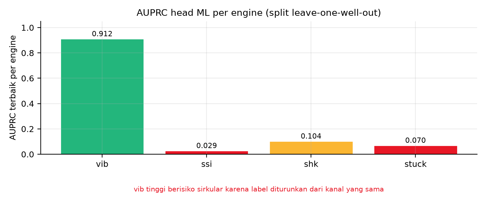

**Gambar 7.** AUPRC terbaik per mode pada split leave-one-well-out: vib 0,912; shk 0,104; stuck 0,070; ssi 0,029. Batang vib menyandang peringatan yang dicalat langsung ke gambar, yaitu risiko sirkularitas karena labelnya diturunkan dari kanal yang sama dengan fitur, sehingga angka 0,912 tidak boleh dibaca sebagai kualitas generalisasi. Angka dan cara mengulangnya tercatat pada Lampiran A butir A-09.

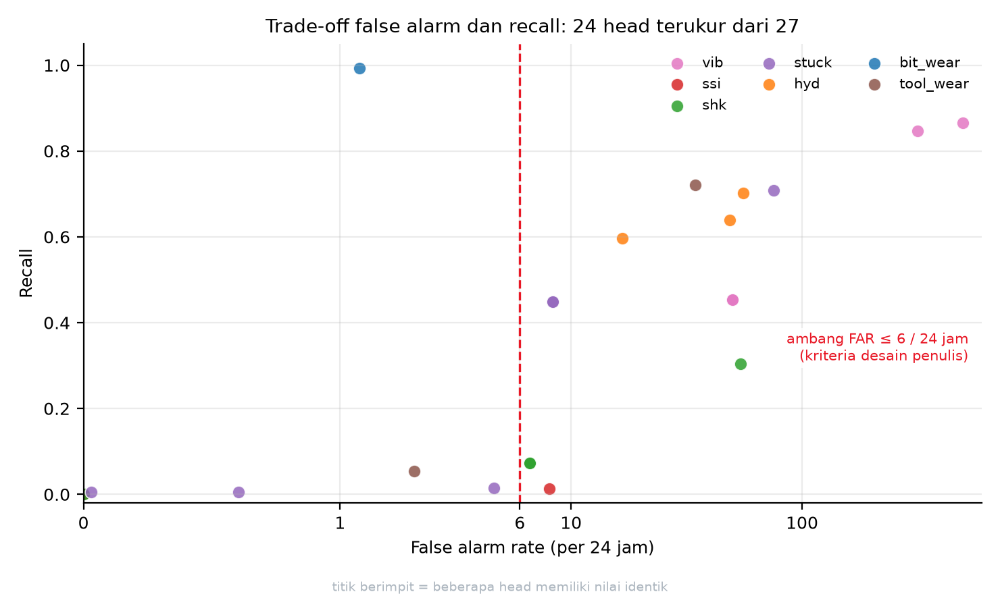

**Gambar 8.** Trade-off false alarm lawan recall pada 24 head yang punya kedua metrik terukur dari 27 head total. Sumbu x menampilkan titik 0, 1, 6, 10, dan 100 sebagai label eksplisit, dan garis putus-putus merah pada FAR 6 per 24 jam adalah kriteria desain yang ditetapkan penulis, bukan hasil optimasi statistik. Hanya sebagian kecil head yang berada di kiri garis ambang.

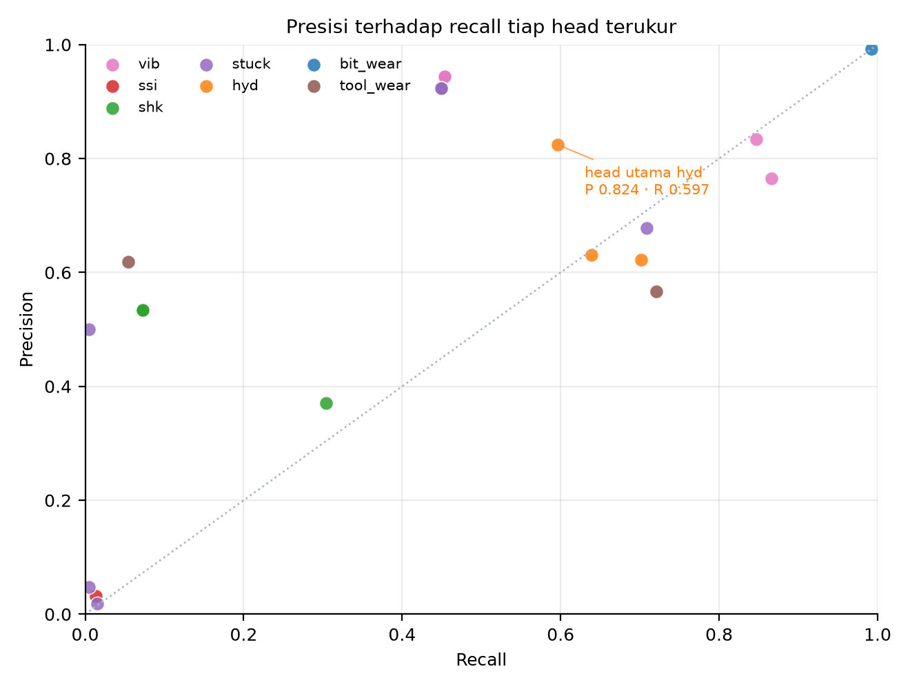

**Gambar 9.** Presisi terhadap recall tiap head terukur. Anotasi atas head utama `hybrid_rule_and_persistence` pada mode hyd menyebut presisi 0,824 dan recall 0,597, dengan FAR 16,6 per 24 jam pada n = 10.401 window (pos 865, neg 9.536). Garis titik-titik diagonal adalah acuan acak (`presisi = recall`). Skala warna
 
 keputusan 3.4.1 dan keluaran ROC tiap varian, dengan sumbu presisi dan
 recall yang definisinya sama dengan tabel 3.4.1.

Pemeriksaan konsistensi menolak dokumen bila ada angka yang berbeda dari hasil hitung ulang, bila rujukan yang disebut tidak ada atau di luar rentang, bila token penanda tidak ditemukan pada baris yang dikutip, bila jumlah skenario kurang dari delapan, dan bila terdapat em-dash atau en-dash. 

---

## 3.5 Uji Tambahan Pemilihan Algoritme: Pencarian Otomatis dan Kombinasi Kandidat

Subbab ini melaporkan dua uji tambahan atas pemilihan algoritme pada Bab III. Pertama, pencarian hyperparameter otomatis (H2O AutoML) diadu dengan Random Forest yang dipakai sebagai detektor utama. Kedua, seluruh kandidat hasil pencarian otomatis digabung untuk melihat apakah gabungan mengalahkan satu model terbaik. Tabel per sumur, temuan, dan langkah mengulang uji ada pada subbab ini, beserta setelannya; setiap uji dapat diulang dengan langkah pada 3.5.8.

### 3.5.1 Pertanyaan yang diuji

1. Apakah pencarian otomatis dengan anggaran komputasi besar mengalahkan Random Forest antar hiperparameter kontrak: pada data kejadian, alias pemilihan otomatis memberi keunggulan atau tidak.
2. Bila satu model pilihan otomatis kalah, apakah kekurangan itu dapat ditutup dengan menggabungkan seluruh kandidat yang dihasilkan pencarian otomatis.
3. Apakah masih ada cacat data yang harus dibereskan lebih dulu sebelum keluarga algoritme tertentu dapat dipakai.

### 3.5.2 Setelan uji

| Parameter | Nilai |
|---|---|
| Data uji | 4.619 baris, 480 fitur, 243 positif (5,3 persen), label kategori enam bukti kegagalan |
| Skema verifikasi | leave-one-well-out pada 7 sumur (`F-14`, `F-15A`, `F-15_S`, `F-5`, `F-7`, `F-9`, `F-9_A`) |
| Anggaran pencarian otomatis | `max_models` 100, `max_runtime_secs` 600 per sumur, `sort_metric` AUCPR, `balance_classes` benar, `seed` 42 |
| Lapisan internal | CV 6 fold dengan `fold_column` yaitu sumur |
| Sumber daya | 18 inti CPU, heap JVM 2 GB |
| Lantai pembanding | prevalensi mayoritas per sumur, 0,029 sampai 0,080 |

### 3.5.3 Hasil: satu model pilihan otomatis kalah, gabungan kandidat menang

Rata-rata AUPRC di 7 sumur, dengan pemilihan kandidat hanya memakai AUCPR CV internal (sumur uji tidak dilihat saat memilih):

| Pasangan | Rata-rata AUPRC |
|---|---|
| Gabungan median seluruh kandidat AutoML | **0,1525** |
| Gabungan median top-10 kandidat | 0,1524 |
| Gabungan peringkat rata-rata top-5 | 0,1519 |
| Rata-rata seluruh kandidat | 0,1470 |
| Baseline Random Forest antar hiperparameter | 0,1392 |
| Leader tunggal AutoML (pilihan CV internal) | 0,1325 |
| Baseline regresi logistik | 0,1061 |
| Lantai mayoritas | 0,0579 |

Tiga pernyataan yang dapat diklaim dari tabel itu:

1. **Leader tunggal AutoML kalah dari Random Forest** (0,1325 lawan 0,1392). Ini menutup klaim bahwa pencarian otomatis lebih baik.
2. **Gabungan median seluruh kandidat AutoML mengalahkan Random Forest** dengan selisih +0,0133 AUPRC atau 9,6 persen relatif, dan menang pada 5 dari 7 sumur.
3. **Kenaikan terbesar ada pada sumur berprevalensi terendah.** F-15A memiliki 24 positif dari 476 baris; AUPRC naik dari 0,0948 menjadi 0,1748, yaitu 84 persen relatif.

Sifat kesalahannya juga berbeda, dan ini bagian yang paling berguna secara operasional. Pada sumur terburuknya, leader tunggal jatuh serendah 0,0360 di bawah Random Forest, sedangkan gabungan median hanya 0,0029 di bawah. Artinya manfaat utama gabungan bukan menaikkan angka tertinggi, melainkan **menghapus risiko salah pilih satu model** di antara kandidat yang selisihnya sangat kecil.

Batas atas bila seleksi boleh memakai informasi sumur uji (dilabeli oracle, bukan hasil yang boleh diklaim): pemilihan greedy 0,1681 dan kandidat tunggal terbaik per sumur 0,1605. Sisa ruang perbaikan di atas gabungan median adalah 0,0156, dan ruang itu tidak dapat diambil tanpa melihat sumur uji.

### 3.5.4 Mengapa satu model pilihan otomatis kalah: pemilihannya tidak terbukti andal

Tiga pengukuran pada leaderboard internal, dihitung dari skor tersimpan per kandidat:

| Besaran | Nilai | Makna |
|---|---|---|
| Selisih antar kandidat pada leaderboard internal (rerata sebaran nilai 5 teratas) | 0,0053 | Kandidat teratas hampir tidak terbedakan oleh CV internal |
| Jarak AUPRC CV leader ke AUPRC sumur uji | 0,0789 rata-rata | Resolusi yang diminta untuk pemilihan 15 kali lebih besar daripada yang ditawarkan CV internal |
| Korelasi Spearman lintas sumur antara AUPRC CV internal leader dan AUPRC uji leader | -0,3929 (7 titik, p 0,383) | Skor CV leader tidak menunjuk sumur yang akan berkinerja baik |

Tiga pembacaan yang perlu dibedakan:

1. **Pemenang leaderboard ditentukan di dalam noise.** Selisih antar kandidat (0,0053) jauh di bawah jarak CV ke hasil uji (0,0789), sehingga "leader" tidak terbukti berbeda secara terukur dari kandidat lainnya, dan menambah jumlah model, inti CPU, atau durasi tidak memperbaiki pemilihan. Pada pengujian F-14, menaikkan anggaran dari 400 menjadi 600 detik justru menurunkan AUPRC sumur uji dari 0,1045 menjadi 0,0848.
2. **Lintas sumur, skor CV leader tidak prediktif.** Korelasinya negatif (-0,3929), sehingga membandingkan kualitas model antar sumur menggunakan leaderboard internal tidak sah.
3. **Di dalam satu sumur, korelasinya lemah dan tidak konsisten**: rerata korelasi peringkat internal terhadap hasil uji adalah +0,28, positif pada 4 dari 7 sumur dan negatif pada sisanya. Jadi pemilihan satu kandidat di dalam satu sumur tidak terbukti bocor secara menyeluruh, tetapi juga tidak terbukti andal; yang benar-benar bocor adalah komparabilitasnya lintas sumur.

Karena itu klaim "AutoML lebih baik" dilarang ditulis tanpa skema seleksi yang netral terhadap prevalensi.

### 3.5.5 Hasil tambahan: DeepLearning gagal karena cacat data, bukan karena engine

Seluruh kandidat DeepLearning gagal dilatih pada 7 sumur. Uji sebab-akibat dijalankan tiga tahap pada klaster terpisah:

| Tahap | Perlakuan | Hasil |
|---|---|---|
| A | data tanpa pembersihan | GAGAL, model tidak stabil secara numerik |
| B | potong di persentile 99,9 per kolom | GAGAL, batas persentile masih 2,26e+27 dan 107 kolom memuat nilai ekstrem |
| C | potong di persentile 99 per kolom | BERHASIL, model konvergen dengan `pr_auc` 0,08 pada CV internal |

Akar masalahnya ada pada data: **30 sel memuat nilai absolut di atas 10^20, yaitu 25 sel pada berkas fitur kontrol dan 5 sel pada berkas fitur kejadian, semuanya kolom SPPA (w2h dan w6h berikut turunannya), dengan nilai maksimum 9,524e+30** (baris 1756 sampai 1759 pada berkas kontrol). Itu 35 orde di atas rentang fitur lain (seluruh fitur lain berada dalam rentang 0 sampai 1). Contoh: `std` 2,89e+29 dan `mean` 1,07e+28. Selain itu ada 188.872 sel kosong (9,9 persen) pada 438 dari 480 kolom, terbanyak pada `burstiness` dan `trend_rho` yang kosong 67 sampai 81 persen.

Model berbasis pohon (GBM, XGBoost, DRF, XRT) tidak terpengaruh karena pemisahannya berbasis peringkat nilai. Jaringan saraf menstandardisasi setiap kolom lalu mengalikan bobot, sehingga satu nilai 10^30 menghancurkan gradien. Setelah perbaikan, DeepLearning dapat dilatih, tetapi `pr_auc` 0,08 masih di bawah Random Forest 0,1008 pada sumur yang sama. Jadi perbaikan data membuat keluarga itu **dapat dipakai**, bukan **lebih baik**.

### 3.5.6 Implikasi untuk pemilihan algoritme pada Bab III dan Bab IV

1. **Random Forest antar hiperparameter tetap menjadi detektor utama** di setiap mode, dengan status teruji dan bukan preferensi.
2. **Bila pencarian otomatis dipakai, kandidatnya harus digabung, bukan diambil pemenangnya.** Strategi yang terukur terbaik adalah median seluruh kandidat (atau median top-10, yang selisihnya hanya 0,0001 AUPRC).
3. **Syarat mutu data masuk ke rancangan**: kanal SPPA dan turunannya harus dipotong pada persentile 99 per kolom, atau dibuang bila tidak diperlukan, sebelum keluarga model linear dan jaringan saraf dipakai.
4. **Batas klaim angka**: 0,1525 lawan 0,1392 hanya berlaku pada 7 sumur data mitra dengan 9 sampai 12 kandidat per sumur, bukan pada 100 model, karena AutoML hanya sempat membangun sebanyak itu dalam 600 detik.

### 3.5.7 Batas yang harus dinyatakan

1. **Belum diuji**: penggabungan berbobot hasil pembelajaran (stacking). AutoML ber-`fold_column` tidak membentuk StackedEnsemble, dan prediksi out-of-fold per fold belum tersimpan.
2. **Belum diuji**: anggaran lebih besar, misalnya 1.800 detik per sumur, untuk mendapatkan puluhan kandidat. Seluruh angka gabungan di subbab ini berasal dari 9 sampai 12 kandidat.
3. **Cakupan**: hanya 7 sumur data mitra. Hasil ini tidak boleh diperluas menjadi klaim tentang sumur lain atau tentang data di luar lingkup 1.4.
4. **Aturan pelaporan**: memilih strategi gabungan berdasarkan hasil sumur uji lalu merata-ratakannya adalah kebocoran. Yang sah dilaporkan adalah rata-rata satu strategi tetap di seluruh sumur, seperti pada tabel 3.5.3.

### 3.5.8 Bahan yang disimpan dan langkah mengulang uji

Catatan eksekusi yang disimpan memuat lima kelompok bahan, masing-masing dipakai langsung
oleh tabel pada 3.5.1 sampai 3.5.7. Kelompok pertama adalah papan peringkat pencarian
otomatis pada tujuh sumur beserta setelan waktunya. Kelompok kedua adalah baseline pada
fold yang sama, yaitu Random Forest, regresi logistik, dan prediksi kelas mayoritas, yang
dipakai ulang oleh pencarian otomatis sehingga tidak dihitung ganda. Kelompok ketiga
adalah hasil uji tahap C, yaitu latihan ulang setelah kolom SPPA dipotong pada persentil
99. Kelompok keempat adalah hasil seluruh strategi penggabungan pada jalur adil dan jalur
oracle. Kelompok kelima adalah skor mentah setiap kandidat per sumur, yang menjadi bahan
hitung median kandidat pada tabel 3.5.3.

Langkah mengulang. Pencarian otomatis dijalankan per sumur dengan batas waktu 600 detik,
18 prosesor, dan kolom fold berisi identitas sumur. Baseline dihitung pada fold yang sama.
Penggabungan dihitung dengan dua jalur: jalur adil, yaitu pemilihan strategi hanya dari
AUCPR validasi silang internal, dan jalur oracle, yaitu pemilihan memakai hasil sumur uji,
yang dilaporkan sebagai batas atas dan bukan klaim. Untuk uji sebab kegagalan DeepLearning,
dipakai tiga tahap berurutan: A tanpa pemotongan, B dengan pembuangan baris bermasalah, dan
C dengan pemotongan pada persentil 99; hanya tahap C yang konvergen.

---

# BAB IV KESIMPULAN DAN SARAN

## 4.1 Temuan dasar

Lima temuan berikut adalah hasil tahap Investigate, yaitu bahan yang dipakai untuk menjawab rumusan masalah, bukan jawabannya. Bahan-bahan ini dipakai untuk menjawabnya, sehingga diletakkan di depan kesimpulan.

**Temuan 1: masalah bukan ketiadaan data.** Masalah utama pada layanan pengeboran yang dikaji bukanlah ketiadaan data, melainkan tidak adanya satu titik keputusan yang menggabungkan data kondisi dengan hasil kalkulasi risiko. Data dan hasil kalkulasi keduanya sudah tersedia: telemetri WITSML dengan 37 sampai 48 kanal terisi per sumur di atas grid 60 detik dan 27 head hasil evaluasi berlapis. Yang belum ada adalah jembatan antara keduanya, sehingga 388 kejadian interupsi dengan 611 jam waktu berhenti di dalam 1.212 jam window terkurasi masih ditangani reaktif, dengan median 45 menit dan p90 180 menit per kejadian. Akar masalah ini diperinci pada fishbone 6M di 1.2 dan dibuktikan dengan tiga alat analisis di Bab II: VSM menunjukkan hampir separuh waktu proses di dalam window terkurasi terkunci pada status menunggu kejelasan (611 dari 1.212 jam), MIFC menunjukkan putusnya alur informasi, dan FTA menunjukkan cabang yang paling menumpuk adalah cabang keputusan manusia, bukan ketiadaan alat ukur.

**Temuan 2: peringkat risiko terbentuk.** FMECA menghasilkan empat mode ber-RPN tinggi: kegagalan fluida sumur (490), stuck pipe (400), kegagalan BHA (378), dan kegagalan mesin permukaan (320). Dua di antaranya sudah memiliki detektor yang diuji, sehingga celah yang perlu ditutup adalah keandalan deteksi dan penyajian keputusan, bukan penambahan alat ukur semata.

**Temuan 3: engine pencarian otomatis tidak menyalip RF pada data kejadian.** Untuk menguji pemilihan Random Forest di Bab III, AutoML H2O dijalankan pada data kejadian 4.619 baris dengan 480 fitur, leave-one-well-out pada 7 sumur, anggaran 600 detik dan 100 model per sumur, 18 core, serta CV internal `fold_column=wellbore` 6 fold. Hasilnya AutoML menang hanya 2 dari 7 sumur dan rata-rata AUPRC-nya lebih rendah daripada RF tuned (0,1319 berbanding 0,1392), sementara pada ambang 0,5 lima dari tujuh leader-nya memprediksi nol positif. Sinyal pemilihan internalnya tidak dapat dipercaya: korelasi Spearman lintas sumur antara AUPRC CV leader dan AUPRC uji adalah -0,3929 (7 titik, p 0,383), selisih antar kandidat di leaderboard (0,0053) lima belas kali lebih kecil daripada jarak CV ke hasil uji (0,0789), dan korelasi peringkat internal terhadap hasil uji di dalam sumur hanya +0,28 dengan arah tidak konsisten. Karena itu menambah model, core, atau waktu tidak dapat memperbaiki pemilihan. Keluarga DeepLearning gagal di seluruh run, dan tiga tahap pengujian (A tanpa perlakuan gagal, B clip p99,9 gagal, C clip p99 berhasil) menetapkan penyebabnya pada 30 sel rusak pada kolom SPPA dengan nilai maksimum 9,524e+30 di data, bukan pada engine. Tabel per sumur dan langkah mengulang uji A, B, dan C beserta setelannya ada pada subbab 3.5.

**Temuan 4: yang menang adalah gabungan median seluruh kandidat AutoML, bukan leadernya.** Ketika skor seluruh kandidat disimpan dan digabung dengan jalur adil (urutan dan bobot hanya memakai AUCPR CV internal), median seluruh kandidat mencapai rata-rata AUPRC 0,1525 di 7 sumur, naik 9,6 persen relatif di atas RF (0,1392), menang di 5 dari 7 sumur. Leader tunggalnya sendiri justru di bawah RF (0,1325). Kombinasi ini juga memperbaiki risiko: paling buruk hanya −0,0029 pada satu sumur, sedangkan leader tunggal bisa jatuh −0,0360. Artinya ketahanan pemilihan model datang dari penggabungan, bukan dari kemenangan satu model. Batas atas yang memakai informasi sumur uji hanya 0,1681, sehingga sisa ruangnya kecil. Tabel tiap sumur dan strateginya ada pada subbab 3.5; skema penggabungannya, yaitu median AUPRC CV internal seluruh kandidat, juga ditulis pada subbab 3.5.

**Temuan 5: klasifikasi disfungsi pada data simulasi terpisah hampir sempurna, dan yang
terukur adalah pemisahan parameter, bukan batas deteksi.** Pada 1.200 run simulator dengan
enam kelas seimbang, 200 run per kelas, 20 kanal telemetri permukaan per run, dan 70 fitur
statistik dari 11 kanal, `HistGradientBoostingClassifier` dengan 300 iterasi dan laju
belajar 0,08 mencapai macro-F1 0,9925 dan akurasi 0,9925 pada validasi 5 lipatan tingkat
run, sedangkan baseline kelas terbanyak 0,1667. F1 per kelas adalah 0,985 untuk `bit_wear`,
1,000 untuk `hard_formation`, 0,995 untuk `high_friction`, 0,997 untuk `low_pump`, 0,997
untuk `low_rpm`, dan 0,980 untuk `normal_soft`. Empat kelas fisik tanpa dua kelas setpoint
memberi macro-F1 0,9950 dan akurasi 0,9950 dengan baseline 0,250. Uji keparahan ringan
menurunkan angka itu menjadi macro-F1 0,979 dan akurasi 0,983 pada tiga kelas, 0,968 dengan
akurasi 0,980 dan recall 0,92 pada biner `bit_wear`, serta tetap 1,000 pada biner
`hard_formation` dan `high_friction`. Mekanisme angka setinggi itu ada pada sebaran
parameter, bukan pada kecanggihan fitur: efisiensi potong pada `bit_wear` bermedian 0,26
dengan IQR 0,16 sampai 0,33 lawan 1,00 pada normal, UCS pada `hard_formation` bermedian
28,04 MPa lawan 3,40 MPa, dan resistensi BHA pada `high_friction` bermedian 1.486 kPa lawan
0 kPa. Ketiga parameter berada jauh dari nilai normal pada seluruh run, sehingga fitur
berupa mean, std, tiga kuantil, dan maksimum sudah cukup memisahkan kelas, dan penurunan
keparahan yang masih di dalam keluarga ekstrem hanya menggeser kesalahan pada pasangan
`bit_wear` dan `normal_soft`. Karena itu angka 0,9925 tidak boleh dibaca sebagai batas
deteksi. Rincian tabel, temuan T1 sampai T4, dan rencana pengukuran batas ada pada 3.1.8.

## 4.2 Kesimpulan: jawaban atas RM1 sampai RM4

Keempat rumusan masalah dirujuk dengan kode dari 1.1.6. Jumlah butir kesimpulan di bawah sama dengan jumlah pertanyaan, dan setiap butir hanya menjawab satu pertanyaan.

**Kesimpulan RM1: dijawab sebagian.** Lapisan peringatan dini dirancang di atas data yang benar-benar ada, yaitu grid 60 detik dan 37 sampai 48 kanal terisi per sumur, tanpa mengklaim resolusi yang tidak dimiliki. Sumbu rancangan terpilih adalah A1, relabeling onset dari status menjadi peristiwa, dengan koefisien kedekatan 0,8465, juara pada 25 dari 25 kasus uji, dan delta terukur positif pada kelas stuck. Hasil negatifnya dinyatakan terbuka pada Tabel 3.4.12 pada subbab 3.4.13: pada kelas hyd, lift turun ke 0,80 pada satu fold, dan persistence mengalahkan Random Forest pada 7 dari 7 fold, sehingga mekanisme ini belum memberi delta positif pada kelas itu. Rancangan itu dibungkus sebagai sistem pemantauan kondisi pengeboran berbasis dashboard dengan 7 mode dan 27 head, berstatus advisory dengan 0 slot alarm otomatis, dan FTA Bab II mencatat 11 peringatan L1 serta 13 head perlu review, sehingga tinjauan engineer tetap menjadi jalur tunggal sebelum peringatan bertindak. Pemilihan dilakukan dengan TOPSIS atas delapan kriteria dan diuji sensitivitasnya pada sembilan skenario bobot.

**Kesimpulan RM2: belum dijawab.** Pertanyaan tentang pemilihan titik operasi per mode sehingga peringatan cukup awal dan beban alarm palsu tetap dapat diterima belum memperoleh jawaban berupa angka. Satu-satunya alternatif yang menyentuh langsung gejala sebaran false alarm rate 119,6 kali antar sumur adalah A9, dan A9 berperingkat sembilan karena rancangan kalibrasi belum diuji. Yang dapat dinyatakan sebagai hasil adalah batas persoalannya: pada titik operasi yang sama, false alarm rate menyebar 4,15 sampai 496,09 per 24 jam antar sumur, sehingga satu ambang global tidak dapat dipakai. Penetapan titik operasi per mode dipindahkan ke Saran 1 sebagai pekerjaan yang harus diselesaikan lebih dahulu sebelum head mana pun naik dari peringatan berpengawas menjadi peringatan sungguhan. Menyatakan pertanyaan ini terjawab akan melebihkan capaian Bab III.

**Kesimpulan RM3: belum dijawab.** Pertanyaan tentang penyajian keluaran yang dapat dijelaskan kepada drilling engineer belum memperoleh jawaban rancangan. Kriteria C8 belum dapat dinilai untuk alternatif mana pun karena antarmuka peringatan belum dirancang, seperti dinyatakan pada 3.3.6 butir 8. Yang sudah ada adalah arahnya: keluaran berstatus advisory, seluruh head berada di bawah tinjauan engineer, dan SOP triage serta eskalasi alarm berjenjang baru tercatat sebagai alternatif Anggota A pada 1.3 dan tidak muncul di Bab III sama sekali, sehingga belum dapat disebut pendukung yang sudah ditetapkan. Penyelesaian antarmuka masuk ruang lingkup Proyek Perancangan Terpadu II sesuai batas tahap pada 1.4.5.

**Kesimpulan RM4: dijawab pada data simulasi, belum pada sumur nyata.** Pertanyaan tentang
sejauh mana disfungsi pengeboran dapat diklasifikasikan dari telemetri permukaan dan
seberapa rendah batas deteksinya memperoleh jawaban berupa angka pada satu sisi dan berupa
pekerjaan terbuka pada sisi lain. Sisi yang terjawab: pada 1.200 run simulator dengan enam
kelas seimbang, model mencapai macro-F1 0,9925 dan akurasi 0,9925 lawan baseline 0,1667,
empat kelas fisik mencapai 0,9950 lawan 0,250, dan uji keparahan ringan masih memberi 0,979
pada tiga kelas serta 0,968 dengan recall 0,92 pada biner `bit_wear`. Angka-angka itu
tinggi karena parameternya terpisah jauh, yaitu efisiensi potong 0,26 lawan 1,00, UCS 28,04
MPa lawan 3,40 MPa, dan resistensi BHA 1.486 kPa lawan 0 kPa, sehingga yang terbukti adalah
metode dapat memisahkan kelas pada keparahan ekstrem, bukan metode peka terhadap gangguan
kecil. Sisi yang belum terjawab: batas deteksi belum terukur, karena seluruh run dibangkitkan
3 sampai 10 kali dari normal sehingga tidak ada contoh di dalam celah antara normal dan
gangguan. Dua kelas setpoint, yaitu `low_rpm` dan `low_pump`, dilaporkan terpisah karena
F1 0,997 keduanya mengukur keterbacaan perintah yang tercatat pada telemetri, bukan
pengenalan disfungsi lubang bawah. Belum ada uji derau sensor dan belum ada transfer ke sumur
nyata, sehingga tidak ada angka pada kesimpulan ini yang berlaku sebagai bukti lapangan.
Ketiga langkah pengukuran batas deteksi, yaitu run keparahan batas pada efisiensi potong 0,6
sampai 0,9, UCS 5 sampai 10 MPa, dan resistensi BHA 300 sampai 800 kPa, uji derau memakai
kolom mutu pengamatan, serta kalibrasi estimator fisika pada simulasi lalu penerapannya ke
sumur nyata, dijadwalkan pada 3.1.8 dan menjadi syarat sebelum klaim batas deteksi boleh
ditulis sebagai hasil.

## 4.3 Batasan yang menyertai kesimpulan

1. Sistem ini tidak menggantikan keputusan manusia. Seluruh head berada di bawah tinjauan engineer dan tidak ada slot alarm otomatis.
2. Tidak ada klaim penghematan biaya yang sudah terukur pada tahap ini. Seluruh angka ekonomi berasal dari publikasi luar dan berlabel ASUMSI sesuai 1.4.3.
3. Total durasi seluruh kejadian tercatat 73.500 menit atau 1.225 jam, tetapi belum terikat pada satu peristiwa alarm maupun work order, sehingga dampak finansial per kejadian belum dapat dihitung.
4. Sebaran false alarm rate antar sumur mencapai hampir 120 kali, sehingga ambang yang berlaku pada satu sumur tidak otomatis berlaku pada sumur lain.

5. Seluruh bukti performa klasifikasi berasal dari simulator internal, sehingga klaim yang
   sah adalah metode teruji pada data simulasi dan bukan bukti lapangan. Angka 0,9925
   mengukur kasus ekstrem dengan parameter 3 sampai 10 kali normal, bukan batas deteksi.
   Belum ada uji derau sensor dan belum ada transfer ke sumur nyata, sehingga pemakaian
   angka itu untuk menetapkan ambang operasional belum dapat dipertanggungjawabkan.
6. Kelas `low_pump` dan `low_rpm` ditentukan setpoint perintah yang terlihat pada telemetri
   permukaan, sehingga F1 0,997 pada keduanya mengukur keterbacaan perintah, bukan deteksi
   disfungsi lubang bawah. Keduanya tidak boleh digabung dalam satu klaim enam kelas, dan
   angka klaim kemampuan deteksi adalah macro-F1 0,9950 pada empat kelas fisik.

## 4.4 Saran

**Saran 1: melunasi RM2.** Menetapkan titik operasi per mode dan menguji kalibrasi ambang per sumur pada kelas yang lingkupnya sudah ditetapkan A9 (`hyd K-i`, `vib`, `shk`) dengan target false alarm rate di bawah 6 per 24 jam pada mayoritas sumur. Pekerjaan ini melanjutkan pertanyaan yang belum terjawab di Kesimpulan RM2, bukan pertanyaan baru.

**Saran 2: menutup celah deteksi fluida sumur.** Mengembangkan `hyd K-ii` untuk mode kegagalan fluida sumur. Mode ini memperoleh RPN tertinggi justru karena deteksinya paling buruk, sedangkan dampaknya menyentuh aspek keselamatan.

**Saran 3: menguji stabilitas dan sirkularitas.** Menguji ulang head yang buktinya masih terbatas pada satu segmen, yaitu prototipe dashboard F-14, pada sumur di luar F-14, dengan cakupan 24 head yang punya kedua metrik terukur. Hasil AUPRC pada mode getaran sebesar 0,9117 wajib diuji ulang karena labelnya diturunkan dari kanal yang sama, sehingga berisiko sirkular.

**Saran 4: menyelesaikan RM3.** Merancang dan menguji prototipe antarmuka peringatan bersama pemilik masalah, lalu memvalidasi silang rancangan dengan mereka sebelum tahap pemodelan sistem dimulai, sesuai kegiatan re-evaluate pada setiap akhir tahap dalam model SIMILAR.

---

# LAMPIRAN A. JEJAK ANGKA

Lampiran ini memuat angka yang dipakai di badan proposal beserta bahan hitung dan cara memperolehnya. Bahan dinyatakan sebagai jenis pengamatan dan kolom yang dipakai, supaya pembaca dapat menilai asal angka. Angka yang belum terukur tidak dimasukkan ke tabel ini dan tetap dinyatakan sebagai asumsi pada subbab asalnya.

| ID | Angka | Tempat dipakai | Bahan dan cara memperoleh | Status |
| --- | --- | --- | --- | --- |
| A-01 | 1.200 run, enam kelas seimbang 200 run per kelas, 20 kanal telemetri permukaan per run, sekitar 1.261 baris per run | 3.1.8 | Keluaran simulator internal: setiap run dibangkitkan dengan satu kelas kondisi, dua puluh kanal permukaan, dan panjang tetap, lalu jumlah run, jumlah kelas, dan jumlah baris per run dicacah | terukur pada data simulasi |
| A-02 | macro-F1 0,9925 dan akurasi 0,9925 pada enam kelas, baseline kelas terbanyak 0,1667 | 3.1.8, 4.1, 4.2 | Hasil pengujian pengklasifikasi pada data simulasi A-01; baseline dihitung sebagai proporsi kelas terbanyak, yaitu satu dibagi enam | terukur pada data simulasi |
| A-03 | F1 per kelas: keausan mata bor 0,985; formasi keras 1,000; gesekan tinggi 0,995; pompa lemah 0,997; putaran rendah 0,997; normal lunak 0,980 | 3.1.8 | Matriks kebingungan enam kelas pada pengujian A-02, lalu F1 tiap kelas dihitung dari presisi dan recall kelas itu | terukur pada data simulasi |
| A-04 | macro-F1 0,9950 dan akurasi 0,9950 pada empat kelas fisik, baseline 0,250 | 3.1.8, 4.2 | Pengujian yang sama dengan A-02 setelah enam kelas digabung menjadi empat kelas fisik; baseline satu dibagi empat | terukur pada data simulasi |
| A-05 | uji keparahan ringan: tiga kelas 0,979 dan akurasi 0,983; biner keausan mata bor 0,968 dengan akurasi 0,980 dan recall 0,92; biner formasi keras dan gesekan tinggi 1,000 | 3.1.8, 4.2 | Pengujian A-02 dengan tingkat keparahan diturunkan, lalu diulang pada dua sasaran biner | terukur pada data simulasi |
| A-06 | sebaran parameter: efisiensi potong median 0,26 dengan rentang antar kuartil 0,16 sampai 0,33; kekuatan batuan median 28,04 MPa lawan 3,40 MPa; resistensi rangkaian median 1.486 kPa lawan 0 kPa | 3.1.8, 4.1, 4.2 | Nilai parameter yang dibangkitkan simulator pada A-01, diambil median dan rentang antar kuartilnya per kelas | terukur pada data simulasi |
| A-07 | 884 kejadian pada 10 wellbore | 1.1.6, 4.1 | Tabel label kejadian: cacah baris, lalu cacah nama sumur berbeda | terukur |
| A-08 | total durasi 73.500 menit atau 1.225 jam, median 45 menit, p90 180 menit, maksimum 780 menit | 4.1, 4.3 | Tabel label kejadian: selisih waktu selesai dan waktu mulai tiap kejadian dijumlahkan, diurutkan, lalu diambil median, persentil 90 cara nearest-rank, dan nilai terbesar | terukur |
| A-09 | AUPRC per mode pada prototipe: getaran 0,912; stick-slip 0,029; stuck 0,070; shock 0,104 | 4.1 dan gambar AUPRC | Rekap evaluasi prototipe per mode dengan skema leave-one-well-out; nilai AUPRC tiap mode dibaca dari rekap itu | terukur, dengan catatan sirkularitas label pada mode getaran |
| A-10 | ablasi pemilihan otomatis: AutoML menang 2 dari 7 sumur, rata-rata AUPRC 0,1319 lawan Random Forest 0,1392; median seluruh kandidat 0,1525 | 4.1 Temuan 3 dan Temuan 4 | Eksperimen pada 3.5, yaitu 4.619 baris kejadian, 480 fitur, leave-one-well-out tujuh sumur, anggaran 600 detik dan 100 model per sumur; hasil per sumur dicacah dan dirata-ratakan | terukur |
| A-11 | laju alarm palsu 4,14897 sampai 496,09249 per 24 jam pada satu ambang, rasio 119,57 kali antar sumur | 1.2 Me1, 4.3 | Rekap metrik tiap head pada evaluasi prototipe: laju alarm palsu per sumur pada ambang yang sama, lalu diambil nilai terkecil, terbesar, dan rasionya | terukur |
| A-12 | lift per fold tiap kelas sasaran, termasuk 1,495 pada F-15S untuk keausan mata bor | 3.4.12 | Buku besar angka evaluasi: lift tiap fold dihitung sebagai AUPRC model dibagi prevalensi kelas pada fold itu | terukur |
| A-13 | 27 head, tier 13 TREN / 12 PERINGATAN-BERPENGAWAS / 2 BELUM LAYAK PAKAI, lapisan L0 5 / L1 11 / L2 9 / L3 2, slot alarm otomatis 0 | 1.1.8, 1.5.3, 3.2.4.1 | Tabel datar 27 head: cacah baris, cacah tiap nilai tier, cacah tiap nilai lapisan, dan cacah klaim bertier alarm otomatis | terukur |
| A-14 | koefisien kedekatan TOPSIS A1 0,8465 dan juara pada 25 dari 25 kasus uji | 3.4.6, 4.2 | Perhitungan TOPSIS delapan kriteria atas sembilan alternatif, diulang pada 25 skenario bobot dan kasus uji; koefisien kedekatan dan peringkat tiap skenario dicatat | terukur |
| A-15 | 3.906 dari 7.150 berkas log tidak terparse, 54,6 persen | 1.2 Ma2 | Buku besar angka Bab I: cacah berkas log per sumur dibandingkan dengan cacah berkas yang berhasil diurai | terukur |
| A-16 | WHIRL_RT identik BOUNCE_RT pada 67 berkas di 5 sumur, 1.790 dari 1.790 nilai | 1.2 Mt1 | Pemeriksaan kanal getaran: nilai kedua kanal dicocokkan baris per baris pada tiap berkas, lalu berkas yang seluruh nilainya identik dicacah | terukur |
| A-17 | sembilan kategori 496, 216, 47, 38, 28, 25, 21, 12, 1; relevansi BHA 50 dan 263 dan 571 | 1.1.6, 1.2 M2 | Tabel label kejadian: frekuensi tiap nilai kolom kategori dan tiap nilai kolom relevansi BHA | terukur |
| A-18 | 6 dari 7 mode bertier peringatan berpengawasan, 0 mode bertier alarm otomatis | RM3, 1.1.6, 1.1.8 | Tabel evaluasi lapisan keputusan: tingkat kewenangan dibaca per klaim, diambil yang tertinggi per mode, lalu dicacah | terukur |
| A-19 | kanal terisi sedikitnya 50 persen: 28 sampai 48 per sumur, dan 37 sampai 48 pada tujuh sumur uji kendali | 1.1.6, 1.1.9 | Ringkasan mutu kanal per sumur: cacah kanal yang isinya sedikitnya 50 persen baris, untuk sembilan sumur yang dianalisis | terukur |
| A-20 | 480 fitur pada matriks fitur | 1.1.6, 1.1.9, 3.5 | Matriks fitur latih: cacah kolom tanpa kolom target | terukur |
| A-21 | 37 lipatan sebagai jumlah pasangan dataset dan sumur | 1.1.6, 1.1.8, 1.1.9 | Enam dataset latih: cacah nama sumur berbeda tiap dataset, yaitu hyd 9, shk 9, ssi 9, stuck K-i 2, stuck K-ii 4, vib 4, lalu dijumlahkan | terukur |
| A-22 | 13 head wajib tinjauan dari 27 head | 1.1.6, 1.1.9 | Rekap evaluasi per head: cacah head yang penanda wajib tinjauannya bernilai benar | terukur |

Angka pada A-11 sampai A-17 dinyatakan dengan toleransi pembulatan, sehingga selisih penulisan desimal tidak dihitung sebagai perbedaan. Angka yang belum dapat dicocokkan tidak dimasukkan ke lampiran ini dan tetap dinyatakan terbuka pada subbab aslinya.

Catatan pembacaan: A-01 sampai A-06 berasal dari simulator internal dan karena itu hanya berlaku sebagai bukti metode pada data simulasi. A-07 sampai A-22 berasal dari data dan hasil pengolahan proyek sendiri, dan batas klaimnya dinyatakan pada subbab 1.4.4 serta 4.3.

# LAMPIRAN B. DAFTAR ASUMSI

Setiap butir di bawah ini adalah pernyataan yang belum diukur pada data proyek, dinyatakan terbuka di
subbab asalnya, dan tidak dipakai sebagai bukti hasil. Daftar ini disusun dengan menyisir naskah, sehingga
asumsi yang dipakai di badan argumen tidak luput dari lampiran.

| No | Subbab | Asumsi yang dinyatakan |
| --- | --- | --- |
| D-01 | 1.1.5 Trade-off Variabel Sistem | Pipeline memakai grid 60 detik; asumsi stream 1 Hz tidak dipakai karena tidak terbukti pada data. |
| D-02 | 1.1.5 Trade-off Variabel Sistem | Ketiga trade-off di atas menegaskan batas: target desain recall 0,70 sampai 0,80 dan lead time 10 sampai 30 menit masih berstatus **ASUMSI berupa target**, karena hasil |
| D-03 | 1.1.7 Batas Data | Resolusi yang dipakai adalah 60 detik. |
| D-04 | 1.1.7 Batas Data | Empat angka pada 1.1.7 berstatus asumsi. |
| D-05 | 3.1.4.4 A4 Unit analisis per-stand pengeboran (Anggota 2) | - Rentang prevalensi unit stand 10 sampai 40 persen adalah **asumsi**. |
| D-06 | 3.1.7 Hasil negatif dan batas yang harus dinyatakan | Dua hal pada subbab ini masih asumsi: rentang prevalensi unit stand 10 sampai 40 persen (dijelaskan dengan isi, dasar, alasan, dan uji pada butir di atas) dan hasil kalibrasi ambang per |
| D-07 | 3.2.1 Dasar analisis dan aturan bukti | Angka yang belum dihitung ditulis eksplisit sebagai asumsi atau perkiraan desain, dan tidak disamarkan sebagai hasil pengukuran. |
| D-08 | 3.2.7.4 BoK 3 Engineering Economic Analysis | Karena itu nilai rupiah pada 3.4 adalah asumsi dari publikasi luar, dan analisis sensitivitas pada 3.4 menggeser tarif untuk memeriksa apakah urutan ranking berubah. |
| D-09 | 3.3.1 Kriteria pemilihan | Rubrik ini berstatus asumsi sampai divalidasi mitra. |
| D-10 | 3.3.5 Serahan untuk subbab 3.4 | Belum ada wawancara mitra, sehingga bobot wajib ditetapkan sebagai asumsi dengan minimal tiga skenario sensitivitas, bukan satu angka tunggal. |
| D-11 | 3.3.6 Hasil negatif dan batas yang harus dinyatakan | Tarif rig per jam tidak tersedia, sehingga nilai rupiah apa pun pada subbab 3.4 berstatus asumsi. |
| D-12 | 3.4.1 Dasar perhitungan dan aturan bukti | Angka yang belum terukur ditulis sebagai asumsi dan diberi penanda yang sama pada tabel, bukan disamarkan sebagai hasil pengukuran. |
| D-13 | 3.4.3 Kriteria, arah, dan fungsi nilai | C8 berstatus asumsi karena belum ada dasar pengukuran. |
| D-14 | 3.4.4 Bobot kriteria | Bobot berstatus asumsi karena belum ada wawancara mitra yang menetapkan prioritas dan ROC adalah pendekatan, bukan elisitasi langsung. |
| D-15 | 3.4.11 Hasil negatif dan batas yang harus dinyatakan | Bobot berstatus asumsi karena belum ada wawancara mitra. |
| D-16 | 3.4.11 Hasil negatif dan batas yang harus dinyatakan | Jumlah minggu kerja pada C6 berstatus asumsi untuk setiap alternatif. |
| D-17 | 4.3 Batasan yang menyertai kesimpulan | Seluruh angka ekonomi berasal dari publikasi luar dan berlabel ASUMSI sesuai 1.4.3. |
| D-18 | 4.4 Saran | Tidak ada asumsi yang dipakai di badan argumen tanpa dicatat di lampiran ini. |
| D-19 | 1.1.6 dan 1.1.9 | Anggaran enam pemeriksaan per 24 jam, setara satu pemeriksaan setiap empat jam, adalah anggaran desain yang belum diukur terhadap beban kerja kru. |

# DAFTAR PUSTAKA

Setiap keputusan desain yang punya dasar pustaka dicatat beserta kekuatan buktinya. Tujuannya agar tidak ada klaim yang berdiri tanpa rujukan, dan agar pembaca dapat membedakan publikasi peer-review, standar, serta sumber industri yang tidak melalui peer-review.

## A. Peta keputusan ke rujukan

| Keputusan dalam proposal | Rujukan | Isi yang dipakai | Status bukti |
|---|---|---|---|
| NPT layak dijadikan titik masalah ekonomi | [1] | 279 sumur offshore, 69 rig jackup: 37.866 jam NPT = 8,7% dari 434.076,5 jam operasi; severity US$9.760 per jam NPT; total anggaran US$4,24 miliar | Peer-review (Springer, jurnal akses terbuka) |
| Rentang tarif rig dipakai sebagai batas atas ASUMSI | [1] | Day rate drillship ultra-deepwater US$300.000–1.000.000 per hari | Peer-review, dikutip dari laporan pasar rig |
| Stuck pipe dipilih sebagai mode prioritas | [2] | Stuck pipe ≥25% dari NPT pengeboran; tingkat keberhasilan penanganan turun tajam setelah 4 jam | Sumber industri (glosarium teknis), bukan peer-review |
| Masalah stabilitas lubang sebagai mode tersendiri | [2] | Stabilitas lubang ≈10% NPT, rata-rata US$2 juta per sumur di Laut Utara | Sumber industri, angka spesifik perlu verifikasi lanjut |
| Getaran sebagai penyebab kegagalan BHA | [2] | 20–30% kegagalan alat lubang bawah disebabkan getaran | Sumber industri |
| Urgensi penurunan waktu deteksi | [2] | Rata-rata rig offshore mengalami ≈27 hari downtime tak terencana per tahun, ≈US$38 juta (Kimberlite) | Sumber industri, angka pihak ketiga |
| Kenapa dashboard, bukan laporan periodik | [3] | DSS di ruang kendali menurunkan beban kognitif dan menaikkan performa, tetapi menurunkan situation awareness karena ketergantungan berlebih | Peer-review (MDPI Processes) |
| Kenapa desain advisory, 0 alarm otomatis | [3] | Risiko over-reliance: operator percaya penuh pada sistem dan berhenti memantau; trust adalah faktor kritis adopsi | Peer-review (MDPI Processes) |
| Batas jumlah metrik per layar | [4] | Batasi tampilan ke 6–8 metrik kunci; organisasi dengan dashboard KPI terstruktur 3,4 kali lebih cepat mengenali aset bermasalah kronis | Sumber industri (konsultan), bukan peer-review |
| Risiko alarm flood bila alarm ditambah | [5] | EPRI: alarm flood (>10 alarm per 10 menit) terjadi pada >70% pembangkit fosil saat transien; tata kelola alarm mengikuti ISA 18.2 | Sumber industri, bukan peer-review |
| Kerangka FMECA dan perhitungan RPN | [6] | Definisi, perencanaan, dan pelaporan FMEA/FMECA; varian criticality memakai severity dan bobot kepentingan | Standar internasional (IEC) |
| Tahapan proyek berhenti di State the Problem dan Investigate | [7] | Tujuh aktivitas SIMILAR: State, Investigate, Model, Integrate, Launch, Assess, Re-evaluate | Peer-review (jurnal sistem engineering) |
| Pemilihan solusi dengan TOPSIS | [8] | Metode MADM berbasis jarak ke solusi ideal positif dan negatif | Buku teks rujukan utama (Springer, 1981) |
| Peta alur nilai dan pemborosan waktu tunggu | [9] | Value stream mapping: memetakan aliran nilai dan mengidentifikasi muda | Buku kerja standar industri (Shingo Award 1999) |
| Sumber data dan lisensi | [10] | ≈40.000 berkas, produksi 2008–2016, Equinor Open Data Licence, tanpa registrasi | Sumber primer pemilik data |

## B. Batas pemakaian dua rujukan kunci

Dua rujukan paling menentukan argumen "kenapa dashboard" adalah [3] dan [2]. Keduanya
dipakai dengan pembatasan berikut:

1. **[3] tidak mendukung klaim bahwa dashboard menurunkan NPT.** Yang dibuktikan adalah
   pengaruhnya pada performa operator dan beban kognitif di lingkungan simulasi ruang
   kendali proses kimia, bukan di rig. Karena itu [3] dipakai hanya untuk
   membenarkan bentuk antarmuka dan pembatasan otomatisasi, bukan untuk mengklaim
   penghematan.
2. **[2] dan [4] dan [5] adalah halaman industri, bukan publikasi peer-review.** Angkanya
   dipakai sebagai rentang indikatif dan selalu diberi label ASUMSI di Lampiran B.
   Satu-satunya angka ekonomi yang berstatus peer-review adalah US$9.760 per jam NPT
   dari [1].

## C. Daftar pustaka

[1] Risk-based budgeting: quantifying Non-Productive Time (NPT) offshore drilling
    financial risk. *Journal of Engineering and Applied Science* (Springer Nature).
    https://doi.org/10.1186/s44147-026-01049-9

[2] GA Drilling. Non-Productive Time (NPT). Glosarium teknis.
    https://www.gadrilling.com/glossary/non-productive-time-npt

[3] Enhancing Control Room Operator Decision Making. *Processes*, 12(2), 328. MDPI.
    https://doi.org/10.3390/pr12020328

[4] Oxand. Predictive Maintenance Dashboards: Which Views Actually Drive Better
    Decisions? https://oxand.com/en/blog/predictive-maintenance-dashboards-drive-better-decisions

[5] iFactory. Control Room Modernization: AI Dashboards & Alarm Management.
    https://ifactoryapp.com/blog/power-plant-control-room-ai-dashboards-alarm-hmi

[6] International Electrotechnical Commission. (2018). *IEC 60812:2018 Failure modes
    and effects analysis (FMEA and FMECA)* (3rd ed.). Geneva: IEC.

[7] Bahill, A. T., & Gissing, B. (1998). Re-evaluating systems engineering concepts
    using systems thinking. *IEEE Transactions on Systems, Man, and Cybernetics,
    Part C*, 28(4), 516–527.

[8] Hwang, C.-L., & Yoon, K. (1981). *Multiple Attribute Decision Making: Methods and
    Applications*. Lecture Notes in Economics and Mathematical Systems, Vol. 186.
    Berlin: Springer-Verlag.

[9] Rother, M., & Shook, J. (1999). *Learning to See: Value Stream Mapping to Add Value
    and Eliminate Muda*. Cambridge, MA: Lean Enterprise Institute.

[10] Equinor. (2018). Volve field data set. Equinor Open Data Licence.
     https://www.equinor.com/energy/volve-data-sharing

[11] Montes, A. C., Ashok, P., & van Oort, E. (2025). Review of stuck pipe prediction
     methods and future directions. *SPE Journal*, 30(6), 3334-3363.
     https://doi.org/10.2118/220725-pa

[12] Yi, M., Ramos, D., Ashok, P., & Thetford, T. (2021). Time-series data augmentation
     techniques for improving automated drilling dysfunction classifiers. *SPE/IADC
     International Drilling Conference and Exhibition*.
     https://doi.org/10.2118/204063-ms

[13] Al Dushaishi, M. F., Abbas, A. K., Alsaba, M., & Abbas, H. (2021). Data-driven stuck
     pipe prediction and remedies. *Upstream Oil and Gas Technology*, 6, 100024.
     https://doi.org/10.1016/j.upstre.2020.100024

[14] Aspiras, A. H., Zarrouk, S. J., Winmill, R., & Kempa-Liehr, A. W. (2025). Real-time
     incident detection in geothermal drilling through machine learning. *Renewable
     Energy*, 250, 123260. https://doi.org/10.1016/j.renene.2025.123260

[15] Rosiani, D., Zulfan, Suranta, B. Y., & Sofyan, A. (2025). Machine learning classifies
     data for early warning of stuck pipe detection in geothermal drilling. *International
     Journal on Advanced Science, Engineering and Information Technology*, 15(1), 44-51.
     https://doi.org/10.18517/ijaseit.15.1.20333

 OpenAlex. (2026). OpenAlex scholarly index, antarmuka pencarian karya.
     https://api.openalex.org
