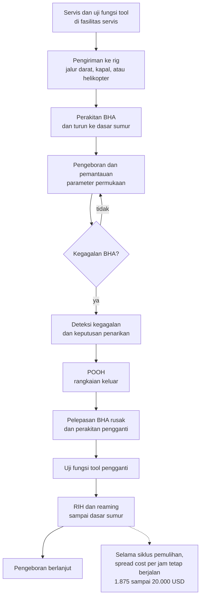
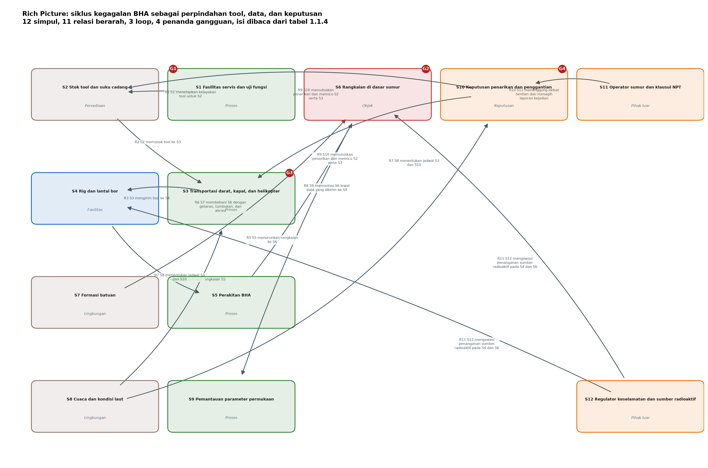
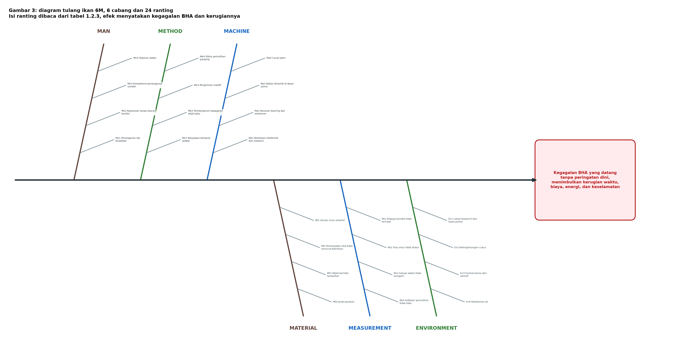
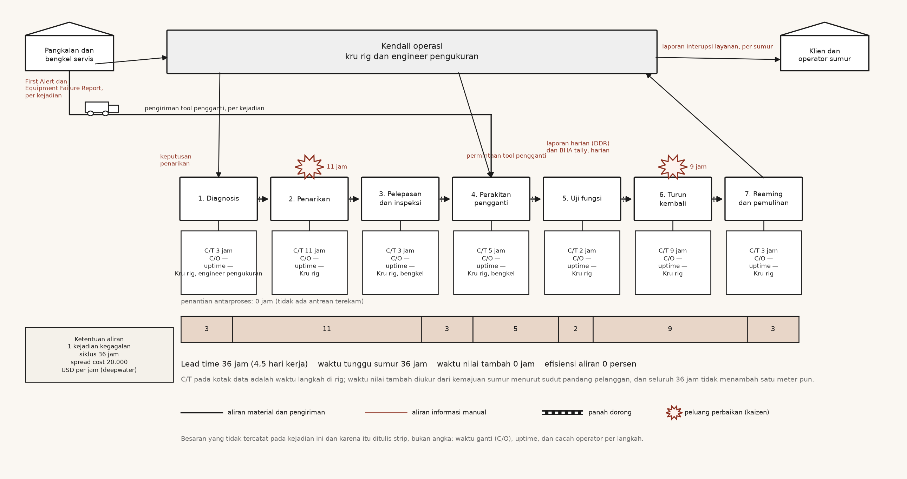
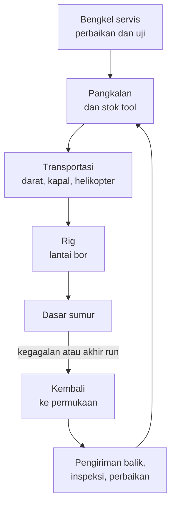
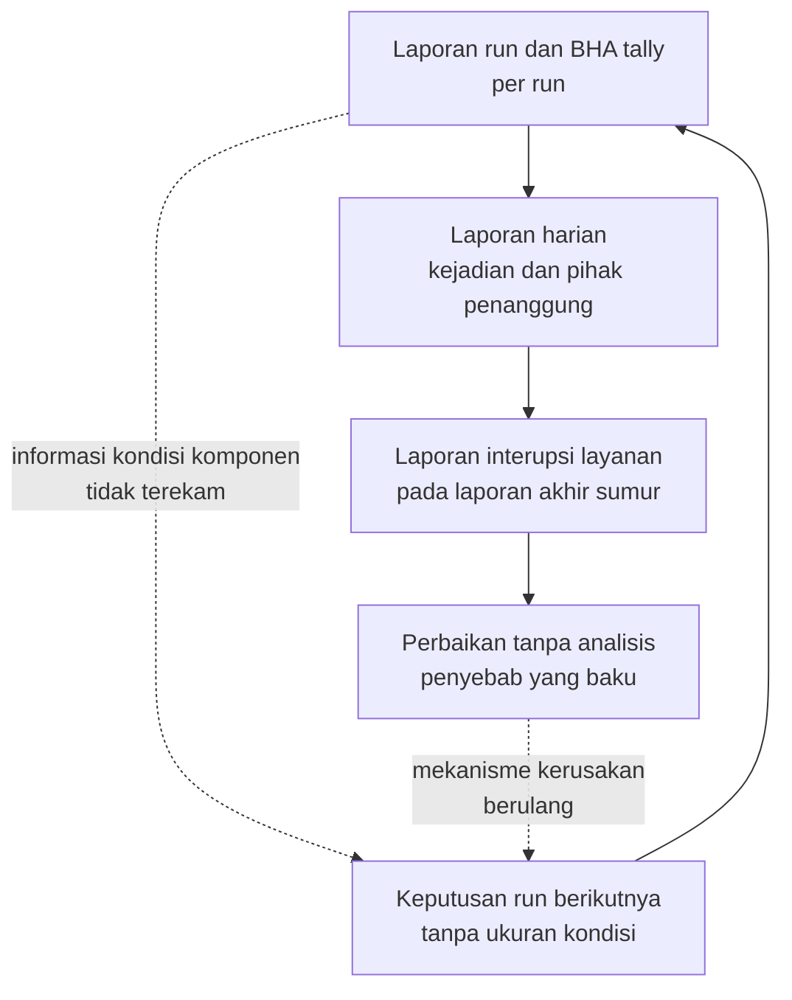
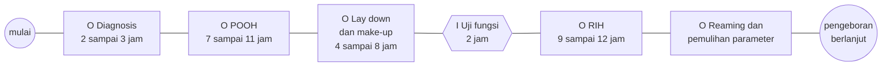
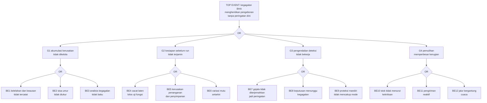
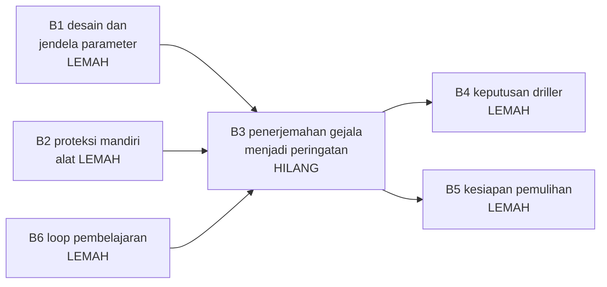

# PROPOSAL PROYEK PERANCANGAN TERPADU I

## Analisis Akar Penyebab Kegagalan Bottom Hole Assembly pada Operasi Pengeboran dan Pengendalian yang Diusulkan

Naskah ini memuat Bab I dan Bab II. Objek kajian adalah kegagalan Bottom Hole Assembly pada operasi pengeboran perusahaan layanan pengeboran multinasional. Data kasus berasal dari dokumen operasi internal yang dipakai dengan izin, dan data publik berasal dari dataset Equinor Volve dengan lisensi CC BY-NC-SA 4.0.

# BAB I PENDAHULUAN

## 1.1 Latar Belakang Sistem

### 1.1.1 Deskripsi Objek Studi dan Sistem yang Dikaji

Objek studi adalah kegagalan Bottom Hole Assembly (BHA) pada operasi pengeboran perusahaan layanan pengeboran multinasional. BHA adalah rangkaian yang bekerja langsung di dasar sumur, terdiri atas bit, motor lumpur atau rotary steerable system, modul pengukuran MWD dan logging LWD, stabilizer, drill collar, dan sambungan mekanis. Rangkaian itu menanggung getaran lateral, stick-slip, tumbukan, tekanan hidraulik, dan suhu tinggi selama pengeboran berlangsung.

Sistem yang dikaji adalah rantai keputusan yang menentukan apakah rangkaian itu masih layak dijalankan. Rantai tersebut berjalan dari penyiapan tool di fasilitas servis, pengiriman ke rig, run di dasar sumur, sampai keputusan menarik rangkaian dan menggantinya. Kerusakan yang datang tanpa peringatan dini menghentikan seluruh rantai itu dan mengubahnya menjadi siklus pemulihan yang panjang.

Kerugian yang timbul berlapis empat. Waktu non-produktif bertambah, biaya harian rig dan layanan tetap berjalan, bahan bakar dan energi terpakai tanpa kemajuan sumur, dan kru menghadapi risiko keselamatan pada penarikan rangkaian yang tidak dijadwalkan. Pada tool LWD yang membawa sumber radioaktif tersegel, kegagalan menambah risiko paparan radiasi dan risiko sumber tertinggal di sumur.

| Komponen BHA | Fungsi | Cara kegagalan yang tercatat |
|---|---|---|
| Bit | Memotong formasi | Aus melewati batas, washout, kehilangan elemen pemotong |
| Motor lumpur | Menggerakkan bit tanpa memutar seluruh rangkaian | Elastomer stator aus, bearing gagal, rendemen turun |
| Rotary steerable system | Mengarahkan lintasan sumur | Berhenti berfungsi, lintasan menyimpang, komponen kendali rusak |
| Modul MWD | Mengirim data ukur dan status ke permukaan | Telemetri berhenti, modul mati, data tidak terkirim |
| Modul LWD | Mengukur sifat formasi | Sensor menurun, respons bergeser, data tidak utuh |
| Stabilizer dan drill collar | Mengendalikan arah dan beban rangkaian | Aus tidak merata, sambungan longgar |
| Sambungan mekanis | Menyambung komponen rangkaian | Ulir rusak, washout, rangkaian lepas |
| Jar dan alat pemancingan | Melepas rangkaian yang terjepit | Tidak berfungsi saat dibutuhkan |

### 1.1.2 Stakeholder dan Kepentingannya

| Pemangku kepentingan | Kepentingan | Bentuk pengaruh pada kajian |
|---|---|---|
| Perusahaan layanan pengeboran | Mengurangi hentian yang menjadi tanggungannya dan menjaga mutu layanan | Pemilik data operasi dan penentu prosedur servis, pengiriman, serta kesiapan tool |
| Operator sumur | Menjaga jadwal sumur dan menghindari biaya hentian yang dibebankan kepadanya | Menetapkan klausul NPT, ambang service interruption, dan menerima laporan kejadian |
| Kru rig dan engineer pengukuran | Menjalankan penarikan, penggantian, dan memantau parameter | Sumber informasi kondisi rangkaian pada laporan harian dan laporan run |
| Bengkel servis dan fasilitas uji | Menyatakan kelayakan tool sebelum run | Penentu apakah cacat laten tertangkap sebelum tool dikirim |
| Rantai pasok dan logistik | Menyediakan tool pengganti, suku cadang, dan transportasi | Penentu lama hentian setelah kerusakan terjadi |
| Pemasok komponen | Menjamin mutu elastomer, bearing, elektronik, dan sambungan | Sumber variasi mutu antarlot |
| Regulator keselamatan | Mengawasi penanganan sumber radioaktif dan keselamatan operasi | Penentu syarat penanganan, pengangkutan, dan pelaporan bila sumber hilang |

### 1.1.3 Alur Operasi dan Alur Data

Alur operasi berjalan enam tahap. Pertama, tool diservis dan diuji fungsi di fasilitas. Kedua, tool dikirim ke rig melalui jalur darat, kapal, atau helikopter. Ketiga, rangkaian dirakit dan diturunkan ke dasar sumur. Keempat, pengeboran berjalan dan parameter permukaan dipantau. Kelima, kegagalan terdeteksi dan rangkaian ditarik. Keenam, BHA pengganti dirakit, diuji, diturunkan, dan pengeboran dilanjutkan.

| Tahap | Aktor | Dokumen yang lahir | Informasi yang dibawa |
|---|---|---|---|
| Servis dan uji fungsi | Bengkel servis | Lembar uji fungsi, catatan perbaikan | Hasil uji, suku cadang yang diganti |
| Pengiriman | Logistik, marine atau aviasi | Dokumen pengiriman, job ticket | Waktu kirim, alat pengganti, biaya mobilisasi |
| Perakitan dan run | Kru rig, engineer pengukuran | Laporan run, BHA tally | Nomor seri, konfigurasi, waktu masuk dan keluar, parameter operasi |
| Pemantauan | Kru rig, engineer | Laporan harian | Parameter torsi, tekanan, laju alir, putaran, beban kait, kedalaman |
| Kegagalan dan penarikan | Kru rig | Laporan harian bagian kejadian tak terjadwal | Waktu mulai dan selesai, jenis kejadian, pihak penanggung, kedalaman gagal |
| Pemulihan dan pelaporan | Penyedia layanan | Laporan akhir sumur, laporan interupsi layanan | Penyebab kegagalan, dampak operasi, jam rig yang hilang |

Alur data pada tabel itu memperlihatkan satu keadaan yang menjadi dasar seluruh bab: informasi kondisi komponen tidak pernah tercatat sebagai deret waktu per nomor seri. Yang terekam adalah kejadian setelah kerusakan terjadi.

**Gambar 1. Alur Operasi Penanganan Satu Siklus Kegagalan BHA**

### 1.1.4 Rich Picture: Narasi dan Spesifikasi Elemen

#### Narasi

Rich picture memuat satu rantai peristiwa dari fasilitas servis sampai dasar sumur, dengan dua lingkungan yang mempengaruhinya, yaitu cuaca dan formasi. Tool berangkat dari bengkel dalam keadaan dinyatakan layak, menempuh jalur transportasi yang bergantung jadwal, bekerja di bawah beban getaran dan tumbukan, lalu kembali ke permukaan dalam keadaan rusak. Di sisi lain rantai itu berdiri dua pihak yang menanggung akibatnya, yaitu operator sumur lewat klausul kontrak dan kru lewat risiko keselamatan.

#### Daftar elemen: simpul (12 simpul)

| Kode | Simpul | Jenis |
|---|---|---|
| S1 | Fasilitas servis dan uji fungsi | Proses |
| S2 | Stok tool dan suku cadang | Persediaan |
| S3 | Transportasi darat, kapal, dan helikopter | Proses |
| S4 | Rig dan lantai bor | Fasilitas |
| S5 | Perakitan BHA | Proses |
| S6 | Rangkaian di dasar sumur | Objek |
| S7 | Formasi batuan | Lingkungan |
| S8 | Cuaca dan kondisi laut | Lingkungan |
| S9 | Pemantauan parameter permukaan | Proses |
| S10 | Keputusan penarikan dan penggantian | Keputusan |
| S11 | Operator sumur dan klausul NPT | Pihak luar |
| S12 | Regulator keselamatan dan sumber radioaktif | Pihak luar |

#### Daftar elemen: relasi (11 relasi berarah)

| Kode | Relasi | Arah |
|---|---|---|
| R1 | S1 menetapkan kelayakan tool untuk S2 | S1 ke S2 |
| R2 | S2 memasok tool ke S3 | S2 ke S3 |
| R3 | S3 mengirim tool ke S4 | S3 ke S4 |
| R4 | S4 merakit rangkaian S5 | S4 ke S5 |
| R5 | S5 menurunkan rangkaian ke S6 | S5 ke S6 |
| R6 | S7 membebani S6 dengan getaran, tumbukan, dan abrasi | S7 ke S6 |
| R7 | S8 menentukan jadwal S3 dan S10 | S8 ke S3, S8 ke S10 |
| R8 | S9 memantau S6 lewat data yang dikirim ke S4 | S6 ke S9 |
| R9 | S10 memutuskan penarikan dan memicu S2 serta S3 | S10 ke S2, S10 ke S3 |
| R10 | S11 menanggung akibat hentian dan menagih laporan kejadian | S11 ke S10 |
| R11 | S12 mengawasi penanganan sumber radioaktif pada S4 dan S6 | S12 ke S4, S12 ke S6 |

#### Loop umpan balik (3 loop)

| Loop | Isi | Arah putaran |
|---|---|---|
| L1 | Tool dari S2 menjalani S3, S4, S5, S6, lalu kembali ke S1 untuk perbaikan | Siklus fisik tool |
| L2 | Kejadian pada S6 dicatat di S9, dilaporkan ke S11, lalu menjadi pembelajaran untuk S10 | Siklus informasi kegagalan |
| L3 | Keputusan S10 mengubah beban S2 dan S3, sehingga lama hentian berubah | Siklus pengaruh keputusan terhadap ketersediaan |

#### Penanda gangguan (4 titik)

| Kode | Titik gangguan | Akibat pada rantai |
|---|---|---|
| G1 | Cacat laten lolos dari S1 | Kegagalan muncul di S6 lebih cepat daripada umur rencana |
| G2 | Informasi kondisi S6 tidak kembali ke S1 | Mekanisme kerusakan yang sama berulang |
| G3 | S3 dan S2 bergantung pada S8 | Henti panjang karena menunggu pengganti |
| G4 | S10 diambil tanpa ukuran kondisi | Penarikan terjadi setelah kegagalan, bukan sebelum batas tercapai |

#### Keterangan Gambar 2

Gambar memuat 12 simpul dan 11 relasi berarah, dengan tiga loop digambar sebagai panah melingkar dan empat penanda gangguan sebagai tanda seru pada titik yang bersangkutan. Simpul lingkungan S7 dan S8 diletakkan di tepi gambar, dan simpul pihak luar S11 serta S12 diletakkan di sisi kanan sebagai penerima akibat.

**Gambar 2. Rich Picture Sistem Penanganan BHA**

### 1.1.5 Trade-off Variabel Sistem

| Trade-off | Dua sisi yang bertentangan | Akibat pemilihan |
|---|---|---|
| Uji fungsi lebih panjang atau waktu kesiapan lebih pendek | Uji lebih lama menaikkan peluang menangkap cacat laten, sedangkan waktu kesiapan tool di pangkalan memanjang | Tool yang lebih cepat dikirim membawa risiko kegagalan dini |
| Stok penyangga atau biaya persediaan | Stok lebih banyak memperpendek hentian, sedangkan modal dan biaya simpan naik | Penempatan stok menurut kekritisan menjadi pilihan, bukan jumlah seragam |
| Penarikan terencana atau kehilangan jam mengebor | Penarikan lebih awal menukar jam mengebor dengan kepastian kondisi, sedangkan penarikan terlambat berisiko kegagalan di sumur | Keputusan bergantung pada ukuran kondisi yang tersedia |
| Penanganan lebih hati-hati atau kecepatan persiapan | Penanganan berlapis mengurangi kerusakan pra-run, tetapi memperlama persiapan di lokasi terpencil | Perlu standar penanganan yang tidak menambah lama persiapan secara berlebihan |
| Kesiapan darurat lebih tebal atau biaya mobilisasi | Peralatan pemulihan di pangkalan terdekat memperpendek hentian, sedangkan biaya siaga berjalan terus | Kelayakan bergantung pada frekuensi kegagalan dan nilai hentian |

Kelima trade-off itu menjadi dasar penyusunan kriteria pada Bab III, karena setiap alternatif solusi akan mengubah salah satu sisi dan harus dinilai pada sisi lainnya. Tidak ada satu pilihan yang unggul pada semua sisi, sehingga setiap alternatif dinilai pada seluruh sisi tersebut sebelum diperingkat.

### 1.1.6 Uraian Singkat Permasalahan

Permasalahan yang dikaji adalah kegagalan BHA yang datang tanpa peringatan dini, sehingga hentian pengeboran menimbulkan kerugian waktu, biaya, energi, dan keselamatan. Kegagalan itu tidak berasal dari satu sebab tunggal, dan tiga akar penyebabnya sudah dirumuskan pada 1.2.4. Akar A adalah akumulasi kerusakan komponen yang tidak dikelola sepanjang siklus hidup. Akar B adalah kesiapan tool sebelum run yang tidak terjamin. Akar C adalah pemulihan yang bergantung pada pasokan jauh dan reaktif.

| Dimensi dampak | Angka | Sumber dan status |
|---|---|---|
| Durasi hentian satu kejadian, operasi darat | 5,00 jam resmi, 10 jam pemulihan penuh | Laporan harian 9 Juli 2026 dan skenario pemulihan |
| Durasi hentian satu kejadian, lepas pantai | 24 jam pada rig jack-up dan 36 jam pada drillship deepwater | Skenario siklus pemulihan |
| Kerugian langsung satu kejadian | 34.375 sampai 43.750 USD darat, 245.000 USD jack-up, 940.000 USD deepwater | Turunan dari durasi dan spread cost |
| Rasio kerugian antartipe operasi | 5,6 kali untuk perairan dangkal dan sekitar 21,5 kali untuk deepwater terhadap darat | Turunan dengan pemulihan penuh darat sebagai dasar |
| Komponen kerugian | Waktu non-produktif, biaya harian rig, energi terbuang, risiko keselamatan, kehilangan atau kerusakan tool | Dokumen kasus dan literatur industri |
| Populasi kejadian interupsi pengeboran publik | 884 kejadian pada 10 wellbore, total 1.225 jam, median 45 menit, p90 180 menit | Dataset publik Equinor Volve, terukur |
| Kejadian bertanda pipa terjepit dan pemancingan | 38 kejadian dari 884 | Tabel label terkurasi, terukur |
| Kejadian bertanda masalah fluida sumur | 25 kejadian dari 884 | Tabel label terkurasi, terukur |
| Kejadian yang tidak dapat dilokalisasi | 28 kejadian dari 884 | Tabel label terkurasi, terukur |
| Ambang pencatatan service interruption | lebih dari 30 menit | Formulir KPI layanan pengeboran berarah |
| Lost rig hours pada malfungsi tanpa hentian | 0 jam | Laporan akhir sumur UXA-7, tercatat |

Empat pertanyaan riset berikut menjadi batas kajian, dan keempatnya dirujuk ulang pada Bab III dan Bab IV.

**RM1.** Bagaimana merancang pengendalian atas akumulasi kerusakan komponen BHA sepanjang siklus hidup, sehingga keadaan komponen dapat dinyatakan sebelum batas kemampuannya tercapai, dengan bahan catatan yang benar-benar tersedia pada operasi pengeboran?

**RM2.** Bagaimana menjamin kesiapan tool sebelum run, sehingga cacat laten, kerusakan penanganan, dan variasi mutu antarlot tertangkap sebelum rangkaian diturunkan ke dasar sumur?

**RM3.** Bagaimana memperpendek hentian dan menekan kerugian per kejadian pada lokasi terpencil dan lepas pantai, ketika pengganti, suku cadang, dan teknisi harus menempuh jalur yang bergantung jadwal dan cuaca?

**RM4.** Dari tindakan yang mungkin pada RM1 sampai RM3, bagaimana urutan penerapan dipilih dengan kriteria yang dapat diperiksa, sehingga pengendalian yang paling menekan kerugian dijalankan lebih dulu?

Pemilik masalah dinyatakan tegas. Masalah dialami bersama oleh perusahaan layanan pengeboran sebagai penyedia jasa dan operator sumur sebagai pengguna jasa, dan pada kejadian yang dirinci, pihak penanggung hentian ditetapkan klausul kontrak sebagaimana contoh pada 1.2.5.

Masing-masing pertanyaan menuntut rancangan, dan jawabannya diuji terhadap empat besaran keberhasilan program: jam hentian akibat kegagalan BHA, biaya hentian per kejadian, energi yang terbuang selama hentian, dan jumlah kejadian berisiko keselamatan yang terkait penarikan rangkaian.

**Kendala yang membatasi ruang jawaban.** Empat keadaan berikut dibahas pada 1.1.7 dan 1.4.4. Pertama, dokumen kasus tidak memuat deret parameter permukaan per kejadian. Kedua, riwayat jam operasi per nomor seri belum lengkap. Ketiga, laju kegagalan komponen per nomor seri belum tersedia. Keempat, sebagian tarif dan durasi pemulihan masih berupa skenario yang menunggu tarif kontrak aktual.

### 1.1.7 Batas Data

Bahan kajian terdiri atas dua kelompok yang dipakai untuk dua keperluan berbeda. Dokumen operasi internal memasok struktur kejadian, durasi hentian, pihak penanggung, dan komponen biaya. Dataset publik Equinor Volve memasok sebaran durasi interupsi pengeboran pada sepuluh wellbore.

Tiga keterbatasan bahan menyertai analisis. Dokumen kasus tidak memuat catatan kondisi komponen sebagai deret waktu, sehingga hubungan antara beban operasi dan kerusakan tidak dapat dihitung per komponen. Laju kegagalan komponen per nomor seri tidak tersedia, sehingga tidak ada angka peluang pada analisis pohon kegagalan. Tarif spread cost dan durasi pemulihan pada Bab II berasal dari skenario yang dibangun dari dokumen kasus, dan nilainya diganti tarif kontrak aktual pada penerapan.

### 1.1.8 Cara Memperoleh Setiap Angka

| Angka | Cara memperoleh |
|---|---|
| Durasi 3,50 jam dan 1,50 jam | Membaca bagian time log dan unscheduled events laporan harian 9 Juli 2026, menjumlahkan durasi yang pihak penanggungnya penyedia layanan |
| NPT resmi 5,00 jam | Menjumlahkan dua durasi kejadian pada tanggal yang sama |
| Durasi pemulihan 10, 24, dan 36 jam | Menyusun siklus pemulihan per tahap: diagnosis, persiapan, POOH, pelepasan, perakitan, uji fungsi, RIH, reaming |
| Spread cost per hari | Menjumlahkan komponen rig, marine, aviasi, layanan aktif, personel, dan logistik menurut skenario tipe operasi |
| Spread cost per jam | Membagi spread cost per hari dengan 24 |
| Kerugian operasional | Mengalikan durasi hentian dengan spread cost per jam |
| Kerugian langsung | Menambahkan kerugian operasional dengan biaya perbaikan, mobilisasi, dan bahan |
| Rasio antartipe operasi | Membagi kerugian langsung tiap tipe dengan kerugian langsung tipe darat pemulihan penuh |
| 884 kejadian dan 1.225 jam | Menghitung baris kejadian pada tabel label terkurasi, lalu menjumlahkan selisih waktu mulai dan waktu selesai |
| Median 45 menit, p90 180 menit, maksimum 780 menit | Mengurutkan durasi kejadian, mengambil nilai tengah, nilai pada posisi persentil 90, dan nilai terbesar |
| 38, 25, dan 28 kejadian | Mencacah baris menurut kategori kejadian pada tabel label terkurasi |
| Ambang 30 menit | Membaca definisi service interruption pada formulir KPI layanan |
| Lost rig hours 0 | Membaca laporan akhir sumur UXA-7 pada bagian interupsi layanan |

### 1.1.9 Metode Perhitungan Kerugian

Kerugian satu kejadian dihitung dalam empat langkah berurutan. Setiap langkah memakai angka yang sudah berstatus pada 1.1.8 dan 1.2.2, sehingga hasil akhirnya dapat ditelusuri kembali ke sumbernya.

**Langkah 1, lama hentian.** Lama hentian adalah jumlah durasi seluruh tahap siklus pemulihan: diagnosis, persiapan, penarikan rangkaian, pelepasan BHA rusak, perakitan BHA pengganti, uji fungsi, penurunan rangkaian kembali, reaming, dan pemulihan parameter pengeboran. Laporan harian sumur S1-O-15C tanggal 9 Juli 2026 mencatat dua kejadian Directional Tool Failure, masing-masing 3,50 jam dan 1,50 jam, dengan pihak penanggung penyedia layanan, sehingga NPT resminya 5,00 jam. Pemulihan penuh pada kejadian yang sama mencakup seluruh tahap tersebut dan skenarionya 10 jam; kedua angka mengukur hal berbeda dan tidak dijumlahkan.

**Langkah 2, spread cost per jam.** Biaya harian gabungan rig, marine, aviasi, layanan aktif, personel, dan logistik dijumlahkan, lalu dibagi 24. Angka yang dipakai: 45.000 USD per hari menjadi 1.875 USD per jam pada operasi darat, 170.000 menjadi 7.083 pada rig jack-up, dan 480.000 menjadi 20.000 pada drillship deepwater.

**Langkah 3, kerugian operasional.** Lama hentian dalam jam dikalikan spread cost per jam. Kejadian darat dengan NPT resmi: 5 jam dikali 1.875 USD sama dengan 9.375 USD. Dengan pemulihan penuh: 10 jam dikali 1.875 USD sama dengan 18.750 USD. Kejadian jack-up: 24 jam dikali 7.083 USD sama dengan 170.000 USD. Kejadian deepwater: 36 jam dikali 20.000 USD sama dengan 720.000 USD.

**Langkah 4, kerugian langsung.** Kerugian operasional ditambah biaya perbaikan dan biaya tambahan berupa mobilisasi, logistik, dan bahan. Kejadian darat: 9.375 ditambah 25.000 sama dengan 34.375 USD pada NPT resmi, dan 18.750 ditambah 25.000 sama dengan 43.750 USD pada pemulihan penuh. Kejadian jack-up: 170.000 ditambah 75.000 sama dengan 245.000 USD. Kejadian deepwater: 720.000 ditambah 220.000 sama dengan 940.000 USD. Dengan dasar darat pemulihan penuh 43.750 USD, rasio jack-up menjadi 5,6 kali dan deepwater 21,5 kali.

**Faktor formasi.** Pada formasi yang lebih keras atau tidak stabil, lama hentian dikalikan faktor berikut, sedangkan biaya perbaikan, penggantian, dan mobilisasi tidak dikalikan agar tidak terjadi penghitungan ganda.

| Kondisi formasi | Faktor pengali waktu |
|---|---|
| Normal dan stabil | 1,00 |
| Cukup keras atau berlapis-lapis | 1,15 |
| Keras, abrasif, atau bergetaran tinggi | 1,30 |
| Tidak stabil, zona kehilangan lumpur, atau tekanan tinggi | 1,50 |

**Contoh penerapan faktor.** Kejadian deepwater pada formasi keras: 36 jam dikali 1,30 sama dengan 46,8 jam, kerugian operasional 46,8 dikali 20.000 USD sama dengan 936.000 USD, dan kerugian langsung 936.000 ditambah 220.000 sama dengan 1.156.000 USD, atau sekitar Rp18,5 miliar.

**Rumus ringkas.** Dengan T lama hentian dalam jam, S spread cost per jam, F faktor formasi, Cp biaya perbaikan, dan Ct biaya tambahan, keempat langkah itu ditulis:

- S sama dengan jumlah biaya rig, marine, aviasi, layanan aktif, personel, dan logistik, dibagi 24.
- Kerugian operasional sama dengan T dikali S.
- Kerugian langsung sama dengan T dikali S dikali F, ditambah Cp, ditambah Ct.

Dari sisi penyedia layanan, nilai hentian mengikuti tarif kontrak: jam hentian dikali operating charge per jam, ditambah kaki pengeboran yang tertunda dikali tarif per kaki, ditambah biaya tool pengganti dan transportasinya. Dengan operating charge 1.000 USD per jam, hentian 24 jam setara 24.000 USD pada komponen itu saja, sebelum kaki pengeboran yang tertunda dan biaya pengganti dihitung.

| Angka pada 1.1.6 | Cara memperoleh | Bahan | Status |
|---|---|---|---|
| Durasi 3,50 dan 1,50 jam | Selisih waktu mulai dan selesai tiap kejadian | Laporan harian, kolom waktu kejadian | tercatat |
| NPT resmi 5,00 jam | Penjumlahan durasi kejadian dengan pihak penanggung penyedia layanan | Laporan harian, kolom pihak penanggung | tercatat |
| Durasi 10, 24, dan 36 jam | Penjumlahan tahap siklus pemulihan | Skenario siklus pemulihan per tipe operasi | skenario |
| Spread cost per hari | Penjumlahan komponen biaya harian | Skenario biaya harian per jarak dan tipe rig | skenario |
| Spread cost per jam | Spread cost per hari dibagi 24 | Spread cost per hari | turunan |
| Kerugian operasional | Lama hentian dikali spread cost per jam | Durasi hentian dan spread cost per jam | turunan |
| Kerugian langsung | Kerugian operasional ditambah biaya perbaikan dan biaya tambahan | Kerugian operasional, biaya perbaikan, biaya tambahan | turunan |
| Rasio antartipe operasi | Pembagian kerugian langsung terhadap dasar darat pemulihan penuh | Kerugian langsung tiap tipe operasi | turunan |
| 884 kejadian, 1.225 jam | Cacah baris dan penjumlahan durasi | Tabel label terkurasi pada dataset publik | terukur |
| Median 45 menit, p90 180 menit, maksimum 780 menit | Statistik urutan durasi | Durasi seluruh kejadian | terukur |
| 38, 25, dan 28 kejadian | Cacah baris per kategori | Tabel label terkurasi kolom kategori | terukur |
| Lost rig hours 0 | Pembacaan bagian interupsi layanan | Laporan akhir sumur UXA-7 | tercatat |

---
## 1.2 Analisis Akar Penyebab Masalah: Fishbone 6M dan 5W1H

Analisis pada subbab ini menjawab satu pertanyaan: mengapa Bottom Hole Assembly (BHA) mengalami kerusakan saat pengeboran tanpa dapat diperkirakan sebelumnya, sehingga menimbulkan kerugian waktu, biaya, energi, dan keselamatan. Efek yang dipetakan adalah kegagalan BHA beserta kerugian yang mengikutinya. Penilaian alternatif solusi tidak termasuk di sini dan dibahas pada Bab III.

### 1.2.1 Batas Masalah dan Definisi Top Event

Top event dipecah menjadi dua sisi yang dirujuk dengan kode tetap. TE-A adalah kegagalan fisik BHA di dasar sumur, mencakup pipa terjepit, getaran yang merusak rangkaian, alat lubang bawah berhenti berfungsi, mata bor aus, sambungan mekanis gagal, washout, dan rangkaian tertinggal di sumur. TE-B adalah konsekuensi kegagalan itu, mencakup hentian pengeboran yang panjang, biaya harian rig dan layanan yang tetap berjalan, energi yang terpakai tanpa kemajuan sumur, dan paparan risiko keselamatan bagi kru.

| Butir | Isi |
|---|---|
| Objek analisis | BHA: bit, motor atau rotary steerable system, modul MWD dan LWD, stabilizer, drill collar, dan sambungan |
| Fase yang dianalisis | Penyiapan tool di pangkalan, pengiriman ke rig, run di dasar sumur, kegagalan, dan siklus pemulihan sampai pengeboran berlanjut |
| Sudut penelusuran | Fasilitas dan energi, mutu dan keandalan, rantai pasok, serta keselamatan |
| Keluaran subbab ini | Daftar sebab per kategori 6M, tiga akar penyebab yang dapat dikendalikan, dan hipotesis yang masih terbuka beserta uji pembedanya |

Analisis berhenti pada akar penyebab dan pada pengendali yang seharusnya mencegah kegagalan itu sampai ke rig.

### 1.2.2 Angka dasar dan status buktinya

Seluruh angka yang dipakai di subbab ini dibedakan menurut lima status: terukur bila dihitung ulang dari data mentah dengan langkah yang ditulis, tercatat bila berasal dari laporan atau dokumen kasus, acuan bila merupakan angka acuan awal dari kesepakatan dengan klien, turunan bila merupakan hasil hitung dari angka lain, dan skenario bila nilainya ditetapkan sebagai simulasi biaya dan waktu yang menunggu tarif kontrak aktual.

| Angka | Nilai | Sumber | Status |
|---|---|---|---|
| NPT resmi satu kejadian onshore | 5,00 jam, terdiri atas 3,50 jam dan 1,50 jam | Daily Drilling Report sumur S1-O-15C tanggal 9 Juli 2026 | tercatat |
| Pemulihan penuh kejadian yang sama | 10 jam | Skenario siklus pemulihan yang mencakup POOH, penggantian, uji fungsi, dan RIH | skenario |
| Durasi pemulihan offshore rig jack-up | 24 jam | Skenario siklus penarikan operasi lepas pantai perairan dangkal | skenario |
| Durasi pemulihan deepwater drillship | 36 jam | Skenario siklus penarikan operasi lepas pantai dalam | skenario |
| Ambang satu kejadian dihitung sebagai service interruption | lebih dari 30 menit | Formulir KPI layanan pengeboran berarah | tercatat |
| Spread cost onshore | 45.000 USD per hari, sama dengan 1.875 USD per jam | Skenario land rig, layanan pengeboran, kru, bahan bakar, dan lumpur | skenario |
| Spread cost offshore perairan dangkal | 170.000 USD per hari, sama dengan 7.083 USD per jam | Skenario jack-up, marine support, layanan aktif, dan personel | skenario |
| Spread cost deepwater | 480.000 USD per hari, sama dengan 20.000 USD per jam | Skenario drillship, marine dan aviasi, layanan aktif, dan personel | skenario |
| Kerugian langsung onshore, NPT resmi | 34.375 USD | 5 jam dikali 1.875 USD ditambah 25.000 USD biaya perbaikan dan tambahan | turunan |
| Kerugian langsung onshore, pemulihan penuh | 43.750 USD | 10 jam dikali 1.875 USD ditambah 25.000 USD | turunan |
| Kerugian langsung offshore jack-up | 245.000 USD, setara Rp3,92 miliar | 170.000 USD ditambah 50.000 USD perbaikan, 15.000 USD mobilisasi, dan 10.000 USD bahan | turunan |
| Kerugian langsung deepwater | 940.000 USD, setara Rp15,04 miliar | 720.000 USD ditambah 150.000 USD perbaikan, 40.000 USD logistik, dan 30.000 USD bahan | turunan |
| Kurs yang dipakai | 1 USD sama dengan Rp16.000 | Kurs pada skenario simulasi | skenario |
| Kejadian interupsi pengeboran pada dataset publik | 884 kejadian pada 10 wellbore, total 1.225 jam, median 45 menit, p90 180 menit | Dataset publik Equinor Volve, tabel label terkurasi | terukur |
| Kejadian bertanda pipa terjepit dan pemancingan | 38 dari 884 kejadian | Kategori pada tabel label terkurasi | terukur |
| Kejadian bertanda masalah fluida sumur | 25 dari 884 kejadian | Kategori pada tabel label terkurasi | terukur |
| Kejadian yang tidak dapat dilokalisasi penyebabnya | 28 dari 884 kejadian | Kategori pada tabel label terkurasi | terukur |
| Lost rig hours pada kejadian malfungsi tool tanpa hentian | 0 jam | End of Well Report sumur UXA-7, respons resistivitas abnormal sejak 870 ftMD | tercatat |
| Durasi kejadian terpanjang pada dataset publik | maksimum 780 menit | Durasi terbesar pada tabel label terkurasi | terukur |
| Cacah sumur dataset publik | 10 wellbore | Cacah nilai berbeda pada kolom sumur tabel label terkurasi | terukur |
| Biaya perbaikan dan tambahan, kejadian jack-up | 75.000 USD | 50.000 USD perbaikan, 15.000 USD mobilisasi, 10.000 USD bahan | turunan |
| Biaya perbaikan dan tambahan, kejadian deepwater | 220.000 USD | 150.000 USD perbaikan, 40.000 USD logistik, 30.000 USD bahan | turunan |

Dua pembacaan menyertai tabel itu. Pertama, malfungsi tool tidak selalu menimbulkan hentian, sehingga jumlah kerusakan komponen dan jumlah hentian adalah dua besaran berbeda. Kedua, rasio kerugian antartipe operasi dihitung terhadap pemulihan penuh onshore sebagai nilai dasar 1,0, sehingga offshore perairan dangkal bernilai sekitar 5,6 kali dan deepwater sekitar 21,5 kali.

### 1.2.3 Fishbone 6M

Fishbone disusun atas enam cabang 6M dengan empat ranting pada setiap cabang, sehingga jumlah ranting seluruhnya 24. Setiap ranting menyatakan sebab yang menuju efek kegagalan di dasar sumur.

**Kotak efek:** "Kegagalan BHA pada operasi pengeboran yang datang tanpa peringatan dini, sehingga pengeboran berhenti dan menimbulkan kerugian waktu, biaya, energi, dan keselamatan."

#### MAN (manusia): 4 ranting

| Kode | Ranting | Isi sebab |
|---|---|---|
| Mn1 | Penanganan tak terjadwal | Penarikan dan penggantian rangkaian terjadi tanpa persiapan, karena kejadiannya tidak dijadwalkan lebih dulu |
| Mn2 | Keputusan tanpa ukuran kondisi | Keputusan menarik atau melanjutkan rangkaian diambil tanpa ukuran sisa umur komponen yang tersedia di lantai bor |
| Mn3 | Kompetensi penanganan sumber | Penanganan tool LWD bersumber radioaktif menuntut petugas proteksi radiasi bersertifikat, dan jumlahnya terbatas di lokasi terpencil |
| Mn4 | Tekanan waktu | Pekerjaan pemulihan dilakukan di bawah tekanan waktu, sehingga analisis keselamatan kerja per penarikan tidak selalu dijalankan sebelum tindakan |

#### METHOD (metode): 4 ranting

| Kode | Ranting | Isi sebab |
|---|---|---|
| Me1 | Kelayakan berbasis jadwal | Kelayakan tool ditentukan jadwal servis dan pemeriksaan sebelum run, sedangkan kondisi komponen selama operasi tidak terpantau |
| Me2 | Pembelajaran kegagalan tidak baku | Tool rusak diperbaiki atau diganti tanpa pembongkaran dan analisis penyebab yang baku, sehingga mekanisme yang sama berulang pada run berikutnya |
| Me3 | Pengiriman reaktif | Tool pengganti dan suku cadang dikirim setelah kerusakan terjadi, bukan ditempatkan lebih dulu menurut tingkat kekritisan |
| Me4 | Siklus pemulihan panjang | Pemulihan menempuh urutan diagnosis, persiapan, POOH, pelepasan BHA rusak, perakitan pengganti, uji fungsi, RIH, dan reaming sampai dasar sumur |

#### MACHINE (mesin dan perkakas): 4 ranting

| Kode | Ranting | Isi sebab |
|---|---|---|
| Ma1 | Kelelahan elektronik dan mekanis | Elektronik MWD dan LWD menanggung getaran, tumbukan, dan suhu tinggi yang menumpuk sepanjang umur pakai |
| Ma2 | Keausan bearing dan elastomer | Bearing motor, elastomer stator, dan komponen rotary steerable system aus secara bertahap sampai di luar batas kemampuannya |
| Ma3 | Beban dinamik di dasar sumur | Getaran lateral, stick-slip, dan tumbukan mempercepat keausan dan kerusakan sambungan |
| Ma4 | Cacat laten | Cacat pada elektronik, sambungan ulir, atau elastomer lolos dari uji fungsi di fasilitas servis dan baru muncul di dasar sumur |

#### MATERIAL (bahan dan komponen): 4 ranting

| Kode | Ranting | Isi sebab |
|---|---|---|
| Mt1 | Variasi mutu antarlot | Elastomer stator, bearing, dan elektronik tahan suhu dari lot atau pemasok berbeda membawa variasi mutu yang baru terlihat saat bekerja di sumur |
| Mt2 | Penempatan stok tidak menurut kekritisan | Tool cadangan dan suku cadang kritis tidak ditempatkan menurut dampak hentian dan laju kerusakannya |
| Mt3 | Objek berisiko tambahan | Sumber radioaktif tersegel pada tool densitas dan porositas neutron menambah konsekuensi kegagalan |
| Mt4 | Jarak pasokan | Suku cadang pengganti harus menempuh jalur darat, kapal, atau helikopter sebelum mencapai rig |

#### MEASUREMENT (pengukuran): 4 ranting

| Kode | Ranting | Isi sebab |
|---|---|---|
| Ms1 | Riwayat kondisi tidak tercatat | Jam operasi, tingkat getaran dan tumbukan yang dialami, suhu maksimum, serta riwayat servis tidak tercatat per nomor seri |
| Ms2 | Sisa umur tidak diukur | Tidak ada ukuran umur pakai yang tersisa, sehingga tool yang tampak layak dapat berada di ambang batas kemampuannya |
| Ms3 | Satuan waktu tidak seragam | Durasi hentian dicatat dalam tiga besaran berbeda: jam operasional yang hilang, NPT yang dikaitkan secara internal, dan NPT yang ditetapkan klien |
| Ms4 | Indikator pemulihan tidak baku | Waktu dari kegagalan sampai pengeboran berlanjut tidak dipecah per tahap siklus, sehingga tahap yang paling mahal tidak terlihat |

#### ENVIRONMENT (lingkungan dan lokasi): 4 ranting

| Kode | Ranting | Isi sebab |
|---|---|---|
| En1 | Lokasi terpencil dan lepas pantai | Akses hanya melalui kapal suplai atau helikopter yang tunduk pada jadwal |
| En2 | Ketergantungan cuaca | Cuaca menentukan jadwal pengiriman maupun jadwal penarikan rangkaian |
| En3 | Formasi keras dan abrasif | Formasi keras, abrasif, dan berlapis-lapis menaikkan getaran, mempercepat keausan, dan memperlama reaming |
| En4 | Kedalaman air | Semakin dalam air, riser dan drillstring semakin panjang, POOH dan RIH semakin lama, dan dukungan kapal, helikopter, serta ROV semakin besar |

**Gambar 3. Fishbone 6M Kegagalan BHA, 6 Cabang dan 24 Ranting**

### 1.2.4 Rekap keadaan sebab

| Cabang | Jumlah ranting | Inti sebab | Akar penyebab yang dibawa |
|---|---|---|---|
| MAN | 4 | Penanganan dan keputusan di lantai bor bergantung pada pengalaman, bukan pada ukuran kondisi | A, C |
| METHOD | 4 | Kelayakan berbasis jadwal, pembelajaran kegagalan, dan pemulihan yang menempuh siklus panjang | B, A, C |
| MACHINE | 4 | Akumulasi kelelahan dan keausan, ditambah cacat laten yang lolos uji | A, B |
| MATERIAL | 4 | Variasi mutu antarlot dan penempatan stok yang tidak menurut kekritisan | B, C |
| MEASUREMENT | 4 | Tidak ada catatan kondisi per komponen, tidak ada ukuran sisa umur, satuan waktu tidak seragam | A |
| ENVIRONMENT | 4 | Jarak, cuaca, formasi, dan kedalaman air memperbesar kerugian setiap kerusakan | C |

Tiga akar penyebab pada kolom terakhir dirumuskan berikut. Akar A adalah akumulasi kerusakan komponen yang tidak dikelola sepanjang siklus hidup, sehingga kegagalan datang tanpa peringatan dan penyebabnya tidak dipelajari. Akar B adalah kesiapan tool sebelum run yang tidak terjamin, mencakup uji fungsi terbatas, penanganan yang merusak, dan mutu komponen yang bervariasi. Akar C adalah pemulihan yang bergantung pada pasokan jauh dan reaktif, sehingga rig tetap menanggung biaya dan konsumsi energi selama menunggu.

Akar A menentukan seberapa sering kerusakan terjadi tanpa peringatan, akar B menentukan kondisi tool saat mulai bekerja, dan akar C menentukan seberapa besar kerugian setiap kerusakan. Ketiga akar penyebab ini menjadi dasar analisis barrier dan pohon kegagalan pada Bab II.

### 1.2.5 5W1H

| Unsur | Isi | Cara memperoleh |
|---|---|---|
| What | Kegagalan BHA yang menghentikan pengeboran tanpa peringatan dini. Satu kejadian onshore tercatat 3,50 jam dan 1,50 jam, sehingga NPT resminya 5,00 jam, sedangkan pemulihan penuh skenarionya 10 jam | Membaca bagian time log dan unscheduled events pada laporan harian, lalu menjumlahkan durasi yang accountable party-nya penyedia layanan |
| Why | Tiga akar penyebab pada 1.2.4: akumulasi kerusakan tidak tercatat, kesiapan sebelum run tidak terjamin, dan pemulihan bergantung pasokan jauh | Menelusuri ranting fishbone, lalu memetakan setiap ranting ke akar penyebab yang menerangkan sifat kegagalan |
| When | Terjadi selama run di dasar sumur dan diketahui ketika tool berhenti berfungsi atau rangkaian ditarik. Ambang pencatatan satu kejadian sebagai service interruption adalah lebih dari 30 menit | Membaca definisi service interruption pada formulir KPI layanan dan urutan waktu pada laporan harian |
| Where | Di dasar sumur, dengan pemulihan bergantung pada pangkalan terdekat. Kasus pembanding mencakup operasi darat, rig jack-up dengan kedalaman air 78,4 ft, dan deepwater dengan target sand sekitar 4.922 m | Membaca bagian konteks sumur pada End of Well Report dan program pengeboran |
| Who | Kru rig, driller, engineer pengukuran, bengkel servis, dan rantai pasok. Pihak yang menanggung hentian ditetapkan klausul kontrak, misalnya penyedia peralatan pengeboran berarah pada kejadian 9 Juli 2026 | Membaca kolom accountable party pada laporan harian dan klausul NPT pada kontrak |
| How much | Kerugian langsung satu kejadian 34.375 sampai 43.750 USD pada operasi darat, 245.000 USD pada rig jack-up, dan 940.000 USD pada deepwater. Satu kejadian deepwater setara 3,8 kali kejadian perairan dangkal dan sekitar 21,5 kali kejadian darat dengan pemulihan penuh sebagai dasar | Menghitung durasi kali spread cost per jam, lalu menambahkan biaya perbaikan, mobilisasi, dan bahan |

### 1.2.6 Keterangan Gambar 3

Gambar 3 adalah diagram tulang ikan dengan orientasi kiri ke kanan. Kotak efek di kanan memuat pernyataan akibat, tulang punggung horizontal, enam cabang berselang-seling di atas dan di bawah, dan 24 ranting.

**Kotak efek:** "Kegagalan BHA pada operasi pengeboran yang datang tanpa peringatan dini".

**Cabang dan ranting:** MAN dengan Mn1 sampai Mn4, METHOD dengan Me1 sampai Me4, MACHINE dengan Ma1 sampai Ma4, MATERIAL dengan Mt1 sampai Mt4, MEASUREMENT dengan Ms1 sampai Ms4, ENVIRONMENT dengan En1 sampai En4.

Cabang disusun MAN, METHOD, MACHINE di sisi atas dan MATERIAL, MEASUREMENT, ENVIRONMENT di sisi bawah, dan setiap ranting diakhiri anak panah menuju tulang punggung.

### 1.2.7 Hipotesis, penjelasan rival, dan uji pembeda

Empat hipotesis berikut masih terbuka, dan setiap hipotesis membawa uji yang dapat membedakannya dari penjelasan rival.

| Hipotesis | Isi | Penjelasan rival | Uji pembeda | Status |
|---|---|---|---|---|
| H1 | Kegagalan didahului gejala yang sudah terekam pada parameter permukaan, sehingga gejala itu dapat dikenali sebelum hentian | Kegagalan terjadi mendadak tanpa gejala yang terekam | Bandingkan parameter torsi, tekanan standpipe, laju alir, putaran, dan beban kait pada jendela sebelum kejadian dengan jendela normal pada sumur yang sama di dataset publik | belum diuji, data kasus tidak memuat deret parameter permukaan |
| H2 | Kegagalan dini pada run tertentu berkaitan dengan uji fungsi yang tidak penuh di fasilitas servis | Kegagalan dini berasal dari variasi mutu komponen, bukan dari uji fungsi | Korelasikan kegagalan dalam periode awal run, ditetapkan 24 jam pertama sebagai pilihan desain uji, dengan jenis uji fungsi yang tercatat pada laporan run | belum diuji, laporan run belum memuat hasil uji fungsi |
| H3 | Kerusakan penanganan dan penyimpanan sebelum run memperpendek umur komponen | Umur komponen ditentukan beban di dasar sumur, dan penanganan tidak berpengaruh | Bandingkan temuan kerusakan fisik saat penerimaan tool di rig dengan jam pakai berikutnya | belum diuji, catatan penerimaan tool tidak tersedia |
| H4 | Pola kerusakan tidak acak terhadap jam operasi kumulatif | Kerusakan acak terhadap jam operasi | Uji sebaran waktu antar-kerusakan terhadap model laju kegagalan, lalu periksa apakah laju naik terhadap jam kumulatif | belum diuji, riwayat jam kumulatif per nomor seri belum lengkap |

Hubungan antara cacat laten dan kejadian di sumur belum dapat ditetapkan dari dokumen kasus, karena laporan run tidak memuat hasil uji fungsi dan catatan penerimaan tool secara lengkap. Hubungan itu dicatat sebagai hipotesis H2 dan H3.

### 1.2.8 Atribut Permasalahan Kompleks yang Dipenuhi

Atribut yang dipakai menilai kerumitan permasalahan terdiri atas WP1 beserta semua atau sebagian WP2 sampai WP7, dengan keterangan tiap atribut seperti pada tabel berikut.

| Atribut | Keterangan | Keadaan pada kasus ini |
|---|---|---|
| WP1 kedalaman pengetahuan yang dibutuhkan | Tidak dapat dipecahkan tanpa pengetahuan rekayasa mendalam berbasis fondasi | Menuntut pengetahuan keandalan alat, keselamatan operasi, dan manajemen rantai pasok pada tingkat lanjutan |
| WP2 rentang persyaratan yang berbenturan | Memuat isu teknis dan non-teknis yang berkonflik dan luas | Jadwal operator, biaya penyedia layanan, keselamatan kru, dan ketentuan regulator saling menekan |
| WP3 kedalaman analisis yang dibutuhkan | Tanpa solusi yang jelas dan menuntut pemikiran abstrak serta model orisinal | Model biaya siklus kegagalan dan struktur sebab tiga akar penyebab dibangun dari bahan kasus |
| WP4 keakraban persoalan | Memuat isu yang jarang ditemui | Kombinasi tool bersumber radioaktif, lokasi terpencil, dan ketiadaan catatan kondisi per nomor seri jarang ditemui sebagai satu paket |
| WP5 luas kode dan standar yang berlaku | Berada di luar cakupan satu kode praktik | Menyentuh IEC 62740:2015, IEC 60812:2018, ketentuan keselamatan sumber radioaktif, dan standar operasi pengeboran |
| WP6 luas keterlibatan pemangku kepentingan | Memuat kelompok pemangku kepentingan yang beragam | Tujuh kelompok pemangku kepentingan pada 1.1.2 dengan kepentingan yang berbeda |
| WP7 keterkaitan antarbagian | Masalah tingkat tinggi dengan banyak bagian atau sub masalah | Empat komponen kerugian, enam barrier, dua belas kejadian dasar, dan tiga akar penyebab saling terkait |

Ketujuh atribut hadir pada kasus ini. WP1 terpenuhi penuh pada subbab ini, sedangkan pemenuhan WP2 sampai WP7 diperluas pada Bab III dan Bab IV.

---

## 1.3 Pembagian Tanggung Jawab dan Titik Kritis

Tim terdiri atas tiga anggota dengan penamaan disamarkan. Pembagian dilakukan per bab dan per sudut kajian, sehingga setiap titik kritis memiliki satu pemilik.

| Anggota | Tanggung jawab utama | Titik kritis | Bukti penyelesaian |
|---|---|---|---|
| A | Bab I: latar belakang sistem, analisis akar penyebab 1.2; sudut kajian fasilitas dan energi | Rumusan masalah dan efek fishbone menyatakan kegagalan BHA pada operasi pengeboran | Fishbone 6M 24 ranting dan 5W1H terbit pada 1.2 dengan tiga akar penyebab berkode |
| B | Bab II: VSM, MIFC, OPC, FMECA, FTA, barrier; sudut kajian mutu dan keandalan | Setiap angka memiliki baris sumber dan status bukti | Tabel cara memperoleh angka pada 1.1.8 dan 1.2.2, hitungan pohon pada 2.5.2 |
| C | Bab III dan Bab IV: alternatif, kriteria, pemilihan, kesimpulan; sudut kajian rantai pasok | Pemenang pemilihan bertahan pada lebih dari satu skenario bobot | Tabel alternatif 12 butir beserta pemetaannya ke tiga akar penyebab |

Sudut kajian keselamatan dipikul ketiga anggota bersama, karena kerusakan BHA serta penanganan sumber radioaktif pada tool LWD menyangkut seluruh anggota tim dan seluruh bab.

**Kontribusi individual.** Setiap anggota mengusulkan tiga gagasan utama, sehingga totalnya sembilan, dan ketiga anggota bersama menambah tiga usulan keselamatan, sehingga bahan usulan seluruhnya dua belas, setara tiga usulan per sudut kajian. Konsolidasi bahan itu menjadi himpunan alternatif dilakukan pada subbab 3.1.

| Anggota | Gagasan yang diusulkan | Akar penyebab yang dituju |
|---|---|---|
| A | F1 bengkel servis dan stasiun uji dekat lokasi; F2 manajemen energi rig lintas fase; F3 fasilitas penanganan dan penyimpanan tool terstandar; K1 pengendalian sumber radioaktif dan penanganan BHA | F1 dan F3 menutup B, F2 menutup C, K1 menutup risiko keselamatan dan menopang A serta C |
| B | Q1 manajemen siklus hidup tool per nomor seri; Q2 pemeliharaan prediktif berbasis data kondisi bawah permukaan; Q3 analisis kegagalan terstruktur; K2 kesiapan darurat tool bersumber yang hilang atau terjepit | Q1, Q2, dan Q3 menutup A, K2 menutup risiko keselamatan |
| C | S1 stok penyangga menurut kekritisan; S2 kualifikasi pemasok dan penelusuran lot; S3 logistik terjadwal dengan penempatan awal; K3 penarikan terencana dan kontrol risiko lantai bor | S1 dan S3 menutup C, S2 menutup B, K3 menutup A dan risiko keselamatan |

Pemetaan gagasan ke sudut kajian dan ke standar acuannya disusun pada subbab 3.1 dan 3.2.

**Mengapa titik kritis di tiga tempat itu.**

1. *Rumusan masalah* (milik A): efek fishbone menyatakan kegagalan BHA yang terjadi di lapangan, sehingga seluruh analisis berikutnya menelusuri kerusakan nyata pada operasi pengeboran.
2. *Ketertelusuran angka* (milik B): setiap angka harus punya pemilik, status bukti, dan langkah hitung. Angka tanpa status akan dipakai sebagai dasar kesimpulan tanpa dapat diperiksa.
3. *Ketahanan pemilihan* (milik C): keputusan pemilihan diuji pada banyak skenario bobot, sehingga pemenang tidak bergantung pada satu set kriteria.

## 1.4 Batasan Penelitian dan Kerahasiaan

### 1.4.1 Sumber data

Bahan kajian memakai dua sumber. Dokumen operasi internal memasok struktur kejadian, durasi hentian, pihak penanggung, komponen biaya, dan isi laporan run. Dataset publik Equinor Volve dengan lisensi CC BY-NC-SA 4.0 memasok sebaran durasi interupsi pengeboran pada sepuluh wellbore. Dokumen kasus dipakai sesuai izin, dan angka yang mampu mengidentifikasi pihak tidak dimunculkan lebih dari yang diperlukan analisis.

### 1.4.2 Identitas

Nama perusahaan dan divisi mitra disamarkan sebagai perusahaan layanan pengeboran multinasional. Kasus dirujuk dengan kode sumur dan tanggal, tanpa nama klien, nama rig komersial, dan nama proyek yang mengidentifikasi. Tim dirujuk sebagai anggota A, B, dan C.

### 1.4.3 Angka ekonomi

Tarif yang dipakai pada 1.1.9 dan Bab II berupa angka acuan awal dari kesepakatan dengan klien: tarif pengeboran per kaki 41 USD pada wilayah dengan batuan relatif lunak, operating charge 1.000 USD per jam, dan biaya tetap per pekerjaan tertentu 21.500 USD. Angka itu berbeda untuk setiap proyek dan wilayah, sehingga seluruh kerugian pada Bab II disajikan sebagai skenario rendah, dasar, dan tinggi, dan diganti tarif kontrak aktual pada penerapan. Kurs yang dipakai 1 USD sama dengan Rp16.000.

### 1.4.4 Keterbatasan validitas

Lima keterbatasan menyertai hasil kajian. Pertama, enam dari dua belas minimal cut set pada 2.5.3 belum memiliki prekursor yang terekam, sehingga pohon kegagalan menyatakan struktur sebab dan kebutuhan pencatatan. Kedua, empat hipotesis pada 1.2.7 belum diuji dan membawa uji pembedanya masing-masing. Ketiga, sebagian durasi dan seluruh tarif spread cost pada Bab II berupa skenario, sehingga kerugian langsung berstatus turunan dari skenario. Keempat, dataset publik memasok sebaran durasi interupsi, tetapi tidak memuat catatan kondisi komponen, sehingga hubungan beban operasi dan kerusakan tidak dapat dihitung per komponen. Kelima, penilaian pada tabel FMECA memakai rubrik dengan dasar per baris, dan nilainya diperbarui bila bahan baru tersedia.

| Jenis batasan | Isi | Letak pembahasan |
|---|---|---|
| Teknis | Catatan kondisi komponen per nomor seri belum ada, laju kegagalan komponen belum tersedia | 1.1.7 dan 1.4.4 butir pertama, keempat |
| Waktu | Sebagian durasi pemulihan berupa skenario | 1.4.4 butir ketiga |
| Ekonomi | Tarif acuan awal, belum tarif kontrak aktual | 1.4.3 |
| Keselamatan | Prosedur sumber radioaktif dinilai dari dokumen, bukan dari pengukuran dosis lapangan | 1.4.5 |
| Lingkungan | Jadwal cuaca tidak dapat dianggarkan pada skenario | 1.4.4 butir ketiga |

### 1.4.5 Ruang lingkup

Kajian berhenti pada analisis kegagalan, perumusan alternatif, dan pemilihan. Yang tidak dikerjakan pada tahap ini: rancangan rinci implementasi dari alternatif terpilih, penghitungan penghematan yang terukur, pemilihan vendor, dan pengukuran peluang kegagalan komponen. Pemutusan jalur kegagalan yang dijanjikan alternatif terpilih diuji kelayakannya pada Bab III, dan rancangan rinciannya berada pada tahap proyek berikutnya.

## 1.5 Istilah dan Penamaan

| Istilah | Definisi pada kajian ini |
|---|---|
| BHA (Bottom Hole Assembly) | Rangkaian yang bekerja langsung di dasar sumur: bit, motor lumpur atau rotary steerable system, modul MWD dan LWD, stabilizer, drill collar, jar, dan sambungan mekanis |
| Mode kegagalan | Satu cara rangkaian berhenti berfungsi, misalnya pipa terjepit, telemetri berhenti, motor aus, atau sambungan gagal |
| NPT (waktu non-produktif) | Durasi hentian yang dicatat pada laporan harian sebagai waktu tanpa kemajuan sumur |
| Technical downtime | Waktu mulai kegagalan sampai BHA kembali siap beroperasi |
| Customer-assigned NPT | Durasi yang secara resmi dicatat sebagai NPT dengan pihak yang ditetapkan kontrak |
| Service interruption | Downtime lebih dari 30 menit menurut formulir KPI layanan pengeboran berarah |
| TFF (trip for failure) | Penarikan rangkaian yang disebabkan kegagalan |
| Spread cost | Biaya harian gabungan rig, marine, aviasi, layanan aktif, personel, dan logistik |
| POOH dan RIH | Penarikan rangkaian keluar dari lubang dan penurunan rangkaian masuk ke lubang |
| Washout | Kebocoran sirkulasi pada sambungan atau badan rangkaian |
| Lost-in-hole | Rangkaian atau komponen tertinggal di sumur |
| Barrier | Kendali yang seharusnya mencegah kegagalan sampai ke rig, dianalisis pada 2.6 |
| Minimal cut set | Kombinasi kejadian dasar terkecil yang mampu menghadirkan top event pohon kegagalan |
| Akar penyebab A, B, C | Tiga akar yang dirumuskan pada 1.2.4 dan dipakai ulang sampai Bab IV |
| PPT II | Mata kuliah lanjutan Proyek Perancangan Terpadu II, tempat rancangan rinci alternatif terpilih disusun |
| Anggota A, B, C | Tiga anggota tim dengan pembagian pada 1.3 |

Istilah pada data publik dipakai sebagai berikut. Kejadian tercakup berarti cacah baris kejadian pada tabel label untuk satu sumur, dengan total 884 pada sepuluh wellbore.

## 1.6 Manfaat bagi Industri dan Pemangku Kepentingan

| Pemangku kepentingan | Manfaat yang dijanjikan kajian | Ukuran yang menyertainya |
|---|---|---|
| Perusahaan layanan pengeboran | Rancangan pengendalian atas tiga akar penyebab kegagalan BHA, dengan urutan penerapan yang dipilih atas dasar kriteria terukur | Jam hentian akibat kegagalan BHA dan biaya hentian per kejadian |
| Operator sumur | Laporan kejadian yang terpecah per tahap siklus pemulihan dan per pihak penanggung, sehingga rekonsiliasi NPT tidak menumpuk pada satu angka | Waktu dari permintaan pengganti sampai tool tiba di rig |
| Kru rig dan engineer | Kriteria keputusan penarikan yang tidak lagi bergantung penuh pada pengalaman, dan prosedur penanganan sumber radioaktif yang terdokumentasi | Proporsi penarikan terencana dan jumlah insiden penanganan tool bersumber |
| Bengkel servis dan fasilitas uji | Standar uji fungsi sebelum pengiriman dan penanganan penyimpanan yang terstandar | Jumlah kegagalan dini per run dan cacah temuan kerusakan fisik saat penerimaan |
| Rantai pasok | Penempatan stok menurut kekritisan dan logistik terjadwal pada lokasi terpencil | Tingkat ketersediaan komponen kritis dan lama menunggu pengganti |
| Regulator keselamatan | Prosedur penanganan sumber radioaktif, kesiapan pemancingan, dan pelaporan bila sumber hilang | Dosis personel terhadap batas dan hasil latihan kesiapan darurat |

Manfaat pada tabel itu berstatus potensi yang kelayakannya diuji pada Bab III; penghitungan penghematan menunggu tarif kontrak aktual dan data kejadian yang terekam.

---
# BAB II PENGOLAHAN DATA DAN ANALISIS

Bab II memuat enam alat analisis dengan satu efek yang sama: kegagalan BHA yang menghentikan pengeboran tanpa peringatan dini. Alat dipilih sesuai pertanyaan yang dijawabnya, dan batas tiap alat dinyatakan pada 2.8. Angka yang dipakai berasal dari tabel 1.2.2 beserta status buktinya, sehingga tidak ada angka baru di bab ini tanpa sumber.

## 2.1 Value Stream Mapping (VSM)

VSM memetakan aliran penanganan satu kegagalan BHA dengan dua ukuran yang dibedakan tegas: lead time, yaitu seluruh waktu siklus dari kegagalan terdeteksi sampai pengeboran berlanjut, dan waktu nilai tambah, yaitu bagian dari siklus yang benar-benar menambah kemajuan sumur (Rother & Shook, Learning to See, Lean Enterprise Institute, 2003). Gambar memuat ikon pemasok dan pelanggan, kotak kendali operasi, kotak proses dengan kotak data di bawahnya, panah dorong bergaris untuk aliran material, garis tipis lurus untuk aliran informasi beserta frekuensinya, penanda peluang perbaikan pada langkah terlama, dan tangga waktu di bawah peta untuk menjumlahkan kedua ukuran. Segitiga persediaan tidak muncul karena tidak ada persediaan yang terekam antarlangkah.

Satuan analisisnya satu kejadian kegagalan. Siklus yang dipetakan adalah siklus pemulihan pada skenario simulasi deepwater selama 36 jam, dan 2.3 menguraikan urutan kerjanya dengan OPC. Angka pada Gambar 4 dan pada tabel 2.1.1 dibaca dari satu berkas data peta yang sama, dan pelaksana tiap langkah pada keduanya identik.

**Gambar 4. Peta Aliran Nilai Siklus Pemulihan Sumur, Kondisi Saat Ini (Skenario Deepwater)**

Gambar 4 menampilkan tujuh kotak proses pada siklus pemulihan. Seluruh 36 jam siklus adalah waktu yang dipakai selagi sumur tidak maju, sehingga waktu nilai tambahnya 0 jam dan efisiensi aliran 0 persen. Tangga waktu pada peta menunjukkan dua tahap dengan porsi terbesar: penarikan rangkaian 11 jam dan turun kembali 9 jam, bersama 55,6 persen dari lead time.

### 2.1.1 Kotak proses, tangga waktu, dan nilai tambah

| No | Kotak proses | Aktor | Keluaran | Waktu siklus (jam) | Waktu nilai tambah sumur (jam) | Porsi lead time |
|---|---|---|---|---|---|---|
| 1 | Diagnosis kegagalan | Kru rig, engineer pengukuran | Keputusan menarik rangkaian | 3 | 0 | 8,3 persen |
| 2 | Penarikan rangkaian | Kru rig | BHA rusak di permukaan | 11 | 0 | 30,6 persen |
| 3 | Pelepasan dan inspeksi | Kru rig, bengkel | Bagian rusak teridentifikasi | 3 | 0 | 8,3 persen |
| 4 | Perakitan BHA pengganti | Kru rig, bengkel | Rangkaian pengganti siap | 5 | 0 | 13,9 persen |
| 5 | Uji fungsi | Kru rig | Tool pengganti dinyatakan bekerja | 2 | 0 | 5,6 persen |
| 6 | Turun kembali | Kru rig | Rangkaian sampai dasar sumur | 9 | 0 | 25,0 persen |
| 7 | Reaming dan pemulihan | Kru rig | Pengeboran berlanjut | 3 | 0 | 8,3 persen |
| | **Jumlah (lead time)** | | | **36** | **0** | **100 persen** |

Tabel 2.1.1 memisahkan dua hal yang pada laporan operasi sering tercampur. Lead time 36 jam adalah seluruh siklus; waktu nilai tambah 0 jam karena selama siklus itu tidak satu meter pun sumur bertambah. Keefisienan aliran, yaitu perbandingan waktu nilai tambah terhadap lead time, karena itu 0 persen, dan seluruh 36 jam berada pada sisi pemborosan yang dihitung sebagai kerugian pada 2.1.2.

Urutan kerja di luar siklus, yaitu servis dan uji fungsi di fasilitas serta pengiriman tool ke rig, tidak masuk tangga waktu ini karena terjadi sebelum kegagalan dan tidak diukur pada kejadian yang dipakai sebagai satuan analisis. Bagian itu dibahas sebagai aliran material dan informasi pada 2.2 dan sebagai urutan operasi pada 2.3.

### 2.1.2 Tabel waktu proses dan nilai kerugian

| Tipe operasi | Durasi hentian | Spread cost per jam | Kerugian operasional | Biaya perbaikan dan tambahan | Kerugian langsung | Setara rupiah |
|---|---|---|---|---|---|---|
| Onshore, NPT resmi | 5 jam | 1.875 USD | 9.375 USD | 25.000 USD | 34.375 USD | Rp550 juta |
| Onshore, pemulihan penuh | 10 jam | 1.875 USD | 18.750 USD | 25.000 USD | 43.750 USD | Rp700 juta |
| Offshore jack-up | 24 jam | 7.083 USD | 170.000 USD | 75.000 USD | 245.000 USD | Rp3,92 miliar |
| Deepwater drillship | 36 jam | 20.000 USD | 720.000 USD | 220.000 USD | 940.000 USD | Rp15,04 miliar |

Dua pembacaan menyertai tabel itu. Pertama, NPT resmi dan pemulihan penuh adalah dua besaran berbeda, karena sebagian kontrak hanya mengakui sebagian siklus pemulihan sebagai NPT penyedia layanan, sehingga kedua baris onshore tidak boleh dijumlahkan. Kedua, kerugian langsung pada baris offshore dan deepwater menyertakan biaya perbaikan, mobilisasi, dan bahan yang diperinci pada 1.2.2, sehingga komponennya tidak dihitung dua kali.

Dua tahap dengan durasi terbesar pada siklus adalah penarikan rangkaian dan turun kembali, masing-masing 11 jam dan 9 jam pada skenario deepwater, dan keduanya mengalikan seluruh spread cost per jam tanpa kemajuan sumur. Pada operasi deepwater, siklus pemulihan 36 jam setara 720.000 USD pada komponen spread saja, sebelum biaya perbaikan dan penggantian.

## 2.2 Material and Information Flow Chart (MIFC)

MIFC memetakan dua alur yang berjalan bersamaan pada satu kegagalan BHA: alur fisik tool dan alur informasi tentang kegagalan itu.

### 2.2.1 Alur material

Tool bergerak dari bengkel servis ke pangkalan, dari pangkalan ke rig melalui jalur darat, kapal, atau helikopter, dari rig ke dasar sumur saat run, dan kembali ke permukaan saat kegagalan atau saat akhir run. Tool rusak berlanjut ke pengiriman balik, inspeksi, perbaikan, lalu kembali ke stok. Setiap perpindahan menanggung waktu tunggu yang bergantung pada jadwal transportasi dan cuaca.

**Gambar 5. Alur Material Tool pada Satu Siklus**

### 2.2.2 Alur informasi

| Dokumen | Informasi yang dibawa | Aliran |
|---|---|---|
| Daily Drilling Report | Waktu mulai dan selesai kejadian, jenis kejadian, accountable party, kedalaman saat kegagalan | Dari rig ke penyedia layanan dan klien, harian |
| Service Interrupt Report pada End of Well Report | Reason for failure, operation impact, lost rig hours | Dari penyedia layanan ke klien, per sumur |
| BHA Performance Report dan BHA tally | Konfigurasi rangkaian, nomor seri komponen, waktu masuk dan keluar, parameter operasi, suhu maksimum, dull grade | Dari engineer pengukuran ke penyedia layanan, per run |
| First Alert dan Equipment Failure Report | Kejadian awal kegagalan, komponen yang rusak | Dari lokasi ke bengkel servis, per kejadian |
| Repair order dan catatan perbaikan | Temuan inspeksi, suku cadang yang diganti, keputusan scrap | Dari bengkel ke sistem catatan aset |
| Invoice dan job ticket | Tarif layanan, mobilisasi, alat pengganti, biaya perbaikan | Dari penyedia layanan ke klien, per periode |

**Gambar 6. Alur Informasi Kegagalan dan Putusnya Umpan Balik**

### 2.2.3 Temuan putusnya alur informasi

Tiga putusan informasi terbaca dari tabel itu. Pertama, informasi kondisi komponen selama operasi tidak mengalir ke dokumen mana pun, karena tidak ada perekaman kondisi per nomor seri, sehingga riwayat kelelahan dan keausan tidak sampai ke keputusan run berikutnya. Kedua, informasi penyebab kegagalan tidak selalu kembali ke prosedur operasi, karena perbaikan tool rusak sering dijalankan tanpa pembongkaran dan analisis penyebab yang baku, sehingga mekanisme yang sama berulang. Ketiga, tiga satuan durasi hentian berjalan sekaligus, yaitu jam operasional yang hilang, NPT yang dikaitkan secara internal, dan NPT yang ditetapkan klien, sehingga perbandingan antarkejadian menuntut rekonsiliasi yang tidak selalu tersedia.

Dokumen kasus menunjukkan kedua sisi dari putusan itu: satu kejadian malfungsi tool dengan lost rig hours 0 karena operasi dapat dilanjutkan sampai titik casing, sementara kejadian lain mencatat 5 jam NPT dengan pihak penanggung yang ditetapkan klausul kontrak.

## 2.3 Operation Process Chart (OPC)

OPC memecah siklus pemulihan menjadi langkah operasi, inspeksi, dan transportasi, lalu menunjuk langkah yang paling lama. Satuan analisisnya satu siklus pemulihan.

### 2.3.1 OPC siklus pemulihan 24 jam pada operasi perairan dangkal

| Langkah | Jenis | Durasi | Keterangan |
|---|---|---|---|
| Identifikasi kegagalan dan troubleshooting | Operasi | 2 jam | Diagnosis di permukaan kontrol |
| Penarikan rangkaian (POOH) | Operasi | 7 jam | Panjangnya mengikuti kedalaman |
| Pelepasan dan perakitan BHA pengganti | Operasi | 4 jam | Lay down dan make-up |
| Uji fungsi | Inspeksi | 2 jam | Konfirmasi tool pengganti |
| Turun kembali (RIH) | Operasi | 8 jam | Sampai dasar sumur |
| Reaming dan pemulihan parameter | Operasi | 1 jam | Kembali ke kondisi mengebor |
| Total | | 24 jam | Skenario simulasi |

### 2.3.2 OPC siklus pemulihan 36 jam pada operasi deepwater

| Langkah | Jenis | Durasi | Keterangan |
|---|---|---|---|
| Diagnosis dan konfirmasi kegagalan | Operasi | 3 jam | Di bawah tekanan waktu |
| Persiapan dan penarikan | Operasi | 11 jam | Riser dan drillstring panjang |
| Pelepasan dan inspeksi BHA rusak | Operasi dan inspeksi | 3 jam | Dasar analisis kegagalan |
| Perakitan BHA pengganti | Operasi | 5 jam | Perakitan penuh |
| Uji fungsi | Inspeksi | 2 jam | Termasuk uji telemetri |
| Turun kembali (RIH) | Operasi | 9 jam | Sampai dasar sumur |
| Reaming, sirkulasi, pemulihan parameter | Operasi | 3 jam | Kembali ke kondisi mengebor |
| Total | | 36 jam | Skenario simulasi |

**Gambar 7. Operation Process Chart Siklus Pemulihan**

Dua temuan OPC. Pertama, pada kedua siklus tidak ada langkah inspeksi kondisi sebelum run yang diturunkan dari catatan umur komponen, sehingga siklus tidak mengandung pengendali sebelum kegagalan, hanya pengendali setelah kegagalan. Kedua, langkah dengan durasi terbesar adalah penarikan dan turun kembali, yang seluruhnya mengalikan spread cost per jam, sehingga setiap jam pemulihan yang bertambah dibayar pada tarif tertinggi siklus.

## 2.4 Failure Modes, Effects, and Criticality Analysis (FMECA)

FMECA memeringkat mode kegagalan BHA menurut keparahan, frekuensi, dan kemampuan mendeteksi sebelum kegagalan terjadi. Struktur skala mengikuti IEC 60812:2018 untuk analisis mode dan efek kegagalan.

### 2.4.1 Skala penilaian yang dipakai

| Skala | Rentang | Dasar penilaian |
|---|---|---|
| Keparahan (S) | 1 sampai 10 | Konsekuensi terhadap hentian, biaya, dan keselamatan, termasuk kehadiran sumber radioaktif pada komponen terkait |
| Frekuensi (O) | 1 sampai 10 | Kemungkinan terjadinya, didasarkan pada mekanisme kegagalan yang dinyatakan pada fishbone dan pada frekuensi kategori kejadian dataset publik |
| Deteksi (D) | 1 sampai 10 | Kemampuan mengenali keadaan sebelum kegagalan terjadi; semakin tidak ada pengendali deteksi, semakin tinggi nilainya |

### 2.4.2 Tabel FMECA

| Mode kegagalan | Efek pada operasi | S | O | D | RPN | Dasar penilaian |
|---|---|---|---|---|---|---|
| Pipa terjepit pada rangkaian | Hentian penuh, pemancingan, risiko sumur hilang | 9 | 6 | 8 | 432 | S dari siklus pemancingan yang memperlama hentian; O dari 38 kejadian bertanda terjepit dan pemancingan pada 884 kejadian dataset publik; D dari ketiadaan ukuran kondisi |
| Masalah fluida sumur | Hentian, risiko well control | 9 | 4 | 9 | 324 | S dari konsekuensi well control; O dari 25 kejadian bertanda fluida pada 884 kejadian; D dari gejala yang jarang diterjemahkan menjadi peringatan |
| Telemetri MWD berhenti | Rangkaian ditarik untuk penggantian alat | 7 | 7 | 7 | 343 | S dari POOH yang menyertai penggantian; O dari kejadian kegagalan alat berarah yang tercatat pada laporan harian; D dari penghentian telemetri sebagai satu-satunya tanda |
| Sensor LWD menurun | Data formasi tidak utuh, keputusan menunggu | 6 | 6 | 8 | 288 | S dari data yang hilang pada interval tertentu; O dari malfungsi sensor yang tidak selalu menghentikan operasi; D dari pergeseran respons yang baru diketahui setelah run |
| Motor lubang bawah aus | Rendemen turun, hentian penggantian | 7 | 6 | 8 | 336 | S dari penggantian yang menuntut penarikan; O dari keausan bertahap yang menumpuk tanpa catatan; D dari ketiadaan ukuran sisa umur |
| Rotary steerable system berhenti | Lintasan menyimpang, penarikan | 8 | 5 | 8 | 320 | S dari penyimpangan lintasan dan penggantian; O dari beban tumbukan yang mempercepat kerusakan; D dari ketiadaan pemantauan kondisi komponen |
| Sambungan mekanis gagal | Rangkaian lepas, risiko lost-in-hole | 10 | 3 | 9 | 270 | S dari konsekuensi lost-in-hole dan pemulihan berlapis; O dari kegagalan yang jarang tetapi total; D dari inspeksi ulir yang hanya ada di permukaan |
| Getaran merusak rangkaian | Keausan dipercepat, kegagalan lanjutan | 6 | 7 | 8 | 336 | S dari kegagalan lanjutan yang diikutinya; O dari beban getaran yang dialami sepanjang run; D dari perekaman kondisi yang tidak ada |

### 2.4.3 Pembacaan hasil

| Mode kegagalan | RPN | Status pengendalian |
|---|---|---|
| Pipa terjepit | 432 | Prioritas tertinggi, diturunkan sebagian oleh catatan kondisi dan pemantauan parameter |
| Telemetri MWD berhenti | 343 | Prioritas tinggi, penggantian menuntut penarikan penuh |
| Motor lubang bawah aus | 336 | Prioritas tinggi, keausan menumpuk tanpa catatan |
| Getaran merusak rangkaian | 336 | Prioritas tinggi, bersambung ke mode lain sebagai penyebab lanjutan |
| Masalah fluida sumur | 324 | Prioritas menengah tinggi, konsekuensi keselamatan ikut dibaca |
| Rotary steerable system berhenti | 320 | Prioritas menengah tinggi |
| Sensor LWD menurun | 288 | Prioritas menengah |
| Sambungan mekanis gagal | 270 | Prioritas menengah, keparahan tertinggi dengan frekuensi terendah |

Pembacaan utamanya: seluruh delapan mode bernilai D 7 sampai 9, karena tidak ada satu mode pun yang memiliki pengendali deteksi sebelum kegagalan terjadi. Nilai D yang seragam tinggi menyatakan kelemahan yang sama pada semua mode, yaitu kelemahan pada pengendali yang menerjemahkan keadaan komponen menjadi keputusan sebelum kegagalan, dan pengendali itu dibedah pada analisis barrier 2.6.

## 2.5 Fault Tree Analysis (FTA)

FTA menjalankan satu pohon dengan satu top event dan kedalaman seragam tiga tingkat: top event, gerbang antara, dan kejadian dasar.

**Top event:** kegagalan BHA menghentikan pengeboran tanpa peringatan dini.

### 2.5.1 Struktur pohon

| Tingkat | Kode | Isi | Gerbang |
|---|---|---|---|
| 1 | TOP | Kegagalan BHA menghentikan pengeboran tanpa peringatan dini | OR |
| 2 | G1 | Akumulasi kerusakan komponen tidak dikelola sepanjang siklus hidup | OR |
| 2 | G2 | Kesiapan tool sebelum run tidak terjamin | OR |
| 2 | G3 | Pengendalian deteksi tidak bekerja | OR |
| 2 | G4 | Pemulihan memperbesar kerugian | OR |
| 3 | BE1 | Kelelahan dan keausan elektronik, bearing, serta elastomer tidak tercatat | Kejadian dasar |
| 3 | BE2 | Sisa umur komponen tidak diukur | Kejadian dasar |
| 3 | BE3 | Mekanisme kerusakan berulang karena analisis kegagalan tidak baku | Kejadian dasar |
| 3 | BE4 | Cacat laten lolos uji fungsi di fasilitas servis | Kejadian dasar |
| 3 | BE5 | Kerusakan akibat penanganan, penyimpanan, dan pengangkutan | Kejadian dasar |
| 3 | BE6 | Variasi mutu komponen antarlot | Kejadian dasar |
| 3 | BE7 | Gejala tidak diterjemahkan menjadi peringatan kuantitatif | Kejadian dasar |
| 3 | BE8 | Keputusan penarikan menunggu kegagalan, tanpa ukuran kondisi | Kejadian dasar |
| 3 | BE9 | Proteksi mandiri alat tidak mencakup mode kegagalan tersebut | Kejadian dasar |
| 3 | BE10 | Stok pengganti tidak ditempatkan menurut kekritisan | Kejadian dasar |
| 3 | BE11 | Pengiriman reaktif setelah kerusakan | Kejadian dasar |
| 3 | BE12 | Jalur pasokan bergantung cuaca | Kejadian dasar |

**Gambar 8. Fault Tree Analysis Kegagalan BHA Tanpa Peringatan Dini**

Setiap gerbang antara memakai OR, karena setiap kejadian dasarnya mampu menghadirkan top event sendirian, tanpa perlu gabungan dengan kejadian lain pada gerbang yang sama. Kedalaman tiga tingkat dipilih agar setiap cabang dapat dibandingkan antar-cabang, dan tidak ada cabang yang diperdalam tanpa kanal bukti baru.

### 2.5.2 Hitungan pohon dan minimal cut set

| Besaran | Nilai | Cara memperoleh |
|---|---|---|
| Gerbang | 5, terdiri atas 1 top event dan 4 gerbang antara | Cacah simpul bertingkat gerbang pada tabel 2.5.1 |
| Kejadian dasar | 12 | Cacah simpul bertingkat kejadian dasar pada tabel 2.5.1 |
| Minimal cut set | 12, semuanya tunggal | Karena keempat gerbang antara bertipe OR dan top event OR, setiap kejadian dasar menjadi satu cut set sendirian |
| Gerbang antara | 4, dengan 3 kejadian dasar per gerbang | Pembagian pohon |

### 2.5.3 Pemetaan cut set ke prekursor yang terukur

| Cut set | Prekursor yang dapat diukur | Status |
|---|---|---|
| BE1, BE2 | Jam operasi dan tingkat getaran yang dialami per nomor seri | Belum direkam |
| BE3 | Cacah kegagalan berulang dengan penyebab sama | Belum direkam |
| BE4 | Cacah kegagalan dini per run terhadap jenis uji fungsi | Belum direkam |
| BE5 | Cacah temuan kerusakan fisik saat penerimaan tool | Belum direkam |
| BE6 | Variasi mutu antarlot pada penerimaan | Belum direkam |
| BE7 | Parameter permukaan menjelang kejadian pada dataset publik | Tersedia pada dataset publik |
| BE8 | Keputusan penarikan pada laporan harian | Tercatat pada laporan harian |
| BE9 | Mode yang dilindungi proteksi mandiri alat | Tercatat pada dokumen desain alat |
| BE10, BE11, BE12 | Lama menunggu pengganti per kejadian | Tercatat pada laporan harian dan job ticket |

Baris pertama dan baris BE10 sampai BE12 masing-masing memuat lebih dari satu cut set tunggal, sehingga cacah baris tabel tidak sama dengan cacah cut set. Enam dari dua belas cut set belum memiliki prekursor yang terekam, sehingga pohon menyatakan struktur sebab dan kebutuhan pencatatan. Tidak ada angka peluang pada pohon, karena laju kegagalan komponen per nomor seri belum tersedia.

## 2.6 Barrier Analysis

Analisis barrier menjalankan IEC 62740:2015 bagian Annex B.2 pada kasus ini: menghitung kendali yang seharusnya mencegah kegagalan sampai ke rig, lalu menyatakan status tiap kendali. Statusnya tiga: berdiri bila kendali bekerja, lemah bila kendali ada tetapi tidak dapat dievaluasi atau tidak mencakup kasus, dan hilang bila kendali tidak ada.

| Kode | Barrier | Fungsi yang diharapkan | Status | Bukti dan akibat |
|---|---|---|---|---|
| B1 | Desain dan jendela parameter | Batas operasi per komponen menurut beban getaran, tumbukan, dan suhu | lemah | Batas operasi ada pada dokumen alat, tetapi pemenuhannya terhadap beban aktual tidak dievaluasi karena beban per run tidak direkam |
| B2 | Proteksi mandiri alat | Alat menghentikan atau menurunkan fungsi sebelum kerusakan merambat | lemah | Cakupan proteksi terbatas pada mode tertentu, sehingga mode lain berjalan sampai kegagalan |
| B3 | Penerjemahan gejala menjadi peringatan kuantitatif | Keadaan komponen dinyatakan sebagai peringatan sebelum hentian | hilang | Tidak ada catatan kondisi per nomor seri dan tidak ada ukuran sisa umur, sehingga tidak ada yang diterjemahkan |
| B4 | Keputusan driller | Keputusan menarik atau melanjutkan diambil atas dasar ukuran | lemah | Keputusan diambil tanpa ukuran kondisi, hanya atas pengalaman dan tekanan waktu |
| B5 | Kesiapan pemulihan | Pengganti tersedia sesuai kekritisan sebelum dibutuhkan | lemah | Stok tidak ditempatkan menurut kekritisan dan pengiriman reaktif, sehingga hentian memanjang |
| B6 | Loop pembelajaran | Penyebab kegagalan kembali ke prosedur, desain, dan pemasok | lemah | Perbaikan tanpa analisis penyebab baku, sehingga mekanisme yang sama berulang |

**Gambar 9. Status Enam Barrier pada Kasus Kegagalan BHA**

Satu barrier berstatus hilang, yaitu B3, dan lima barrier berstatus lemah dengan penyebab yang dapat dibaca pada kolom bukti. Status hilang berarti kendali tidak pernah dibangun pada kasus ini.

Pengisi B3 dicatat sebagai kandidat solusi pada Bab III; salah satu kandidatnya, pada sudut mutu dan keandalan, adalah pemeliharaan prediktif.

## 2.7 Sintesis Akar Penyebab

Enam alat pada bab ini bertemu pada satu alur penyebab. VSM menunjukkan di mana waktu dan uang terbakar, MIFC menunjukkan informasi apa yang tidak mengalir, OPC menunjukkan langkah pemulihan yang tidak mengandung pengendali sebelum kegagalan, FMECA menunjukkan nilai deteksi yang seragam tinggi pada seluruh mode, dan pohon kegagalan serta barrier menyatakan struktur sebab beserta kendali yang hilang.

| Akar penyebab | Penjelasan | Ranting fishbone | Cut set | Barrier | Solusi pada Bab III |
|---|---|---|---|---|---|
| A. Akumulasi kerusakan komponen tidak dikelola sepanjang siklus hidup | Kelelahan dan keausan menumpuk tanpa catatan per komponen, sehingga kegagalan datang tanpa peringatan dan penyebabnya tidak dipelajari | Ma1, Ma2, Me2, Mn2, Ms1, Ms2, Ms3 | BE1, BE2, BE3, BE7, BE8 | B1, B3, B6 | Alternatif dari sudut mutu dan keandalan, termasuk pemeliharaan prediktif sebagai satu kandidat |
| B. Kesiapan tool sebelum run tidak terjamin | Uji fungsi terbatas, penanganan merusak komponen, dan mutu komponen bervariasi antarlot | Ma4, Mt1, Me1, BE9 | BE4, BE5, BE6, BE9 | B1, B2 | Alternatif dari sudut fasilitas dan mutu pasokan |
| C. Pemulihan bergantung pada pasokan yang jauh dan reaktif | Pengganti dikirim setelah kerusakan, melalui jalur yang bergantung cuaca, sementara rig terus menanggung biaya dan konsumsi energi | Mn1, Mn3, Mn4, Me3, Me4, Mt2, Mt4, En1, En2, En4 | BE10, BE11, BE12 | B4, B5 | Alternatif dari sudut rantai pasok dan fasilitas |

Keempat sifat kegagalan dinyatakan dengan kode berikut pada tiap akar penyebab. P1 lama: hentian memanjang karena pemulihan menempuh siklus penuh, 24 sampai 36 jam menurut skenario. P2 kompleks: kegagalan melibatkan bengkel servis, logistik, kru, dan cuaca pada saat yang sama. P3 mahal: kerugian langsung satu kejadian 34.375 sampai 940.000 USD menurut tipe operasi. P4 tidak terprediksi: tidak ada ukuran kondisi yang terekam, sehingga kejadian datang tanpa peringatan.

| Akar penyebab | Sifat yang diterangkan |
|---|---|
| A | P1, P3, P4 |
| B | P3, P4 |
| C | P1, P2, P3 |

Akar A menerangkan mengapa hentian lama, mengapa kerugian menumpuk, dan mengapa kegagalan tidak terprediksi, akar B menerangkan mengapa kegagalan mahal karena dibiayai dua kali, sekali saat cacat lolos dan sekali saat diganti, dan akar C menerangkan mengapa hentian lama serta kompleks. Pada sintesis ini ketiga akar penyebab menerangkan minimal satu dari empat sifat kegagalan tersebut.

## 2.8 Alat yang Dipertimbangkan dan Batas Pemakaiannya

| Alat | Pertanyaan yang dijawab | Keluaran |
|---|---|---|
| Fishbone 6M pada 1.2 | Sebab apa yang mungkin, per kategori | 24 ranting dan tiga akar penyebab |
| VSM dan OPC | Waktu dan nilai terbakar di tahap mana | Tabel waktu proses dan langkah pemulihan |
| MIFC | Informasi apa yang tidak mengalir | Daftar putusan informasi |
| FMECA | Mode kegagalan mana yang beratnya paling besar | Peringkat RPN delapan mode |
| FTA | Jalur mana yang benar-benar menghadirkan top event | 12 minimal cut set |
| Barrier analysis | Kendali mana yang hilang atau lemah | Status enam barrier |
| Analisis keputusan berbobot | Dari tindakan yang mungkin, mana yang lebih dulu | Peringkat alternatif |

Setiap alat dipakai menurut pertanyaan yang dinyatakan pada keluarannya. Penelusuran mengapa per sudut kajian dipenuhi oleh fishbone dan 5W1H pada 1.2, sehingga pohon mengapa terpisah tidak dibuat lagi. Analisis keputusan berbobot dipakai untuk pemilihan alternatif pada Bab III.

---

# DAFTAR PUSTAKA

- IEC 62740:2015, Root cause analysis (RCA) - Analysis of causes of failures and other undesired events.
- IEC 60812:2018, Analysis techniques for failure mode and effects analysis (FMEA and FMECA).
- Rother, M., & Shook, J. (2003). Learning to See: Value-Stream Mapping to Create Value and Eliminate Muda. Lean Enterprise Institute.
- ASME. (1979). ASME Y15.3M-1979, Graphic Symbols for Process Charts.
- Equinor, Volve data set, dataset publik dengan lisensi CC BY-NC-SA 4.0.

